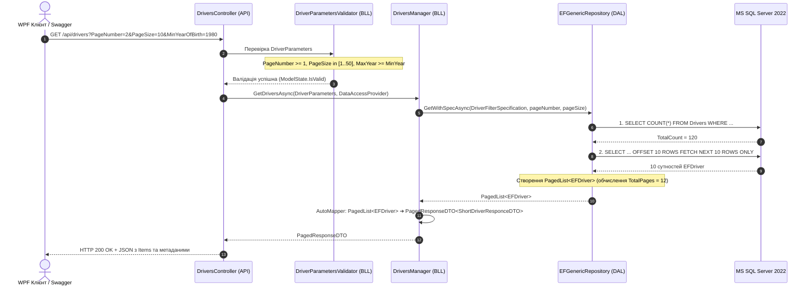

# 📄 01. Патерн Пагінації (Pagination & Metadata Envelope Pattern)

> **Модуль:** `01-Ntier-Drivers`  
> **Рівні реалізації:** `Presentation (API/WPF)` ➔ `Business Logic (BLL)` ➔ `Data Access (DAL.EF & DAL.ADO)`

---

## 1. Теоретична преамбула (Суть і «Навіщо це потрібно?»)

### 1.1. Що це таке простими словами (Життєва аналогія)
Уявіть велику телефонну книгу мегаполісу на 1 000 000 номерів. Якщо кур'єр запитає: *«Покажіть мені всі контакти»*, і ви вивалите на стіл 500 важких томів паперу, стіл зламається, а кур'єр не зможе знайти потрібне. 

Замість цього оператор відкриває **конкретну сторінку 15** і дає **20 номерів**, додаючи закладку: *«Сторінка 15 із 50 000, всього 1 000 000 номерів»*. Це і є **Пагінація з конвертом метаданих (Metadata Envelope)**.

### 1.2. Яку конкретну проблему це вирішує?
У наївній реалізації контролер виконує:
```csharp
// ПОГАНО: Завантажує всю базу в RAM сервера
[HttpGet]
public async Task<IActionResult> GetAll() => Ok(await _context.Drivers.ToListAsync());
```
Коли кількість водіїв зростає з 50 до 100 000:
1. **Вичерпання оперативної пам'яті (OutOfMemoryException):** Сервер виділяє сотні мегабайт пам'яті на кожен HTTP-запит.
2. **Мережеве перевантаження:** Сервер передає по мережі гігабайти нечитабельного JSON.
3. **Зависання клієнта:** WPF-додаток або браузер зависає на кілька секунд під час рендерингу 100 000 елементів у ListBox.
4. **Блокування бази даних:** Тривалі важкі операції `SELECT *` блокують таблиці або перевантажують пул з'єднань.

### 1.3. Порівняльна таблиця підходів

| Критерій | Наївний підхід (`GetAll`) | Патерн Пагінації у проекті |
| :--- | :--- | :--- |
| **Навантаження на RAM** | Пропорційне розміру таблиці ($O(N)$) | Фіксоване ($O(PageSize)$, наприклад 10–50 об'єктів) |
| **Генерація SQL** | `SELECT * FROM Drivers` | `SELECT ... OFFSET @skip ROWS FETCH NEXT @take ROWS ONLY` |
| **Захист від DoS** | Відсутній (клієнт може завалити сервер) | Жорсткий ліміт `PageSize <= 50` у валідаторі |
| **Метадані навігації** | Відсутні | Надає `TotalPages`, `TotalCount`, `HasNext`, `HasPrevious` |
| **UI-інтеграція** | Клієнт показує безкінечне «колесо завантаження» | Миттєвий рендеринг кнопок перегортання `<<`, `1`, `2`, `>>` |

---

## 2. Наскрізний потік виконання (End-to-End Architectural Flow)



---

## 3. Розбір класів та коду проекту (з прямими посиланнями)

Пагінація в системі складається з 4 взаємопов'язаних компонентів:

### 3.1. Базові параметри запиту: [QueryStringParameters.cs](../../Drivers.DAL.EF/Entities/HelpModels/QueryStringParameters.cs)
Базовий клас, який гарантує, що клієнт не зможе запросити більше `maxPageSize = 50` записів:
```csharp
public abstract class QueryStringParameters
{
    const int maxPageSize = 50;
    public int PageNumber { get; set; } = 1;

    private int _pageSize = 10;
    public int PageSize
    {
        get => _pageSize;
        set => _pageSize = value > maxPageSize ? maxPageSize : value;
    }

    public string OrderBy { get; set; }
}
```

### 3.2. Доменні параметри з фільтром: [DriverParameters.cs](../../Drivers.DAL.EF/Entities/HelpModels/DriverParameters.cs)
Розширює базові параметри специфічними критеріями бізнесу (діапазон років народження водіїв):
```csharp
public class DriverParameters : QueryStringParameters
{
    public DriverParameters() => OrderBy = "LastName";

    public uint MinYearOfBirth { get; set; }
    public uint MaxYearOfBirth { get; set; } = (uint)DateTime.Now.Year;
    public string LastName { get; set; }
}
```

### 3.3. Ядро обчислення та колекція: [PagedList.cs](../../Drivers.DAL.EF/Helpers/PagedList.cs)
Колекція `PagedList<T>`, яка спадкується від `List<T>`, розраховує метадані та виконує відкладену вибірку в БД через фабричний метод `ToPagedList`:
```csharp
public class PagedList<T> : List<T>
{
    public int CurrentPage { get; private set; }
    public int TotalPages { get; private set; }
    public int PageSize { get; private set; }
    public int TotalCount { get; private set; }

    public bool HasPrevious => CurrentPage > 1;
    public bool HasNext => CurrentPage < TotalPages;

    public static PagedList<T> ToPagedList(IQueryable<T> source, int pageNumber, int pageSize)
    {
        var count = source.Count(); // Запит 1: COUNT
        var items = source.Skip((pageNumber - 1) * pageSize).Take(pageSize).ToList(); // Запит 2: OFFSET/FETCH

        return new PagedList<T>(items, count, pageNumber, pageSize);
    }
}
```

### 3.4. Клієнтська DTO-обгортка: [PagedResponseDTO.cs](../../Drivers.BLL/DTOs/Responses/PagedResponseDTO.cs)
Чистий контракт для клієнтів (WPF, Mobile, SPA), який містить як самі елементи, так і навігаційні прапорці:
```csharp
public class PagedResponseDTO<T>
{
    public IEnumerable<T> Items { get; set; } = Enumerable.Empty<T>();
    public int CurrentPage { get; set; }
    public int TotalPages { get; set; }
    public int PageSize { get; set; }
    public int TotalCount { get; set; }
    public bool HasPrevious { get; set; }
    public bool HasNext { get; set; }
}
```

---

## 4. Підсумок
Патерн пагінації гарантує масштабованість системи: незалежно від того, чи в базі даних 1 000 водіїв, чи 10 000 000, навантаження на пам'ять сервера залишається стабільним ($O(1)$ відносно розміру БД).
