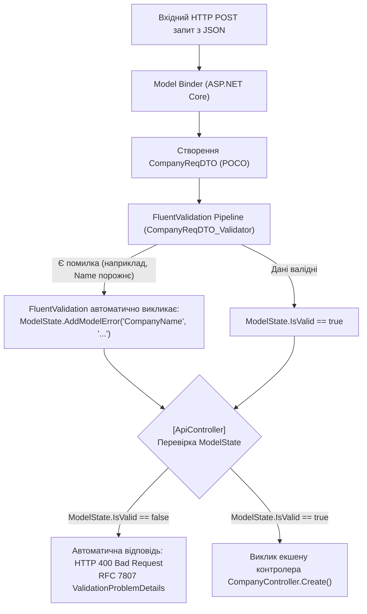

# 🛡️ 02. Патерн Валідації (Data Annotations / ModelState проти FluentValidation)

> **Модуль:** `01-Ntier-Drivers`  
> **Рівні реалізації:** `Presentation (API Controller & ModelState)` ➔ `Business Logic (BLL Validators)` ➔ `Unit Tests`  
> **Ключові технології:** C# 13 • .NET 10 • FluentValidation 11 • Data Annotations • `ModelStateDictionary` • RFC 7807 ValidationProblemDetails

---

## 📑 Зміст посібника

1. [Теоретична преамбула (Суть і «Навіщо це потрібно?»)](file:///c:/Users/Yurii/source/repos/Demo-CargoDeliveryService/01-Ntier-Drivers/docs/Guides/02_Patterns_Validation.md#1-теоретична-преамбула-суть-і-навіщо-це-потрібно)
2. [Два світи валідації в .NET: Data Annotations vs FluentValidation](file:///c:/Users/Yurii/source/repos/Demo-CargoDeliveryService/01-Ntier-Drivers/docs/Guides/02_Patterns_Validation.md#2-два-світи-валідації-в-net-data-annotations-vs-fluentvalidation)
3. [Як FluentValidation інтегрується з ASP.NET Core ModelState](file:///c:/Users/Yurii/source/repos/Demo-CargoDeliveryService/01-Ntier-Drivers/docs/Guides/02_Patterns_Validation.md#3-як-fluentvalidation-інтегрується-з-aspnet-core-modelstate)
4. [Аналіз коду проєкту по кроках](file:///c:/Users/Yurii/source/repos/Demo-CargoDeliveryService/01-Ntier-Drivers/docs/Guides/02_Patterns_Validation.md#4-аналіз-коду-проєкту-по-кроках)
5. [Реєстрація валідаторів у Dependency Injection](file:///c:/Users/Yurii/source/repos/Demo-CargoDeliveryService/01-Ntier-Drivers/docs/Guides/02_Patterns_Validation.md#5-реєстрація-валідаторів-у-dependency-injection)
6. [Юніт-тестування валідаторів](file:///c:/Users/Yurii/source/repos/Demo-CargoDeliveryService/01-Ntier-Drivers/docs/Guides/02_Patterns_Validation.md#6-юніт-тестування-валідаторів)
7. [Прямі посилання на файли коду проєкту](file:///c:/Users/Yurii/source/repos/Demo-CargoDeliveryService/01-Ntier-Drivers/docs/Guides/02_Patterns_Validation.md#7-прямі-посилання-на-файли-коду-проєкту)

---

## 1. Теоретична преамбула (Суть і «Навіщо це потрібно?»)

### 1.1. Що це таке простими словами (Життєва аналогія)
Уявіть митний контроль в аеропорту. Пасажир (HTTP-запит) намагається пройти на борт літака (до контролера та бази даних). 
- Якщо пропустити пасажира без перевірки паспорта, він може створити аварійну ситуацію в польоті.
- Але **хто** має перевіряти паспорт? 
  - Якщо пілот літака (контролер) особисто перевіряє візи кожного пасажира — він не встигає керувати літаком.
  - Правильний підхід: **окрема служба безпеки на вході (Валідатор)**, яка перевіряє всі документи за чіткими правилами ще до того, як пасажир дійде до пілота.

---

## 2. Два світи валідації в .NET: Data Annotations vs FluentValidation

В екосистемі .NET існують два основних підходи до валідації вхідних даних:

### Підхід А: Вбудовані в .NET Data Annotations (`System.ComponentModel.DataAnnotations`)
Атрибути вішаються безпосередньо на властивості DTO-моделі:
```csharp
public class CompanyReqDTO
{
    [Required(ErrorMessage = "Назва обов'язкова")]
    [MaxLength(100)]
    public string CompanyName { get; set; }

    [EmailAddress]
    public string? Email { get; set; }
}
```
ASP.NET Core під час прив'язки моделі автоматично перевіряє ці атрибути та записує помилки у **`ModelState`**. Якщо контролер має атрибут `[ApiController]`, фреймворк автоматично повертає `400 Bad Request`, якщо `ModelState.IsValid == false`.

### Підхід Б: Декларативний FluentValidation (Використовується в нашому проєкті)
DTO залишається чистим класом POCO, а всі правила виносяться в окремий клас валідатора, який спадкується від `AbstractValidator<T>`.

### Порівняльна таблиця: Data Annotations проти FluentValidation

| Критерій | Data Annotations (.NET Built-in) | FluentValidation (.NET Enterprise) |
| :--- | :--- | :--- |
| **Місце опису правил** | Атрибути прямо над полями DTO | Окремі класи валідаторів у шарі BLL |
| **Чистота коду (SRP)** | Порушує: DTO одночасно і контракт, і валідатор | Ідеально: DTO — це чистий POCO без залежностей |
| **Складні бізнес-правила** | Дуже важко (потрібно писати власні `ValidationAttribute`) | Елементарно (будь-які вирази C#, предикати, лямбди) |
| **Умовна валідація** | Майже неможливо без хаків | З коробки через `.When(x => !string.IsNullOrEmpty(x.Email))` |
| **Крос-перевірка кількох полів** | Потребує реалізації `IValidatableObject` всередині DTO | Легко через `RuleFor(x => x).Must(p => p.MaxYear >= p.MinYear)` |
| **Асинхронна валідація (БД)** | Не підтримується | Підтримується через `MustAsync` (перевірка унікальності в БД) |
| **Юніт-тестування правил** | Важко, потребує емуляції `ValidationContext` | Миттєво через бібліотеку `ShouldHaveValidationErrorFor` |
| **Інтеграція з `ModelState`** | Вбудована | **Повна автоматична інтеграція** (помилки потрапляють в той самий `ModelState`) |

---

## 3. Як FluentValidation інтегрується з ASP.NET Core `ModelState`

Найкраще те, що FluentValidation **не замінює `ModelState`, а доповнює його**!



---

## 4. Аналіз коду проєкту по кроках

### 4.1. Чистий DTO-контракт: [`CompanyReqDTO.cs`](file:///c:/Users/Yurii/source/repos/Demo-CargoDeliveryService/01-Ntier-Drivers/Drivers.BLL/DTOs/Requests/CompanyReqDTO.cs)
DTO залишається абсолютно чистим від сторонніх атрибутів:
```csharp
namespace Drivers.BLL.DTOs.Requests;

public class CompanyReqDTO
{
    public string CompanyName { get; set; } = default!;
    public string? Address { get; set; }
    public string? Phone { get; set; }
    public string? Email { get; set; }
    public string? ContactPerson { get; set; }
    public string? ContactPhone { get; set; }
    public string? ContactEmail { get; set; }
}
```

### 4.2. Ізольований валідатор: [`CompanyReqDTO_Validator.cs`](file:///c:/Users/Yurii/source/repos/Demo-CargoDeliveryService/01-Ntier-Drivers/Drivers.BLL/DTOs/Validation/CompanyReqDTO_Validator.cs)
Правила чітко структуровані, підтримують умовну логіку:
```csharp
public class CompanyReqDTO_Validator : AbstractValidator<CompanyReqDTO>
{
    public CompanyReqDTO_Validator()
    {
        // 1. Обов'язкове поле + обмеження довжини
        RuleFor(c => c.CompanyName)
            .NotEmpty().WithMessage("Назва компанії є обов'язковою.")
            .MaximumLength(100).WithMessage("Назва компанії не може перевищувати 100 символів.");

        // 2. Умовна валідація формату email (перевіряється, тільки якщо поле заповнено)
        RuleFor(c => c.Email)
            .EmailAddress().When(c => !string.IsNullOrEmpty(c.Email))
            .WithMessage("Некоректний формат електронної пошти компанії.");

        // 3. Обмеження довжини контактного номера
        RuleFor(c => c.Phone)
            .MaximumLength(20).WithMessage("Телефон не може бути довшим за 20 символів.");
    }
}
```

### 4.3. Крос-польова валідація діапазонів: [`DriverParametersValidator.cs`](file:///c:/Users/Yurii/source/repos/Demo-CargoDeliveryService/01-Ntier-Drivers/Drivers.BLL/DTOs/Validation/DriverParametersValidator.cs)
Демонструє бізнес-правило, яке неможливо гарно записати стандартними Data Annotations:
```csharp
public class DriverParametersValidator : AbstractValidator<DriverParameters>
{
    public DriverParametersValidator()
    {
        RuleFor(p => p.PageNumber).GreaterThanOrEqualTo(1);
        RuleFor(p => p.PageSize).InclusiveBetween(1, 50);

        // Крос-польова перевірка: MaxYear не може бути меншим за MinYear
        RuleFor(p => p)
            .Must(p => p.MaxYearOfBirth >= p.MinYearOfBirth)
            .WithMessage("Максимальний рік народження не може бути меншим за мінімальний.")
            .When(p => p.MinYearOfBirth > 0 && p.MaxYearOfBirth > 0);
    }
}
```

### 4.4. Валідація створення водія: [`MiniDriverReqDTO_Validator.cs`](file:///c:/Users/Yurii/source/repos/Demo-CargoDeliveryService/01-Ntier-Drivers/Drivers.BLL/DTOs/Validation/MiniDriverReqDTO_Validator.cs)
Перевіряє коректність персональних даних водія:
```csharp
public class MiniDriverReqDTO_Validator : AbstractValidator<MiniDriverReqDTO>
{
    public MiniDriverReqDTO_Validator()
    {
        RuleFor(d => d.FirstName).NotEmpty().MaximumLength(50);
        RuleFor(d => d.LastName).NotEmpty().MaximumLength(50);
        RuleFor(d => d.DriverLicenseNumber).NotEmpty().Length(6, 20);
        RuleFor(d => d.Birthdate).LessThan(DateTime.Now.AddYears(-18))
            .WithMessage("Водій повинен бути повнолітнім (вік від 18 років).");
    }
}
```

---

## 5. Реєстрація валідаторів у Dependency Injection

У файлі [`Program.cs`](file:///c:/Users/Yurii/source/repos/Demo-CargoDeliveryService/01-Ntier-Drivers/DriversApi/Program.cs) FluentValidation автоматично сканує всю збірку BLL та реєструє валідатори:
```csharp
builder.Services.AddFluentValidationAutoValidation();
builder.Services.AddValidatorsFromAssemblyContaining<CompanyReqDTO_Validator>();
```

---

## 6. Юніт-тестування валідаторів

Завдяки винесенню валідації в окремі класи, написання тестів у [`ValidationTests.cs`](file:///c:/Users/Yurii/source/repos/Demo-CargoDeliveryService/01-Ntier-Drivers/NtierDrivers.UnitTests/ValidationTests.cs) не вимагає моків або підняття HTTP сервера:
```csharp
[Fact]
public void Should_Have_Error_When_Company_Name_Is_Empty()
{
    var validator = new CompanyReqDTO_Validator();
    var model = new CompanyReqDTO { CompanyName = "" };
    
    var result = validator.TestValidate(model);
    
    result.ShouldHaveValidationErrorFor(c => c.CompanyName);
}
```

---

## 7. Прямі посилання на файли коду проєкту

| Файл коду | Шар архітектури | Призначення |
| :--- | :--- | :--- |
| 📄 [`CompanyReqDTO.cs`](file:///c:/Users/Yurii/source/repos/Demo-CargoDeliveryService/01-Ntier-Drivers/Drivers.BLL/DTOs/Requests/CompanyReqDTO.cs) | Business Logic (BLL) | Чистий POCO контракт запиту компанії без залежностей |
| 📄 [`CompanyReqDTO_Validator.cs`](file:///c:/Users/Yurii/source/repos/Demo-CargoDeliveryService/01-Ntier-Drivers/Drivers.BLL/DTOs/Validation/CompanyReqDTO_Validator.cs) | Business Logic (BLL) | FluentValidation валідатор з перевіркою довжини та умовним email |
| 📄 [`DriverParametersValidator.cs`](file:///c:/Users/Yurii/source/repos/Demo-CargoDeliveryService/01-Ntier-Drivers/Drivers.BLL/DTOs/Validation/DriverParametersValidator.cs) | Business Logic (BLL) | Крос-польовий валідатор бізнес-діапазонів `MaxYear >= MinYear` |
| 📄 [`MiniDriverReqDTO_Validator.cs`](file:///c:/Users/Yurii/source/repos/Demo-CargoDeliveryService/01-Ntier-Drivers/Drivers.BLL/DTOs/Validation/MiniDriverReqDTO_Validator.cs) | Business Logic (BLL) | Валідатор повноліття та формату посвідчення водія |
| 📄 [`Program.cs`](file:///c:/Users/Yurii/source/repos/Demo-CargoDeliveryService/01-Ntier-Drivers/DriversApi/Program.cs) | Presentation (API) | Конфігурація автоматичної прив'язки FluentValidation до `ModelState` |
| 📄 [`ValidationTests.cs`](file:///c:/Users/Yurii/source/repos/Demo-CargoDeliveryService/01-Ntier-Drivers/NtierDrivers.UnitTests/ValidationTests.cs) | Unit Tests | Комплекс модульних тестів валідації бізнес-правил |
