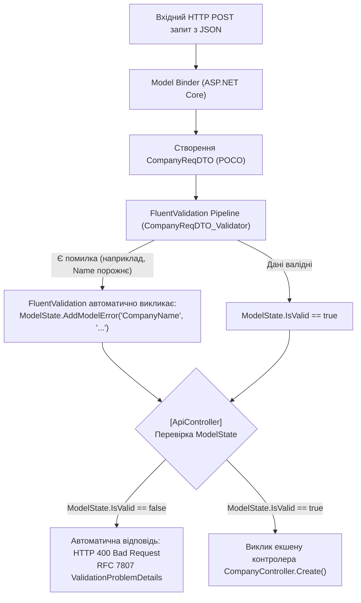

# 🛡️ 02. Патерн Валідації (Data Annotations / ModelState проти FluentValidation)

> **Модуль:** `01-Ntier-Drivers`  
> **Рівні реалізації:** `Presentation (API Controller & ModelState)` ➔ `Business Logic (BLL Validators)`

---

## 1. Теоретична преамбула (Суть і «Навіщо це потрібно?»)

### 1.1. Що це таке простими словами (Життєва аналогія)
Уявіть митний контроль в аеропорту. Пасажир (HTTP-запит) намагається пройти на борт літака (до контролера та бази даних). 
- Якщо пропустити пасажира без перевірки паспорта, він може створити аварійну ситуацію в польоті.
- Але **хто** має перевіряти паспорт? 
  - Якщо пілот літака (контролер) особисто перевіряє візи кожного пасажира — він не встигає керувати літаком.
  - Правильний підхід: **окрема служба безпеки на вході (Валідатор)**, яка перевіряє всі документи за чіткими правилами ще до того, як пасажир дійде до пілота.

### 1.2. Два світи валідації в .NET: Data Annotations vs FluentValidation

В екосистемі .NET існують два основних підходи до валідації вхідних даних:

#### Підхід А: Вбудовані в .NET Data Annotations (`System.ComponentModel.DataAnnotations`)
Атрибути вішаються безпосередньо на властивості DTO-моделі:
```csharp
public class CompanyReqDTO
{
    [Required(ErrorMessage = "Назва обов'язкова")]
    [MaxLength(100)]
    public string CompanyName { get; set; }

    [EmailAddress]
    public string? Email { get; set; }
}
```
ASP.NET Core під час прив'язки моделі автоматично перевіряє ці атрибути та записує помилки у **`ModelState`**. Якщо контролер має атрибут `[ApiController]`, фреймворк автоматично повертає `400 Bad Request`, якщо `ModelState.IsValid == false`.

#### Підхід Б: Декларативний FluentValidation (Використовується в нашому проєкті)
DTO залишається чистим класом POCO, а всі правила виносяться в окремий клас валідатора, який спадкується від `AbstractValidator<T>`.

---

### 1.3. Порівняльна таблиця: Data Annotations проти FluentValidation

| Критерій | Data Annotations (.NET Built-in) | FluentValidation (.NET Enterprise) |
| :--- | :--- | :--- |
| **Місце опису правил** | Атрибути прямо над полями DTO | Окремі класи валідаторів у шарі BLL |
| **Чистота коду (SRP)** | Порушує: DTO одночасно і контракт, і валідатор | Ідеально: DTO — це чистий POCO без залежностей |
| **Складні бізнес-правила** | Дуже важко (потрібно писати власні `ValidationAttribute`) | Елементарно (будь-які вирази C#, предикати, лямбди) |
| **Умовна валідація** | Майже неможливо без хаків | З коробки через `.When(x => !string.IsNullOrEmpty(x.Email))` |
| **Крос-перевірка кількох полів** | Потребує реалізації `IValidatableObject` всередині DTO | Легко через `RuleFor(x => x).Must(p => p.MaxYear >= p.MinYear)` |
| **Асинхронна валідація (БД)** | Не підтримується | Підтримується через `MustAsync` (перевірка унікальності в БД) |
| **Юніт-тестування правил** | Важко, потребує емуляції `ValidationContext` | Миттєво через бібліотеку `ShouldHaveValidationErrorFor` |
| **Інтеграція з `ModelState`** | Вбудована | **Повна автоматична інтеграція** (помилки потрапляють в той самий `ModelState`) |

---

## 2. Як FluentValidation інтегрується з ASP.NET Core `ModelState`

Найкраще те, що FluentValidation **не замінює `ModelState`, а доповнює його**!



---

## 3. Аналіз коду проєкту (з прямими посиланнями)

### 3.1. Чистий DTO-контракт: [CompanyReqDTO.cs](../../Drivers.BLL/DTOs/Requests/CompanyReqDTO.cs)
DTO залишається абсолютно чистим від сторонніх атрибутів:
```csharp
namespace Drivers.BLL.DTOs.Requests;

public class CompanyReqDTO
{
    public string CompanyName { get; set; } = default!;
    public string? Address { get; set; }
    public string? Phone { get; set; }
    public string? Email { get; set; }
    public string? ContactPerson { get; set; }
    public string? ContactPhone { get; set; }
    public string? ContactEmail { get; set; }
}
```

### 3.2. Ізольований валідатор: [CompanyReqDTO_Validator.cs](../../Drivers.BLL/DTOs/Validation/CompanyReqDTO_Validator.cs)
Правила чітко структуровані, підтримують умовну логіку:
```csharp
public class CompanyReqDTO_Validator : AbstractValidator<CompanyReqDTO>
{
    public CompanyReqDTO_Validator()
    {
        // 1. Обов'язкове поле + обмеження довжини
        RuleFor(c => c.CompanyName)
            .NotEmpty().WithMessage("Назва компанії є обов'язковою.")
            .MaximumLength(100).WithMessage("Назва компанії не може перевищувати 100 символів.");

        // 2. Умовна валідація формату email (перевіряється, тільки якщо поле заповнено)
        RuleFor(c => c.Email)
            .EmailAddress().When(c => !string.IsNullOrEmpty(c.Email))
            .WithMessage("Некоректний формат електронної пошти компанії.");

        // 3. Обмеження довжини контактного номера
        RuleFor(c => c.Phone)
            .MaximumLength(20).WithMessage("Телефон не може бути довшим за 20 символів.");
    }
}
```

### 3.3. Крос-польова валідація діапазонів: [DriverParametersValidator.cs](../../Drivers.BLL/DTOs/Validation/DriverParametersValidator.cs)
Демонструє бізнес-правило, яке неможливо гарно записати стандартними Data Annotations:
```csharp
public class DriverParametersValidator : AbstractValidator<DriverParameters>
{
    public DriverParametersValidator()
    {
        RuleFor(p => p.PageNumber).GreaterThanOrEqualTo(1);
        RuleFor(p => p.PageSize).InclusiveBetween(1, 50);

        // Крос-польова перевірка: MaxYear не може бути меншим за MinYear
        RuleFor(p => p)
            .Must(p => p.MaxYearOfBirth >= p.MinYearOfBirth)
            .WithMessage("Максимальний рік народження не може бути меншим за мінімальний.")
            .When(p => p.MinYearOfBirth > 0 && p.MaxYearOfBirth > 0);
    }
}
```

### 3.4. Юніт-тестування правил: [ValidationTests.cs](../../NtierDrivers.UnitTests/ValidationTests.cs)
Завдяки винесенню валідації в окремі класи, написання юніт-тестів перетворюється на елементарні тести без потреби створювати контролери чи HTTP-контекст:
```csharp
[Fact]
public void Should_Have_Error_When_Company_Name_Is_Empty()
{
    var validator = new CompanyReqDTO_Validator();
    var model = new CompanyReqDTO { CompanyName = "" };
    
    var result = validator.TestValidate(model);
    
    result.ShouldHaveValidationErrorFor(c => c.CompanyName);
}
```

---

## 4. Підсумок
- **Data Annotations** підходять для простих демонстрацій або мікро-скриптів.
- **FluentValidation** є де-факто стандартом корпоративної архітектури, забезпечуючи високу тестованість, чисті POCO-моделі та прозору передачу помилок у стандартний `ModelState` ASP.NET Core.
