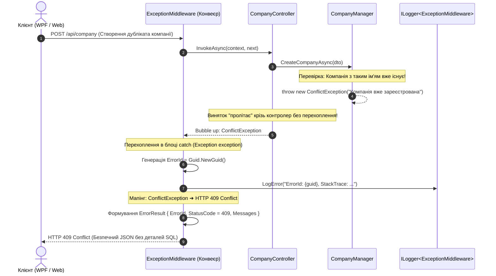

# 🚨 03. Патерн Централізованої Обробки Помилок (Centralized Exception Middleware & RFC 7807)

> **Модуль:** `01-Ntier-Drivers`  
> **Рівні реалізації:** `Presentation (HTTP Pipeline Middleware)` ➔ `Business Logic (Domain Exceptions)` ➔ `Data Access (EF/ADO Exceptions)`

---

## 1. Теоретична преамбула (Суть і «Навіщо це потрібно?»)

### 1.1. Що це таке простими словами (Життєва аналогія)
Уявіть сучасну службу екстреного реагування (911) або диспетчерську аеропорту. 
- Якщо в салоні літака виникне поломка датчика або пасажиру стане зле, пілотові не потрібно кидати штурвал і бігти в салон з аптечкою.
- Замість цього система фіксує сигнал тривоги, присвоює йому **код інциденту (Incident ID)**, і передає інформацію спеціалізованій службі на землі, а пасажирам спокійно повідомляють: *«Рейс виконується за планом, деталі інциденту #INC-9482 передані диспетчеру»*.

У веб-додатках такою «службою 911» є **Centralized Exception Handling Middleware**. Вона перехоплює будь-яку проблему в конвеєрі, захищає сервери від витоку даних і віддає клієнту зрозумілий, безпечний статус.

---

### 1.2. Яку конкретну проблему це вирішує?

#### Наївний антипатерн (Try-Catch Spaghetti у контролерах):
```csharp
// ПОГАНО: Дублювання коду в кожному екшені кожного контролера
[HttpGet("{id}")]
public async Task<IActionResult> Get(int id)
{
    try
    {
        var driver = await _manager.GetById(id);
        if (driver == null) return NotFound("Водія не знайдено");
        return Ok(driver);
    }
    catch (SqlException ex)
    {
        // НЕБЕЗПЕЧНО: Витік SQL паролів, схеми таблиць та внутрішнього стек-трейсу клієнту!
        return StatusCode(500, ex.ToString());
    }
    catch (Exception ex)
    {
        return StatusCode(500, ex.Message);
    }
}
```

#### Наслідки наївного підходу:
1. **Витік чутливих даних (CWE-209 / OWASP Information Disclosure):** Клієнт або зловмисник отримує імена SQL-серверів, користувачів бази, версії бібліотек та номери рядків коду.
2. **Неможливість відстеження (No Correlation):** Користувач пише в техпідтримку: *«У мене видало помилку 500»*. Знайти конкретний лог серед мільйонів рядків сервера неможливо.
3. **Засмічення коду:** 80% коду контролера — це бойлерплейт `try-catch`, а не бізнес-логіка.

---

### 1.3. Порівняльна таблиця підходів

| Критерій | Наївний `try-catch` у контролерах | Centralized Exception Middleware |
| :--- | :--- | :--- |
| **Код контролерів** | Перевантажений логікою ловлі помилок | Чистий «Happy Path» (тільки успішний хід виконання) |
| **Безпека стек-трейсу** | Ризик витоку внутрішніх деталей у відповіді | Стек-трейс **ніколи** не віддається назовні (лише у безпечний лог) |
| **Ідентифікація збою** | Неможливо знайти конкретний запит | Кожен збій отримує унікальний **`ErrorId` (GUID)** |
| **Стандарт формату** | Довільний хаотичний текст або рядок | Стандартизована JSON-структура у стилі **RFC 7807** |
| **Мапінг HTTP статусів** | Ручний у кожному методі | Автоматичний за типом C# винятку (404, 409, 400, 500) |

---

## 2. Наскрізний потік перехоплення помилок (Architectural Flow)



---

## 3. Розбір коду проєкту (з прямими посиланнями)

Централізована обробка побудована на взаємодії трьох елементів:

### 3.1. Ядро перехоплення: [ExceptionMiddleware.cs](../../DriversApi/Middleware/ExceptionMiddleware.cs)
Клас реалізує інтерфейс `IMiddleware` і реєструється першим у конвеєрі `Program.cs`:
```csharp
public class ExceptionMiddleware : IMiddleware
{
    private readonly ILogger<ExceptionMiddleware> _logger;
    public ExceptionMiddleware(ILogger<ExceptionMiddleware> logger) => _logger = logger;  

    public async Task InvokeAsync(HttpContext context, RequestDelegate next)
    {
        try
        {
            await next(context); // Виконання наступного вузла конвеєра
        }
        catch (Exception exception)
        {
            string errorId = Guid.NewGuid().ToString(); // Унікальний Correlation ID
            _logger.LogError($"==>> ErrorId - {errorId}, StackTrace: {exception.StackTrace}");

            var errorResult = new ErrorResult
            {
                Source = exception.TargetSite?.DeclaringType?.FullName,
                Exception = exception.Message.Trim(),
                ErrorId = errorId,
                SupportMessage = $"Provide the Error Id: {errorId} to the support team."
            };

            // Мапінг статус-кодів за типом винятку
            switch (exception)
            {
                case CustomException e:
                    errorResult.StatusCode = (int)e.StatusCode;
                    break;
                case KeyNotFoundException or EntityNotFoundException:
                    errorResult.StatusCode = (int)HttpStatusCode.NotFound;
                    break;
                case ArgumentNullException:
                    errorResult.StatusCode = (int)HttpStatusCode.BadRequest;
                    break;
                default:
                    errorResult.StatusCode = (int)HttpStatusCode.InternalServerError;
                    break;
            }

            context.Response.ContentType = "application/json";
            context.Response.StatusCode = errorResult.StatusCode;
            await context.Response.WriteAsync(JsonConvert.SerializeObject(errorResult));
        }
    }
}
```

### 3.2. Стандартизована відповідь клієнту: [ErrorResult.cs](../../Drivers.BLL/Exceptions/Models/ErrorResult.cs)
Контракт помилки у форматі RFC 7807:
```csharp
public class ErrorResult
{
    public List<string> Messages { get; set; } = new();
    public string? Source { get; set; }
    public string? Exception { get; set; }
    public string? ErrorId { get; set; }
    public string? SupportMessage { get; set; }
    public int StatusCode { get; set; }
}
```

### 3.3. Ієрархія доменних винятків BLL:
- Базовий виняток: [CustomException.cs](../../Drivers.BLL/Exceptions/CustomException.cs) (містить `HttpStatusCode`).
- Специфічні бізнес-винятки:
  - [NotFoundException.cs](../../Drivers.BLL/Exceptions/NotFoundException.cs) — коли сутність не знайдена в системі (404).
  - [ConflictException.cs](../../Drivers.BLL/Exceptions/ConflictException.cs) — порушення бізнес-унікальності або конфлікт стану (409).
  - [InternalServerException.cs](../../Drivers.BLL/Exceptions/InternalServerException.cs) — критичні збої логіки (500).
  - [EntityNotFoundException.cs](../../Drivers.DAL.EF/Exceptions/EntityNotFoundException.cs) — помилка вибірки в DAL (404).

---

## 4. Підсумок
Завдяки **Exception Middleware**:
1. Контролери залишаються чистими і модульними.
2. Клієнт отримує зрозумілі коди помилок (400, 404, 409, 500) замість білого екрану чи краху програми.
3. Техпідтримка може за лічені секунди знайти у логах повний стек-трейс будь-якого збою за його `ErrorId`.
