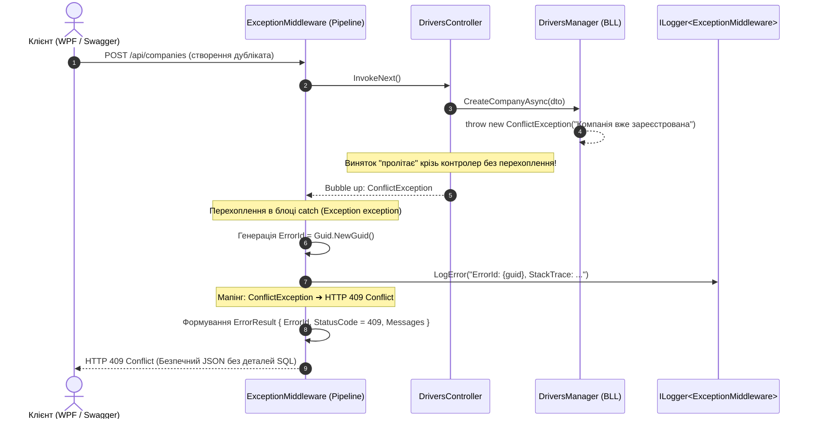

# 🚨 03. Патерн Централізованої Обробки Помилок (Exception Middleware & RFC 7807)

> **Модуль:** `01-Ntier-Drivers`  
> **Рівні реалізації:** `Presentation (API Pipeline Middleware)` ➔ `Business Logic (Domain Exceptions)` ➔ `Logging`  
> **Ключові технології:** C# 13 • .NET 10 • `IMiddleware` • RFC 7807 Problem Details • Correlation `ErrorId` • `ILogger`

---

## 📑 Зміст посібника

1. [Теоретична преамбула (Суть і «Навіщо це потрібно?»)](file:///c:/Users/Yurii/source/repos/Demo-CargoDeliveryService/01-Ntier-Drivers/docs/Guides/03_Patterns_Centralized_Exception_Handling.md#1-теоретична-преамбула-суть-і-навіщо-це-потрібно)
2. [Чому try-catch у кожному контролері — це катастрофа](file:///c:/Users/Yurii/source/repos/Demo-CargoDeliveryService/01-Ntier-Drivers/docs/Guides/03_Patterns_Centralized_Exception_Handling.md#2-чому-try-catch-у-кожному-контролері--це-катастрофа)
3. [Архітектурний потік перехоплення винятків (Sequence Diagram)](file:///c:/Users/Yurii/source/repos/Demo-CargoDeliveryService/01-Ntier-Drivers/docs/Guides/03_Patterns_Centralized_Exception_Handling.md#3-архітектурний-потік-перехоплення-винятків-sequence-diagram)
4. [Розбір коду проєкту по кроках](file:///c:/Users/Yurii/source/repos/Demo-CargoDeliveryService/01-Ntier-Drivers/docs/Guides/03_Patterns_Centralized_Exception_Handling.md#4-розбір-коду-проєкту-по-кроках)
5. [Реєстрація Middleware у конвеєрі ASP.NET Core](file:///c:/Users/Yurii/source/repos/Demo-CargoDeliveryService/01-Ntier-Drivers/docs/Guides/03_Patterns_Centralized_Exception_Handling.md#5-реєстрація-middleware-у-конвеєрі-aspnet-core)
6. [Підсумок](file:///c:/Users/Yurii/source/repos/Demo-CargoDeliveryService/01-Ntier-Drivers/docs/Guides/03_Patterns_Centralized_Exception_Handling.md#6-підсумок)
7. [Прямі посилання на файли коду проєкту](file:///c:/Users/Yurii/source/repos/Demo-CargoDeliveryService/01-Ntier-Drivers/docs/Guides/03_Patterns_Centralized_Exception_Handling.md#7-прямі-посилання-на-файли-коду-проєкту)

---

## 1. Теоретична преамбула (Суть і «Навіщо це потрібно?»)

### 1.1. Що це таке простими словами (Життєва аналогія)
Уявіть великий п'ятизірковий ресторан. Офіціанти (контролери) носять страви клієнтам (HTTP-запитам), а кухарі (BLL) готують їжу.
- Якщо на кухні впала сковорідка чи згоріло м'ясо (виняток `Exception`):
  - **Погано:** Офіціант біжить до гостя в сльозах і кричить: *"У нас тріснула газова труба, шеф порізав палець, дивіться на шматки м'яса!"* (витік стеку викликів бази даних клієнту).
  - **Добре:** Офіціанти навіть не думають про аварії на кухні. У ресторані є **Адміністратор (Exception Middleware)**. Якщо на кухні щось пішло не так, адміністратор негайно підходить до клієнта, ввічливо вибачається, надає компенсаційний талон із номером інциденту: *"Вибачте, сталася затримка. Ось ваш номер інциденту #A83F-201, ми вже розбираємося"*, а на кухні фіксує деталі в журналі інцидентів (логи).

---

## 2. Чому `try-catch` у кожному контролері — це катастрофа

У наївних проєктах розробники обгортають кожен контролер:
```csharp
// ❌ АНТИПАТЕРН: Дублювання try-catch у кожному контролері
[HttpGet("{id}")]
public async Task<IActionResult> Get(int id)
{
    try
    {
        var driver = await _manager.GetById(id);
        return Ok(driver);
    }
    catch (Exception ex)
    {
        return StatusCode(500, ex.Message); // Витік системних деталей або білий екран
    }
}
```
**Наслідки:**
1. **Дублювання коду (Boilerplate):** 100 ендпоінтів — це 100 однакових блоків `try-catch`.
2. **Витік безпеки (Security Leak):** Повідомлення `ex.Message` часто містить назви таблиць SQL Server, IP-адреси серверів або паролі з'єднань.
3. **Непослідовність відповідей:** Один розробник повертає `{ "err": "..." }`, інший — `{ "error_description": "..." }`, третій — просто рядок. Клієнтський додаток не знає, як парсити помилки.

---

## 3. Архітектурний потік перехоплення винятків (Sequence Diagram)



---

## 4. Розбір коду проєкту по кроках

### 4.1. Ядро перехоплення: [`ExceptionMiddleware.cs`](file:///c:/Users/Yurii/source/repos/Demo-CargoDeliveryService/01-Ntier-Drivers/DriversApi/Middleware/ExceptionMiddleware.cs)
Клас реалізує інтерфейс `IMiddleware` і реєструється першим у конвеєрі:
```csharp
public class ExceptionMiddleware : IMiddleware
{
    private readonly ILogger<ExceptionMiddleware> _logger;
    public ExceptionMiddleware(ILogger<ExceptionMiddleware> logger) => _logger = logger;  

    public async Task InvokeAsync(HttpContext context, RequestDelegate next)
    {
        try
        {
            await next(context); // Виконання наступного вузла конвеєра
        }
        catch (Exception exception)
        {
            string errorId = Guid.NewGuid().ToString(); // Унікальний Correlation ID
            _logger.LogError($"==>> ErrorId - {errorId}, StackTrace: {exception.StackTrace}");

            var errorResult = new ErrorResult
            {
                Source = exception.TargetSite?.DeclaringType?.FullName,
                Exception = exception.Message.Trim(),
                ErrorId = errorId,
                SupportMessage = $"Provide the Error Id: {errorId} to the support team."
            };

            // Мапінг статус-кодів за типом винятку
            switch (exception)
            {
                case CustomException e:
                    errorResult.StatusCode = (int)e.StatusCode;
                    break;
                case KeyNotFoundException or EntityNotFoundException:
                    errorResult.StatusCode = (int)HttpStatusCode.NotFound;
                    break;
                case ArgumentNullException:
                    errorResult.StatusCode = (int)HttpStatusCode.BadRequest;
                    break;
                default:
                    errorResult.StatusCode = (int)HttpStatusCode.InternalServerError;
                    break;
            }

            context.Response.ContentType = "application/json";
            context.Response.StatusCode = errorResult.StatusCode;
            await context.Response.WriteAsync(JsonConvert.SerializeObject(errorResult));
        }
    }
}
```

### 4.2. Стандартизована відповідь клієнту: [`ErrorResult.cs`](file:///c:/Users/Yurii/source/repos/Demo-CargoDeliveryService/01-Ntier-Drivers/Drivers.BLL/Exceptions/Models/ErrorResult.cs)
Контракт помилки у форматі RFC 7807:
```csharp
public class ErrorResult
{
    public List<string> Messages { get; set; } = new();
    public string? Source { get; set; }
    public string? Exception { get; set; }
    public string? ErrorId { get; set; }
    public string? SupportMessage { get; set; }
    public int StatusCode { get; set; }
}
```

### 4.3. Ієрархія доменних винятків BLL:
- Базовий виняток: [`CustomException.cs`](file:///c:/Users/Yurii/source/repos/Demo-CargoDeliveryService/01-Ntier-Drivers/Drivers.BLL/Exceptions/CustomException.cs) (містить `HttpStatusCode`).
- Специфічні бізнес-винятки:
  - [`NotFoundException.cs`](file:///c:/Users/Yurii/source/repos/Demo-CargoDeliveryService/01-Ntier-Drivers/Drivers.BLL/Exceptions/NotFoundException.cs) — коли сутність не знайдена в системі (HTTP 404).
  - [`ConflictException.cs`](file:///c:/Users/Yurii/source/repos/Demo-CargoDeliveryService/01-Ntier-Drivers/Drivers.BLL/Exceptions/ConflictException.cs) — порушення бізнес-унікальності або конфлікт стану (HTTP 409).
  - [`InternalServerException.cs`](file:///c:/Users/Yurii/source/repos/Demo-CargoDeliveryService/01-Ntier-Drivers/Drivers.BLL/Exceptions/InternalServerException.cs) — критичні збої логіки (HTTP 500).
  - [`EntityNotFoundException.cs`](file:///c:/Users/Yurii/source/repos/Demo-CargoDeliveryService/01-Ntier-Drivers/Drivers.DAL.EF/Exceptions/EntityNotFoundException.cs) — помилка вибірки в DAL (HTTP 404).

---

## 5. Реєстрація Middleware у конвеєрі ASP.NET Core

У файлі [`Program.cs`](file:///c:/Users/Yurii/source/repos/Demo-CargoDeliveryService/01-Ntier-Drivers/DriversApi/Program.cs):
```csharp
// Реєстрація у DI контейнері
builder.Services.AddTransient<ExceptionMiddleware>();

// Підключення на самому початку конвеєра HTTP запитів
app.UseMiddleware<ExceptionMiddleware>();
```

---

## 6. Підсумок
Завдяки **Exception Middleware**:
1. Контролери залишаються чистими і модульними (жодного зайвого `try-catch`).
2. Клієнт отримує зрозумілі коди помилок (400, 404, 409, 500) замість білого екрану чи краху програми.
3. Техпідтримка може за лічені секунди знайти у логах повний стек-трейс будь-якого збою за його `ErrorId`.

---

## 7. Прямі посилання на файли коду проєкту

| Файл коду | Шар архітектури | Призначення |
| :--- | :--- | :--- |
| 📄 [`ExceptionMiddleware.cs`](file:///c:/Users/Yurii/source/repos/Demo-CargoDeliveryService/01-Ntier-Drivers/DriversApi/Middleware/ExceptionMiddleware.cs) | Presentation (API) | Центральне middleware перехоплення всіх винятків та генерації `ErrorId` |
| 📄 [`ErrorResult.cs`](file:///c:/Users/Yurii/source/repos/Demo-CargoDeliveryService/01-Ntier-Drivers/Drivers.BLL/Exceptions/Models/ErrorResult.cs) | Business Logic (BLL) | Модель уніфікованої відповіді з описом помилки згідно з RFC 7807 |
| 📄 [`CustomException.cs`](file:///c:/Users/Yurii/source/repos/Demo-CargoDeliveryService/01-Ntier-Drivers/Drivers.BLL/Exceptions/CustomException.cs) | Business Logic (BLL) | Базовий клас доменних винятків з явним `HttpStatusCode` |
| 📄 [`NotFoundException.cs`](file:///c:/Users/Yurii/source/repos/Demo-CargoDeliveryService/01-Ntier-Drivers/Drivers.BLL/Exceptions/NotFoundException.cs) | Business Logic (BLL) | Специфічний виняток відсутності ресурсу (HTTP 404) |
| 📄 [`ConflictException.cs`](file:///c:/Users/Yurii/source/repos/Demo-CargoDeliveryService/01-Ntier-Drivers/Drivers.BLL/Exceptions/ConflictException.cs) | Business Logic (BLL) | Специфічний виняток конфлікту бізнес-стану (HTTP 409) |
| 📄 [`EntityNotFoundException.cs`](file:///c:/Users/Yurii/source/repos/Demo-CargoDeliveryService/01-Ntier-Drivers/Drivers.DAL.EF/Exceptions/EntityNotFoundException.cs) | Data Access (DAL) | Виняток відсутності сутності в базі даних |
| 📄 [`Program.cs`](file:///c:/Users/Yurii/source/repos/Demo-CargoDeliveryService/01-Ntier-Drivers/DriversApi/Program.cs) | Presentation (API) | Реєстрація `ExceptionMiddleware` у конвеєрі обробки запитів |
