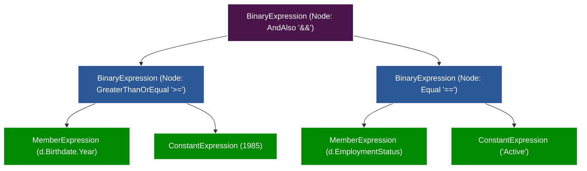
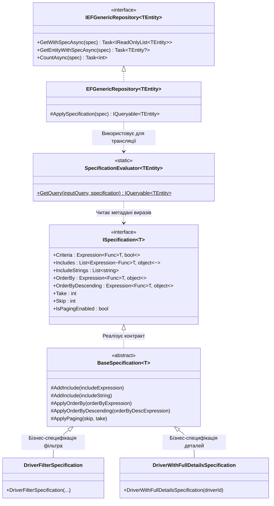

# 📐 04. Патерн Specification (Специфікація) та Дерева Виразів (Expression Trees)

> **Модуль:** `01-Ntier-Drivers`  
> **Рівні реалізації:** `Business Logic (BLL)` ➔ `Data Access (Drivers.DAL.EF)` ➔ `MS SQL Server`  
> **Ключові технології:** C# 13 • .NET 10 • Entity Framework Core 10 • `System.Linq.Expressions`

---

## 📑 Зміст посібника

1. [Теоретична преамбула: Що це таке «на пальцях»](#1-теоретична-преамбула-що-це-таке-на-пальцях)
2. [Дві архітектурні катастрофи, які лікує Specification](#2-дві-архітектурні-катастрофи-які-лікує-specification)
   - 2.1. [Катастрофа №1: «Товстий Репозиторій» (Fat Repository Anti-Pattern)](#21-катастрофа-1-товстий-репозиторій-fat-repository)
   - 2.2. [Катастрофа №2: «Дірява Абстракція» (Leaky Abstraction / IQueryable Leak)](#22-катастрофа-2-дірява-абстракція-leaky-abstraction)
3. [Глибока теорія: Дерева Виразів (Expression Trees) проти Делегатів (Func)](#3-глибока-теорія-дерева-виразів-expression-trees-проти-делегатів-func)
   - 3.1. [Чому Func&lt;T, bool&gt; вбиває базу даних (Client Evaluation)](#31-чому-funct-bool-вбиває-базу-даних)
   - 3.2. [Що насправді таке Expression&lt;Func&lt;T, bool&gt;&gt; (AST — Дерево Синтаксису)](#32-що-насправді-таке-expressionfunct-bool-ast)
   - 3.3. [Як Entity Framework Core читає дерево та будує SQL](#33-як-entity-framework-core-читає-дерево-та-будує-sql)
4. [Архітектура рішення у проєкті CargoDeliveryService](#4-архітектура-рішення-у-проєкті-cargodeliveryservice)
   - 4.1. [Діаграма класів та взаємодії](#41-діаграма-класів-та-взаємодії)
   - 4.2. [Контракт ISpecification&lt;T&gt;](#42-контракт-ispecificationt)
   - 4.3. [Базовий клас BaseSpecification&lt;T&gt; (Fluent API)](#43-базовий-клас-basespecificationt-fluent-api)
   - 4.4. [Транслятор SpecificationEvaluator&lt;TEntity&gt;](#44-транслятор-specificationevaluatortentity)
   - 4.5. [Універсальний Generic Repository](#45-універсальний-generic-repository)
5. [Покроковий туторіал: Створення нової специфікації з нуля](#5-покроковий-туторіал-створення-нової-специфікації-з- нуля)
6. [Порівняльна таблиця архітектурних підходів](#6-порівняльна-таблиця-архітектурних-підходів)
7. [Модульне тестування специфікацій без БД](#7-модульне-тестування-специфікацій-без-бд)
8. [Прямі посилання на файли коду проєкту](#8-прямі-посилання-на-файли-коду-проєкту)

---

## 1. Теоретична преамбула: Що це таке «на пальцях»

### 1.1. Життєва аналогія: Замовлення піци через чек-лист
Уявіть, що ви приходите в ресторан швидкого харчування. Ви хочете замовити піцу за індивідуальним рецептом.

У вас є три варіанти, як це організувати:
1. **Варіант "Хаос" (Leaky Abstraction):** Офіціант відчиняє двері на кухню, пускає вас до печі, і ви самі починаєте крутити тісто, сипати сир і налаштовувати температуру полум'я. Кухня в паніці, санстанція закриває ресторан, інші кухарі спотикаються об вас.
2. **Варіант "Меню на 1000 сторінок" (Fat Repository):** Вимагати від шеф-кухаря надрукувати в меню окрему позицію під кожен можливий смак: *"Піца з грибами без цибулі"*, *"Піца з грибами, без цибулі, але з подвійним сиром"*, *"Піца з грибами, подвійним сиром і ковбасками для жителів лівого берега"*. Офіціанти збожеволіють оновлювати таке меню.
3. **Варіант "Патерн Specification":** Офіціант дає вам невеликий аркуш — **Бланк замовлення (Специфікацію)**. Ви просто ставите галочки:
   - `Основа:` Тонке тісто
   - `Сир:` Подвійний моцарела
   - `Без:` Цибулі
   - `Доставка:` До 18:00

Ви віддаєте цей бланк офіціанту (**Репозиторію**). Бланк сам по собі нічого не пече, не знає напруги в мережі печі та марки борошна. Але кухар бере цей бланк, читає критерії та готує точнісінько те, що зазначено.

> 💡 **Визначення:** **Specification Pattern (Патерн Специфікація)** — це патерн проектування, в якому бізнес-правило або критерій вибірки/фільтрації інкапсулюється в окремий самостійний C#-об'єкт. Цей об'єкт можна передавати в репозиторій, комбінувати, перевикористовувати та легко тестувати.

---

## 2. Дві архітектурні катастрофи, які лікує Specification

У більшості проектів середнього та великого масштабу робота з базами даних скочується в одну з двох небезпечних крайнощів.

### 2.1. Катастрофа №1: «Товстий Репозиторій» (Fat Repository)

Коли приходить нова бізнес-вимога, розробник просто додає новий метод у свій `DriverRepository`:

```csharp
// ❌ АНТИПАТЕРН: Комбінаторний вибух методів у репозиторії
public interface IDriverRepository
{
    Task<List<Driver>> GetAllActiveDriversAsync();
    Task<List<Driver>> GetActiveDriversWithLicensesAsync();
    Task<List<Driver>> GetActiveDriversWithLicensesAndExpensesAsync();
    Task<List<Driver>> GetDriversByAgeRangeAsync(int minAge, int maxAge);
    Task<List<Driver>> GetDriversByAgeRangeAndCompanyAsync(int minAge, int maxAge, int companyId);
    Task<List<Driver>> GetDriversByAgeCompanyAndStatusWithPagingAsync(int minAge, int maxAge, int companyId, string status, int skip, int take);
    // ... і так до 50+ однотипних методів-близнюків!
}
```

#### Чому це катастрофа?
1. **Порушення Open/Closed Principle (OCP):** Будь-який новий фільтр на фронтенді вимагає зміни інтерфейсу репозиторію та його реалізації.
2. **Дублювання коду (DRY violation):** У кожному з цих методів дублюється логіка `.Where(d => d.IsActive)` або `.Include(d => d.Company)`. Якщо статус "активний" зміниться (наприклад, додасться `"Verified"`), доведеться правити 30 методів.
3. **Кошмар тестування:** Мокати такий репозиторій у юніт-тестах стає нестерпно боляче.

---

### 2.2. Катастрофа №2: «Дірява Абстракція» (Leaky Abstraction)

Намагаючись уникнути першої проблеми, розробники часто роблять іншу, ще гіршу помилку: повертають `IQueryable<T>` з репозиторію прямо в сервіси бізнес-логіки (BLL) або навіть у контролери:

```csharp
// ❌ АНТИПАТЕРН: Репозиторій просто випльовує IQueryable
public class DriverRepository : IDriverRepository
{
    public IQueryable<Driver> GetAll() => _context.Drivers; // "Дірява дамба"
}

// У BLL або API-контролері:
[HttpGet]
public async Task<IActionResult> GetDrivers([FromQuery] string name)
{
    // Контролер знає структуру таблиць БД, пише сирі LINQ та Includes!
    var drivers = await _driverRepo.GetAll()
        .Where(d => d.LastName.Contains(name))
        .Include(d => d.Company)
        .Include(d => d.Expenses)
        .ToListAsync();
        
    return Ok(drivers);
}
```

#### Чому це катастрофа?
1. **Витік деталей збереження (Data Access Leak):** Контролери та менеджери стають жорстко прив'язаними до конкретної ORM (EF Core) та структури реляційної бази даних.
2. **Проблема N+1 та неочікувані запити:** Якщо хтось забуде викликати `.Include()`, навігаційна властивість буде `null`, або спрацює Lazy Loading у циклі, посилаючи 1000 окремих SQL-запитів.
3. **Неможливість чесного Unit-тестування:** Ви не можете протестувати метод бізнес-логіки без створення фейкового провайдера EF Core у пам'яті (In-Memory DB), бо звичайний `List<T>` не підтримує специфічні методи EF Core (наприклад, `EF.Functions.Like` або `.Include`).

---

## 3. Глибока теорія: Дерева Виразів (Expression Trees) проти Делегатів (Func)

Це найважливіший теоретичний розділ, який відділяє початківця від Middle/Senior .NET інженера.

### 3.1. Чому `Func<T, bool>` вбиває базу даних?

Розглянемо два сигнатурні типи в C#:
1. `Func<Driver, bool>` — звичайний **делегат** (покажчик на скомпільовану функцію).
2. `Expression<Func<Driver, bool>>` — **дерево виразів** (структура даних).

Подивіться, що станеться, якщо використати звичайний `Func`:

```csharp
// Метод приймає ДЕЛЕГАТ:
public List<Driver> FilterDrivers(Func<Driver, bool> predicate)
{
    return _context.Drivers.Where(predicate).ToList();
}
```

```
┌────────────────────────────────────────────────────────┐
│  Що бачить Entity Framework Core всередині Func?       │
│                                                        │
│       [ 01001010 11001011 00101101 ... IL Bytecode ]   │
│                                                        │
│  "ЧОРНА СКРИНЬКА"! EF Core НЕ ЗНАЄ, ЩО ТАМ НАПИСАНО!   │
└────────────────────────────────────────────────────────┘
```

Оскільки `Func` — це скомпільований бінарний байткод C#, Entity Framework Core **фізично не здатний розпарсити його на текст SQL-запиту**. Він не розуміє, які там поля і які оператори порівняння.

Щоб виконати цей код, EF Core змушений застосувати **Client Evaluation (Клієнтську оцінку)**:
1. Виконати сирий `SELECT * FROM Drivers` і завантажити **ВСІ 1 000 000 записів** з SQL Server по мережі в оперативну пам'ять (RAM) вашого бекенда.
2. У циклі `foreach` запустити скомпільований делегат C# на кожному об'єкті в пам'яті.
3. Результат: **OutOfMemoryException**, зависання сервера, 100% завантаження процесора.

---

### 3.2. Що насправді таке `Expression<Func<T, bool>>` (AST)?

Коли ви пишете:
```csharp
Expression<Func<Driver, bool>> expr = d => d.Birthdate.Year >= 1985 && d.EmploymentStatus == "Active";
```
Компілятор C# робить магію: він **НЕ генерує скомпільований код функції**. Натомість він будує в оперативній пам'яті **дерево об'єктів — Abstract Syntax Tree (AST)**!

Це дерево виглядає так:



Кожен листочок і гілка цього дерева — це звичайний C#-об'єкт класів простору імен `System.Linq.Expressions`:
- `BinaryExpression` — оператор, що має ліву і праву частину (`&&`, `==`, `>=`, `+`).
- `MemberExpression` — звернення до властивості сутності (`d.Birthdate.Year`).
- `ConstantExpression` — конкретне літеральне значення (`1985`, `"Active"`).
- `ParameterExpression` — параметр лямбди (`d` типу `Driver`).

---

### 3.3. Як Entity Framework Core читає дерево та будує SQL

Коли ми передаємо `Expression<Func<T, bool>>` у `_context.Drivers.Where(expr)`:
1. EF Core викликає внутрішній компонент **Query Provider (Транслятор виразів)**.
2. Транслятор рекурсивно обходить дерево виразів (патерн Visitor):
   - Бачить корінь `AndAlso` ➔ записує в SQL буфер слово `AND`.
   - Обходить ліву гілку `GreaterThanOrEqual` ➔ записує `>=`.
   - Знаходить `MemberExpression (d.Birthdate)` ➔ бере ім'я стовпця з мапінгу `[d].[Birthdate]`.
   - Знаходить `ConstantExpression (1985)` ➔ замінює на безпечний параметризований SQL-параметр `@__p_0 = 1985` (повний захист від SQL-ін'єкцій!).
   - Обходить праву гілку `Equal` ➔ генерує `[d].[EmploymentStatus] = @__p_1`.
3. Фінальний результат, який відправляється на MS SQL Server:

```sql
SELECT [d].[Id], [d].[FirstName], [d].[LastName], [d].[Birthdate], [d].[EmploymentStatus]
FROM [Drivers] AS [d]
WHERE (DATEPART(year, [d].[Birthdate]) >= @__p_0) AND ([d].[EmploymentStatus] = @__p_1)
```

> 🎯 **Головний висновок:** `Func` — це непрозора виконавча дія в пам'яті процесора. `Expression` — це **прозора структура даних (опис наміру)**, яку можна прочитати, проаналізувати і перекласти на будь-яку мову світу, зокрема на T-SQL!

---

## 4. Архітектура рішення у проєкті CargoDeliveryService

У проєкті `Demo-CargoDeliveryService` патерн Specification реалізовано у вигляді чіткого розмежування обов'язків:

### 4.1. Діаграма класів та взаємодії



---

### 4.2. Контракт `ISpecification<T>`
👉 Код: [`ISpecification.cs`](file:///c:/Users/Yurii/source/repos/Demo-CargoDeliveryService/01-Ntier-Drivers/Drivers.DAL.EF/Specifications/Contracts/ISpecification.cs)

Контракт визначає всі частини запиту, які специфікація може описати:

```csharp
public interface ISpecification<T>
{
    // Головний предикат вибірки WHERE як дерево виразів
    Expression<Func<T, bool>>? Criteria { get; }

    // Список виразів жадібного завантаження (.Include)
    List<Expression<Func<T, object?>>> Includes { get; }

    // Список рядкових шляхів для глибоких вкладених зв'язків (.Include("Expenses.Truck"))
    List<string> IncludeStrings { get; }

    // Дерево виразів для сортування (ORDER BY ASC)
    Expression<Func<T, object>>? OrderBy { get; }

    // Дерево виразів для сортування (ORDER BY DESC)
    Expression<Func<T, object>>? OrderByDescending { get; }

    // Параметри пагінації (OFFSET / FETCH NEXT)
    int Take { get; }
    int Skip { get; }
    bool IsPagingEnabled { get; }
}
```

---

### 4.3. Базовий клас `BaseSpecification<T>` (Fluent API)
👉 Код: [`BaseSpecification.cs`](file:///c:/Users/Yurii/source/repos/Demo-CargoDeliveryService/01-Ntier-Drivers/Drivers.DAL.EF/Specifications/BaseSpecification.cs)

Надає захищені (`protected`) методи для зручного конструювання запитів у класах-нащадках:

```csharp
public abstract class BaseSpecification<T> : ISpecification<T>
{
    public Expression<Func<T, bool>>? Criteria { get; private set; }
    public List<Expression<Func<T, object?>>> Includes { get; } = new();
    public List<string> IncludeStrings { get; } = new();
    public Expression<Func<T, object>>? OrderBy { get; private set; }
    public Expression<Func<T, object>>? OrderByDescending { get; private set; }
    public int Take { get; private set; }
    public int Skip { get; private set; }
    public bool IsPagingEnabled { get; private set; }

    // Конструктор без фільтрації (для Get All зі зв'язками)
    protected BaseSpecification() { }

    // Конструктор з умовою фільтрації
    protected BaseSpecification(Expression<Func<T, bool>> criteria)
    {
        Criteria = criteria;
    }

    protected void AddInclude(Expression<Func<T, object?>> includeExpression) =>
        Includes.Add(includeExpression);

    protected void AddInclude(string includeString) =>
        IncludeStrings.Add(includeString);

    protected void ApplyOrderBy(Expression<Func<T, object>> orderByExpression) =>
        OrderBy = orderByExpression;

    protected void ApplyOrderByDescending(Expression<Func<T, object>> orderByDescExpression) =>
        OrderByDescending = orderByDescExpression;

    protected void ApplyPaging(int skip, int take)
    {
        Skip = skip;
        Take = take;
        IsPagingEnabled = true;
    }
}
```

---

### 4.4. Транслятор `SpecificationEvaluator<TEntity>`
👉 Код: [`SpecificationEvaluator.cs`](file:///c:/Users/Yurii/source/repos/Demo-CargoDeliveryService/01-Ntier-Drivers/Drivers.DAL.EF/Specifications/Evaluator/SpecificationEvaluator.cs)

Це серце патерну. Він бере «сирий» `IQueryable<TEntity>` з бази даних (наприклад, `_context.Set<Driver>()`) і послідовно одягає на нього всі конфігурації специфікації:

```csharp
public static class SpecificationEvaluator<TEntity> where TEntity : class
{
    public static IQueryable<TEntity> GetQuery(
        IQueryable<TEntity> inputQuery, 
        ISpecification<TEntity> specification)
    {
        var query = inputQuery;

        // 1. Накладаємо умову WHERE, якщо вона задана
        if (specification.Criteria != null)
        {
            query = query.Where(specification.Criteria);
        }

        // 2. Функціональна згортка Aggregate для сильнотипізованих .Include()
        query = specification.Includes.Aggregate(query,
            (current, include) => current.Include(include));

        // 3. Функціональна згортка Aggregate для рядкових .Include("A.B")
        query = specification.IncludeStrings.Aggregate(query,
            (current, include) => current.Include(include));

        // 4. Сортування ORDER BY
        if (specification.OrderBy != null)
        {
            query = query.OrderBy(specification.OrderBy);
        }
        else if (specification.OrderByDescending != null)
        {
            query = query.OrderByDescending(specification.OrderByDescending);
        }

        // 5. Серверна пагінація OFFSET @skip ROWS FETCH NEXT @take ROWS ONLY
        if (specification.IsPagingEnabled)
        {
            query = query.Skip(specification.Skip).Take(specification.Take);
        }

        return query;
    }
}
```

> ❓ **Чому використовується метод `.Aggregate()`?**  
> `Aggregate` — це функціональний метод згортки (fold/reduce). Якщо у вас у списку `Includes` є три зв'язки `[d => d.Company, d => d.Photo, d => d.Expenses]`, `Aggregate` автоматично зробить ланцюжок:  
> `query.Include(Company).Include(Photo).Include(Expenses)` без необхідності писати ручний цикл `foreach` з проміжними змінними.

---

### 4.5. Універсальний Generic Repository
👉 Код: [`EFGenericRepository.cs`](file:///c:/Users/Yurii/source/repos/Demo-CargoDeliveryService/01-Ntier-Drivers/Drivers.DAL.EF/Repositories/EFGenericRepository.cs#L115-L146) 📍 (рядки 115–146)

Тепер репозиторію більше не потрібні десятки специфічних методів. Він має лише три універсальні методи на всі випадки життя:

```csharp
// 1. Отримати список записів, що відповідають специфікації
public virtual async Task<IReadOnlyList<TEntity>> GetWithSpecAsync(
    ISpecification<TEntity> specification, 
    CancellationToken cancellationToken = default)
{
    return await ApplySpecification(specification).ToListAsync(cancellationToken);
}

// 2. Отримати один перший запис за специфікацією
public virtual async Task<TEntity?> GetEntityWithSpecAsync(
    ISpecification<TEntity> specification, 
    CancellationToken cancellationToken = default)
{
    return await ApplySpecification(specification).FirstOrDefaultAsync(cancellationToken);
}

// 3. Підрахувати загальну кількість записів за специфікацією (для пагінації)
public virtual async Task<int> CountAsync(
    ISpecification<TEntity> specification, 
    CancellationToken cancellationToken = default)
{
    return await ApplySpecification(specification).CountAsync(cancellationToken);
}

// Приватний хелпер підключення Evaluator
protected IQueryable<TEntity> ApplySpecification(ISpecification<TEntity> specification)
{
    return SpecificationEvaluator<TEntity>.GetQuery(table.AsNoTracking(), specification);
}
```

---

## 5. Покроковий туторіал: Створення нової специфікації з нуля

Уявімо завдання: бізнес попросив розробити функцію **пошуку водіїв для міжнародних перевезень (ADR)**.  
Вимоги:
- Водій повинен мати активний статус (`"Active"`).
- Рік народження має бути в діапазоні від `minYear` до `maxYear`.
- Прізвище може фільтруватися за підрядком (якщо передано).
- Потрібно підвантажити дані компанії (`Company`) та фотографію (`Photo`).
- Сортувати за прізвищем.
- Підтримувати пагінацію.

Ось як це реалізується за 3 простих кроки:

### Крок 1. Створюємо клас специфікації
👉 Код у проєкті: [`DriverFilterSpecification.cs`](file:///c:/Users/Yurii/source/repos/Demo-CargoDeliveryService/01-Ntier-Drivers/Drivers.DAL.EF/Specifications/DriverFilterSpecification.cs)

```csharp
using Drivers.DAL.EF.Entities;
using Drivers.DAL.EF.Specifications;

namespace Drivers.DAL.EF.Specifications;

public class DriverFilterSpecification : BaseSpecification<EFDriver>
{
    public DriverFilterSpecification(
        string? searchLastName = null,
        string? employmentStatus = null,
        int? minBirthYear = null,
        int? maxBirthYear = null,
        int skip = 0,
        int take = 10,
        bool isPaging = false)
        : base(driver =>
            // Динамічна побудова умов: якщо параметр null, умова ігнорується
            (string.IsNullOrWhiteSpace(searchLastName) || driver.LastName.Contains(searchLastName)) &&
            (string.IsNullOrWhiteSpace(employmentStatus) || driver.EmploymentStatus == employmentStatus) &&
            (!minBirthYear.HasValue || driver.Birthdate.Year >= minBirthYear.Value) &&
            (!maxBirthYear.HasValue || driver.Birthdate.Year <= maxBirthYear.Value))
    {
        // 1. Eager Loading залежностей
        AddInclude(d => d.Company);
        AddInclude(d => d.Photo);

        // 2. Сортування за замовчуванням
        ApplyOrderBy(d => d.LastName);

        // 3. Налаштування сторінки
        if (isPaging)
        {
            ApplyPaging(skip, take);
        }
    }
}
```

### Крок 2. Викликаємо специфікацію в бізнес-шарі (BLL)

У вашому `DriversManager`:
```csharp
public async Task<PagedResponseDTO<DriverDTO>> GetFilteredDriversAsync(DriverFilterDTO filter)
{
    // 1. Створюємо об'єкт специфікації для вибірки поточної сторінки
    var spec = new DriverFilterSpecification(
        searchLastName: filter.LastName,
        employmentStatus: "Active",
        minBirthYear: filter.MinYear,
        maxBirthYear: filter.MaxYear,
        skip: (filter.PageNumber - 1) * filter.PageSize,
        take: filter.PageSize,
        isPaging: true);

    // 2. Створюємо специфікацію для точного підрахунку TotalCount (без Skip/Take)
    var countSpec = new DriverFilterSpecification(
        searchLastName: filter.LastName,
        employmentStatus: "Active",
        minBirthYear: filter.MinYear,
        maxBirthYear: filter.MaxYear,
        isPaging: false);

    // 3. Виконуємо запити через Generic Repository
    var drivers = await _unitOfWork.EFDriverRepository.GetWithSpecAsync(spec);
    var totalCount = await _unitOfWork.EFDriverRepository.CountAsync(countSpec);

    // 4. Мапимо на DTO та повертаємо
    var dtos = _mapper.Map<List<DriverDTO>>(drivers);
    return new PagedResponseDTO<DriverDTO>(dtos, totalCount, filter.PageNumber, filter.PageSize);
}
```

### Крок 3. Насолоджуємося чистим згенерованим SQL-запитом
Entity Framework Core автоматично виконає на сервері:
```sql
SELECT [d].[Id], [d].[FirstName], [d].[LastName], [d].[Birthdate], [c].[Name] AS [CompanyName], ...
FROM [Drivers] AS [d]
LEFT JOIN [Companies] AS [c] ON [d].[CompanyId] = [c].[Id]
LEFT JOIN [Photos] AS [p] ON [d].[PhotoId] = [p].[Id]
WHERE [d].[EmploymentStatus] = N'Active' 
  AND DATEPART(year, [d].[Birthdate]) >= 1980
ORDER BY [d].[LastName] ASC
OFFSET 0 ROWS FETCH NEXT 10 ROWS ONLY;
```

---

## 6. Порівняльна таблиця архітектурних підходів

| Критерій | Наївний LINQ у BLL / Контролерах | Традиційний Fat Repository | Specification Pattern (Наш вибір) |
| :--- | :--- | :--- | :--- |
| **Місце збереження фільтрів** | Розмазано по контролерах | 50+ методів у репозиторії | Окремі ізольовані класи специфікацій |
| **Принцип DRY (Не повторюйся)** | ❌ Постійне дублювання умов | ❌ Дублювання частин запитів | ✅ Єдине джерело правди для правила |
| **Генерація SQL** | ✅ На стороні БД | ✅ На стороні БД | ✅ На стороні БД через Expression Tree |
| **Eager Loading (.Include)** | ⚠️ Легко забути зв'язок (N+1) | ⚠️ Захардкоджений у кожному методі | ✅ Централізовано всередині специфікації |
| **Тестованість логіки фільтрів** | ❌ Потребує InMemory DB | ❌ Потребує моків десятків методів | ✅ Миттєве тестування на `List<T>.AsQueryable()` |
| **Інкапсуляція домену** | ❌ Витік структури таблиць БД | ⚠️ Слабке розмежування | ✅ Повна ізоляція деталей зберігання |

---

## 7. Модульне тестування специфікацій без БД

👉 Код у проєкті: [`SpecificationPatternTests.cs`](file:///c:/Users/Yurii/source/repos/Demo-CargoDeliveryService/01-Ntier-Drivers/NtierDrivers.UnitTests/SpecificationPatternTests.cs)

Найбільша практична перевага специфікацій — **можливість тестувати найскладніші бізнес-фільтри за мілісекунди**, взагалі не підключаючись до бази даних чи In-Memory провайдера EF Core!

Оскільки C# колекція `List<T>` вміє повертати `IQueryable` через виклик `.AsQueryable()`, `SpecificationEvaluator` працює з нею ідеально:

```csharp
[Fact]
public void SpecificationEvaluator_WhenCriteriaApplied_FiltersDriversCorrectly()
{
    // Arrange: Тестовий набір водіїв у звичайному списку пам'яті
    var drivers = new List<EFDriver>
    {
        new() { Id = 1, LastName = "Бойко", EmploymentStatus = "Active" },
        new() { Id = 2, LastName = "Коваленко", EmploymentStatus = "Active" },
        new() { Id = 3, LastName = "Мельник", EmploymentStatus = "Inactive" }
    };

    // Створюємо специфікацію
    var spec = new DriverFilterSpecification(searchLastName: "ко", employmentStatus: "Active");

    // Act: Проганяємо через SpecificationEvaluator
    var result = SpecificationEvaluator<EFDriver>
        .GetQuery(drivers.AsQueryable(), spec)
        .ToList();

    // Assert: Перевіряємо бізнес-правило
    result.Should().HaveCount(2);
    result.Should().OnlyContain(d => d.EmploymentStatus == "Active");
    result.Select(d => d.LastName).Should().Contain(new[] { "Бойко", "Коваленко" });
}
```

---

## 8. Прямі посилання на файли коду проєкту

| Файл | Опис та роль у шаблоні |
| :--- | :--- |
| 📄 [`ISpecification.cs`](file:///c:/Users/Yurii/source/repos/Demo-CargoDeliveryService/01-Ntier-Drivers/Drivers.DAL.EF/Specifications/Contracts/ISpecification.cs) | Базовий контракт специфікації з виразами фільтрації, зв'язків та сортування |
| 📄 [`BaseSpecification.cs`](file:///c:/Users/Yurii/source/repos/Demo-CargoDeliveryService/01-Ntier-Drivers/Drivers.DAL.EF/Specifications/BaseSpecification.cs) | Абстрактний базовий клас із захищеним Fluent API (`AddInclude`, `ApplyOrderBy`, `ApplyPaging`) |
| 📄 [`SpecificationEvaluator.cs`](file:///c:/Users/Yurii/source/repos/Demo-CargoDeliveryService/01-Ntier-Drivers/Drivers.DAL.EF/Specifications/Evaluator/SpecificationEvaluator.cs) | Транслятор об'єкта специфікації у фінальний конвеєр `IQueryable` |
| 📄 [`DriverFilterSpecification.cs`](file:///c:/Users/Yurii/source/repos/Demo-CargoDeliveryService/01-Ntier-Drivers/Drivers.DAL.EF/Specifications/DriverFilterSpecification.cs) | Реалізація фільтрації водіїв за прізвищем, роком народження, статусом із пагінацією |
| 📄 [`DriverWithFullDetailsSpecification.cs`](file:///c:/Users/Yurii/source/repos/Demo-CargoDeliveryService/01-Ntier-Drivers/Drivers.DAL.EF/Specifications/DriverWithFullDetailsSpecification.cs) | Специфікація завантаження повного графа водія (Company, Photo, Expenses.Truck) |
| 📄 [`EFGenericRepository.cs`](file:///c:/Users/Yurii/source/repos/Demo-CargoDeliveryService/01-Ntier-Drivers/Drivers.DAL.EF/Repositories/EFGenericRepository.cs) | Generic Repository, що містить методи `GetWithSpecAsync`, `GetEntityWithSpecAsync`, `CountAsync` |
| 📄 [`SpecificationPatternTests.cs`](file:///c:/Users/Yurii/source/repos/Demo-CargoDeliveryService/01-Ntier-Drivers/NtierDrivers.UnitTests/SpecificationPatternTests.cs) | Набір юніт-тестів, що підтверджують коректність роботи фільтрації, сортування та пагінації |
