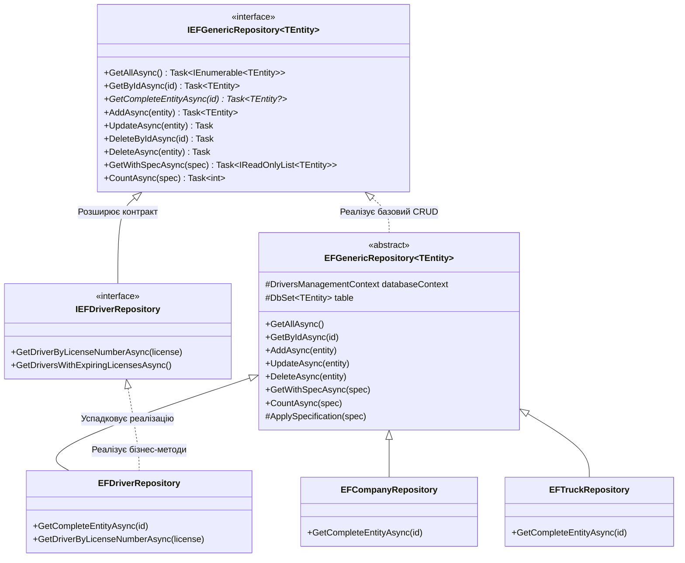

# 🏛️ 05. Патерн Generic Repository (Універсальний Репозиторій)

> **Модуль:** `01-Ntier-Drivers`  
> **Рівні реалізації:** `Business Logic (BLL)` ➔ `Data Access Layer (Drivers.DAL.EF & Drivers.DAL.ADO)` ➔ `MS SQL Server`  
> **Ключові технології:** C# 13 • .NET 10 • Entity Framework Core 10 • Generics (`<TEntity>`)

---

## 📑 Зміст посібника

1. [Теоретична преамбула: Що це таке «на пальцях»](#1-теоретична-преамбула-що-це-таке-на-пальцях)
2. [Яку проблему вирішує Generic Repository](#2-яку-проблему-вирішує-generic-repository)
   - 2.1. [Кошмар дублювання CRUD-коду](#21-кошмар-дублювання-crud-коду)
   - 2.2. [Пряма залежність бізнес-логіки від ORM](#22-пряма-залежність-бізнес-логіки-від-orm)
3. [Архітектура та структура класів у проєкті](#3-архітектура-та-структура-класів-у-проєкті)
   - 3.1. [UML Діаграма класів репозиторіїв](#31-uml-діаграма-класів-репозиторіїв)
   - 3.2. [Контракт IEFGenericRepository&lt;TEntity&gt;](#32-контракт-iefgenericrepositorytentity)
   - 3.3. [Базова реалізація EFGenericRepository&lt;TEntity&gt;](#33-базова-реалізація-efgenericrepositorytentity)
   - 3.4. [Спеціалізовані репозиторії (EFDriverRepository, EFTruckRepository)](#34-спеціалізовані-репозиторії-efdriverrepository-eftruckrepository)
4. [Велика архітектурна дискусія: «Навіщо репозиторій, якщо DbContext уже є репозиторієм?»](#4-велика-архітектурна-дискусія-навіщо-репозиторій-якщо-dbcontext-уже-є-репозиторієм)
5. [Ключові технічні деталі реалізації](#5-ключові-технічні-деталі-реалізації)
   - 5.1. [Стратегія AsNoTracking() для максимальної швидкодії](#51-стратегія-asnotracking-для-максимальної-швидкодії)
   - 5.2. [Інтеграція зі Specification Pattern](#52-інтеграція-зі-specification-pattern)
   - 5.3. [Абстрактний метод GetCompleteEntityAsync](#53-абстрактний-метод-getcompleteentityasync)
6. [Порівняльна таблиця підходів](#6-порівняльна-таблиця-підходів)
7. [Прямі посилання на файли коду проєкту](#7-прямі-посилання-на-файли-коду-проєкту)

---

## 1. Теоретична преамбула: Що це таке «на пальцях»

### 1.1. Життєва аналогія: Універсальний комірник логістичного терміналу
Уявіть великий автопарк та склад запасних частин. На складі зберігаються десятки різних категорій речей:
- Вантажні тягачі (`Truck`)
- Колеса та шини (`Parts`)
- Особові справи водіїв (`Driver`)
- Товарно-транспортні накладні (`Expense`)

У вас є два шляхи, як організувати видачу речей:
1. **Поганий шлях:** Найняти 20 різних працівників, де кожен знає тільки свій товар: «Комірник лівих коліс», «Комірник особових справ», «Комірник накладних». Кожен із них вигадує власні правила запису в журнал і власний формат видачі товару.
2. **Правильний шлях (Generic Repository):** Розробити **єдиний універсальний стандартний регламент комірника**:
   - `ЗнайтиЗаНомерком(id)`
   - `ВидатиВсі()`
   - `ПокластиНаПолицю(річ)`
   - `ОновитиДані(річ)`
   - `Списати(річ)`

Цей універсальний регламент працює для **будь-якого** товару (`<TEntity>`). Але якщо для особливого товару (наприклад, водіїв) потрібна специфічна дія (перевірити термін дії посвідчення категорії C/E), ви створюєте **спеціалізованого комірника** (`EFDriverRepository`), який бере весь універсальний регламент і додає лише одну унікальну операцію.

> 💡 **Визначення:** **Generic Repository (Узагальнений Репозиторій)** — це патерн проєктування, що надає типізовану колекцієподібну абстракцію (`IEFGenericRepository<TEntity>`) над рівнем доступу до даних, інкапсулюючи стандартні CRUD-операції над базою даних для будь-якого типу сутності.

---

## 2. Яку проблему вирішує Generic Repository

### 2.1. Кошмар дублювання CRUD-коду
Без використання узагальнень розробник змушений вручну писати один і той самий код для кожної таблиці бази даних:

```csharp
// ❌ АНТИПАТЕРН: Дублювання 100% однакового коду для кожної сутності
public class DriverRepository 
{
    public async Task<EFDriver?> GetByIdAsync(int id) => await _context.Drivers.FindAsync(id);
    public async Task AddAsync(EFDriver entity) => await _context.Drivers.AddAsync(entity);
    // ... Delete, Update, GetAll ...
}

public class TruckRepository 
{
    public async Task<EFTruck?> GetByIdAsync(int id) => await _context.Trucks.FindAsync(id);
    public async Task AddAsync(EFTruck entity) => await _context.Trucks.AddAsync(entity);
    // ... ТОЧНО ТАКИЙ САМИЙ КОД ...
}

public class CompanyRepository 
{
    public async Task<EFCompany?> GetByIdAsync(int id) => await _context.Companies.FindAsync(id);
    // ... І ТАК ДЛЯ 10+ СУТНОСТЕЙ ...
}
```
Якщо в системі 15 таблиць, це **понад 600 рядків абсолютно однакового шаблонного коду** (Boilerplate). При зміні способу збереження або логування доведеться виправляти всі 15 класів.

### 2.2. Пряма залежність бізнес-логіки від ORM
Якщо рівень бізнес-логіки (`DriversManager`) напряму викликає `_context.Drivers.Add(driver)`:
- Менеджер стає жорстко прив'язаним до Entity Framework Core.
- Неможливо замінити ORM на високошвидкісний **Dapper** (що реалізовано в нашому модулі для важких звітів).
- Неможливо написати чистий юніт-тест без розгортання повноцінного In-Memory провайдера EF Core.

---

## 3. Архітектура та структура класів у проєкті

У модулі `Drivers.DAL.EF` Generic Repository побудовано з чіткою ієрархією:

### 3.1. UML Діаграма класів репозиторіїв



---

### 3.2. Контракт `IEFGenericRepository<TEntity>`
👉 Код: [`IEFGenericRepository.cs`](file:///c:/Users/Yurii/source/repos/Demo-CargoDeliveryService/01-Ntier-Drivers/Drivers.DAL.EF/Repositories/Contracts/IEFGenericRepository.cs)

```csharp
public interface IEFGenericRepository<TEntity> where TEntity : class
{
    // Базові операції вибірки
    Task<IEnumerable<TEntity>> GetAllAsync();
    Task<TEntity> GetByIdAsync(int id);
    Task<TEntity?> GetCompleteEntityAsync(int id);

    // Модифікація даних
    Task<TEntity> AddAsync(TEntity entity);
    Task UpdateAsync(TEntity entity);
    Task DeleteByIdAsync(int id);
    Task DeleteAsync(TEntity entity);

    // Фільтрація (Expression Trees)
    IQueryable<TEntity> FindAll();
    Task<IQueryable<TEntity>> FindByCondition(Expression<Func<TEntity, bool>> expression);

    // Інтеграція зі Specification Pattern
    Task<IReadOnlyList<TEntity>> GetWithSpecAsync(ISpecification<TEntity> specification, CancellationToken cancellationToken = default);
    Task<TEntity?> GetEntityWithSpecAsync(ISpecification<TEntity> specification, CancellationToken cancellationToken = default);
    Task<int> CountAsync(ISpecification<TEntity> specification, CancellationToken cancellationToken = default);
}
```

---

### 3.3. Базова реалізація `EFGenericRepository<TEntity>`
👉 Код: [`EFGenericRepository.cs`](file:///c:/Users/Yurii/source/repos/Demo-CargoDeliveryService/01-Ntier-Drivers/Drivers.DAL.EF/Repositories/EFGenericRepository.cs)

Універсальний клас інкапсулює роботу з `DbSet<TEntity>` через `databaseContext.Set<TEntity>()`:

```csharp
public abstract class EFGenericRepository<TEntity> : IEFGenericRepository<TEntity> where TEntity : class
{
    protected readonly DriversManagementContext databaseContext;
    protected readonly DbSet<TEntity> table;

    protected EFGenericRepository(DriversManagementContext databaseContext)
    {
        this.databaseContext = databaseContext;
        this.table = this.databaseContext.Set<TEntity>();
    }

    public virtual async Task<TEntity> AddAsync(TEntity entity)
    {
        if (entity == null) throw new ArgumentNullException(nameof(entity));
        await table.AddAsync(entity);
        return entity;
    }

    public virtual async Task<TEntity> GetByIdAsync(int id)
    {
        return await table.FindAsync(id) ?? throw new KeyNotFoundException($"Сутність з Id={id} не знайдена.");
    }

    public virtual async Task<IEnumerable<TEntity>> GetAllAsync()
    {
        return await table.AsNoTracking().ToListAsync();
    }

    public virtual async Task UpdateAsync(TEntity entity)
    {
        table.Attach(entity);
        databaseContext.Entry(entity).State = EntityState.Modified;
    }

    public virtual async Task DeleteAsync(TEntity entity)
    {
        table.Remove(entity);
    }

    // Абстрактний метод: кожна конкретна сутність сама знає, які .Include їй потрібні для повного графа
    public abstract Task<TEntity?> GetCompleteEntityAsync(int id);
}
```

---

### 3.4. Спеціалізовані репозиторії (`EFDriverRepository`)
👉 Код: [`EFDriverRepository.cs`](file:///c:/Users/Yurii/source/repos/Demo-CargoDeliveryService/01-Ntier-Drivers/Drivers.DAL.EF/Repositories/EFDriverRepository.cs)

Завдяки Generic Repository спеціалізований клас не пише CRUD з нуля. Він лише реалізує унікальні доменні методи:

```csharp
public class EFDriverRepository : EFGenericRepository<EFDriver>, IEFDriverRepository
{
    public EFDriverRepository(DriversManagementContext databaseContext) 
        : base(databaseContext)
    {
    }

    // Реалізація обов'язкового Eager Loading для агрегату водія
    public override async Task<EFDriver?> GetCompleteEntityAsync(int id)
    {
        return await databaseContext.Drivers
            .Include(d => d.Company)
            .Include(d => d.Photo)
            .Include(d => d.Expenses)
                .ThenInclude(e => e.Truck)
            .AsNoTracking()
            .FirstOrDefaultAsync(d => d.Id == id);
    }
}
```

---

## 4. Велика архітектурна дискусія: «Навіщо репозиторій, якщо DbContext уже є репозиторієм?»

У світі .NET часто точаться суперечки: *«Навіщо писати обгортку Repository над DbContext, якщо сам DbContext реалізує Unit of Work, а DbSet&lt;T&gt; — це Generic Repository?»*.

Ось чесний інженерний аналіз:

| Аргумент | Робота напряму з `DbContext` | Робота через `EFGenericRepository` |
| :--- | :--- | :--- |
| **Чистота шарів** | ❌ Витік EF Core у сервіси BLL та Web API | ✅ Шар BLL знає лише інтерфейс `IEFGenericRepository` |
| **Гібридний стек (Dual Engine)** | ❌ Неможливо непомітно підмінити EF на Dapper | ✅ У проекті паралельно працюють `EFDriverRepository` та `DriverRepository (Dapper)` з єдиною семантикою |
| **Захист від небезпечних запитів** | ❌ Будь-хто може написати `_context.Database.ExecuteSqlRaw` у BLL | ✅ Усі запити проходять через контрольовані методи та специфікації |
| **Тестування бізнес-логіки** | ❌ Потрібно мокати складний внутрішній стан `DbContext` | ✅ Достатньо зробити простий Moq для `IEFGenericRepository<Driver>` |

---

## 5. Ключові технічні деталі реалізації

### 5.1. Стратегія `AsNoTracking()` для максимальної швидкодії
Усі методи читання (`GetAllAsync`, `GetWithSpecAsync`) викликають `.AsNoTracking()`.
- **Чому це важливо:** За замовчуванням EF Core зберігає копію кожного прочитаного об'єкта в `ChangeTracker`. Для читання 1000 водіїв це створює 1000 зайвих об'єктів у RAM та витрачає CPU на порівняння знімків (Snapshot Detection).
- Метод `.AsNoTracking()` вимикає цей механізм, роблячи вибірку **в 2–3 рази швидшою** і не засмічуючи пам'ять.

### 5.2. Інтеграція зі Specification Pattern
Generic Repository у нашому проєкті має пряму підтримку патерну **Specification**:
```csharp
public virtual async Task<IReadOnlyList<TEntity>> GetWithSpecAsync(ISpecification<TEntity> specification, CancellationToken cancellationToken = default)
{
    return await ApplySpecification(specification).ToListAsync(cancellationToken);
}

protected IQueryable<TEntity> ApplySpecification(ISpecification<TEntity> specification)
{
    return SpecificationEvaluator<TEntity>.GetQuery(table.AsNoTracking(), specification);
}
```
Це означає, що вам **ніколи не доведеться додавати нові методи в репозиторій** заради нового фільтра. Ви просто передаєте нову специфікацію в `GetWithSpecAsync`!

---

## 6. Порівняльна таблиця підходів

| Критерій | Наївний код (прямий DbContext у BLL) | Generic Repository (Наш вибір) |
| :--- | :--- | :--- |
| **Обсяг коду (LoC)** | Дублювання 5-7 методів на кожну сутність | Базовий CRUD написаний 1 раз для всіх сутностей |
| **Гнучкість фільтрів** | Хаотичні LINQ вирази розкидані по системі | Консолідовані через `GetWithSpecAsync` |
| **Швидкість розробки нових сутностей** | Потрібно писати новий контролер, репозиторій, сервіс | Новий репозиторій створюється в 5 рядків коду через успадкування |
| **Захист від регресій** | Помилка в одному репозиторії не впливає на інші | Виправлення багу в `EFGenericRepository` автоматично виправляє його скрізь |

---

## 7. Прямі посилання на файли коду проєкту

| Файл | Опис ролі в архітектурі |
| :--- | :--- |
| 📄 [`IEFGenericRepository.cs`](file:///c:/Users/Yurii/source/repos/Demo-CargoDeliveryService/01-Ntier-Drivers/Drivers.DAL.EF/Repositories/Contracts/IEFGenericRepository.cs) | Базовий контракт узагальненого репозиторію з підтримкою специфікацій |
| 📄 [`EFGenericRepository.cs`](file:///c:/Users/Yurii/source/repos/Demo-CargoDeliveryService/01-Ntier-Drivers/Drivers.DAL.EF/Repositories/EFGenericRepository.cs) | Базова абстрактна реалізація CRUD операцій для Entity Framework Core |
| 📄 [`IEFDriverRepository.cs`](file:///c:/Users/Yurii/source/repos/Demo-CargoDeliveryService/01-Ntier-Drivers/Drivers.DAL.EF/Repositories/Contracts/IEFDriverRepository.cs) | Спеціалізований інтерфейс репозиторію водіїв |
| 📄 [`EFDriverRepository.cs`](file:///c:/Users/Yurii/source/repos/Demo-CargoDeliveryService/01-Ntier-Drivers/Drivers.DAL.EF/Repositories/EFDriverRepository.cs) | Конкретна реалізація репозиторію водіїв із повним завантаженням зв'язків |
| 📄 [`IEFCompanyRepository.cs`](file:///c:/Users/Yurii/source/repos/Demo-CargoDeliveryService/01-Ntier-Drivers/Drivers.DAL.EF/Repositories/Contracts/IEFCompanyRepository.cs) | Спеціалізований інтерфейс репозиторію компаній-перевізників |
| 📄 [`EFCompanyRepository.cs`](file:///c:/Users/Yurii/source/repos/Demo-CargoDeliveryService/01-Ntier-Drivers/Drivers.DAL.EF/Repositories/EFCompanyRepository.cs) | Конкретна реалізація репозиторію компаній |
| 📄 [`EFTruckRepository.cs`](file:///c:/Users/Yurii/source/repos/Demo-CargoDeliveryService/01-Ntier-Drivers/Drivers.DAL.EF/Repositories/EFTruckRepository.cs) | Конкретна реалізація репозиторію вантажівок |
