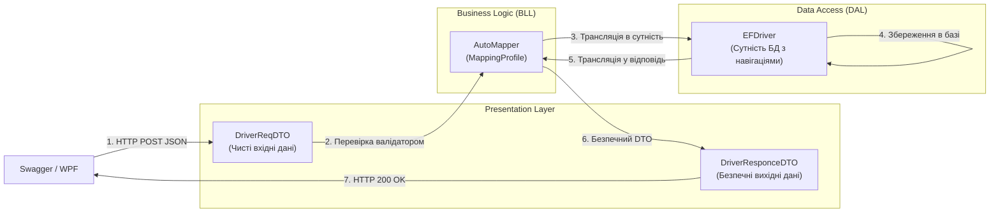

# 🔄 08. Патерн Data Transfer Object (DTO) та Object Mapping (AutoMapper)

> **Модуль:** `01-Ntier-Drivers`  
> **Рівні реалізації:** `Presentation (DriversApi & WPFDrivers)` ➔ `Business Logic (Drivers.BLL)` ➔ `Data Access (Drivers.DAL.EF)`  
> **Ключові технології:** C# 13 • .NET 10 • AutoMapper 12 • JSON Serialization • Безпека Over-Posting

---

## 📑 Зміст посібника

1. [Теоретична преамбула: Що це таке «на пальцях»](#1-теоретична-преамбула-що-це-таке-на-пальцях)
2. [Чому повертати сутності БД назовні — це катастрофа](#2-чому-повертати-сутності-бд-назовні-це-катастрофа)
   - 2.1. [Вразливість Over-Posting (Масове призначення)](#21-вразливість-over-posting-масове-призначення)
   - 2.2. [Циклічні посилання та збій серіалізації (JsonException: Object Cycle)](#22-циклічні-посилання-та-збій-серіалізації)
   - 2.3. [Витік внутрішньої структури бази даних](#23-витік-внутрішньої-структури-бази-даних)
3. [Архітектура розділення контрактів: Request DTO vs Response DTO](#3-архітектура-розділення-контрактів-request-dto-vs-response-dto)
   - 3.1. [Діаграма потоку трансформації даних](#31-діаграма-потоку-трансформації-даних)
   - 3.2. [Request DTOs (Вхідні моделі запиту)](#32-request-dtos-вхідні-моделі-запиту)
   - 3.3. [Response DTOs (Вихідні моделі відповіді)](#33-response-dtos-вихідні-моделі-відповіді)
4. [Автоматизація мапінгу через AutoMapper](#4-автоматизація-мапінгу-через-automapper)
   - 4.1. [Профіль мапінгу MappingProfile.cs](#41-профіль-мапінгу-mappingprofilecs)
   - 4.2. [Використання в бізнес-менеджерах BLL](#42-використання-в-бізнес-менеджерах-bll)
5. [Порівняльна таблиця: Прямі сутності проти DTO](#5-порівняльна-таблиця-прямі-сутності-проти-dto)
6. [Прямі посилання на файли коду проєкту](#6-прямі-посилання-на-файли-коду-проєкту)

---

## 1. Теоретична преамбула: Що це таке «на пальцях»

### 1.1. Життєва аналогія: Паспорт громадянина проти Візитної картки
Уявіть, що ви знайомитеся з новим клієнтом на бізнес-зустрічі. 

- **Сутність бази даних (`EFDriver`) — це ваш внутрішній державний паспорт:** У ньому записані ваші відбитки пальців, реєстрація шлюбу, ідентифікаційний код, військовий квиток, група крові та домашня адреса.
- **Data Transfer Object (`DriverResponceDTO`) — це ваша візитна картка:** На ній надруковано лише ваше ім'я, номер телефону та посада в автопарку.

Якщо ви віддасте незнайомцю свій повний паспорт (сутність БД), зловмисник візьме на вас кредит або дізнається конфіденційні таємниці. Ви віддаєте лише **візитну картку (DTO)** — рівно стільки інформації, скільки потрібно для конкретної операції, і ні байтом більше!

> 💡 **Визначення:** **Data Transfer Object (DTO)** — це простий об'єкт без бізнес-поведінки (POCO), призначений виключно для транспортування даних між шарами архітектури (від Presentation до BLL) та мережевими клієнтами (Web API / WPF / Mobile).

---

## 2. Чому повертати сутності БД назовні — це катастрофа

### 2.1. Вразливість Over-Posting (Масове призначення)
Уявіть, що контролер приймає напряму сутність бази даних:
```csharp
// ❌ СМЕРТЕЛЬНИЙ АНТИПАТЕРН: Прийом сутності БД у контролері
[HttpPost]
public async Task<IActionResult> CreateDriver([FromBody] EFDriver driver)
{
    await _driverRepository.AddAsync(driver);
    return Ok();
}
```
Зловмисник відправляє прихований JSON:
```json
{
  "firstName": "Іван",
  "lastName": "Петренко",
  "isSystemAdmin": true,
  "salaryBonus": 999999,
  "complianceVerified": true
}
```
Модельний біндер ASP.NET Core автоматично заповнить поля `IsSystemAdmin` та `ComplianceVerified`, і вони запишуться в базу! **Патерн DTO унеможливлює цю атаку**, оскільки у `DriverReqDTO` цих полів просто не існує.

### 2.2. Циклічні посилання та збій серіалізації
У реляційній базі даних сутності посилаються одна на одну:
`Водій -> належить Компанії -> Компанія містить список Водіїв -> кожен Водій належить Компанії...`

Під час спроби серіалізувати сутність `EFDriver` у JSON, серіалізатор входить у нескінченний рекурсивний цикл і викидає виняток:
```
System.Text.Json.JsonException: A possible object cycle was detected. 
This can either be due to a cycle or if the object depth is larger than the maximum allowed depth of 64.
```
DTO розриває ці циклічні зв'язки, транслюючи компанію у простий рядок `CompanyName` або чистий дочірній DTO без зворотного посилання.

### 2.3. Витік внутрішньої структури бази даних
Якщо ви зміните назву колонки в таблиці SQL Server або розділите одну таблицю на дві в рамках оптимізації БД, клієнтські додатки (WPF-клієнт, веб-інтерфейс, сторонні інтеграції) миттєво зламаються, якщо вони зав'язані на назви колонок. DTO створює стабільний **контракт**, який не змінюється при рефакторингу БД.

---

## 3. Архітектура розділення контрактів: Request DTO vs Response DTO

### 3.1. Діаграма потоку трансформації даних



---

### 3.2. Request DTOs (Вхідні моделі запиту)
👉 Код: [`CompanyReqDTO.cs`](file:///c:/Users/Yurii/source/repos/Demo-CargoDeliveryService/01-Ntier-Drivers/Drivers.BLL/DTOs/Requests/CompanyReqDTO.cs)

Містить тільки ті властивості, які клієнт має право передавати:
```csharp
public class CompanyReqDTO
{
    public string Name { get; set; } = string.Empty;
    public string Address { get; set; } = string.Empty;
    public string PhoneNumber { get; set; } = string.Empty;
}
```

### 3.3. Response DTOs (Вихідні моделі відповіді)
👉 Код: [`TruckResponceDTO.cs`](file:///c:/Users/Yurii/source/repos/Demo-CargoDeliveryService/01-Ntier-Drivers/Drivers.BLL/DTOs/Responses/TruckResponceDTO.cs)

Містить пласкі (flattened) дані без важких реляційних циклів:
```csharp
public class TruckResponceDTO
{
    public int Id { get; set; }
    public string TruckNumber { get; set; } = string.Empty;
    public string Model { get; set; } = string.Empty;
    public int YearOfManufacture { get; set; }
    public decimal Mileage { get; set; }
}
```

---

## 4. Автоматизація мапінгу через AutoMapper

Щоб не писати сотні рядків ручного присвоєння `dto.Name = entity.Name; dto.Age = entity.Age;`, використовується бібліотека **AutoMapper**:

### 4.1. Профіль мапінгу `MappingProfile.cs`
👉 Код: [`MappingProfile.cs`](file:///c:/Users/Yurii/source/repos/Demo-CargoDeliveryService/01-Ntier-Drivers/DriversApi/AutomapperProfile/MappingProfile.cs)

```csharp
public class MappingProfile : Profile
{
    public MappingProfile() 
    {
        // 1. Мапінг відповідей (Сутність -> DTO)
        CreateMap<EFDriver, FullDriverResponceDTO>().ReverseMap();
        CreateMap<EFDriver, ShortDriverResponceDTO>().ReverseMap();
        CreateMap<EFCompany, CompanyResponceDTO>().ReverseMap();

        // 2. Мапінг запитів (DTO -> Сутність)
        CreateMap<EFDriver, MiniDriverReqDTO>().ReverseMap();
        CreateMap<EFPhoto, PhotoReqDTO>().ReverseMap();
    }
}
```

### 4.2. Використання в бізнес-менеджерах BLL
👉 Код: [`DriversManager.cs`](file:///c:/Users/Yurii/source/repos/Demo-CargoDeliveryService/01-Ntier-Drivers/Drivers.BLL/Managers/DriversManager.cs)

```csharp
public async Task<FullDriverResponceDTO> GetDriverByIdAsync(int id)
{
    // 1. Отримуємо сутність з повним графом через Unit of Work
    var driverEntity = await _uow.EFDriverRepository.GetCompleteEntityAsync(id);
    if (driverEntity == null) throw new NotFoundException($"Водія з Id={id} не знайдено");

    // 2. Автоматично мапимо на безпечний DTO за 1 рядок!
    return _mapper.Map<FullDriverResponceDTO>(driverEntity);
}
```

---

## 5. Порівняльна таблиця: Прямі сутності проти DTO

| Критерій | Пряме використання сутностей БД | Патерн DTO + AutoMapper (Наш вибір) |
| :--- | :--- | :--- |
| **Захист від Over-Posting** | ❌ Відсутній (високий ризик зламу) | ✅ Повний (клієнт бачить тільки дозволені поля) |
| **Серіалізація в JSON** | ❌ Падає через циклічні посилання | ✅ Чистий, оптимізований JSON |
| **Мережевий трафік** | ⚠️ Передаються всі поля і зв'язки | 🚀 Тільки необхідні для поточного екрану дані |
| **Ізоляція схеми БД** | ❌ Будь-яка зміна БД ламає клієнтів | ✅ Публічний API стабільний і версіонований |

---

## 6. Прямі посилання на файли коду проєкту

| Файл | Опис ролі в архітектурі |
| :--- | :--- |
| 📄 [`MappingProfile.cs`](file:///c:/Users/Yurii/source/repos/Demo-CargoDeliveryService/01-Ntier-Drivers/DriversApi/AutomapperProfile/MappingProfile.cs) | Центральний профіль конфігурації AutoMapper |
| 📄 [`CompanyReqDTO.cs`](file:///c:/Users/Yurii/source/repos/Demo-CargoDeliveryService/01-Ntier-Drivers/Drivers.BLL/DTOs/Requests/CompanyReqDTO.cs) | Вхідний DTO запиту створення/редагування компанії |
| 📄 [`TruckResponceDTO.cs`](file:///c:/Users/Yurii/source/repos/Demo-CargoDeliveryService/01-Ntier-Drivers/Drivers.BLL/DTOs/Responses/TruckResponceDTO.cs) | Вихідний DTO представлення даних вантажівки |
| 📄 [`PagedResponseDTO.cs`](file:///c:/Users/Yurii/source/repos/Demo-CargoDeliveryService/01-Ntier-Drivers/Drivers.BLL/DTOs/Responses/PagedResponseDTO.cs) | Універсальний конверт відповіді пагінованих вибірок |
| 📄 [`DriversManager.cs`](file:///c:/Users/Yurii/source/repos/Demo-CargoDeliveryService/01-Ntier-Drivers/Drivers.BLL/Managers/DriversManager.cs) | Менеджер бізнес-логіки, що транслює сутності через IMapper |
