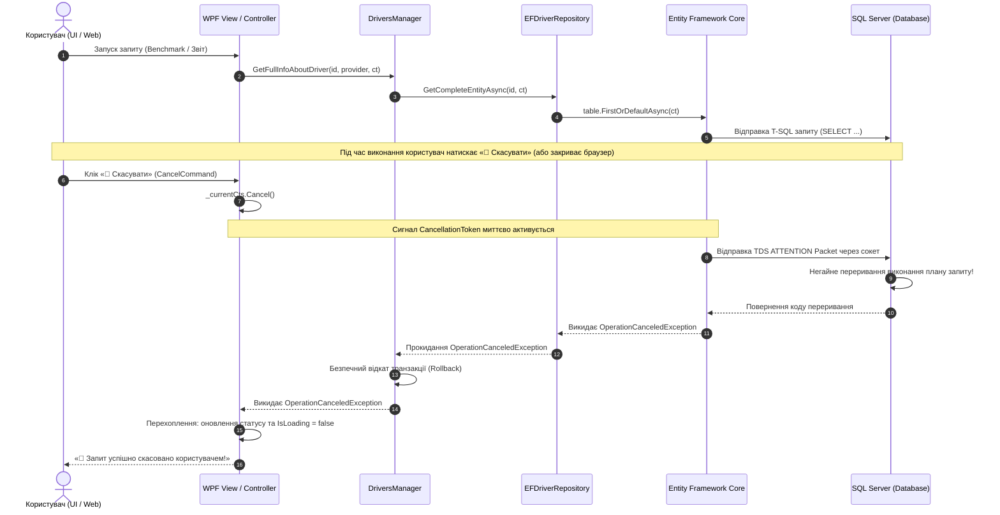

# 🛑 09. Патерн Cooperative Cancellation (CancellationToken)

> **Модуль:** `01-Ntier-Drivers`  
> **Рівні реалізації:** `Presentation (DriversApi & WPFDrivers)` ➔ `Business Logic (Drivers.BLL)` ➔ `Data Access (Drivers.DAL.EF)` ➔ `Database (SQL Server)`  
> **Ключові технології:** C# 13 • .NET 10 • `CancellationToken` • `CancellationTokenSource` • EF Core • `DbCommand.Cancel()` • Kestrel `HttpContext.RequestAborted`

---

## 📑 Зміст посібника

1. [Теоретична преамбула: Що це таке «на пальцях»](#1-теоретична-преамбула-що-це-таке-на-пальцях)
   - 1.1. [Життєва аналогія: Скасування замовлення таксі або піци](#11-життєва-аналогія-скасування-замовлення-таксі-або-піци)
   - 1.2. [Концепція кооперативного скасування в .NET](#12-концепція-кооперативного-скасування-в-net)
2. [Чому відсутність скасування веде до краху серверної інфраструктури](#2-чому-відсутність-скасування-веде-до-краху-серверної-інфраструктури)
   - 2.1. [Фантомні запити (Ghost Queries)](#21-фантомні-запити-ghost-queries)
   - 2.2. [Виснаження пулу з'єднань БД (Connection Pool Exhaustion)](#22-виснаження-пулу-зєднань-бд-connection-pool-exhaustion)
   - 2.3. [Деградація пулу потоків Kestrel (Thread Pool Starvation)](#23-деградація-пулу-потоків-kestrel-thread-pool-starvation)
3. [Архітектура наскрізного потоку: End-to-End Cancellation Flow](#3-архітектура-наскрізного-потоку-end-to-end-cancellation-flow)
   - 3.1. [Діаграма послідовності передачі сигналу скасування](#31-діаграма-послідовності-передачі-сигналу-скасування)
   - 3.2. [Що відбувається під капотом на рівні сокета та SQL Server](#32-що-відбувається-під-капотом-на-рівні-сокета-та-sql-server)
4. [Покрокова реалізація в проєкті по шарах](#4-покрокова-реалізація-в-проєкті-по-шарах)
   - 4.1. [Шаблон WPF клієнта: Кнопка «🛑 Скасувати» та CancellationTokenSource](#41-шаблон-wpf-клієнта-кнопка--скасувати-та-cancellationtokensource)
   - 4.2. [Рівень Web API: HttpContext.RequestAborted](#42-рівень-web-api-httpcontextrequestaborted)
   - 4.3. [Рівень Business Logic (BLL): Коректний відкат транзакцій та прокидання](#43-рівень-business-logic-bll-коректний-відкат-транзакцій-та-прокидання)
   - 4.4. [Рівень Data Access (DAL): EF Core та асинхронні методи](#44-рівень-data-access-dal-ef-core-та-асинхронні-методи)
5. [Тестування скасування: CancellationTokenTests](#5-тестування-скасування-cancellationtokentests)
6. [Золоті правила та антипатерни роботи з CancellationToken](#6-золоті-правила-та-антипатерни-роботи-з-cancellationtoken)
7. [Прямі посилання на файли коду проєкту](#7-прямі-посилання-на-файли-коду-проєкту)

---

## 1. Теоретична преамбула: Що це таке «на пальцях»

### 1.1. Життєва аналогія: Скасування замовлення таксі або піци

Уявіть, що ви замовили таксі через мобільний додаток, аби терміново встигнути на потяг:

```
[Ви (Клієнт)] ---> Натиснули «Викликати таксі» ---> [Диспетчер] ---> [Водій їде 15 хвилин]
```

Через 2 хвилини вам зателефонував друг і сказав, що рейс скасовано або він підвезе вас своєю машиною. Ви відкриваєте додаток і тиснете кнопку **«Скасувати поїздку»**.
- **При кооперативній системі (з CancellationToken):** Диспетчер негайно передає водієві радіосигнал. Водій зупиняється, розвертається і бере наступне замовлення. Бензин не спалюється марно, водій вільний для інших клієнтів.
- **Без системи скасування (без CancellationToken):** Таксист продовжує їхати до вашого будинку ще 13 хвилин, паркується під під'їздом, чекає 20 хвилин, дзвонить вам у двері, з'ясовує, що вас там немає, і лише тоді їде. Весь цей час таксист був недоступний іншим людям, автопарк зазнав збитків, ресурси спалено нанівець.

У веб-серверах та базах даних цим «водієм» є **SQL Server** та **потоки веб-сервера Kestrel**.

### 1.2. Концепція кооперативного скасування в .NET

У середовищі .NET операції **не вбиваються примусово** (абортуванням потоків на зразок застарілого `Thread.Abort()`, яке руйнувало стан пам'яті). Натомість використовується патерн **кооперативного скасування (Cooperative Cancellation)**:

1. **`CancellationTokenSource` (Джерело / Пульт):** Об'єкт, який створює сигнал і володіє кнопкою скасування: метод `cts.Cancel()`.
2. **`CancellationToken` (Слухач / Радіоприймач):** Легковажна структура даних (`readonly struct`), яка передається аргументом через усі методи. Вона не може сама ініціювати скасування, а лише слухає сигнал: `token.IsCancellationRequested` або `token.ThrowIfCancellationRequested()`.
3. Коли метод бачить сигнал, він викидає стандартизований виняток **`OperationCanceledException`** (або похідний `TaskCanceledException`), акуратно звільняє всі неуправляємі ресурси (`using`, транзакції) та припиняє обчислення.

---

## 2. Чому відсутність скасування веде до краху серверної інфраструктури

Багато розробників-початківців ігнорують `CancellationToken` у методах репозиторіїв та контролерів, вважаючи: *«Та навіщо воно мені, запит і так повернеться за кілька секунд»*. Але під високим навантаженням це призводить до системного краху з таких причин:

### 2.1. Фантомні запити (Ghost Queries)
Користувач у браузері або WPF-клієнті відкрив сторінку важкого аналітичного звіту (наприклад, агрегація за мільйоном записів за 5 років), не дочекався завантаження за 2 секунди, закрив вкладку або клацнув іншу кнопку.
- Якщо `cancellationToken` **не передається** до `DbContext`: Kestrel бачить відключення клієнта, але **запит на SQL Server продовжує виконуватися**! Він читає терабайти з дисків, спалює процесорні ядра SQL Server, блокує рядки в базі даних (locks), хоча результат уже **нікому не потрібен** — клієнтський сокет давно закрито.

### 2.2. Виснаження пулу з'єднань БД (Connection Pool Exhaustion)
Кожне підключення до БД береться з пулу (`SqlConnectionPool`). Кількість з'єднань обмежена (за замовчуванням у ADO.NET — 100 з'єднань).
Якщо 50 користувачів одночасно клацнули важкі фільтри, а потім швидко перезавантажили сторінку, ще 50 фантомних запитів займають усі 100 з'єднань. Усі наступні користувачі сайту отримують помилку:
```
Timeout expired. The timeout period elapsed prior to obtaining a connection from the pool.
```

### 2.3. Деградація пулу потоків Kestrel (Thread Pool Starvation)
Потоки асинхронного введення/виведення залишаються заблокованими очікуванням відповіді від мережевих драйверів, черга завдань росте, час відгуку (latency) системи катастрофічно деградує.

---

## 3. Архітектура наскрізного потоку: End-to-End Cancellation Flow

### 3.1. Діаграма послідовності передачі сигналу скасування

Нижче наведено повний ланцюжок від інтерфейсу користувача до ядра бази даних, реалізований у нашому проєкті `01-Ntier-Drivers`:



### 3.2. Що відбувається під капотом на рівні сокета та SQL Server

Коли ви передаєте `CancellationToken` у метод EF Core на кшталт `FirstOrDefaultAsync(cancellationToken)`:
1. `Microsoft.Data.SqlClient` реєструє зворотний виклик (callback) на переданий токен через метод `cancellationToken.Register(...)`.
2. Коли токен переходить у статус скасованого, драйвер викликає внутрішній метод `DbCommand.Cancel()`.
3. По відкритому TCP-з'єднанню до SQL Server надсилається спеціальний **TDS Attention Packet** (пакет уваги протоколу Tabular Data Stream).
4. SQL Server отримує пакет переривання і **негайно зупиняє свій Query Execution Thread**, звільняючи пам'ять, дискові ресурси та блокування таблиць.

---

## 4. Покрокова реалізація в проєкті по шарах

### 4.1. Шаблон WPF клієнта: Кнопка «🛑 Скасувати» та CancellationTokenSource

У файлі [DriversViewModel.cs](file:///c:/Users/Yurii/source/repos/Demo-CargoDeliveryService/01-Ntier-Drivers/WPFDrivers/ViewModels/DriversViewModel.cs) реалізовано повноцінне управління життєвим циклом токена скасування:

```csharp
public class DriversViewModel : ViewModelBase
{
    private CancellationTokenSource? _currentCts;

    public ICommand CancelCommand { get; }

    public DriversViewModel(IServiceProvider serviceProvider)
    {
        // Команда скасування активна ТІЛЬКИ тоді, коли триває завантаження
        CancelCommand = new RelayCommand(CancelCurrentOperation, () => IsLoading);
    }

    /// <summary>
    /// Ініціалізація нового токена перед запуском будь-якої тривалої операції
    /// </summary>
    private CancellationToken BeginOperation()
    {
        _currentCts?.Cancel();
        _currentCts?.Dispose();
        _currentCts = new CancellationTokenSource();
        IsLoading = true;
        CommandManager.InvalidateRequerySuggested();
        return _currentCts.Token;
    }

    /// <summary>
    /// Викликається користувачем при натисканні червоної кнопки «🛑 Скасувати»
    /// </summary>
    public void CancelCurrentOperation()
    {
        if (_currentCts != null && !_currentCts.IsCancellationRequested)
        {
            _currentCts.Cancel();
            StatusMessage = "⏳ Надсилання сигналу скасування операції (CancellationToken)...";
        }
    }

    public async Task LoadDriverAsync()
    {
        var ct = BeginOperation();
        var sw = Stopwatch.StartNew();

        try
        {
            DriverInfo = await manager.GetFullInfoAboutDriver(DriverId, SelectedProvider, ct);
            StatusMessage = $"Успішно завантажено за {sw.ElapsedMilliseconds} мс";
        }
        catch (OperationCanceledException)
        {
            // Граційна реакція на скасування: НЕ лякаємо користувача модальними вікнами з помилками
            sw.Stop();
            StatusMessage = $"🛑 Запит водія #{DriverId} успішно скасовано користувачем (CancellationToken) після {sw.Elapsed.TotalMilliseconds:F1} мс!";
        }
        catch (Exception ex)
        {
            // Справжня неочікувана помилка
            StatusMessage = $"Помилка: {ex.Message}";
        }
        finally
        {
            IsLoading = false;
            CommandManager.InvalidateRequerySuggested();
        }
    }
}
```

У файлі розмітки [DriversView.xaml](file:///c:/Users/Yurii/source/repos/Demo-CargoDeliveryService/01-Ntier-Drivers/WPFDrivers/Views/DriversView.xaml) додано кнопку скасування:
```xml
<!-- Кнопка: Скасування операції (CancellationToken) -->
<Button Command="{Binding CancelCommand}" Content="🛑 Скасувати" 
        Height="34" Padding="14,0" Background="#DC2626" Foreground="White" 
        FontWeight="Bold" BorderThickness="0" Cursor="Hand" Margin="0,0,10,4"
        ToolTip="Скасувати поточну асинхронну операцію через CancellationToken"
        IsEnabled="{Binding IsLoading}"/>
```

---

### 4.2. Рівень Web API: HttpContext.RequestAborted

У файлі [DriversController.cs](file:///c:/Users/Yurii/source/repos/Demo-CargoDeliveryService/01-Ntier-Drivers/DriversApi/Controllers/DriversController.cs) ASP.NET Core автоматично передає токен скасування HTTP-з'єднання:

```csharp
[HttpGet("{id}", Name = "GetInformationAboutDriver")]
public async Task<ActionResult<FullDriverResponceDTO>> GetFullInfoAboutDriver(
    int id,
    [FromQuery] DataAccessProvider provider = DataAccessProvider.EntityFramework,
    CancellationToken cancellationToken = default) // <-- ASP.NET прив'язує HttpContext.RequestAborted
{
    var result = await _driversManager.GetFullInfoAboutDriver(id, provider, cancellationToken);
    return Ok(result);
}
```

> 💡 **Як це працює у Web API:**  
> Якщо клієнт закриває вкладку браузера, розриває мобільний зв'язок або спливає HTTP Timeout у Postman/WPF, фреймворк ASP.NET Core негайно виставляє сигнал у `HttpContext.RequestAborted`. Завдяки параметру `CancellationToken cancellationToken = default`, контролер автоматично передає цей токен у BLL.

---

### 4.3. Рівень Business Logic (BLL): Коректний відкат транзакцій та прокидання

У файлі [DriversManager.cs](file:///c:/Users/Yurii/source/repos/Demo-CargoDeliveryService/01-Ntier-Drivers/Drivers.BLL/Managers/DriversManager.cs) токен наскрізно передається до репозиторіїв та транзакцій:

```csharp
public async Task<FullDriverResponceDTO> AddDriverToSystemAsync(
    MiniDriverReqDTO driverDTO,
    DataAccessProvider provider,
    CancellationToken cancellationToken)
{
    if (provider == DataAccessProvider.EntityFramework)
    {
        try
        {
            await _efUow.BeginTransactionAsync(cancellationToken);
            var entity = _mapper.Map<EFDriver>(driverDTO);
            
            // 1. Додавання сутності з перевіркою токена
            var added = await _efUow.EFDriverRepository.AddAsync(entity, cancellationToken);
            
            // 2. Фіксація змін
            await _efUow.CompleteAsync(cancellationToken);
            await _efUow.CommitTransactionAsync(cancellationToken);

            var created = await _efUow.EFDriverRepository.GetCompleteEntityAsync(added.Id, cancellationToken);
            return _mapper.Map<FullDriverResponceDTO>(created);
        }
        catch (OperationCanceledException)
        {
            // ВАЖЛИВО: Відкат транзакції виконуємо з CancellationToken.None,
            // оскільки базовий токен вже скасовано, і скасований токен не дозволив би завершити ROLLBACK!
            await _efUow.RollbackTransactionAsync(CancellationToken.None);
            throw; // Прокидаємо нагору для Kestrel / UI
        }
        catch (Exception ex)
        {
            await _efUow.RollbackTransactionAsync(CancellationToken.None);
            _logger.LogError(ex, "Помилка додавання водія через EF Core");
            throw new ApplicationException("Error in transaction while adding driver", ex);
        }
    }
    // ...
}
```

---

### 4.4. Рівень Data Access (DAL): EF Core та асинхронні методи

У репозиторіях [EFGenericRepository.cs](file:///c:/Users/Yurii/source/repos/Demo-CargoDeliveryService/01-Ntier-Drivers/Drivers.DAL.EF/Repositories/EFGenericRepository.cs) та [EFDriverRepository.cs](file:///c:/Users/Yurii/source/repos/Demo-CargoDeliveryService/01-Ntier-Drivers/Drivers.DAL.EF/Repositories/EFDriverRepository.cs) усі асинхронні виклики приймають токен:

```csharp
public virtual async Task<T?> GetByIdAsync(int id, CancellationToken cancellationToken = default)
{
    return await table.FindAsync(new object?[] { id }, cancellationToken);
}

public virtual async Task<IEnumerable<T>> GetAllAsync(CancellationToken cancellationToken = default)
{
    return await table.AsNoTracking().ToListAsync(cancellationToken);
}

public override async Task<EFDriver?> GetCompleteEntityAsync(int id, CancellationToken cancellationToken = default)
{
    return await table
        .AsNoTracking()
        .Include(d => d.Company)
        .Include(d => d.Photos)
        .Include(d => d.Expenses)
        .FirstOrDefaultAsync(d => d.Id == id, cancellationToken);
}
```

Також оновлено асинхронну пагінацію у [PagedList.cs](file:///c:/Users/Yurii/source/repos/Demo-CargoDeliveryService/01-Ntier-Drivers/Drivers.DAL.EF/Helpers/PagedList.cs):
```csharp
public static async Task<PagedList<T>> ToPagedListAsync(
    IQueryable<T> source, 
    int pageNumber, 
    int pageSize, 
    CancellationToken cancellationToken = default)
{
    var count = await source.CountAsync(cancellationToken);
    var items = await source
        .Skip((pageNumber - 1) * pageSize)
        .Take(pageSize)
        .ToListAsync(cancellationToken);

    return new PagedList<T>(items, count, pageNumber, pageSize);
}
```

---

## 5. Тестування скасування: CancellationTokenTests

У файлі [CancellationTokenTests.cs](file:///c:/Users/Yurii/source/repos/Demo-CargoDeliveryService/01-Ntier-Drivers/NtierDrivers.UnitTests/CancellationTokenTests.cs) реалізовано модульні тести поведінки системи:

```csharp
[Fact]
public async Task GetFullInfoAboutDriver_WhenCancellationTokenCanceled_ThrowsOperationCanceledException()
{
    // Arrange: Створюємо токен, який вже перебуває у стані скасування
    using var cts = new CancellationTokenSource();
    cts.Cancel();
    var cancellationToken = cts.Token;
    const int driverId = 42;

    _efDriverRepoMock
        .Setup(r => r.GetCompleteEntityAsync(driverId, cancellationToken))
        .ThrowsAsync(new OperationCanceledException(cancellationToken));

    var manager = new DriversManager(_loggerMock.Object, _mapper, _adoUowMock.Object, _efUowMock.Object);

    // Act
    var act = async () => await manager.GetFullInfoAboutDriver(driverId, DataAccessProvider.EntityFramework, cancellationToken);

    // Assert: Перевіряємо, що BLL не поглинає виняток і прокидає OperationCanceledException
    await act.Should().ThrowAsync<OperationCanceledException>();
    _efDriverRepoMock.Verify(r => r.GetCompleteEntityAsync(driverId, cancellationToken), Times.Once);
}

[Fact]
public async Task AddDriverToSystemAsync_WhenCancelled_DoesNotCommitUnitOfWork()
{
    // Arrange
    using var cts = new CancellationTokenSource();
    cts.Cancel();
    var cancellationToken = cts.Token;

    _efDriverRepoMock
        .Setup(r => r.AddAsync(It.IsAny<EFDriver>(), cancellationToken))
        .ThrowsAsync(new OperationCanceledException(cancellationToken));

    var manager = new DriversManager(_loggerMock.Object, _mapper, _adoUowMock.Object, _efUowMock.Object);

    // Act
    var act = async () => await manager.AddDriverToSystemAsync(new MiniDriverReqDTO(), DataAccessProvider.EntityFramework, cancellationToken);

    // Assert: Unit of Work не повинен підтверджувати збереження даних у БД!
    await act.Should().ThrowAsync<OperationCanceledException>();
    _efUowMock.Verify(u => u.CompleteAsync(It.IsAny<CancellationToken>()), Times.Never);
}
```

---

## 6. Золоті правила та антипатерни роботи з CancellationToken

| Патерн / Правило | Чому це важливо | Приклад коду |
| :--- | :--- | :--- |
| **Параметр завжди останній із `= default`** | Забезпечує зворотну сумісність: виклик без параметра автоматично підставляє `CancellationToken.None`. | `Task DoWorkAsync(int id, CancellationToken ct = default)` |
| **НЕ маскувати як `ApplicationException`** | Якщо обернути `OperationCanceledException` у `Exception`, ASP.NET Core поверне клієнту статус `500 Internal Server Error` замість штатного закриття з'єднання. | `catch (OperationCanceledException) { throw; }` |
| **Rollback з `CancellationToken.None`** | Якщо сталася відміна під час транзакції, відкат повинен завершитися гарантовано, незалежно від стану вихідного токена. | `await _uow.RollbackAsync(CancellationToken.None);` |
| **Звільняти `CancellationTokenSource`** | Незвільнений CTS з таймаутом тримає таймер у пам'яті, спричиняючи витоки пам'яті (Memory Leak). | `using var cts = new CancellationTokenSource();` або `_cts?.Dispose();` |
| **Не блокувати синхронний потік** | Ніколи не викликайте `.Result` або `.Wait()` на асинхронних задачах із токеном (ризик взаємного блокування — Deadlock). | `await repo.FindAsync(id, ct);` |

---

## 7. Прямі посилання на файли коду проєкту

- [DriversViewModel.cs](file:///c:/Users/Yurii/source/repos/Demo-CargoDeliveryService/01-Ntier-Drivers/WPFDrivers/ViewModels/DriversViewModel.cs) — Реалізація `CancellationTokenSource`, `CancelCommand`, `BeginOperation()` та обробки скасування у WPF.
- [DriversView.xaml](file:///c:/Users/Yurii/source/repos/Demo-CargoDeliveryService/01-Ntier-Drivers/WPFDrivers/Views/DriversView.xaml) — Графічна кнопка скасування «🛑 Скасувати» з прив'язкою до стану завантаження `IsLoading`.
- [DriversController.cs](file:///c:/Users/Yurii/source/repos/Demo-CargoDeliveryService/01-Ntier-Drivers/DriversApi/Controllers/DriversController.cs) — Автоматична прив'язка `HttpContext.RequestAborted` у REST контролері.
- [DriversManager.cs](file:///c:/Users/Yurii/source/repos/Demo-CargoDeliveryService/01-Ntier-Drivers/Drivers.BLL/Managers/DriversManager.cs) — Наскрізне прокидання токена в BLL, безпечний відкат транзакцій.
- [IEFGenericRepository.cs](file:///c:/Users/Yurii/source/repos/Demo-CargoDeliveryService/01-Ntier-Drivers/Drivers.DAL.EF/Repositories/Contracts/IEFGenericRepository.cs) — Контракт універсального репозиторію з `cancellationToken = default`.
- [EFGenericRepository.cs](file:///c:/Users/Yurii/source/repos/Demo-CargoDeliveryService/01-Ntier-Drivers/Drivers.DAL.EF/Repositories/EFGenericRepository.cs) — Реалізація CRUD в EF Core з передачею токена в `ToListAsync`, `FindAsync`, `FirstOrDefaultAsync`.
- [PagedList.cs](file:///c:/Users/Yurii/source/repos/Demo-CargoDeliveryService/01-Ntier-Drivers/Drivers.DAL.EF/Helpers/PagedList.cs) — Асинхронний метод пагінації `ToPagedListAsync` із `CountAsync(ct)` та `ToListAsync(ct)`.
- [CancellationTokenTests.cs](file:///c:/Users/Yurii/source/repos/Demo-CargoDeliveryService/01-Ntier-Drivers/NtierDrivers.UnitTests/CancellationTokenTests.cs) — Модульні тести наскрізного скасування операцій.
