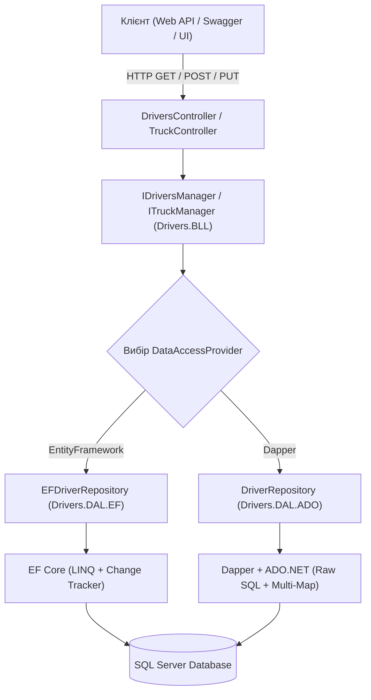

# Порівняльний аналіз доступу до даних: Entity Framework Core проти ADO.NET + Dapper у модулі NtierDriversModule

## 1. Загальний огляд кейсу

У рамках оптимізації монолітного модуля управління водіями (**NtierDriversModule**) було виконано глибокий рефакторинг та синхронізацію двох паралельних стеків доступу до даних:
1. **ORM-стек**: `Drivers.DAL.EF` на базі **Entity Framework Core**.
2. **Micro-ORM стек**: `Drivers.DAL.ADO` на базі **ADO.NET** та **Dapper**.

Усі проекти модуля та новий тестовий набір переведено на сучасну платформу **.NET 10 (`net10.0`)**:
- `Drivers.DAL.ADO` (net10.0)
- `Drivers.DAL.EF` (net10.0)
- `Drivers.BLL` (net10.0)
- `DriversApi` (net10.0)
- `NtierDrivers.UnitTests` (net10.0)

---

## 2. Архітектура та принципи синхронізації

Головною метою було створення **дзеркальних репозиторіїв із повністю ідентичною бізнес-логікою**, щоб мати можливість прямого порівняння коректності даних, швидкодії та навантаження на систему.



---

## 3. Детальний опис реалізованих запитів

Нижче наведено порівняння реалізації однакових бізнес-запитів на обох шарах.

### 3.1. Отримання повної інформації про водія (`GetCompleteEntityAsync`)
Повертає водія разом із компанією, фотографією та історією витрат з інформацією про закріплені вантажівки.

* **Entity Framework Core**:
  Використовує механізм Eager Loading через ланцюжок `.Include()` / `.ThenInclude()` із вимкненим відстеженням (`AsNoTracking()`).
  ```csharp
  public override async Task<EFDriver?> GetCompleteEntityAsync(int id)
  {
      return await databaseContext.Drivers
          .AsNoTracking()
          .Include(driver => driver.Company)
          .Include(driver => driver.Photo)
          .Include(driver => driver.Expenses.OrderByDescending(e => e.Date))
              .ThenInclude(expense => expense.Truck)
          .FirstOrDefaultAsync(driver => driver.Id == id);
  }
  ```

* **ADO.NET + Dapper**:
  Використовує `QueryMultipleAsync` для виконання єдиного пакетного запиту з двома наборами результатів (Result Sets). Це усуває проблему Cartesian Product при Join колекцій і не створює N+1 запитів:
  ```csharp
  public async Task<Driver?> GetCompleteEntityAsync(int id)
  {
      const string sql = @"
          -- Запит 1: Водій + Компанія + Фото
          SELECT d.*, c.*, p.*
          FROM [dbo].[Drivers] d
          LEFT JOIN [dbo].[Companies] c ON d.[CompanyID] = c.[Id]
          LEFT JOIN [dbo].[Photos] p ON d.[PhotoID] = p.[Id]
          WHERE d.[Id] = @Id;

          -- Запит 2: Витрати водія + дані вантажівки
          SELECT e.*, t.*
          FROM [dbo].[Expenses] e
          LEFT JOIN [dbo].[Trucks] t ON e.[TruckID] = t.[Id]
          WHERE e.[DriverID] = @Id
          ORDER BY e.[Date] DESC;";

      using var multi = await _sqlConnection.QueryMultipleAsync(sql, new { Id = id }, transaction: _dbTransaction);
      var driver = multi.Read<Driver, Company?, Photo?, Driver>((d, c, p) =>
      {
          d.Company = c;
          d.Photo = p;
          return d;
      }, splitOn: "Id,Id").FirstOrDefault();

      if (driver != null)
      {
          driver.Expenses = multi.Read<Expenses, Truck?, Expenses>((e, t) =>
          {
              e.Truck = t;
              return e;
          }, splitOn: "Id").ToList();
      }
      return driver;
  }
  ```

---

### 3.2. Пагінація, фільтрація за роками народження та прізвищем (`GetPaginatedDriversAsync`)

* **Entity Framework Core**:
  Динамічне формування дерева виразів `IQueryable<EFDriver>` з використанням допоміжного класу `ISortHelper<EFDriver>`.
  ```csharp
  var query = table.AsNoTracking().AsQueryable();
  if (driverParameters.MinYearOfBirth > 0)
      query = query.Where(d => d.Birthdate.Year >= driverParameters.MinYearOfBirth);
  if (driverParameters.MaxYearOfBirth > 0)
      query = query.Where(d => d.Birthdate.Year <= driverParameters.MaxYearOfBirth);
  if (!string.IsNullOrWhiteSpace(driverParameters.LastName))
      query = query.Where(d => d.LastName.ToLower().Contains(driverParameters.LastName.Trim().ToLower()));

  var sortedQuery = _sortHelper.ApplySort(query, driverParameters.OrderBy);
  var totalCount = await sortedQuery.CountAsync();
  var items = await sortedQuery
      .Skip((driverParameters.PageNumber - 1) * driverParameters.PageSize)
      .Take(driverParameters.PageSize)
      .ToListAsync();
  ```

* **ADO.NET + Dapper**:
  Динамічна побудова SQL-рядка через `StringBuilder`, параметризація через `DynamicParameters`, захист від SQL-ін'єкцій через whitelist стовпчиків сортування та T-SQL пагінація `OFFSET ... FETCH NEXT`:
  ```csharp
  var whereBuilder = new StringBuilder("WHERE 1=1 ");
  var parameters = new DynamicParameters();
  if (driverParameters.MinYearOfBirth > 0) {
      whereBuilder.Append("AND YEAR([Birthdate]) >= @MinYear ");
      parameters.Add("MinYear", (int)driverParameters.MinYearOfBirth);
  }
  if (!string.IsNullOrWhiteSpace(driverParameters.LastName)) {
      whereBuilder.Append("AND LOWER([LastName]) LIKE @LastName ");
      parameters.Add("LastName", $"%{driverParameters.LastName.Trim().ToLower()}%");
  }
  var safeOrderBy = BuildSafeOrderBy(driverParameters.OrderBy);
  var querySql = $@"
      SELECT * FROM [dbo].[Drivers]
      {whereBuilder}
      ORDER BY {safeOrderBy}
      OFFSET @Offset ROWS FETCH NEXT @PageSize ROWS ONLY;";
  ```

---

### 3.3. Фінансовий звіт витрат водія (`GetDriverExpenseSummaryAsync`)
Розрахунок агрегованих фінансових показників: загальної суми виплат водієві, пального, техобслуговування, загальної суми витрат, середньої вартості однієї операції, а також дат першої та останньої операції за опціональний період `[FromDate, ToDate]`.

* **Entity Framework Core**:
  Агрегація за допомогою LINQ над таблицею `databaseContext.Expenses`.
* **Dapper**:
  Прямий агрегатний SQL-запит з `ISNULL(SUM(...), 0)`, `COUNT(Id)`, `AVG(...)` без підтягування зайвих колонок у пам'ять додатка.

---

### 3.4. Топ-N водіїв за загальними витратами (`GetTopDriversByExpensesAsync`)
Аналітичний запит для виявлення водіїв з найвищими сумарними витратами компанії.

* **Entity Framework Core**:
  LINQ `GroupBy` за водієм з підрахунком агрегатів і сортуванням `.OrderByDescending(x => x.TotalExpenses).Take(topCount)`.
* **ADO.NET + Dapper**:
  T-SQL запит `SELECT TOP (@TopCount)` з `INNER JOIN Expenses` та `GROUP BY d.Id, d.FirstName, d.LastName, c.CompanyName`.

---

### 3.5. Сповіщення щодо закінчення водійських посвідчень (`GetDriversWithExpiringLicenseAsync`)
Оперативний звіт для диспетчерів та HR-відділу: водії, у яких посвідчення закінчується протягом `daysThreshold` днів.

* **Entity Framework Core**:
  Фільтрація через `d.DriverLicenseExpirationDate >= today && d.DriverLicenseExpirationDate <= thresholdDate`.
* **ADO.NET + Dapper**:
  Оптимізований запит з `DATEDIFF(day, CAST(GETDATE() AS DATE), d.[DriverLicenseExpirationDate])`.

---

### 3.6. Зведена аналітика технічного стану вантажівки (`GetTruckMaintenanceSummaryAsync`)
Агрегація витрат на автопарк: сума витрат на обслуговування (таблиця `Expenses`), сума проведених ремонтів (таблиця `Repairs`), загальна кількість інспекцій та співвідношення успішних/провалених техоглядів (таблиця `Inspections`).

---

## 4. Рефакторинг бізнес-логіки (`Drivers.BLL`)

1. **Ізоляція DTO від сутностей DAL**:
   - Виправлено витік `EFPhoto` та `EFExpense` з DTO `FullDriverResponceDTO`.
   - Введено незалежні моделі: `ExpenseResponceDTO`, `PhotoResponceDTO`, `DriverExpenseSummaryResponseDTO`, `TopDriverExpenseResponseDTO`, `DriverLicenseAlertResponseDTO`, `TruckMaintenanceSummaryResponseDTO`, `PagedResponseDTO<T>`.
2. **Єдиний профіль AutoMapper**:
   - Створено `BLLMappingProfile`, що підтримує двосторонній мапінг як для сутностей Entity Framework, так і для ADO.NET/Dapper.
3. **Валідація за допомогою FluentValidation**:
   - `DriverParametersValidator`: перевірка діапазонів сторінок, розмірів та років народження.
   - `DateRangeValidator`: перевірка коректності часових проміжків (`FromDate <= ToDate`).
   - `MiniDriverReqDTO_Validator`: обов'язкові поля водія, формат дат.
   - `CompanyReqDTO_Validator`: валідація назви компанії, email, контактних даних.
   - `ExpenseReqDTO_Validator`: невід'ємні витрати (пальне, заробітна плата, обслуговування), валідність категорій та дат.
   - `InspectionReqDTO_Validator`: валідація дати техогляду та зв'язку з авто.
   - `RepairReqDTO_Validator`: невід'ємна вартість ремонту та валідація дат.
4. **Бенчмаркінг у режимі реального часу**:
   - Реалізовано метод `CompareDriverQueryPerformanceAsync(int id)`: одночасно виконує вибірку через EF Core та Dapper, заміряє `Stopwatch` з точністю до мілісекунд, порівнює еквівалентність отриманих даних та повертає фактор прискорення (`SpeedupFactor`).
   - Реалізовано метод `CompareExpenseSummaryPerformanceAsync(int id, ...)` для порівняння складних агрегатних розрахунків.
   - Реалізовано метод `CompareTruckMaintenancePerformanceAsync(int truckId)`.
5. **Повноцінний супровід допоміжних підсистем (`Company`, `Expense`, `Inspection`, `Repair`)**:
   - Усі 4 сутності отримали повноцінний CRUD з підтримкою `DataAccessProvider.EntityFramework` та `DataAccessProvider.Dapper`.
   - Автоматичний мапінг запитів і відповідей через AutoMapper `BLLMappingProfile`.

---

## 5. Оновлені кінцеві точки Web API (`DriversApi`)

Усі ендпоінти отримали підтримку параметра `provider` (`0 = EntityFramework`, `1 = Dapper`) та повертають суворі HTTP-коди (200, 201, 204, 400, 404):

| Контролер | Метод | Маршрут | Опис |
| :--- | :--- | :--- | :--- |
| **Drivers** | `GET` | `/api/drivers/{id}?provider=0` | Повна інформація про водія |
| | `GET` | `/api/drivers/alldrivers?provider=1` | Список усіх водіїв |
| | `GET` | `/api/drivers/alldriverspaginated?PageNumber=1&PageSize=10&provider=0` | Пагінований список водіїв |
| | `GET` | `/api/drivers/{id}/expense-summary?provider=1` | Фінансовий звіт витрат |
| | `GET` | `/api/drivers/top-by-expenses?top=5&provider=1` | Топ-5 водіїв за витратами |
| | `GET` | `/api/drivers/expiring-licenses?daysThreshold=30&provider=0` | Водії з протермінованими ліцензіями |
| | `GET` | `/api/drivers/{id}/compare-providers` | **Бенчмарк:** вибірка водія (EF vs Dapper) |
| | `GET` | `/api/drivers/{id}/compare-expense-summary` | **Бенчмарк:** агрегатний звіт (EF vs Dapper) |
| | `POST` | `/api/drivers/assess-and-dispatch?provider=0` | **Бізнес-логіка 1:** Перевірка допуску, комплаєнс, ціноутворення та бюджет рейсу |
| | `GET` | `/api/drivers/{id}/annual-audit?auditYear=2025&provider=0` | **Бізнес-логіка 2:** Річний KPI-аудит водія, грейдування (A/B/C) та нарахування премії |
| **Truck** | `GET` | `/api/trucks?provider=1` | Список усіх вантажівок |
| | `GET` | `/api/trucks/{id}/maintenance-summary?provider=1` | Зведена аналітика техобслуговування |
| | `GET` | `/api/trucks/{id}/compare-maintenance` | **Бенчмарк:** аналітика обслуговування авто (EF vs Dapper) |
| **Company** | `GET` | `/api/company?provider=0` | Список усіх компаній |
| | `GET` | `/api/company/{id}?provider=0` | Отримання компанії за Id |
| | `GET` | `/api/company/{id}/drivers?provider=1` | Отримання компанії разом із закріпленими водіями |
| | `POST` | `/api/company?provider=0` | Створення нової компанії (201 Created) |
| | `PUT` | `/api/company/{id}?provider=0` | Оновлення компанії (200 OK) |
| | `DELETE` | `/api/company/{id}?provider=0` | Видалення компанії (204 NoContent) |
| **Expense** | `GET` | `/api/expense?provider=0` | Список усіх записів витрат |
| | `GET` | `/api/expense/{id}?provider=0` | Отримання витрат за Id |
| | `GET` | `/api/expense/driver/{driverId}?provider=1` | Отримання витрат конкретного водія |
| | `GET` | `/api/expense/truck/{truckId}?provider=1` | Отримання витрат конкретної вантажівки |
| | `POST` | `/api/expense?provider=0` | Створення запису витрат (201 Created) |
| | `PUT` | `/api/expense/{id}?provider=0` | Оновлення запису витрат (200 OK) |
| | `DELETE` | `/api/expense/{id}?provider=0` | Видалення запису витрат (204 NoContent) |
| **Inspection** | `GET` | `/api/inspectation?provider=0` | Список усіх техоглядів |
| | `GET` | `/api/inspectation/{id}?provider=0` | Отримання техогляду за Id |
| | `GET` | `/api/inspectation/truck/{truckId}?provider=1` | Список техоглядів для вантажівки |
| | `POST` | `/api/inspectation?provider=0` | Створення нового техогляду (201 Created) |
| | `PUT` | `/api/inspectation/{id}?provider=0` | Оновлення техогляду (200 OK) |
| | `DELETE` | `/api/inspectation/{id}?provider=0` | Видалення техогляду (204 NoContent) |
| **Repair** | `GET` | `/api/repair?provider=0` | Список усіх ремонтів |
| | `GET` | `/api/repair/{id}?provider=0` | Отримання ремонту за Id |
| | `GET` | `/api/repair/truck/{truckId}?provider=1` | Список ремонтів для вантажівки |
| | `POST` | `/api/repair?provider=0` | Створення запису про ремонт (201 Created) |
| | `PUT` | `/api/repair/{id}?provider=0` | Оновлення даних ремонту (200 OK) |
| | `DELETE` | `/api/repair/{id}?provider=0` | Видалення запису про ремонт (204 NoContent) |

---

## 6. Архітектура WPF-клієнта (`WPFDrivers`)

Клієнтський застосунок WPF було модернізовано на платформу **.NET 10 Windows (`net10.0-windows`)** з підтримкою **гібридної подвійної архітектури**:

1. **Режим прямого використання бізнес-шару (`DirectBllService`)**:
   - Застосунок напряму підключає `Drivers.BLL`, `Drivers.DAL.EF`, `Drivers.DAL.ADO`.
   - Демонструє, як у десктопному застосунку можна використовувати патерни Unit of Work та репозиторії безпосередньо у ViewModel.
2. **Режим віддаленого виклику через Web API (`DriversWebApiService`)**:
   - Застосунок робить HTTP-запити до REST API контролерів на `https://localhost:4002`.
   - Реалізовано стійкість до збоїв та автоматичний fallback у разі недоступності сервера.
3. **Вбудована панель порівняння швидкодії (Live Benchmarking UI)**:
   - Дозволяє користувачеві в один клік запустити паралельний замір швидкодії вибірки водія та аналітики обслуговування вантажівки між EF Core та Dapper, з візуалізацією різниці в часі виконання (ms) та коефіцієнта прискорення.
4. **Корпоративний дизайн у стилі C# / .NET**:
   - Повний редизайн інтерфейсу з використанням фірмових фіолетових відтінків C# (`#512BD4`, `#7F52FF`, `#1A0F38`, `#FAF8FF`).

---

## 7. Порівняльна характеристика Entity Framework Core та Dapper

| Критерій | Entity Framework Core 10 | ADO.NET + Dapper |
| :--- | :--- | :--- |
| **Тип інструменту** | Повнофункціональний ORM | Легковаговий Micro-ORM |
| **Швидкодія на читання** | Висока (з `AsNoTracking`), але є накладні витрати на парсинг LINQ та матерілізацію | **Максимальна** (близька до "чистого" SqlDataReader) |
| **Пам'ять (Allocations)** | Вище споживання через метадані контексту | **Мінімальне** виділення пам'яті |
| **Контроль над SQL** | Автоматична генерація через LINQ | **Повний ручний контроль** над T-SQL інструкціями |
| **Складні зв'язки (1:N)** | Зручно через `.Include()`, але ризик Cartesian Product | Ефективно через `QueryMultipleAsync` (декілька наборів даних) |
| **Безпека від ін'єкцій** | Автоматична параметризація LINQ | Автоматична параметризація через анонімні об'єкти Dapper |
| **Change Tracking / Unit of Work** | Вбудований потужний механізм відстеження змін | Відсутній (вимагає ручних `UPDATE` та `INSERT`) |
| **Рекомендована сфера застосування** | Складні транзакційні бізнес-операції, CRUD, адмін-панелі | Високонавантажені API, аналітичні звіти, важкі вибірки, дашборди |

---

## 8. Практична демонстрація Бізнес-Логіки (Rich Domain Business Logic у BLL)

### 8.1. Що таке бізнес-логіка (BLL) і чому вона не належить контролерам чи базі даних?

У багаторівневій архітектурі (N-Tier) **бізнес-логіка** — це сукупність правил, обмежень, розрахункових формул та регламентів бізнесу, що визначають, **як підприємство заробляє гроші, дотримується законодавства та уникає ризиків**:

- **Чому не в Контролерах (UI / API Layer)?**
  Контролер відповідає виключно за транспортний протокол: прийом HTTP-запиту, десеріалізацію JSON, базову перевірку формату запиту та повернення HTTP-статусу (200, 400, 404). Контролер не знає тарифних сіток, політики безпеки рейсів чи формул KPI. Якби логіка була в контролері, її неможливо було б перевикористати у WPF десктоп-клієнті, консольних утилітах або фонових воркерах без дублювання.
- **Чому не в Базі Даних (DAL / Stored Procedures)?**
  База даних відповідає за надійне зберігання (ACID) та швидкий пошук. Зашивання складної бізнес-логіки в SQL-процедури прив'язує систему до конкретного вендора СУБД, ускладнює версіонування, модульне тестування (mocking) та виключає використання об'єктно-орієнтованих патернів.
- **Обов'язок BLL (Business Logic Layer):**
  BLL оркеструє виклики репозиторіїв, застосовує корпоративні політики безпеки, виконує складні фінансові розрахунки, приймає рішення (Approved / Rejected) та зберігає побічні ефекти (Side Effects).

---

### 8.2. Метод 1: Комплексна оцінка допуску до рейсу, розрахунок кошторису та диспетчеризація (`AssessAndDispatchDriverForTripAsync`)

Цей метод реалізує багатокроковий бізнес-процес випуску вантажівки в рейс:

1. **Оркестрація репозиторіїв (DAL):**
   - Завантажує агрегати водія (`DriverRepository` / `EFDriverRepository`), тягача (`TruckRepository` / `EFPTruckRepository`) та історію техоглядів (`InspectionRepository` / `EFInspectionRepository`).
2. **Юридичний та комплаєнс-контроль (Compliance Enforcement):**
   - *Статус працевлаштування*: тільки водії у статусі `"Active"` допускаються до перевезень.
   - *Віковий ценз*: далекобійні рейси — не менше 21 року; небезпечні вантажі (`ADR`) — не менше 25 років.
   - *Категорія прав*: перевірка наявності вантажної категорії `C` або `CE`.
   - *Термін дії посвідчення*: посвідчення має бути дійсним увесь рейс плюс 14 днів безпекового буфера.
3. **Політика безпеки автопарку (Fleet Safety Policy):**
   - Блокування рейсу, якщо останній техогляд тягача мав результат `"НЕ ПРОЙДЕНО"`.
   - Попередження, якщо техогляд проводився більше 180 днів тому.
4. **Тарифний калькулятор вартості (Pricing & Budgeting Engine):**
   - *Базова оплата водія*: $\text{Відстань} \times \text{Базова ставка}$
   - *Бонус за стаж у компанії*: $+10\%$ за стаж від 2 років, $+20\%$ за стаж від 5 років.
   - *Надбавка за категорію складності*: $+35\%$ за небезпечні вантажі (ADR), $+20\%$ за міжнародні рейси, $+15\%$ за швидкопсувні рефрижераторні вантажі.
   - *Добові (Per Diem)*: 800 грн на добу на період рейсу.
   - *Прогнозна вартість пального*: норма 32 л / 100 км за ціною 54.50 грн/л.
   - *Резервний фонд безпеки*: $10\%$ від вартості пального на випадок дорожніх форс-мажорів.
5. **Прийняття вердикту та реєстрація:**
   - Формує статус (`Approved`, `ConditionalApproval`, `Rejected`).
   - Якщо виїзд дозволено — **автоматично фіксує плановий кошторис у фінансовому модулі** як новий запис витрат (`Expenses`).

---

### 8.3. Метод 2: Щорічний операційний та безпековий аудит водія (`ConductDriverAnnualPerformanceAuditAsync`)

Демонструє інтерпретацію історичних даних за бізнес-моделлю оцінювання персоналу:

1. **Агрегація за звітний рік:**
   - Збирає всі виконані рейси, заробіток водія, витрачене пальне та ремонти за вказаний рік.
2. **Оцінювальні нормативні алгоритми (KPI Scoring, 0–100):**
   - *Паливна економічність ($KPI_{Fuel}$)*: порівнює частку витрат на пальне із загальними операційними витратами (норма $\le 40\%$ дає бал 95.0, перевитрата $>55\%$ знижує бал до 40.0).
   - *Дбайливість до техніки ($KPI_{Care}$)*: відношення вартості ремонтів до зарплати водія (ідеальний стан $\le 10\%$ ремонтів дає бал 98.0).
   - *Дисципліна та безпека ($KPI_{Safety}$)*: враховує дійсність документів і регулярність рейсів.
3. **Інтегральний рейтинг за корпоративною ваговою моделлю:**
   $$\text{Composite Score} = 0.35 \times KPI_{Fuel} + 0.35 \times KPI_{Care} + 0.30 \times KPI_{Safety}$$
4. **Матриця грейдування та преміювання:**
   - $\ge 85$ балів: **Grade A (Platinum)** $\to$ річний бонус **10%** від річного заробітку.
   - $\ge 70$ балів: **Grade B (Gold)** $\to$ річний бонус **5%** від річного заробітку.
   - $\ge 50$ балів: **Grade C (Silver)** $\to$ рекомендація курсу Eco-driving, премія 0 грн.
   - $< 50$ балів: **UnderReview (Переатестація)** $\to$ призупинення допуску до рейсів.
5. **Транзакційне проведення виплати:**
   - Якщо бонус нараховано — автоматично реєструє транзакцію виплати в системі обліку витрат із детальним обґрунтуванням у примітці.

---

## 9. Модульне тестування (`NtierDrivers.UnitTests`)

Тестовий набір на базі **xUnit**, **Moq** та **FluentAssertions** під .NET 10:
- **Всього тестів**: 45
- **Пройдено**: 45 (100%)
- **Покриті компоненти**:
  1. `BusinessLogicDemonstrationTests`: модульні тести перевірки вікового цензу, відсутності категорії прав, проваленого техогляду, повного розрахунку кошторису ADR-рейсу, а також річного аудиту з грейдуванням A/B/C та нарахуванням премії.
  2. `MappingTests`: AutoMapper-мапінг сутностей EF Core та Dapper у DTO для всіх доменів (Drivers, Trucks, Companies, Expenses, Inspections, Repairs, Analytics).
  3. `ValidationTests`: правила FluentValidation для водіїв, параметрів пошуку, дат, компаній, витрат, техоглядів та ремонтів.
  4. `DriversManagerTests`: тестування маршрутизації між `EntityFramework` та `Dapper`, обробки помилок та метрик бенчмаркінгу.
  5. `TruckManagerTests`: аналітика обслуговування вантажівок та порівняння швидкодії.
  6. `AuxiliaryManagersTests`: перевірка викликів EF Core та Dapper репозиторіїв для CompanyManager, ExpenseManager, InspectationManager та RepairManager.
  7. `DriversControllerTests`: тестування HTTP відповідей контролера, ендпоінтів бізнес-логіки (`assess-and-dispatch`, `annual-audit`), кодів стану 200/400/404 та заголовка `X-Pagination`.

```bash
Test run for NtierDrivers.UnitTests.dll (.NETCoreApp,Version=v10.0)
Passed!  - Failed: 0, Passed: 45, Skipped: 0, Total: 45, Duration: 306 ms
```

