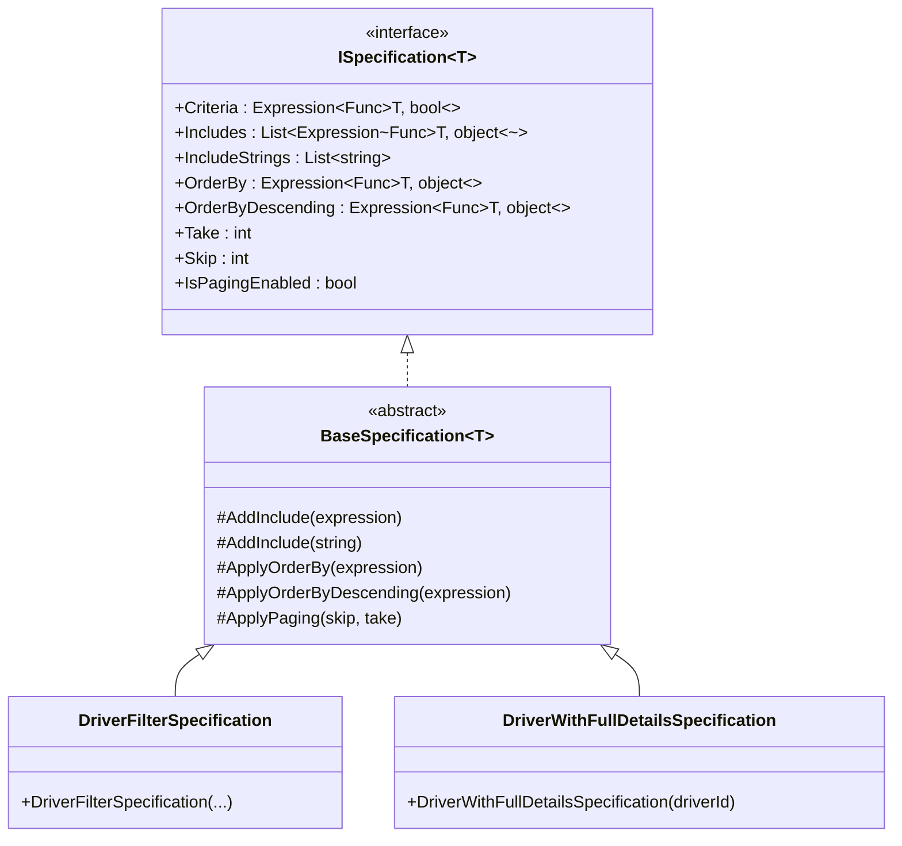
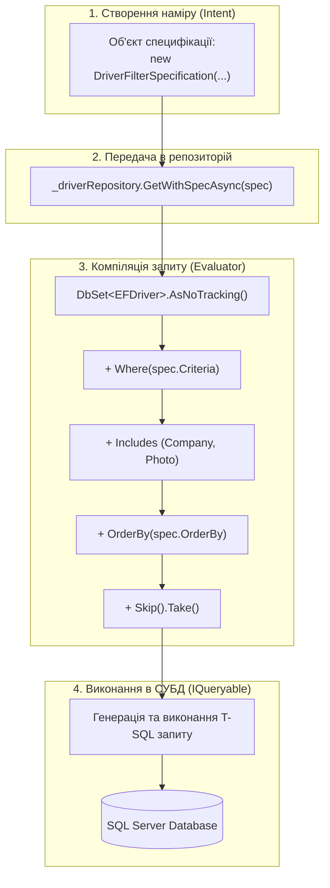
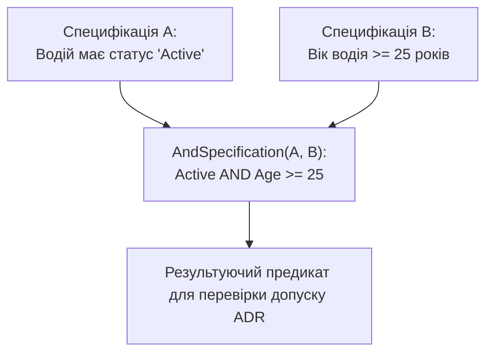

# 📘 Технічний Довідник: Патерни Specification, Repository та Unit of Work у .NET 10

> **Проєкт:** `Demo-CargoDeliveryService` • **Модуль:** `Drivers.DAL.EF` & `Drivers.BLL`  
> **Технології:** .NET 10 • Entity Framework Core • C# 13 • LINQ Expression Trees

---

## 📑 Зміст

1. [Теоретична преамбула: Навіщо потрібне тріо патернів?](#1-теоретична-преамбула)
2. [Анатомія та контракти базових інтерфейсів](#2-анатомія-та-контракти-базових-інтерфейсів)
3. [Архітектурний конвеєр обробки запиту (Принцип «Матрьошки»)](#3-архітектурний-конвеєр-обробки-запиту)
4. [Внутрішня механіка SpecificationEvaluator](#4-внутрішня-механіка-specificationevaluator)
5. [Реалізація конкретних специфікацій у бізнес-домені](#5-реалізація-конкретних-специфікацій-у-бізнес-домені)
6. [Композиція специфікацій (Composite / Chained Specifications)](#6-композиція-специфікацій)
7. [Інтеграція з Generic Repository та Unit of Work](#7-інтеграція-з-generic-repository-та-unit-of-work)
8. [Порівняння: Звичайний LINQ проти патерну Specification](#8-порівняння-звичайний-linq-проти-патерну-specification)
9. [Модульне тестування специфікацій](#9-модульне-тестування-специфікацій)

---

## 1. Теоретична преамбула

### 1.1. Що це таке простими словами?
У корпоративних системах робота з даними часто страждає від двох крайнощів:
- **Крайнощі 1 (Витік деталей запиту):** Рівень бізнес-логіки (BLL) або навіть контролери пишуть власні сирі LINQ-запити (`_context.Drivers.Where(d => d.IsActive && ...).Include(...)`). Це призводить до того, що бізнес-правила розмазуються по всьому коду, а зміна схеми бази даних вимагає переписування десятків файлів.
- **Крайнощі 2 (Засмічений репозиторій):** Репозиторій намагається приховати всі запити, через що перетворюється на звалище методів із 30+ схожими варіаціями:
  - `GetActiveDriversAsync()`
  - `GetActiveDriversWithLicensesAsync()`
  - `GetActiveDriversWithLicensesAndExpensesAsync()`
  - `GetDriversByAgeRangeAndCityAsync(...)`

> 💡 **Життєва аналогія: Тріо "Клієнт — Замовлення — Склад"**
> - **Specification (Бланк фільтрів):** Ви берете аркуш паперу і ставите галочки: "Хочу вантажівку не старіше 5 років, з пройденим техоглядом, вантажопідйомністю від 10 тонн". Аркуш не знає, як їздить вантажівка і де вона стоїть — це просто сукупність критеріїв.
> - **Repository (Працівник автопарку):** Отримує ваш аркуш і застосовує критерії до автостоянки (таблиці бази даних).
> - **Unit of Work (Диспетчер оформлення):** Якщо ви одночасно бронюєте тягач, причіп та водія, диспетчер гарантує, що вся операція буде проведена як єдине неподільне бронювання.

### 1.2. Порівняльна таблиця підходів

| Критерій | Наївний підхід (LINQ у BLL / Fat Repo) | Архітектурний підхід (Specification + Repo + UoW) |
| :--- | :--- | :--- |
| **Місце збереження фільтрів** | Прямо в методах менеджерів або десятках методів репозиторію | Окремі ізольовані класи специфікацій у домені |
| **Перевикористання фільтрів** | Дублювання коду `Where(...)` у різних місцях | Одна специфікація використовується у вибірках, підрахунках (`Count`) та перевірках |
| **Тестованість** | Складно перевірити правильність складного LINQ без бази | Специфікація тестується на звичайній колекції `List<T>.AsQueryable()` |
| **Eager Loading (.Include)** | Забутий `.Include()` призводить до `NullReferenceException` або N+1 | Всі необхідні зв'язки явно задекларовані всередині специфікації |

---

## 2. Анатомія та контракти базових інтерфейсів

У модулі `Drivers.DAL.EF` архітектуру специфікацій побудовано на чіткому розподілі відповідальності:



### 2.1. Контракт `ISpecification<T>`
👉 Код у проєкті: [ISpecification.cs](../Drivers.DAL.EF/Specifications/Contracts/ISpecification.cs)

```csharp
public interface ISpecification<T>
{
    // Головний предикат фільтрації (WHERE)
    Expression<Func<T, bool>>? Criteria { get; }

    // Жадібне завантаження через сильно типізовані лямбди (.Include(d => d.Company))
    List<Expression<Func<T, object?>>> Includes { get; }

    // Жадібне завантаження за рядковим шляхом (.Include("Expenses.Truck"))
    List<string> IncludeStrings { get; }

    // Сортування (ORDER BY ASC / DESC)
    Expression<Func<T, object>>? OrderBy { get; }
    Expression<Func<T, object>>? OrderByDescending { get; }

    // Пагінація
    int Take { get; }
    int Skip { get; }
    bool IsPagingEnabled { get; }
}
```

### 2.2. Базова реалізація `BaseSpecification<T>`
👉 Код у проєкті: [BaseSpecification.cs](../Drivers.DAL.EF/Specifications/BaseSpecification.cs)

Надає зручні інкапсульовані методи для нащадків:
- `AddInclude(d => d.Property)` — додає вираз жадібного завантаження.
- `ApplyOrderBy(d => d.Property)` — встановлює сортування за зростанням.
- `ApplyOrderByDescending(d => d.Property)` — встановлює сортування за спаданням.
- `ApplyPaging(skip, take)` — активує та задає параметри розбивки на сторінки.

---

## 3. Архітектурний конвеєр обробки запиту (Принцип «Матрьошки»)

Патерн працює за конвеєрним принципом вкладеності: кожен рівень огортає попередній, збагачуючи його логікою, але не порушуючи ізоляції.



---

## 4. Внутрішня механіка SpecificationEvaluator

👉 Код у проєкті: [SpecificationEvaluator.cs](../Drivers.DAL.EF/Specifications/Evaluator/SpecificationEvaluator.cs)

`SpecificationEvaluator<TEntity>` — це статичний транслятор, який приймає `IQueryable<TEntity>` і покроково накладає на нього всі конфігурації специфікації:

```csharp
public static class SpecificationEvaluator<TEntity> where TEntity : class
{
    public static IQueryable<TEntity> GetQuery(
        IQueryable<TEntity> inputQuery, 
        ISpecification<TEntity> specification)
    {
        var query = inputQuery;

        // 1. Фільтрація WHERE
        if (specification.Criteria != null)
        {
            query = query.Where(specification.Criteria);
        }

        // 2. Жадібне завантаження сильнотипізованих зв'язків
        query = specification.Includes.Aggregate(query,
            (current, include) => current.Include(include));

        // 3. Жадібне завантаження глибоких зв'язків за назвами
        query = specification.IncludeStrings.Aggregate(query,
            (current, include) => current.Include(include));

        // 4. Впорядкування ORDER BY
        if (specification.OrderBy != null)
        {
            query = query.OrderBy(specification.OrderBy);
        }
        else if (specification.OrderByDescending != null)
        {
            query = query.OrderByDescending(specification.OrderByDescending);
        }

        // 5. Серверна пагінація OFFSET ... FETCH
        if (specification.IsPagingEnabled)
        {
            query = query.Skip(specification.Skip).Take(specification.Take);
        }

        return query;
    }
}
```

---

## 5. Реалізація конкретних специфікацій у бізнес-домені

### 5.1. `DriverFilterSpecification`
👉 Код у проєкті: [DriverFilterSpecification.cs](../Drivers.DAL.EF/Specifications/DriverFilterSpecification.cs)

Специфікація підтримує динамічну фільтрацію водіїв:
```csharp
public class DriverFilterSpecification : BaseSpecification<EFDriver>
{
    public DriverFilterSpecification(
        string? searchLastName = null,
        string? employmentStatus = null,
        int? minBirthYear = null,
        int? maxBirthYear = null,
        int skip = 0,
        int take = 10,
        bool isPaging = false)
        : base(driver =>
            (string.IsNullOrWhiteSpace(searchLastName) || driver.LastName.Contains(searchLastName)) &&
            (string.IsNullOrWhiteSpace(employmentStatus) || driver.EmploymentStatus == employmentStatus) &&
            (!minBirthYear.HasValue || driver.Birthdate.Year >= minBirthYear.Value) &&
            (!maxBirthYear.HasValue || driver.Birthdate.Year <= maxBirthYear.Value))
    {
        AddInclude(d => d.Company);
        AddInclude(d => d.Photo);
        ApplyOrderBy(d => d.LastName);

        if (isPaging)
        {
            ApplyPaging(skip, take);
        }
    }
}
```

### 5.2. `DriverWithFullDetailsSpecification`
👉 Код у проєкті: [DriverWithFullDetailsSpecification.cs](../Drivers.DAL.EF/Specifications/DriverWithFullDetailsSpecification.cs)

Завантажує повний граф об'єкта водія для формування картки водія у UI:
```csharp
public class DriverWithFullDetailsSpecification : BaseSpecification<EFDriver>
{
    public DriverWithFullDetailsSpecification(int driverId)
        : base(driver => driver.Id == driverId)
    {
        AddInclude(d => d.Company);
        AddInclude(d => d.Photo);
        AddInclude(d => d.Expenses);
        AddInclude("Expenses.Truck");
    }
}
```

---

## 6. Композиція специфікацій (Composite Specifications)

Специфікації можна поєднувати за допомогою логічних операторів `AND`, `OR`, `NOT`:



---

## 7. Інтеграція з Generic Repository та Unit of Work

Репозиторій розширюється лише трьома методами для підтримки будь-яких теперішніх і майбутніх специфікацій:

👉 Код у проєкті: [EFGenericRepository.cs](../Drivers.DAL.EF/Repositories/EFGenericRepository.cs) 📍 (дивіться рядки 115–145)

```csharp
// 1. Отримання списку за специфікацією
public virtual async Task<IReadOnlyList<TEntity>> GetWithSpecAsync(
    ISpecification<TEntity> specification, 
    CancellationToken cancellationToken = default)
{
    return await ApplySpecification(specification).ToListAsync(cancellationToken);
}

// 2. Отримання одиничного елемента
public virtual async Task<TEntity?> GetEntityWithSpecAsync(
    ISpecification<TEntity> specification, 
    CancellationToken cancellationToken = default)
{
    return await ApplySpecification(specification).FirstOrDefaultAsync(cancellationToken);
}

// 3. Підрахунок кількості
public virtual async Task<int> CountAsync(
    ISpecification<TEntity> specification, 
    CancellationToken cancellationToken = default)
{
    return await ApplySpecification(specification).CountAsync(cancellationToken);
}
```

Використання в бізнес-менеджері:
```csharp
// Виклик у BLL через Unit of Work
var spec = new DriverFilterSpecification(searchLastName: "Коваленко", isPaging: true, skip: 0, take: 10);
var drivers = await _efUow.EFDriverRepository.GetWithSpecAsync(spec);
var totalCount = await _efUow.EFDriverRepository.CountAsync(spec);
```

---

## 8. Порівняння: Звичайний LINQ проти патерну Specification

| Аспект | Звичайний виклик LINQ у коді | Патерн Specification |
| :--- | :--- | :--- |
| **Принцип DRY (Не повторюйся)** | ❌ Предикати дублюються у контролерах, сервісах і тестах | ✅ Предикат написаний один раз у класі специфікації |
| **Інкапсуляція бізнес-правил** | ❌ Витік уявлень про структуру таблиць бази даних | ✅ Бізнес-правило має виразне доменне ім'я (`DriverFilterSpecification`) |
| **Підтримка Eager Loading** | ❌ Ризик забути потрібний `.Include()`, що спричиняє N+1 | ✅ Усі залежні зв'язки гарантовано підвантажуються автоматично |
| **Тестування без бази даних** | ❌ Вимагає In-Memory DB або реального SQL Server | ✅ Легко тестується на звичайному `List<T>.AsQueryable()` |

---

## 9. Модульне тестування специфікацій

👉 Код у проєкті: [SpecificationPatternTests.cs](../NtierDrivers.UnitTests/SpecificationPatternTests.cs)

Завдяки відокремленню специфікацій від контексту EF Core, ми можемо перевірити всю логіку фільтрації, пагінації та сортування за мілісекунди без запуску бази даних:

```csharp
[Fact]
public void SpecificationEvaluator_WhenCriteriaApplied_FiltersDriversCorrectly()
{
    // Arrange
    var spec = new DriverFilterSpecification(
        searchLastName: "ко",
        employmentStatus: "Active");

    var query = _testDrivers.AsQueryable();

    // Act
    var result = SpecificationEvaluator<EFDriver>.GetQuery(query, spec).ToList();

    // Assert
    result.Should().HaveCount(3);
    result.Should().OnlyContain(d => d.EmploymentStatus == "Active");
}
```

---

### 📌 Висновок
Поєднання **Specification + Generic Repository + Unit of Work** усуває головний головний біль традиційних багатошарових монолітів: розростання репозиторіїв та витік LINQ-запитів у рівень бізнес-логіки. Архітектура стає масштабованою, чистою та повністю тестованою.
