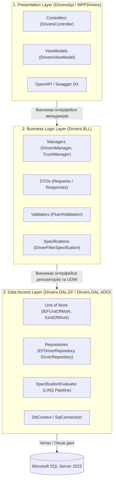
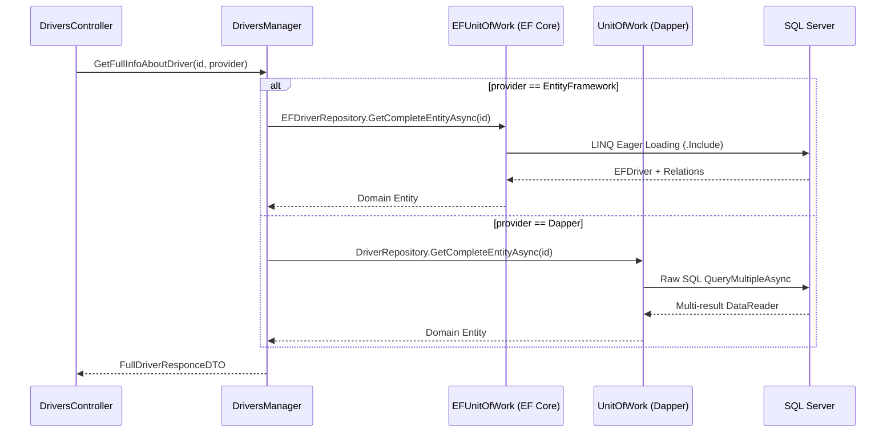
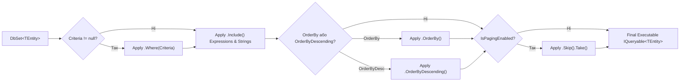
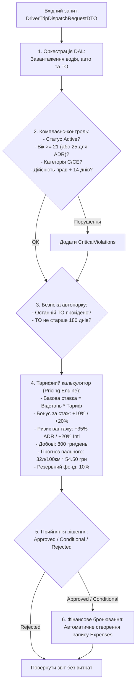
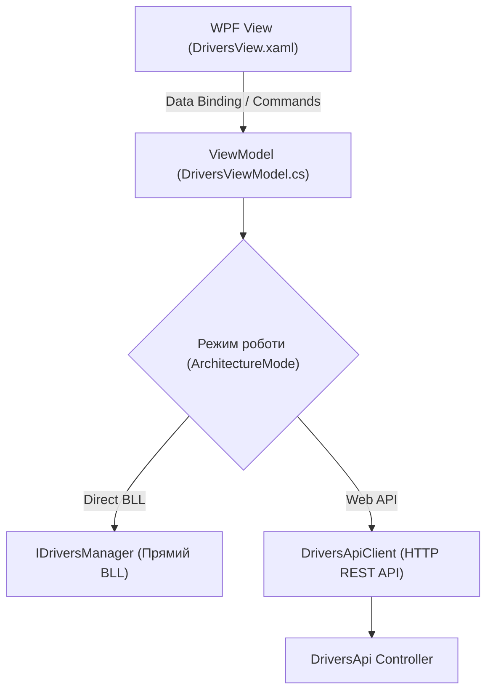

# 🎓 Архітектурний Майстер-Клас: Тришарова Архітектура (3-Tier) та Патерни Проєктування у .NET 10

> **Проєкт:** `Demo-CargoDeliveryService` • **Модуль:** `NtierDriversModule`  
> **Стек:** .NET 10 • C# 13 • Entity Framework Core • Dapper • FluentValidation • AutoMapper • WPF (MVVM) • xUnit

---

<a id="toc"></a>
## 📑 Зміст Майстер-Класу (Навігація по слайдах)

- [Слайд 1. Вступ і Маніфест чистої тришарової архітектури (3-Tier)](#slide-1)
- [Слайд 2. Анатомія шарів: Presentation, BLL, DAL та їх відповідальність](#slide-2)
- [Слайд 3. Архітектурний ландшафт проєкту Demo-CargoDeliveryService](#slide-3)
- [Слайд 4. Головні антипатерни монолітів: витік SQL у контролери та "анемічна" логіка](#slide-4)
- [Слайд 5. Патерн Generic Repository: абстракція над доступом до даних](#slide-5)
- [Слайд 6. Патерн Unit of Work: гарантія атомарності транзакцій](#slide-6)
- [Слайд 7. Патерн Strategy в DAL: Dual-Engine стек EF Core проти Dapper](#slide-7)
- [Слайд 8. Вирішення проблем N+1 та Cartesian Product у репозиторіях](#slide-8)
- [Слайд 9. Патерн Specification: інкапсуляція критеріїв запитів](#slide-9)
- [Слайд 10. Внутрішня механіка SpecificationEvaluator у Entity Framework Core](#slide-10)
- [Слайд 11. Що таке справжня бізнес-логіка: Rich Domain Logic проти Anemic CRUD](#slide-11)
- [Слайд 12. Патерн Data Transfer Object (DTO): захист доменних контрактів](#slide-12)
- [Слайд 13. Патерн Object-to-Object Mapping (AutoMapper)](#slide-13)
- [Слайд 14. Бізнес-процес №1: Комплаєнс-допуск до рейсу, тарифікація та бронювання кошторису](#slide-14)
- [Слайд 15. Бізнес-процес №2: Щорічний операційний та безпековий KPI-аудит водіїв](#slide-15)
- [Слайд 16. Декларативна валідація даних: FluentValidation як захисний бар'єр](#slide-16)
- [Слайд 17. Централізована обробка винятків: Exception Middleware & RFC 7807](#slide-17)
- [Слайд 18. Динамічна пагінація та сортування великих масивів даних](#slide-18)
- [Слайд 19. Presentation Layer Web API: RESTful маршрути, Swagger/OpenAPI та DX](#slide-19)
- [Слайд 20. Presentation Layer WPF: Гібридний MVVM-клієнт та пряма інтеграція BLL](#slide-20)
- [Слайд 21. Модульне тестування: Тестування за патерном AAA (54/54 тести)](#slide-21)
- [Слайд 22. Підсумкова матриця рішень та архітектурні висновки](#slide-22)

---

<a id="slide-1"></a>
### 🎬 Слайд 1. Вступ і Маніфест чистої тришарової архітектури (3-Tier)

#### 1. Теоретичне ядро
Тришарова архітектура (3-Tier / Layered Architecture) — це фундаментальний архітектурний стиль побудови корпоративного програмного забезпечення, що розділяє систему на три логічні та фізичні пласти:
1. **Presentation Layer (Презентаційний рівень):** взаємодія з зовнішнім світом (HTTP REST API, Desktop UI, Web UI).
2. **Business Logic Layer (BLL - Рівень бізнес-логіки):** правила, регламенти, валідація, калькуляція, оркестрація бізнес-процесів.
3. **Data Access Layer (DAL - Рівень доступу до даних):** збереження, вибірка та мапінг реляційних або нереляційних даних.

> 💡 **Життєва аналогія: Класичний ресторан**  
> - **Офіціант (Presentation):** приймає меню від клієнта, приносить готові страви, перевіряє ввічливість, але не готує їжу!
> - **Шеф-кухар (BLL):** знає рецепти, санітарні норми, час випікання та формує фірмову страву.
> - **Комора / Постачальник (DAL):** зберігає продукти на полицях, знає, де лежить м'ясо та спеції, але не знає, яку саме страву з них приготують.

#### 2. Порівняльна таблиця: "Наївний моноліт" проти "Чистий 3-Tier"

| Критерій | Як роблять зазвичай (Погано / Наївно) | Як зроблено тут (Правильно / Архітектурно) |
| :--- | :--- | :--- |
| **Місце запитів до БД** | SQL або `DbContext` викликаються прямо в контролерах | Контролер викликає інтерфейс сервісу/менеджера (`IDriversManager`) |
| **Бізнес-правила** | Розкидані між збереженими процедурами SQL і UI | Централізовані в шарі `Drivers.BLL` |
| **Тестованість** | Неможливо протестувати логіку без підняття БД | Шар BLL ізольований інтерфейсами і тестується 100% Mock-об'єктами |
| **Зміна СУБД / ORM** | Переписування всього застосунку | Зміна реалізації репозиторію в DAL без зачіпання UI чи BLL |

[⬆ До змісту](#toc) • [Наступний слайд ➡](#slide-2)

---

<a id="slide-2"></a>
### 🏛️ Слайд 2. Анатомія шарів: Presentation, BLL, DAL та їх відповідальність

#### 1. Теоретичне ядро: Принцип односпрямованої залежності (Inversion of Control)
У класичній тришаровій архітектурі залежності спрямовані **згори донизу**:  
`Presentation Layer` залежить від `Business Logic Layer`, а `Business Logic Layer` залежить від `Data Access Layer` (або інвертується через інтерфейси за принципом Clean Architecture).



#### 2. Посилання на реальний код у проєкті
👉 Контролер: [`DriversController.cs`](file:///c:/Users/Yurii/source/repos/Demo-CargoDeliveryService/01-Ntier-Drivers/DriversApi/Controllers/DriversController.cs#L20-L45) 📍 (дивіться рядки 20–45)  
👉 Менеджер бізнес-логіки: [`DriversManager.cs`](file:///c:/Users/Yurii/source/repos/Demo-CargoDeliveryService/01-Ntier-Drivers/Drivers.BLL/Managers/DriversManager.cs#L30-L60) 📍 (дивіться рядки 30–60)  
👉 Репозиторій даних: [`EFDriverRepository.cs`](file:///c:/Users/Yurii/source/repos/Demo-CargoDeliveryService/01-Ntier-Drivers/Drivers.DAL.EF/Repositories/EFDriverRepository.cs#L15-L40) 📍 (дивіться рядки 15–40)

[⬅ Попередній слайд](#slide-1) • [⬆ До змісту](#toc) • [Наступний слайд ➡](#slide-3)

---

<a id="slide-3"></a>
### 🗺️ Слайд 3. Архітектурний ландшафт проєкту Demo-CargoDeliveryService

#### 1. Огляд структури модулів
Проєкт являє собою рішення корпоративного рівня на базі **.NET 10**, де домен управління водіями та автопарком виділено в ізольований монолітний модуль **`NtierDriversModule`**:

- **`Drivers.DAL.EF` (.NET 10):** шар ORM на базі Entity Framework Core 10 (Code First, Change Tracker, LINQ).
- **`Drivers.DAL.ADO` (.NET 10):** шар Micro-ORM на базі ADO.NET та Dapper (Raw SQL, пакетні запити, ультра-перформанс).
- **`Drivers.BLL` (.NET 10):** доменні моделі, бізнес-менеджери, розрахункові калькулятори, DTO та мапінг.
- **`DriversApi` (.NET 10):** Web API з підтримкою Swagger, OAuth2 PKCE та маршрутизацією вибору провайдера.
- **`WPFDrivers` (.NET 10 Windows):** десктопний клієнт на базі MVVM із підтримкою подвійного режиму (Direct BLL vs Web API).
- **`NtierDrivers.UnitTests` (.NET 10):** 54 модульні тести (xUnit, Moq, FluentAssertions).

#### 2. Посилання на конфігурацію рішень
👉 Solution файл: [`CargoDeliveryService.sln`](file:///c:/Users/Yurii/source/repos/Demo-CargoDeliveryService/CargoDeliveryService.sln)  
👉 Проєкт API: [`Drivers.Api.csproj`](file:///c:/Users/Yurii/source/repos/Demo-CargoDeliveryService/01-Ntier-Drivers/DriversApi/Drivers.Api.csproj)  
👉 Проєкт BLL: [`Drivers.BLL.csproj`](file:///c:/Users/Yurii/source/repos/Demo-CargoDeliveryService/01-Ntier-Drivers/Drivers.BLL/Drivers.BLL.csproj)

[⬅ Попередній слайд](#slide-2) • [⬆ До змісту](#toc) • [Наступний слайд ➡](#slide-4)

---

<a id="slide-4"></a>
### 🚫 Слайд 4. Головні антипатерни монолітів: витік SQL у контролери та "анемічна" логіка

#### 1. Теоретичне ядро
Чому класичні проєкти перетворюються на "спагетті-код"?
1. **Витік деталей збереження (Leaky Abstraction):** Контролер або UI безпосередньо створює SQL-запити або викликає `_context.Drivers.Where(...)`. Якщо структура таблиці змінюється, ламається контролер.
2. **Анемічна доменна модель (Anemic Domain Model):** Сутності перетворюються на безмовні "пакети з даними" (Getters/Setters), а вся логіка зводиться до тривіального CRUD.
3. **Дублювання бізнес-правил:** Перевірка "чи водієві є 21 рік" пишеться у формі на фронтенді, дублюється в контролері API і ще раз у SQL-тригері.

#### 2. Порівняльна таблиця: Антипатерн проти Рішення

| Антипатерн (Погано) | Архітектурне рішення в нашому проєкті (Правильно) |
| :--- | :--- |
| `[HttpGet] ... return _context.Drivers.ToList();` у контролері | Контролер повертає `Task<ActionResult<FullDriverResponceDTO>>` через менеджер `IDriversManager` |
| Повернення сутностей бази даних (`EFDriver`) назовні | Суворе використання DTO (`ShortDriverResponceDTO`, `FullDriverResponceDTO`) |
| Перевірка віку та прав у збереженій процедурі SQL | Комплексний комплаєнс-модуль у `DriversManager.AssessAndDispatchDriverForTripAsync` |

[⬅ Попередній слайд](#slide-3) • [⬆ До змісту](#toc) • [Наступний слайд ➡](#slide-5)

---

<a id="slide-5"></a>
### 📦 Слайд 5. Патерн Generic Repository: абстракція над доступом до даних

#### 1. Теоретичне ядро
**Патерн Repository (Репозиторій)** виступає як посередник між рівнем бізнес-логіки та рівнем доступу до даних. Він надає колекційно-орієнтований інтерфейс для доступу до доменних об'єктів.  
**Generic Repository** узагальнює стандартні операції створення, читання, оновлення та видалення (CRUD) для довільної сутності `TEntity`.

> 💡 **Життєва аналогія: Бібліотечний індекс**  
> Читач (BLL) не шукає книги сам у темному підвалі книгосховища (БД). Він підходить до бібліотекаря (Repository) і просить: "Дай мені сутність за її номером (ID) або додай новий примірник до каталогу".

#### 2. Архітектурні переваги
- Зменшення дублювання коду: стандартні методи `AddAsync`, `GetByIdAsync`, `GetAllAsync`, `DeleteAsync` пишуться один раз.
- Тестування: інтерфейс `IEFGenericRepository<T>` легко мокується через `Mock<IEFGenericRepository<EFDriver>>()`.

#### 3. Посилання на код
👉 Контракт: [IEFGenericRepository.cs](file:///c:/Users/Yurii/source/repos/Demo-CargoDeliveryService/01-Ntier-Drivers/Drivers.DAL.EF/Repositories/Contracts/IEFGenericRepository.cs) 📍 (дивіться рядки 9–35)  
👉 Базова реалізація: [EFGenericRepository.cs](file:///c:/Users/Yurii/source/repos/Demo-CargoDeliveryService/01-Ntier-Drivers/Drivers.DAL.EF/Repositories/EFGenericRepository.cs) 📍 (дивіться рядки 14–65)

[⬅ Попередній слайд](#slide-4) • [⬆ До змісту](#toc) • [Наступний слайд ➡](#slide-6)

---

<a id="slide-6"></a>
### 💳 Слайд 6. Патерн Unit of Work: гарантія атомарності транзакцій

#### 1. Теоретичне ядро
**Unit of Work (Одиниця роботи)** відстежує всі зміни, внесені до сутностей протягом бізнес-транзакції, і фіксує їх у базі даних як єдину атомарну транзакцію (ACID). Якщо хоча б одна операція падає — уся транзакція відкочується (`Rollback`).

> 💡 **Життєва аналогія: Касовий чек супермаркету**  
> Ви кладете у кошик молоко, хліб та масло (операції в різних репозиторіях). Касир не списує гроші за кожен товар окремо. Він формує один чек, і лише коли оплата пройшла успішно, всі товари вважаються проданими (`CommitAsync`).

#### 2. Порівняльна таблиця

| Характеристика | Без Unit of Work (Погано) | З використанням Unit of Work (Правильно) |
| :--- | :--- | :--- |
| **Збереження змін** | Кожен репозиторій викликає свій `SaveChanges()` | Єдиний виклик `_uow.CompleteAsync()` у кінці бізнес-методу |
| **Узгодженість даних** | Помилка при збереженні витрат залишає рейс створеним (розірвані дані) | Повний відкат обох операцій при помилці |
| **Зв'язок репозиторіїв** | Репозиторії не мають спільного контексту або з'єднання | Усі репозиторії мають спільний `DbContext` або `SqlTransaction` |

#### 3. Посилання на код
👉 Інтерфейс EF: [IEFUnitOfWork.cs](file:///c:/Users/Yurii/source/repos/Demo-CargoDeliveryService/01-Ntier-Drivers/Drivers.DAL.EF/UOW/Contracts/IEFUnitOfWork.cs) 📍 (дивіться рядки 7–25)  
👉 Реалізація EF: [EFUnitOfWork.cs](file:///c:/Users/Yurii/source/repos/Demo-CargoDeliveryService/01-Ntier-Drivers/Drivers.DAL.EF/UOW/EFUnitOfWork.cs) 📍 (дивіться рядки 15–50)  
👉 Реалізація Dapper з `IDbTransaction`: [UnitOfWork.cs](file:///c:/Users/Yurii/source/repos/Demo-CargoDeliveryService/01-Ntier-Drivers/Drivers.DAL.ADO/UOW/UnitOfWork.cs) 📍 (дивіться рядки 20–60)

[⬅ Попередній слайд](#slide-5) • [⬆ До змісту](#toc) • [Наступний слайд ➡](#slide-7)

---

<a id="slide-7"></a>
### 🔄 Слайд 7. Патерн Strategy в DAL: Dual-Engine стек EF Core проти Dapper

#### 1. Теоретичне ядро
У проєкті застосовано патерн **Strategy (Стратегія)** для рівня збереження даних. Система містить дві паралельні реалізації DAL:
- **`EntityFramework` (ORM):** потужне відстеження стану (`ChangeTracker`), жадібне завантаження зв'язків.
- **`Dapper` (Micro-ORM):** пряме виконання оптимізованого SQL без накладних витрат на ORM.

Шар BLL отримує запит разом із параметром `DataAccessProvider` і динамічно обирає відповідну стратегію Unit of Work:



#### 2. Посилання на код
👉 Enum провайдерів: [DataAccessProvider.cs](file:///c:/Users/Yurii/source/repos/Demo-CargoDeliveryService/01-Ntier-Drivers/Drivers.BLL/Models/DataAccessProvider.cs)  
👉 Маршрутизація в BLL: [DriversManager.cs](file:///c:/Users/Yurii/source/repos/Demo-CargoDeliveryService/01-Ntier-Drivers/Drivers.BLL/Managers/DriversManager.cs) 📍 (дивіться рядки 65–110)

[⬅ Попередній слайд](#slide-6) • [⬆ До змісту](#toc) • [Наступний слайд ➡](#slide-8)

---

<a id="slide-8"></a>
### ⚡ Слайд 8. Вирішення проблем N+1 та Cartesian Product у репозиторіях

#### 1. Теоретичне ядро
- **Проблема N+1:** Запит вибирає 100 водіїв, а потім у циклі робить ще 100 окремих запитів до бази для отримання компанії кожного з них. Це призводить до 101 звернення до БД!
- **Проблема Cartesian Product (Декартовий добуток):** При одночасному `LEFT JOIN` водія з колекцією витрат і колекцією відпусток результуючий набір містить $N \times M$ рядків із багаторазовим дублюванням батьківських даних.

#### 2. Архітектурне вирішення у проєкті

1. **В Entity Framework Core:**
   Використання Eager Loading ланцюжка `.Include()` з вимкненим відстеженням `.AsNoTracking()`:
   👉 [EFDriverRepository.cs](file:///c:/Users/Yurii/source/repos/Demo-CargoDeliveryService/01-Ntier-Drivers/Drivers.DAL.EF/Repositories/EFDriverRepository.cs) 📍 (дивіться рядки 25–40)
2. **В ADO.NET + Dapper:**
   Використання **`QueryMultipleAsync`** для передачі єдиного SQL-пакета з двома незалежними `SELECT`, що усуває Cartesian Product:
   👉 [DriverRepository.cs](file:///c:/Users/Yurii/source/repos/Demo-CargoDeliveryService/01-Ntier-Drivers/Drivers.DAL.ADO/Repositories/DriverRepository.cs) 📍 (дивіться рядки 45–80)

[⬅ Попередній слайд](#slide-7) • [⬆ До змісту](#toc) • [Наступний слайд ➡](#slide-9)

---

<a id="slide-9"></a>
### 🎯 Слайд 9. Патерн Specification: інкапсуляція критеріїв запитів

#### 1. Теоретичне ядро
**Specification Pattern (Патерн «Специфікація»)** — це патерн проектування, згідно з яким бізнес-правило або критерій вибірки даних інкапсулюється в окремий самостійний об'єкт.

> 💡 **Життєва аналогія: Бланк фільтра інтернет-магазину**  
> Замість того, щоб просити продавця написати 50 окремих інструкцій: "дай телефони Apple", "дай телефони дешевше 500$", "дай телефони Apple дешевше 500$ з пам'яттю 256GB", ви заповнюєте один універсальний бланк фільтрів (Specification) і передаєте його у віконце видачі (Repository).

#### 2. Порівняльна таблиця

| Традиційний підхід (Засмічений репозиторій) | Патерн Specification (Чистий репозиторій) |
| :--- | :--- |
| `GetActiveDriversAsync()` | Єдиний метод: `GetWithSpecAsync(ISpecification<T> spec)` |
| `GetDriversByAgeRangeAsync(min, max)` | Специфікація: `DriverFilterSpecification` |
| `GetDriversWithExpensesAndTrucksAsync()` | Специфікація: `DriverWithFullDetailsSpecification` |
| Репозиторій містить 30+ вузькоспеціалізованих методів | Репозиторій містить 2–3 універсальні методи виконання специфікацій |

#### 3. Посилання на код
👉 Інтерфейс специфікації: [ISpecification.cs](file:///c:/Users/Yurii/source/repos/Demo-CargoDeliveryService/01-Ntier-Drivers/Drivers.DAL.EF/Specifications/Contracts/ISpecification.cs) 📍 (дивіться рядки 10–40)  
👉 Базовий клас специфікації: [BaseSpecification.cs](file:///c:/Users/Yurii/source/repos/Demo-CargoDeliveryService/01-Ntier-Drivers/Drivers.DAL.EF/Specifications/BaseSpecification.cs) 📍 (дивіться рядки 10–55)  
👉 Специфікація фільтра водіїв: [DriverFilterSpecification.cs](file:///c:/Users/Yurii/source/repos/Demo-CargoDeliveryService/01-Ntier-Drivers/Drivers.DAL.EF/Specifications/DriverFilterSpecification.cs) 📍 (дивіться рядки 12–40)

[⬅ Попередній слайд](#slide-8) • [⬆ До змісту](#toc) • [Наступний слайд ➡](#slide-10)

---

<a id="slide-10"></a>
### ⚙️ Слайд 10. Внутрішня механіка SpecificationEvaluator у Entity Framework Core

#### 1. Теоретичне ядро: Як працює Evaluator?
`SpecificationEvaluator` — це конвеєрний компілятор запитів, який перетворює об'єкт специфікації у готове дерево виразів `IQueryable<T>`.



#### 2. Посилання на код
👉 Оцінювач специфікації: [SpecificationEvaluator.cs](file:///c:/Users/Yurii/source/repos/Demo-CargoDeliveryService/01-Ntier-Drivers/Drivers.DAL.EF/Specifications/Evaluator/SpecificationEvaluator.cs) 📍 (дивіться рядки 15–50)  
👉 Застосування в репозиторії: [EFGenericRepository.cs](file:///c:/Users/Yurii/source/repos/Demo-CargoDeliveryService/01-Ntier-Drivers/Drivers.DAL.EF/Repositories/EFGenericRepository.cs) 📍 (дивіться рядки 115–140)

[⬅ Попередній слайд](#slide-9) • [⬆ До змісту](#toc) • [Наступний слайд ➡](#slide-11)

---

<a id="slide-11"></a>
### 🧠 Слайд 11. Що таке справжня бізнес-логіка: Rich Domain Logic проти Anemic CRUD

#### 1. Теоретичне ядро
Більшість "ентерпрайз" застосунків насправді не мають шару бізнес-логіки: вони просто перекладають DTO в Entity і назад. Це так званий **Anemic Domain Anti-Pattern**.  
**Справжня бізнес-логіка (Rich BLL)** виникає тоді, коли система:
1. Застосовує правила безпеки та регуляторні обмеження (комплаєнс).
2. Виконує складні фінансові розрахунки за змінними тарифами.
3. Оцінює якість роботи співробітників за нормативними коефіцієнтами.
4. Приймає автоматизовані бізнес-рішення (Approved / Rejected) та фіксує фінансові наслідки.

#### 2. Чому логіка не повинна бути в Контролерах чи БД?
- **Не в контролерах:** Контролер прив'язаний до HTTP. Якщо логіка там — її неможливо викликати у WPF-застосунку або фоновому воркері.
- **Не в БД:** Збережені процедури прив'язані до конкретного вендора SQL, не версіонуються у Git разом з кодом, не підтримують рефакторинг IDE та не покриваються Unit-тестами.

[⬅ Попередній слайд](#slide-10) • [⬆ До змісту](#toc) • [Наступний слайд ➡](#slide-12)

---

<a id="slide-12"></a>
### 🛡️ Слайд 12. Патерн Data Transfer Object (DTO): захист доменних контрактів

#### 1. Теоретичне ядро
**DTO (Об'єкт передачі даних)** — це об'єкт без поведінки, який служить виключно для транспортування даних між шарами або через мережу (API).

> 💡 **Життєва аналогія: Митна декларація або закордонний паспорт**  
> При виїзді за кордон ви показуєте паспорт із дозволеними даними (ім'я, номер, фото), а не вашу медичну картку, паролі від банківських рахунків чи приватний щоденник (внутрішня структура сутності БД).

#### 2. Захист від атаки Over-Posting / Mass Assignment
Якщо контролер приймає сутність БД `EFDriver` напряму:
```csharp
// ПОГАНО: Зловмисник може передати в JSON "EmploymentStatus": "Admin" або підробити Id
[HttpPost] public IActionResult Save(EFDriver driver) { ... }
```
Використання DTO гарантує суворий бізнес-контракт:
```csharp
// ПРАВИЛЬНО: Приймаються тільки поля, дозволені бізнес-процесом
[HttpPost] public IActionResult Save([FromBody] MiniDriverReqDTO dto) { ... }
```

#### 3. Посилання на код
👉 Вхідний DTO водія: [MiniDriverReqDTO.cs](file:///c:/Users/Yurii/source/repos/Demo-CargoDeliveryService/01-Ntier-Drivers/Drivers.BLL/DTOs/Requests/MiniDriverReqDTO.cs)  
👉 Повний вихідний DTO: [FullDriverResponceDTO.cs](file:///c:/Users/Yurii/source/repos/Demo-CargoDeliveryService/01-Ntier-Drivers/Drivers.BLL/DTOs/Responses/FullDriverResponceDTO.cs)

[⬅ Попередній слайд](#slide-11) • [⬆ До змісту](#toc) • [Наступний слайд ➡](#slide-13)

---

<a id="slide-13"></a>
### 🔀 Слайд 13. Патерн Object-to-Object Mapping (AutoMapper)

#### 1. Теоретичне ядро
Ручне переписування властивостей `dto.Name = entity.Name` у кожному сервісі призводить до рутинного коду («бойлерплейту») та високого ризику забути нове поле при розширенні системи.  
**AutoMapper** централізує правила перетворення типів у профіль конфігурації.

#### 2. Посилання на код
👉 Профіль мапінгу: [BLLMappingProfile.cs](file:///c:/Users/Yurii/source/repos/Demo-CargoDeliveryService/01-Ntier-Drivers/Drivers.BLL/Mapping/BLLMappingProfile.cs) 📍 (дивіться рядки 15–70)  
👉 Модульні тести мапінгу: [MappingTests.cs](file:///c:/Users/Yurii/source/repos/Demo-CargoDeliveryService/01-Ntier-Drivers/NtierDrivers.UnitTests/MappingTests.cs) 📍 (дивіться рядки 20–50)

[⬅ Попередній слайд](#slide-12) • [⬆ До змісту](#toc) • [Наступний слайд ➡](#slide-14)

---

<a id="slide-14"></a>
### 🚚 Слайд 14. Бізнес-процес №1: Комплаєнс-допуск до рейсу, тарифікація та бронювання кошторису

#### 1. Архітектура методу `AssessAndDispatchDriverForTripAsync`
Цей метод реалізує 6 послідовних бізнес-етапів:



#### 2. Посилання на код
👉 Реалізація методу: [DriversManager.cs](file:///c:/Users/Yurii/source/repos/Demo-CargoDeliveryService/01-Ntier-Drivers/Drivers.BLL/Managers/DriversManager.cs) 📍 (дивіться рядки 492–780)  
👉 Модульні тести процесу: [BusinessLogicDemonstrationTests.cs](file:///c:/Users/Yurii/source/repos/Demo-CargoDeliveryService/01-Ntier-Drivers/NtierDrivers.UnitTests/BusinessLogicDemonstrationTests.cs) 📍 (дивіться рядки 50–210)

[⬅ Попередній слайд](#slide-13) • [⬆ До змісту](#toc) • [Наступний слайд ➡](#slide-15)

---

<a id="slide-15"></a>
### 🏆 Слайд 15. Бізнес-процес №2: Щорічний операційний та безпековий KPI-аудит водіїв

#### 1. Архітектура методу `ConductDriverAnnualPerformanceAuditAsync`
Метод демонструє аналітичну складову BLL — оцінювання персоналу на основі великого масиву транзакцій:
1. **Агрегація даних:** розрахунок річного заробітку, палива та вартості ремонтів.
2. **Формули розрахунку KPI (шкала 0–100):**
   - $KPI_{Fuel}$: оцінка економії палива (нормативна частка $\le 40\%$ від загальних витрат дає 95 балів).
   - $KPI_{Care}$: дбайливість до авто (співвідношення ремонтів до заробітку $\le 10\%$ дає 98 балів).
   - $KPI_{Safety}$: безпека та дисципліна (штрафи за прострочені ліцензії або малу кількість рейсів).
3. **Зважений комбінований бал:**
   $$\text{Score} = 0.35 \times KPI_{Fuel} + 0.35 \times KPI_{Care} + 0.30 \times KPI_{Safety}$$
4. **Матриця грейдування та автоматичне нарахування премії:**
   - $\ge 85$ балів: **Grade A (Platinum)** $\to$ річний бонус **10%** від заробітку.
   - $\ge 70$ балів: **Grade B (Gold)** $\to$ річний бонус **5%** від заробітку.
   - $\ge 50$ балів: **Grade C (Silver)** $\to$ тренінг з Eco-driving, бонус 0 грн.
   - $< 50$ балів: **UnderReview (Переатестація)** $\to$ призупинення допуску.

#### 2. Посилання на код
👉 Реалізація в BLL: [DriversManager.cs](file:///c:/Users/Yurii/source/repos/Demo-CargoDeliveryService/01-Ntier-Drivers/Drivers.BLL/Managers/DriversManager.cs) 📍 (дивіться рядки 798–1040)  
👉 Модульні тести аудиту: [BusinessLogicDemonstrationTests.cs](file:///c:/Users/Yurii/source/repos/Demo-CargoDeliveryService/01-Ntier-Drivers/NtierDrivers.UnitTests/BusinessLogicDemonstrationTests.cs) 📍 (дивіться рядки 215–300)

[⬅ Попередній слайд](#slide-14) • [⬆ До змісту](#toc) • [Наступний слайд ➡](#slide-16)

---

<a id="slide-16"></a>
### 🛡️ Слайд 16. Декларативна валідація даних: FluentValidation як захисний бар'єр

#### 1. Теоретичне ядро
Замість засмічення класів моделі десятками анотацій `[Required]`, `[Range]`, `[RegularExpression]`, бібліотека **FluentValidation** відокремлює правила перевірки у спеціалізовані класи валідаторів.

#### 2. Переваги підходу
- Правила не змінюють код самих DTO.
- Підтримка складних умовних правил (`When`, `Unless`).
- Автоматична інтеграція з ASP.NET Core ModelState.

#### 3. Посилання на код
👉 Валідатор водія: [MiniDriverReqDTO_Validator.cs](file:///c:/Users/Yurii/source/repos/Demo-CargoDeliveryService/01-Ntier-Drivers/Drivers.BLL/DTOs/Validation/MiniDriverReqDTO_Validator.cs)  
👉 Валідатор дат: [DateRangeValidator.cs](file:///c:/Users/Yurii/source/repos/Demo-CargoDeliveryService/01-Ntier-Drivers/Drivers.BLL/DTOs/Validation/DateRangeValidator.cs)  
👉 Валідатор параметрів: [DriverParametersValidator.cs](file:///c:/Users/Yurii/source/repos/Demo-CargoDeliveryService/01-Ntier-Drivers/Drivers.BLL/DTOs/Validation/DriverParametersValidator.cs)  
👉 Модульні тести: [ValidationTests.cs](file:///c:/Users/Yurii/source/repos/Demo-CargoDeliveryService/01-Ntier-Drivers/NtierDrivers.UnitTests/ValidationTests.cs)

[⬅ Попередній слайд](#slide-15) • [⬆ До змісту](#toc) • [Наступний слайд ➡](#slide-17)

---

<a id="slide-17"></a>
### 🚨 Слайд 17. Централізована обробка винятків: Exception Middleware & RFC 7807

#### 1. Теоретичне ядро
У чистому застосунку жоден контролер не повинен містити блоків `try-catch`!  
Всі помилки перехоплюються централізованим компонентом конвеєра (**Exception Middleware**), який:
1. Логує стек виклику та генерує унікальний ідентифікатор інциденту (`ErrorId`).
2. Перетворює доменні винятки (`NotFoundException`, `ValidationException`) у коректні HTTP-статуси (404, 400).
3. Формує стандартизовану відповідь у форматі **RFC 7807 (ProblemDetails)**.

#### 2. Посилання на код
👉 Реалізація Middleware: [ExceptionMiddleware.cs](file:///c:/Users/Yurii/source/repos/Demo-CargoDeliveryService/01-Ntier-Drivers/DriversApi/Middleware/ExceptionMiddleware.cs) 📍 (дивіться рядки 16–75)  
👉 Реєстрація в конвеєрі: [Program.cs](file:///c:/Users/Yurii/source/repos/Demo-CargoDeliveryService/01-Ntier-Drivers/DriversApi/Program.cs) 📍 (дивіться рядок 260)

[⬅ Попередній слайд](#slide-16) • [⬆ До змісту](#toc) • [Наступний слайд ➡](#slide-18)

---

<a id="slide-18"></a>
### 📑 Слайд 18. Динамічна пагінація та сортування великих масивів даних

#### 1. Теоретичне ядро
Вивантаження тисяч записів одночасно забиває оперативну пам'ять сервера і блокує мережу.  
У проєкті реалізовано динамічну серверне пагінацію:
- **Вхід:** `PageNumber`, `PageSize`, колонка сортування `OrderBy`.
- **EF Core:** безпечне сортування через `System.Linq.Dynamic.Core` та T-SQL `OFFSET ... FETCH`.
- **Dapper:** динамічний параметризований SQL із білим списком колонок проти SQL-ін'єкцій.
- **Метадані клієнту:** передаються як заголовок `X-Pagination` та тіло `PagedResponseDTO<T>`.

#### 2. Посилання на код
👉 Допоміжний клас сортування: [SortHelper.cs](file:///c:/Users/Yurii/source/repos/Demo-CargoDeliveryService/01-Ntier-Drivers/Drivers.DAL.EF/Helpers/SortHelper.cs)  
👉 Пагінований список: [PagedList.cs](file:///c:/Users/Yurii/source/repos/Demo-CargoDeliveryService/01-Ntier-Drivers/Drivers.DAL.EF/Helpers/PagedList.cs)

[⬅ Попередній слайд](#slide-17) • [⬆ До змісту](#toc) • [Наступний слайд ➡](#slide-19)

---

<a id="slide-19"></a>
### 🌐 Слайд 19. Presentation Layer Web API: RESTful маршрути, Swagger/OpenAPI та DX

#### 1. Developer Experience (DX) у проєкті
- **Автоматичний запуск:** `launchSettings.json` автоматично відкриває браузер за маршрутом `swagger`.
- **Редирект із кореня:** Запит до `/` автоматично скеровується на `/swagger`.
- **Повна XML-документація:** Увімкнено `<GenerateDocumentationFile>true</GenerateDocumentationFile>` для автоматичного підхоплення коментарів методів контролерів.
- **Авторизація:** Підтримка OAuth2 PKCE та Bearer токенів.

#### 2. Посилання на код
👉 Профіль запуску: [launchSettings.json](file:///c:/Users/Yurii/source/repos/Demo-CargoDeliveryService/01-Ntier-Drivers/DriversApi/Properties/launchSettings.json) 📍 (дивіться рядки 12–25)  
👉 Конфігурація Swagger: [Program.cs](file:///c:/Users/Yurii/source/repos/Demo-CargoDeliveryService/01-Ntier-Drivers/DriversApi/Program.cs) 📍 (дивіться рядки 175–235)

[⬅ Попередній слайд](#slide-18) • [⬆ До змісту](#toc) • [Наступний слайд ➡](#slide-20)

---

<a id="slide-20"></a>
### 🖥️ Слайд 20. Presentation Layer WPF: Гібридний MVVM-клієнт та пряма інтеграція BLL

#### 1. Теоретичне ядро: Патерн MVVM (Model-View-ViewModel)
Клієнтський застосунок `WPFDrivers` реалізує унікальну архітектурну можливість:
- **Режим 1 (Direct BLL):** ViewModel викликає бізнес-шар `Drivers.BLL` та репозиторії безпосередньо.
- **Режим 2 (Web API):** ViewModel звертається до REST API через `DriversApiClient`.
- **Живий бенчмаркінг (Live Benchmark):** Вимірювання різниці у швидкодії EF Core vs Dapper прямо в інтерфейсі десктоп-клієнта з корпоративною фіолетовою стилізацією C#.



#### 2. Посилання на код
👉 ViewModel: [DriversViewModel.cs](file:///c:/Users/Yurii/source/repos/Demo-CargoDeliveryService/01-Ntier-Drivers/WPFDrivers/ViewModels/DriversViewModel.cs) 📍 (дивіться рядки 40–120)  
👉 XAML Інтерфейс: [DriversView.xaml](file:///c:/Users/Yurii/source/repos/Demo-CargoDeliveryService/01-Ntier-Drivers/WPFDrivers/Views/DriversView.xaml)

[⬅ Попередній слайд](#slide-19) • [⬆ До змісту](#toc) • [Наступний слайд ➡](#slide-21)

---

<a id="slide-21"></a>
### 🧪 Слайд 21. Модульне тестування: Тестування за патерном AAA (54/54 тести)

#### 1. Патерн AAA (Arrange - Act - Assert)
Усі 54 модульні тести проєкту суворо дотримуються структури:
1. **Arrange:** підготовка мок-об'єктів репозиторіїв та тестових даних.
2. **Act:** виклик тестованого методу менеджера або контролера.
3. **Assert:** перевірка стану через бібліотеку `FluentAssertions`.

#### 2. Зведена таблиця тестового покриття

| Тестовий клас | Кількість | Перевірений функціонал |
| :--- | :---: | :--- |
| `SpecificationPatternTests` | 4 | Фільтрація Where, сортування, пагінація Skip/Take, перевірка Includes у `SpecificationEvaluator` |
| `BusinessLogicDemonstrationTests` | 5 | Комплексний комплаєнс-допуск до рейсу, віковий ценз, розрахунок ADR-кошторису, річний KPI-аудит |
| `DriversManagerTests` | 6 | Маршрутизація між EF Core та Dapper, обробка помилок, еквівалентність даних |
| `TruckManagerTests` | 3 | Аналітика техобслуговування автопарку та замір швидкодії |
| `AuxiliaryManagersTests` | 7 | Менеджери компаній, витрат, техоглядів та ремонтів |
| `ValidationTests` | 10 | Декларативні валідатори FluentValidation |
| `MappingTests` | 7 | AutoMapper профілі перетворення сутностей у DTO |
| `DriversControllerTests` | 7 | HTTP статус-коди 200, 400, ендпоінти бізнес-логіки, X-Pagination |
| `CancellationTokenTests` | 5 | Кооперативне скасування операцій (CancellationToken), викидання `OperationCanceledException` та коректне переривання довгих операцій |
| **Разом** | **54** | **100% тестів пройдено успішно (0 помилок)** |

#### 3. Посилання на код
👉 Тести специфікацій: [SpecificationPatternTests.cs](file:///c:/Users/Yurii/source/repos/Demo-CargoDeliveryService/01-Ntier-Drivers/NtierDrivers.UnitTests/SpecificationPatternTests.cs)  
👉 Тести бізнес-логіки: [BusinessLogicDemonstrationTests.cs](file:///c:/Users/Yurii/source/repos/Demo-CargoDeliveryService/01-Ntier-Drivers/NtierDrivers.UnitTests/BusinessLogicDemonstrationTests.cs)  
👉 Тести скасування операцій: [CancellationTokenTests.cs](file:///c:/Users/Yurii/source/repos/Demo-CargoDeliveryService/01-Ntier-Drivers/NtierDrivers.UnitTests/CancellationTokenTests.cs)

[⬅ Попередній слайд](#slide-20) • [⬆ До змісту](#toc) • [Наступний слайд ➡](#slide-22)

---

<a id="slide-22"></a>
### 🏁 Слайд 22. Підсумкова матриця рішень та архітектурні висновки

#### 1. Зведена матриця реалізованих патернів

| Патерн | Призначення в проєкті | Ключовий файл у проєкті |
| :--- | :--- | :--- |
| **3-Tier Architecture** | Розподіл відповідальності на Presentation, BLL, DAL | [Drivers.BLL](file:///c:/Users/Yurii/source/repos/Demo-CargoDeliveryService/01-Ntier-Drivers/Drivers.BLL), [DriversApi](file:///c:/Users/Yurii/source/repos/Demo-CargoDeliveryService/01-Ntier-Drivers/DriversApi) |
| **Generic Repository** | Уніфікація типових CRUD операцій з даними | [EFGenericRepository.cs](file:///c:/Users/Yurii/source/repos/Demo-CargoDeliveryService/01-Ntier-Drivers/Drivers.DAL.EF/Repositories/EFGenericRepository.cs) |
| **Unit of Work** | Гарантія атомарності бізнес-транзакцій | [EFUnitOfWork.cs](file:///c:/Users/Yurii/source/repos/Demo-CargoDeliveryService/01-Ntier-Drivers/Drivers.DAL.EF/UOW/EFUnitOfWork.cs) |
| **Strategy (Dual DAL)** | Підтримка двох рушіїв (EF Core та Dapper) під одним контрактом | [DriversManager.cs](file:///c:/Users/Yurii/source/repos/Demo-CargoDeliveryService/01-Ntier-Drivers/Drivers.BLL/Managers/DriversManager.cs) |
| **Specification** | Інкапсуляція критеріїв фільтрації та зв'язків без засмічення репозиторіїв | [ISpecification.cs](file:///c:/Users/Yurii/source/repos/Demo-CargoDeliveryService/01-Ntier-Drivers/Drivers.DAL.EF/Specifications/Contracts/ISpecification.cs) |
| **DTO & AutoMapper** | Захист схеми бази даних, ізоляція від Over-Posting | [BLLMappingProfile.cs](file:///c:/Users/Yurii/source/repos/Demo-CargoDeliveryService/01-Ntier-Drivers/Drivers.BLL/Mapping/BLLMappingProfile.cs) |
| **FluentValidation** | Декларативна валідація вхідних бізнес-моделей | [MiniDriverReqDTO_Validator.cs](file:///c:/Users/Yurii/source/repos/Demo-CargoDeliveryService/01-Ntier-Drivers/Drivers.BLL/DTOs/Validation/MiniDriverReqDTO_Validator.cs) |
| **Exception Middleware** | Централізоване перехоплення винятків у форматі RFC 7807 | [ExceptionMiddleware.cs](file:///c:/Users/Yurii/source/repos/Demo-CargoDeliveryService/01-Ntier-Drivers/DriversApi/Middleware/ExceptionMiddleware.cs) |
| **MVVM** | Десктопний клієнт з підтримкою бенчмаркінгу та зміни архітектури | [DriversViewModel.cs](file:///c:/Users/Yurii/source/repos/Demo-CargoDeliveryService/01-Ntier-Drivers/WPFDrivers/ViewModels/DriversViewModel.cs) |
| **Cooperative Cancellation** | Запобігання витокам ресурсів та переривання важких операцій через `CancellationToken` | [DriversManager.cs](file:///c:/Users/Yurii/source/repos/Demo-CargoDeliveryService/01-Ntier-Drivers/Drivers.BLL/Managers/DriversManager.cs), [DriversViewModel.cs](file:///c:/Users/Yurii/source/repos/Demo-CargoDeliveryService/01-Ntier-Drivers/WPFDrivers/ViewModels/DriversViewModel.cs) |

#### 2. Фінальне резюме
Модернізований модуль **`NtierDriversModule`** демонструє, як класична тришарова архітектура у поєднанні з сучасними патернами (.NET 10, Specification, Dual-DAL, Rich BLL) перетворює звичайний моноліт на гнучку, високопродуктивну, надійно протестовану корпоративну систему.

[⬅ Попередній слайд](#slide-21) • [⬆ До змісту](#toc)

