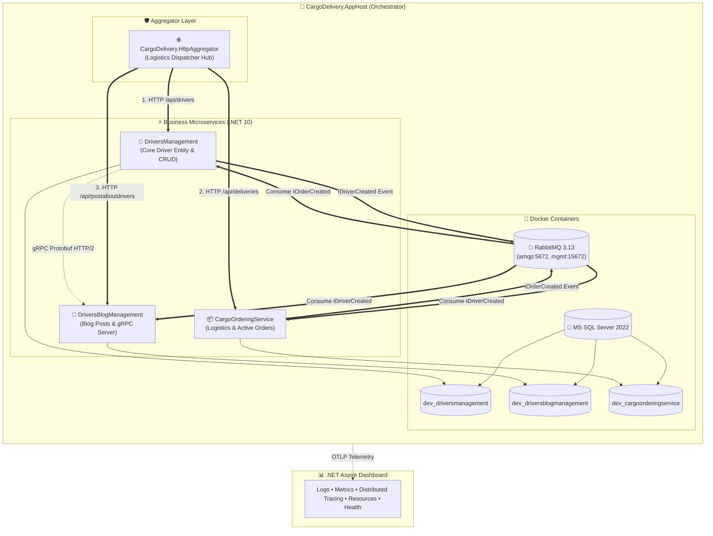
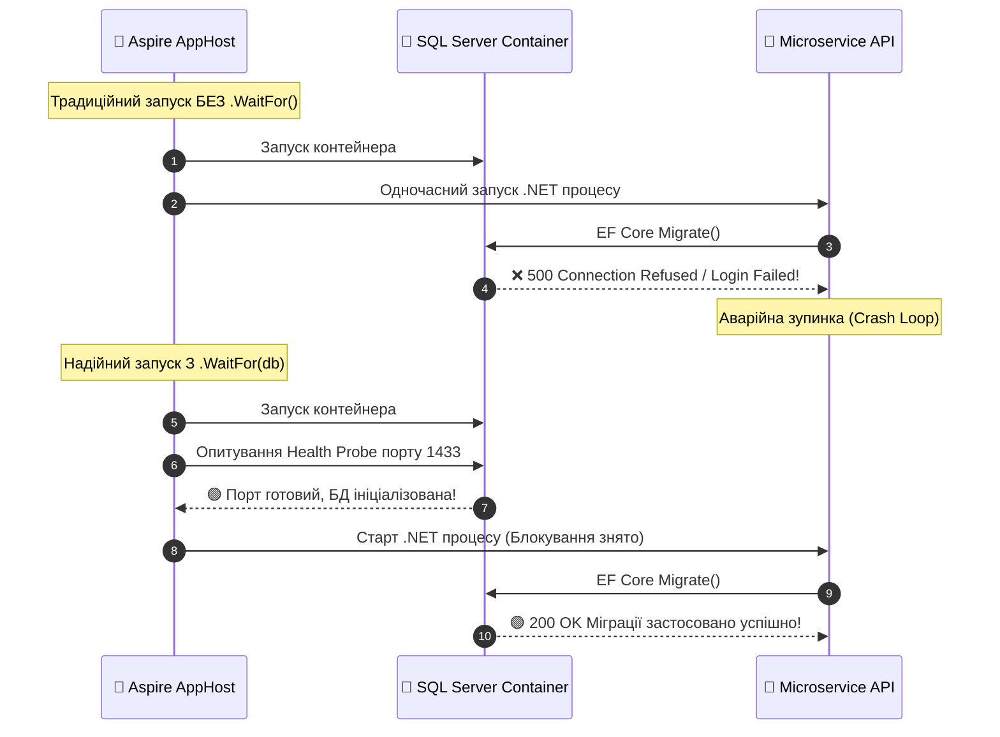

# 🎯 01. Оркестрація розподіленої системи: .NET 10 Aspire AppHost Deep Dive

> **Розділ:** `02-Microservices-Craftsman` • **Модуль:** `02-01-Aspire-Documentation`  
> **Стек:** .NET 10, .NET Aspire 13, `Aspire.Hosting.RabbitMQ`, `Aspire.Hosting.SqlServer`, Docker Desktop / Podman.  
> **Офіційна документація Microsoft:** [.NET Aspire AppHost and Orchestration Overview](https://learn.microsoft.com/dotnet/aspire/fundamentals/app-host)

---

## 📑 Зміст модуля

- [Слайд 1. Концепція AppHost: C# як мова інфраструктури замість YAML-конфігів](#slide-1)
- [Слайд 2. Архітектурна топологія системи: Контейнери, БД та 4 мікросервіси](#slide-2)
- [Слайд 3. Анатомія проєкту CargoDelivery.AppHost: Розбір коду Program.cs](#slide-3)
- [Слайд 4. Декларативне керування контейнерами: RabbitMQ та MS SQL Server 2022](#slide-4)
- [Слайд 5. Патерн .WaitFor(): Усунення Race Conditions при старті розподіленої системи](#slide-5)
- [Слайд 6. Інтеграція нового Gateway Aggregator (CargoDelivery.HttpAggregator)](#slide-6)
- [Слайд 7. Інжекція Connection Strings та Service Discovery з AppHost](#slide-7)
- [Слайд 8. Чек-лист та практичні команди запуску](#slide-8)

---

<a id="slide-1"></a>
### 🎬 Слайд 1. Концепція AppHost: C# як мова інфраструктури замість YAML-конфігів

#### 1. Проблема: Крихкість традиційного Docker Compose
У класичному підході до розробки мікросервісів розробники змушені писати великі файли `docker-compose.yaml`:
* **Відсутність типізації:** Помилка в одній літері змінної оточення (`ConnecitonStrings__db`) виявляється лише під час виконання у вигляді `NullReferenceException`.
* **Жорсткі порти (Port Collisions):** Якщо сервіс A займає порт 5001, а розробник локально вже запустив інший застосунок, запуск падає з `Address already in use`.
* **Відсутність рефакторингу:** При перейменуванні проєкту в рішенні Docker Compose не оновлюється автоматично.

#### 2. Рішення: .NET Aspire AppHost
`CargoDelivery.AppHost` — це звичайний консольний проєкт C# (`net10.0`), який використовує `Aspire.AppHost.Sdk`. Він описує топологію всієї розподіленої системи типізованим кодом:
* **Compile-Time перевірка:** Будь-яка помилка в назвах проєктів чи залежностей виявляється компілятором Roslyn ще до запуску.
* **Динамічний вибір портів:** Aspire автоматично виділяє вільні порти для сервісів та прокидає їх через Service Discovery.
* **Єдина точка F5:** Одне натискання `F5` у Visual Studio або `dotnet run --project CargoDelivery.AppHost` піднімає Docker-контейнери, створює бази даних, застосовує змінні оточення та відкриває Aspire Dashboard.

---

<a id="slide-2"></a>
### 🗺️ Слайд 2. Архітектурна топологія системи: Контейнери, БД та 4 мікросервіси

Топологія оркестрації `Demo-CargoDeliveryService` об'єднує інфраструктурні ресурси та чотири незалежні .NET 10 мікросервіси:



---

<a id="slide-3"></a>
### 🔍 Слайд 3. Анатомія проєкту CargoDelivery.AppHost: Розбір коду Program.cs

> 📍 **Вихідний файл у рішенні:**  
> [AppHost.cs](file:///c:/Users/Yurii/source/repos/Demo-CargoDeliveryService/02-Microservices-Craftsman/Aspire/CargoDelivery.AppHost/AppHost.cs)

Код оркестратора лаконічний, типізований та повністю декларативний:

```csharp
var builder = DistributedApplication.CreateBuilder(args);

// 1. Інфраструктура черг повідомлень RabbitMQ
var rabbitmq = builder.AddRabbitMQ("rabbitmq")
    .WithManagementPlugin();

// 2. Інфраструктура баз даних MS SQL Server 2022
var sqlserver = builder.AddSqlServer("sqlserver");
var driversDb = sqlserver.AddDatabase("DriversManagement", "dev_driversmanagement");
var blogDb = sqlserver.AddDatabase("DriversBlogManagement", "dev_driversblogmanagement");
var cargoDb = sqlserver.AddDatabase("CargoOrderingService", "dev_cargoorderingservice");

// 3. Сервіс замовлень
var cargoApi = builder.AddProject<Projects.CargoOrderingService>("cargoorderingservice")
    .WithReference(cargoDb)
    .WithReference(rabbitmq)
    .WaitFor(cargoDb)
    .WaitFor(rabbitmq);

// 4. Сервіс блогу водіїв
var blogApi = builder.AddProject<Projects.DriversBlogManagement>("driversblogmanagement")
    .WithReference(blogDb)
    .WithReference(rabbitmq)
    .WaitFor(blogDb)
    .WaitFor(rabbitmq);

// 5. Сервіс управління водіями
var driversApi = builder.AddProject<Projects.DriversManagement>("driversmanagement")
    .WithReference(driversDb)
    .WithReference(rabbitmq)
    .WithReference(blogApi)
    .WithReference(cargoApi)
    .WaitFor(driversDb)
    .WaitFor(rabbitmq)
    .WaitFor(blogApi)
    .WaitFor(cargoApi);

// 6. Новий виділений Gateway Aggregator
var httpAggregator = builder.AddProject<Projects.CargoDelivery_HttpAggregator>("httpaggregator")
    .WithReference(driversApi)
    .WithReference(cargoApi)
    .WithReference(blogApi)
    .WaitFor(driversApi)
    .WaitFor(cargoApi)
    .WaitFor(blogApi);

builder.Build().Run();
```

---

<a id="slide-4"></a>
### 🐰 Слайд 4. Декларативне керування контейнерами: RabbitMQ та MS SQL Server 2022

#### 1. RabbitMQ з Management UI
```csharp
var rabbitmq = builder.AddRabbitMQ("rabbitmq")
    .WithManagementPlugin();
```
* **Що робить Aspire:** Завантажує офіційний Docker-образ `rabbitmq:3-management`.
* **Мережеві порти:**
  * Порт `5672` (AMQP 0-9-1) — для передачі бінарних фреймів MassTransit.
  * Порт `15672` (HTTP) — вебінтерфейс черг RabbitMQ Management.
* **Автоматична змінна:** Усім залежним сервісам передається змінна `ConnectionStrings__rabbitmq`.

#### 2. MS SQL Server та Database-per-Microservice
```csharp
var sqlserver = builder.AddSqlServer("sqlserver");
var driversDb = sqlserver.AddDatabase("DriversManagement", "dev_driversmanagement");
var blogDb = sqlserver.AddDatabase("DriversBlogManagement", "dev_driversblogmanagement");
var cargoDb = sqlserver.AddDatabase("CargoOrderingService", "dev_cargoorderingservice");
```
* **Ізоляція доменів:** Кожен Bounded Context володіє власною базою даних (`dev_driversmanagement`, `dev_driversblogmanagement`, `dev_cargoorderingservice`).
* **Безпека:** Мікросервіси фізично не мають спільного доступу до чужих таблиць, унеможливлюючи несанкціоновані прямі SQL JOIN.

---

<a id="slide-5"></a>
### ⏳ Слайд 5. Патерн .WaitFor(): Усунення Race Conditions при старті розподіленої системи

#### Проблема класичного старту ("Connection Refused")
Коли Docker запускає контейнер SQL Server або RabbitMQ, процес ОС стартує за 1 секунду, але сам SQL Server ініціалізує системні файли та транзакційні журнали ще 10-15 секунд. У цей час .NET-сервіс, стартувавши паралельно, виконує `DbContext.Database.Migrate()` і негайно падає з фатальною помилкою:
> `Microsoft.Data.SqlClient.SqlException: Cannot open database requested by the login.`



#### Як працює `.WaitFor()` у коді AppHost
Метод `.WaitFor(resource)` блокує старт залежного проєкту на рівні планувальника Aspire:
1. Aspire чекає, поки цільовий ресурс перейде в стан `Running` і його зонди готовності (Health Checks) повернуть статус `Healthy`.
2. Лише після цього запускається процес `.NET API`.
3. У результаті старт системи стає 100% передбачуваним та стабільним.

---

<a id="slide-6"></a>
### 🛡️ Слайд 6. Інтеграція нового Gateway Aggregator (CargoDelivery.HttpAggregator)

Для чистої та ізольованої демонстрації HTTP-агрегації та можливостей Aspire створено окремий мікросервіс:
> 📍 **Проєкт агрегатора:**  
> [CargoDelivery.HttpAggregator.csproj](file:///c:/Users/Yurii/source/repos/Demo-CargoDeliveryService/02-Microservices-Craftsman/CargoDelivery.HttpAggregator/CargoDelivery.HttpAggregator.csproj)

В `AppHost.cs` агрегатор підключається як фінальна ланка в ланцюгу залежностей:

```csharp
var httpAggregator = builder.AddProject<Projects.CargoDelivery_HttpAggregator>("httpaggregator")
    .WithReference(driversApi)
    .WithReference(cargoApi)
    .WithReference(blogApi)
    .WaitFor(driversApi)
    .WaitFor(cargoApi)
    .WaitFor(blogApi);
```

#### Що дає `WithReference()`:
1. Додає посилання в граф Aspire Dashboard: видно, що агрегатор залежить від 3 API.
2. Автоматично впроваджує в агрегатор конфігураційні змінні Service Discovery:
   * `services__driversmanagement__http__0`
   * `services__cargoorderingservice__http__0`
   * `services__driversblogmanagement__http__0`
3. Дозволяє клієнтам `HttpClient` в агрегаторі використовувати прості імена `http://driversmanagement` без хардкоду портів!

---

<a id="slide-7"></a>
### 🔌 Слайд 7. Інжекція Connection Strings та Service Discovery з AppHost

Коли `AppHost` стартує ваші проєкти, він формує віртуальне середовище оточення:

| Конфігураційний ключ у сервісі | Звідки генерується в AppHost | Призначення |
| :--- | :--- | :--- |
| `ConnectionStrings__rabbitmq` | `builder.AddRabbitMQ("rabbitmq")` | Рядок підключення до брокера для MassTransit |
| `ConnectionStrings__DriversManagement` | `sqlserver.AddDatabase("DriversManagement")` | Рядок підключення EF Core до БД водіїв |
| `services__cargoorderingservice__http__0` | `builder.AddProject<CargoOrderingService>()` | URL ендпоінту для Service Discovery |
| `OTEL_EXPORTER_OTLP_ENDPOINT` | Вбудований OTLP Receiver у Dashboard | Адреса експорту трейсів, логів та метрик |

---

<a id="slide-8"></a>
### 🚀 Слайд 8. Чек-лист та практичні команди запуску

1. **Запуск через Visual Studio:**
   * Встановіть `CargoDelivery.AppHost` як стартовий проєкт (*Set as Startup Project*).
   * Натисніть **F5** або **Ctrl+F5**.
   * Автоматично відкриється браузер з **Aspire Dashboard**.

2. **Запуск через консоль:**
   ```powershell
   dotnet run --project 02-Microservices-Craftsman/Aspire/CargoDelivery.AppHost/CargoDelivery.AppHost.csproj
   ```

3. **Що перевірити в Aspire Dashboard:**
   * Вкладка **Resources**: Всі 6 ресурсів (`sqlserver`, `rabbitmq`, `driversmanagement`, `cargoorderingservice`, `driversblogmanagement`, `httpaggregator`) мають статус **Running**.
   * Натисніть на посилання ендпоінту `httpaggregator` та відкрийте `api/v1/shipment-summary/{id}` або `health`.
