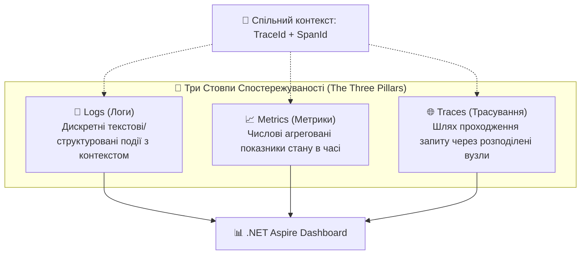
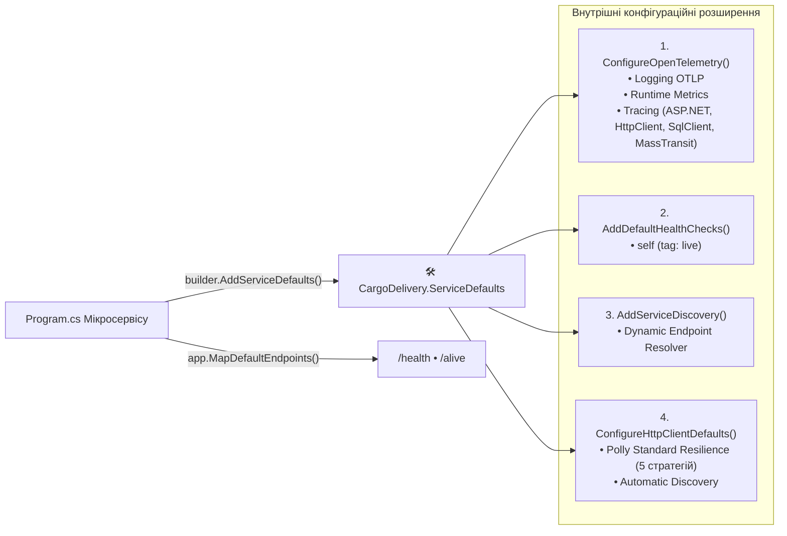
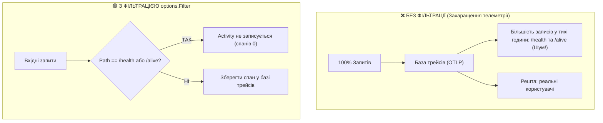
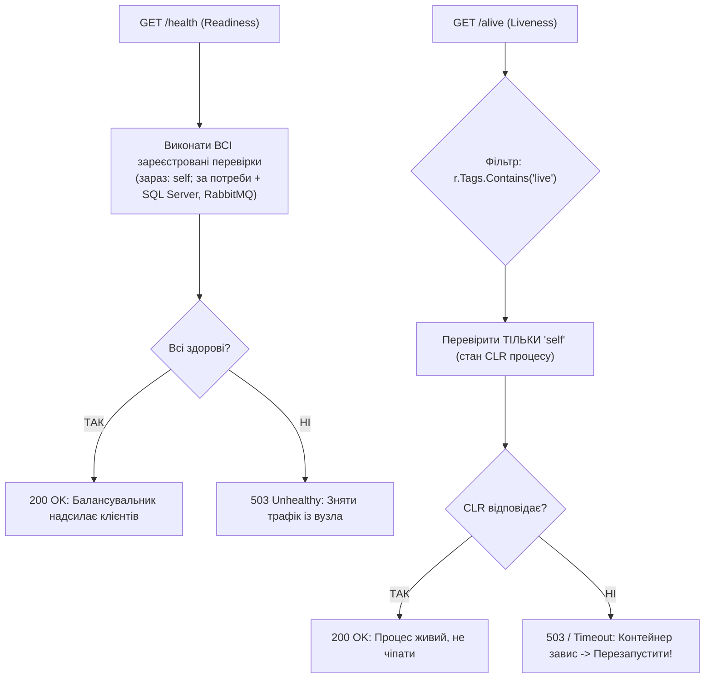

# 🛠️ 02. Анатомія ServiceDefaults: Архітектура Спільних Стандартів та Параметризація

> **Розділ:** `02-Microservices-Craftsman` • **Модуль:** `02-01-Aspire-Documentation`  
> **Роль матеріалу:** Поглиблене керівництво з проєктування крос-сервісних стандартів спостережуваності (Observability), надійності та системної діагностики.  
> **Стек:** .NET 10, OpenTelemetry .NET SDK 1.19 (+ SqlClient instrumentation), `Microsoft.Extensions.Http.Resilience` (Polly v8), `Microsoft.Extensions.Diagnostics.HealthChecks`, `Microsoft.Extensions.ServiceDiscovery`.  
> **Офіційна специфікація Microsoft:** [.NET Aspire Service Defaults Architecture](https://learn.microsoft.com/dotnet/aspire/fundamentals/service-defaults)

---

## 📑 Зміст Архітектурного Модуля

- [1. Теоретичний базис: Наскрізна функціональність (Cross-Cutting Concerns) та 12-Factor App](#section-1)
- [2. Три стовпи спостережуваності (Observability): Traces, Metrics та Logs](#section-2)
- [3. Архітектурне місце ServiceDefaults у конвеєрі ASP.NET Core](#section-3)
- [4. Повний розбір вихідного коду Extensions.cs: Блок за блоком](#section-4)
- [5. Деконструкція ConfigureOpenTelemetry: Параметри, джерела та фільтрація шумів](#section-5)
- [6. Проблема кардинальності та відсікання псевдо-трафіку Health Checks](#section-6)
- [7. Інтелектуальний OTLP Експортер: Гібридний Fallback для юніт-тестів](#section-7)
- [8. Система діагностичних зондів: Розподіл за тегами 'live' та 'ready'](#section-8)
- [9. Глобальний тюнінг HttpClient: Polly Resilience та Service Discovery](#section-9)
- [10. Інженерна матриця параметризації: Development vs High-Throughput Production](#section-10)
- [11. Як ServiceDefaults підключено в кожному сервісі (і пастка з Serilog)](#section-11)
- [12. Контрольні запитання та практичні завдання](#section-12)

---

<a id="section-1"></a>
## 1. Теоретичний базис: Наскрізна функціональність (Cross-Cutting Concerns) та 12-Factor App

У розподіленій системі бізнес-код кожного мікросервісу повинен фокусуватися виключно на своєму Bounded Context (водії, замовлення, блог). Проте кожен сервіс одночасно повинен вирішувати однакові системні задачі, які називаються **Наскрізною функціональністю (Cross-Cutting Concerns)**:
1. Збір та експорт телеметрії єдиним протоколом.
2. Діагностика працездатності для оркестратора (Health Checks).
3. Динамічне перетворення імен мережевих ресурсів (Service Discovery).
4. Захист вихідних мережевих сокетів від зависання та збоїв (Resilience).

Якщо кожна команда налаштує це «по-своєму», ми отримаємо 4 різні формати логів, 4 різні політики повторів і неможливість зіставити трейси між сервісами. ServiceDefaults — це реалізація принципу **«Paved Road» (протоптана доріжка)**: платформа пропонує один перевірений спосіб, і кожен сервіс отримує його одним рядком коду.

Згідно з методологією **The Twelve-Factor App** (розділи IV — Backing Services, IX — Disposability, XI — Logs):
> *"Застосунок не повинен займатися управлінням чи збереженням власних логів. Кожен запущений процес повинен писати небуферизований потік подій у стандартний вивід або передавати через структурований агент збору."*

Якщо в моноліті логи писалися у локальні текстові файли на диск (`logs/app.txt`), то в контейнеризованій системі диск є ефемерним (тимчасовим). Будь-який перезапуск контейнера знищує файли. Тому стандарт **ServiceDefaults** переводить усі мікросервіси на єдиний OTLP-конвеєр (OpenTelemetry Protocol).

| Фактор 12-Factor App | Як його реалізує ServiceDefaults / Aspire |
| :--- | :--- |
| III. Config (конфігурація в середовищі) | Адреси, рядки підключення, OTLP-ендпоінт приходять змінними середовища від AppHost |
| IV. Backing Services (зовнішні ресурси як підключувані) | БД і брокер — ресурси, які можна підмінити без зміни коду (інший рядок підключення) |
| IX. Disposability (швидкий старт / коректна зупинка) | Зонди `/alive` і `/health` дають оркестратору знати, коли процес можна вбити або вже можна слати трафік |
| XI. Logs (логи як потік подій) | Логи не пишуться у файли — вони йдуть потоком через OTLP у колектор (Aspire Dashboard) |

---

<a id="section-2"></a>
## 2. Три стовпи спостережуваності (Observability): Traces, Metrics та Logs

Сучасна спостережуваність спирається на три взаємопов'язані типи даних:



1. **Структуровані логи (Structured Logs):** Не просто текст `"Водія знайдено"`, а пара ключ-значення `{"Event": "DriverFound", "DriverId": "3fa85f64...", "TraceId": "4bf92f35..."}`.
2. **Метрики (Metrics):** Лічильники (Counters), гістограми (Histograms) та шкали (Gauges), які відображають затримки HTTP, використання пам'яті CLR GC, розміри черг. Метрики **дешеві** (агрегуються в пам'яті), тому їх збирають завжди.
3. **Розподілені трейси (Distributed Traces):** Ланцюжок спанів (Spans), що показує точний час перебування запиту в кожному мікросервісі.

### Як три стовпи працюють разом при розслідуванні інциденту
1. **Метрики** кажуть *що* сталося: «p95 латентність `httpaggregator` зросла з 0.5 с до 3 с».
2. **Трейси** кажуть *де*: «час іде на виклик `GET api/internal/postaboutdrivers`, спан чекає 1 с і падає з таймаутом».
3. **Логи** кажуть *чому*: «`Мікросервіс DriversBlogManagement недоступний. Застосовано Graceful Degradation`» — з тим самим `TraceId`, тож у дашборді можна перейти з трейсу до логів одним кліком.

> 💡 Зв'язок між стовпами тримається на `TraceId`. Метрики з ним пов'язуються через **exemplars** — вибіркові точки, що несуть TraceId конкретного запиту (Aspire вмикає їх змінною `OTEL_METRICS_EXEMPLAR_FILTER`).

---

<a id="section-3"></a>
## 3. Архітектурне місце ServiceDefaults у конвеєрі ASP.NET Core

Проєкт `CargoDelivery.ServiceDefaults` є спільною бібліотекою (у `.csproj` позначена як `<IsAspireSharedProject>true</IsAspireSharedProject>` — [csproj#L7](../Aspire/CargoDelivery.ServiceDefaults/CargoDelivery.ServiceDefaults.csproj#L7)), яка розширює стандартний інтерфейс `IHostApplicationBuilder`:



Важливо розрізняти **два етапи** життя ASP.NET Core застосунку:
* **Реєстрація сервісів (до `builder.Build()`):** `AddServiceDefaults()` лише *додає* реєстрації в DI-контейнер.
* **Побудова конвеєра (після `Build()`):** `MapDefaultEndpoints()` *мапить* HTTP-маршрути `/health` та `/alive`. Тому в кожному `Program.cs` є обидва виклики.

---

<a id="section-4"></a>
## 4. Повний розбір вихідного коду Extensions.cs: Блок за блоком

> 📍 **Вихідний файл у рішенні:**  
> [Extensions.cs](../Aspire/CargoDelivery.ServiceDefaults/Extensions.cs) — кожен метод має розгорнутий XML-коментар українською.

| Метод | Рядок | Призначення |
| :--- | :--- | :--- |
| `AddServiceDefaults` | [#L56](../Aspire/CargoDelivery.ServiceDefaults/Extensions.cs#L56) | Точка входу: викликає всі інші методи |
| `ConfigureOpenTelemetry` | [#L132](../Aspire/CargoDelivery.ServiceDefaults/Extensions.cs#L132) | Логи, метрики, трейси |
| `AddOpenTelemetryExporters` | [#L185](../Aspire/CargoDelivery.ServiceDefaults/Extensions.cs#L185) | Умовне підключення OTLP-експортера |
| `AddDefaultHealthChecks` | [#L214](../Aspire/CargoDelivery.ServiceDefaults/Extensions.cs#L214) | Перевірка `self` з тегом `live` |
| `MapDefaultEndpoints` | [#L248](../Aspire/CargoDelivery.ServiceDefaults/Extensions.cs#L248) | Маршрути `/health` та `/alive` |

### 4.1. Дженерик-обмеження `IHostApplicationBuilder`
```csharp
public static class Extensions
{
    private const string HealthEndpointPath = "/health";
    private const string AlivenessEndpointPath = "/alive";

    public static TBuilder AddServiceDefaults<TBuilder>(this TBuilder builder) 
        where TBuilder : IHostApplicationBuilder
    {
        builder.ConfigureOpenTelemetry();
        builder.AddDefaultHealthChecks();
        builder.Services.AddServiceDiscovery();

        builder.Services.ConfigureHttpClientDefaults(http =>
        {
            http.AddStandardResilienceHandler();
            http.AddServiceDiscovery();
        });

        return builder;
    }
    // ...
}
```

#### Чому застосовано патерн `where TBuilder : IHostApplicationBuilder`?
У .NET 8/9/10 `IHostApplicationBuilder` — це уніфікований інтерфейс, який реалізують:
* `WebApplicationBuilder` — для класичних REST/gRPC мікросервісів (усі наші 4 сервіси).
* `HostApplicationBuilder` — для консольних фонових воркерів (Background Services, що слухають лише черги RabbitMQ без відкриття веб-портів).

Завдяки цьому методу конфігурація стає **поліморфною**: одна й та сама збірка `ServiceDefaults` підключається як до веб-API, так і до фонового обробника подій! Повернення того самого `TBuilder` (а не `IHostApplicationBuilder`) зберігає fluent-ланцюжок: після `AddServiceDefaults()` у вас і далі `WebApplicationBuilder` з усіма його методами.

> ℹ️ **AppHost не використовує ServiceDefaults.** `IDistributedApplicationBuilder` (білдер AppHost) — окремий інтерфейс, і AppHost не посилається на цей проєкт. ServiceDefaults підключають лише **сервіси**, якими AppHost керує.

---

<a id="section-5"></a>
## 5. Деконструкція ConfigureOpenTelemetry: Параметри, джерела та фільтрація шумів

Розглянемо найскладніший блок конфігурації ([Extensions.cs#L132](../Aspire/CargoDelivery.ServiceDefaults/Extensions.cs#L132)):

```csharp
public static TBuilder ConfigureOpenTelemetry<TBuilder>(this TBuilder builder) 
    where TBuilder : IHostApplicationBuilder
{
    // 1. НАЛАШТУВАННЯ ЛОГУВАННЯ
    builder.Logging.AddOpenTelemetry(logging =>
    {
        logging.IncludeFormattedMessage = true;
        logging.IncludeScopes = true;
    });

    // 2. НАЛАШТУВАННЯ МЕТРИК
    builder.Services.AddOpenTelemetry()
        .WithMetrics(metrics =>
        {
            metrics.AddAspNetCoreInstrumentation()
                   .AddHttpClientInstrumentation()
                   .AddRuntimeInstrumentation();
        })
        // 3. НАЛАШТУВАННЯ ТРАСУВАННЯ
        .WithTracing(tracing =>
        {
            tracing.AddSource(builder.Environment.ApplicationName)
                   .AddSource("MassTransit")
                   .AddAspNetCoreInstrumentation(options =>
                   {
                       options.Filter = context =>
                           !context.Request.Path.StartsWithSegments(HealthEndpointPath)
                           && !context.Request.Path.StartsWithSegments(AlivenessEndpointPath);
                   })
                   .AddHttpClientInstrumentation()
                   .AddSqlClientInstrumentation();
        });

    builder.AddOpenTelemetryExporters();
    return builder;
}
```

### Детальний розбір параметрів:

#### 1. `logging.IncludeFormattedMessage = true` ([#L136](../Aspire/CargoDelivery.ServiceDefaults/Extensions.cs#L136))
* **Що означає:** Дозволяє зберігати у вихідному OTLP-пакеті не лише шаблон рядка `LogInformation("Driver {Id}", id)`, а й готовий згенерований рядок `"Driver 123"`.
* **Інженерний компроміс:** Спрощує читання логів людиною в Aspire Dashboard, проте збільшує розмір логу на $20-30\%$. У критично високонавантажених системах можна встановити `false`, щоб рядок формувався на стороні сервера логів із шаблону та параметрів.

#### 2. `logging.IncludeScopes = true`
* **Що означає:** Включає контекстні області `ILogger.BeginScope(...)` як атрибути запису.
* **Навіщо це:** ASP.NET Core, MassTransit і ваш власний код відкривають скоупи з корисними даними (`RequestPath`, `MessageId`, `ConversationId`, власні бізнес-ключі). З `IncludeScopes = true` ці дані потрапляють у кожен запис і за ними можна фільтрувати в дашборді.
* **Уточнення про TraceId:** `TraceId` і `SpanId` OTel-провайдер додає до запису з поточної `Activity` **незалежно** від цього параметра — саме тому з будь-якого логу в Structured Logs можна перейти до трейсу.

#### 3. `metrics.AddRuntimeInstrumentation()` ([#L145](../Aspire/CargoDelivery.ServiceDefaults/Extensions.cs#L145))
* **Що збирає:** Вбудований інструментарій збирає глибинні показники віртуальної машини CLR (у .NET 9+ це вбудований `Meter` `System.Runtime`):
  * Частоту збірок сміття `dotnet.gc.collections` (Gen 0, Gen 1, Gen 2).
  * Час паузи під час зупинки світу: `dotnet.gc.pause.time`.
  * Використання оперативної пам'яті: `dotnet.process.memory.working_set`.
  * Стан черги завдань пулу потоків: `dotnet.thread_pool.queue.length`.

#### 4. `tracing.AddSource(...)` та інструментації ([#L149](../Aspire/CargoDelivery.ServiceDefaults/Extensions.cs#L149))
| Рядок конфігурації | Що з'являється в трейсі |
| :--- | :--- |
| `AddSource(builder.Environment.ApplicationName)` | Власні спани сервісу, створені через `new ActivitySource("DriversManagement").StartActivity(...)` |
| `AddSource("MassTransit")` | Спани `send driver-created`, `ordering-sync-driver receive/process` — публікація та споживання повідомлень RabbitMQ |
| `AddAspNetCoreInstrumentation()` | Серверний спан на кожен вхідний HTTP/gRPC-запит (`GET api/drivers/{id}`) |
| `AddHttpClientInstrumentation()` | Клієнтський спан на кожен вихідний `HttpClient`-виклик + автоматичний заголовок `traceparent` |
| `AddSqlClientInstrumentation()` | Спан на кожен SQL-запит EF Core / ADO.NET до SQL Server (`Microsoft.Data.SqlClient`) |

> ⚠️ **Типова пастка:** раніше тут стояв рядок `AddSource("Microsoft.EntityFrameworkCore.SqlServer")`. Такого `ActivitySource` **не існує** — EF Core не створює спанів сам по собі, тому SQL-запитів у трейсах не було видно. `AddSource` лише *підписується* на джерело за іменем і мовчки нічого не робить, якщо джерела немає. Правильний спосіб — пакет інструментації `OpenTelemetry.Instrumentation.SqlClient` ([csproj#L20](../Aspire/CargoDelivery.ServiceDefaults/CargoDelivery.ServiceDefaults.csproj#L20)), який слухає діагностичні події `Microsoft.Data.SqlClient`.

---

<a id="section-6"></a>
## 6. Проблема кардинальності та відсікання псевдо-трафіку Health Checks

Уважно розглянемо рядок фільтрації ([Extensions.cs#L154](../Aspire/CargoDelivery.ServiceDefaults/Extensions.cs#L154)):
```csharp
options.Filter = context =>
    !context.Request.Path.StartsWithSegments(HealthEndpointPath)
    && !context.Request.Path.StartsWithSegments(AlivenessEndpointPath);
```

### Математика проблеми «шумового» трафіку
Оркестратор опитує зонди регулярно: Kubernetes за замовчуванням — кожні 10 секунд на кожен зонд (`periodSeconds: 10`), Aspire опитує `/health` кожні кілька секунд. Візьмемо консервативні 10 секунд і два зонди:

$$\text{Запитів від одного сервісу за добу} = \frac{86400\text{ с}}{10\text{ с}} \times 2\text{ зонди} = 17\,280\text{ запитів}$$

Для 4 мікросервісів системи це становить:
$$17\,280 \times 4 = 69\,120\text{ штучних трейсів на добу}$$

…а для 50 сервісів по 3 репліки — понад **2.5 млн** порожніх трейсів щодня. Кожен трейс займає місце в сховищі, коштує грошей у SaaS-моніторингу і «закопує» реальні запити користувачів.



Якщо не встановити `options.Filter`, у тихі години база трейсів буде переважно заповнена беззмістовними перевірками здоров'я, що ускладнить пошук реальних бізнес-помилок користувачів.

> 🔎 **Що фільтр НЕ прибирає.** `options.Filter` стосується лише **трейсів**. У Craftsman-сервісах Serilog ще й логує кожен HTTP-запит (`app.UseSerilogRequestLogging()`), тому у вкладці *Structured logs* ви побачите рядки `HTTP "GET" "/health" responded 200`. Щоб прибрати і їх, у Serilog налаштовують `GetLevel` для шляхів `/health` / `/alive` (наприклад, рівень `Verbose`) або фільтр `Filter.ByExcluding(...)`.

> 💡 **Кардинальність у вузькому сенсі** — це кількість унікальних комбінацій значень атрибутів метрики. Саме тому інструментація ASP.NET Core пише в атрибут `http.route` шаблон маршруту (`api/drivers/{id}`), а не реальний шлях з GUID — інакше кожен водій створював би новий часовий ряд.

---

<a id="section-7"></a>
## 7. Інтелектуальний OTLP Експортер: Гібридний Fallback для юніт-тестів

```csharp
private static TBuilder AddOpenTelemetryExporters<TBuilder>(this TBuilder builder) 
    where TBuilder : IHostApplicationBuilder
{
    var useOtlpExporter = !string.IsNullOrWhiteSpace(builder.Configuration["OTEL_EXPORTER_OTLP_ENDPOINT"]);

    if (useOtlpExporter)
    {
        builder.Services.AddOpenTelemetry().UseOtlpExporter();
    }

    return builder;
}
```
> 📍 [Extensions.cs#L185](../Aspire/CargoDelivery.ServiceDefaults/Extensions.cs#L185)

### Принцип роботи захисного механізму:
1. **Режим оркестрації Aspire:** AppHost автоматично встановлює змінні `OTEL_EXPORTER_OTLP_ENDPOINT` (у нашому стенді — `https://localhost:21114`, див. [launchSettings.json AppHost#L12](../Aspire/CargoDelivery.AppHost/Properties/launchSettings.json#L12)), `OTEL_EXPORTER_OTLP_PROTOCOL` та `OTEL_EXPORTER_OTLP_HEADERS` (API-ключ дашборду). Умова виконується, і сервіс починає передавати OTLP-пакети в дашборд. `UseOtlpExporter()` одним викликом вмикає експорт **усіх трьох** сигналів і сам читає ці змінні.
2. **Режим автоматизованого тестування (xUnit / WebApplicationFactory):** Змінна відсутня. Якби ми жорстко викликали `UseOtlpExporter()`, кожен тест намагався б відправляти телеметрію на дефолтну адресу `localhost:4317`, засмічуючи вивід помилками з'єднання та сповільнюючи завершення процесу.
3. Завдяки цій перевірці наші тести в проєкті `CargoDelivery.HttpAggregator.Tests` виконуються миттєво та без жодного мережевого шуму ([HttpAggregatorEndpointTests.cs](../CargoDelivery.HttpAggregator.Tests/FunctionalTests/HttpAggregatorEndpointTests.cs)).

> 🧭 **Принцип «експортер — це конфігурація, а не код».** Код сервісу ніде не згадує Aspire Dashboard. Зміна однієї змінної середовища перенаправить телеметрію в OpenTelemetry Collector, Grafana Tempo/Loki, Jaeger (він давно приймає OTLP) чи Azure Monitor.

---

<a id="section-8"></a>
## 8. Система діагностичних зондів: Розподіл за тегами 'live' та 'ready'

```csharp
public static TBuilder AddDefaultHealthChecks<TBuilder>(this TBuilder builder) 
    where TBuilder : IHostApplicationBuilder
{
    builder.Services.AddHealthChecks()
        .AddCheck("self", () => HealthCheckResult.Healthy(), ["live"]);

    return builder;
}

public static WebApplication MapDefaultEndpoints(this WebApplication app)
{
    if (app.Environment.IsDevelopment())
    {
        // 1. READINESS: Всі зареєстровані перевірки
        app.MapHealthChecks(HealthEndpointPath);

        // 2. LIVENESS: Тільки перевірки з тегом "live"
        app.MapHealthChecks(AlivenessEndpointPath, new HealthCheckOptions
        {
            Predicate = r => r.Tags.Contains("live")
        });
    }

    return app;
}
```
> 📍 [Extensions.cs#L214](../Aspire/CargoDelivery.ServiceDefaults/Extensions.cs#L214) (реєстрація) • [Extensions.cs#L248](../Aspire/CargoDelivery.ServiceDefaults/Extensions.cs#L248) (маршрути)



> ⚖️ **Чесна примітка про поточний стан.** Зараз у всіх сервісах зареєстрована лише перевірка `self`, тому `/health` і `/alive` фактично перевіряють одне й те саме. Різниця з'явиться, щойно ви додасте перевірки залежностей без тегу `live` (див. [гайд 05, §6](05_HealthChecks_Probes_Liveness_Readiness.md#section-6)) — вони автоматично потраплять у `/health`, але не в `/alive`. Саме так і має бути.

---

<a id="section-9"></a>
## 9. Глобальний тюнінг HttpClient: Polly Resilience та Service Discovery

У файлі `Extensions.cs` блок ([#L73](../Aspire/CargoDelivery.ServiceDefaults/Extensions.cs#L73)):
```csharp
builder.Services.ConfigureHttpClientDefaults(http =>
{
    http.AddStandardResilienceHandler();
    http.AddServiceDiscovery();
});
```
Забезпечує такі гарантії:
1. **Глобальність:** Будь-який клієнт, створений через `IHttpClientFactory` — типізований (`AddHttpClient<TClient, TImpl>()`), іменований (`AddHttpClient("name")`) **і навіть gRPC-клієнт** (`AddGrpcClient<T>()`, бо він теж будується фабрикою) — автоматично успадковує ці налаштування.
2. **Service Discovery:** Дозволяє писати `client.BaseAddress = new Uri("https+http://cargoorderingservice")` без попереднього налаштування DNS.
3. **Resilience Handler:** Захищає сокети конвеєром з 5 стратегій (детально розглянуто в модулі [`06`](06_ServiceDiscovery_Resilience_Polly_HttpClient.md)).

### Правила роботи з глобальними налаштуваннями
| Ситуація | Як правильно | Як неправильно |
| :--- | :--- | :--- |
| Клієнту достатньо стандартних параметрів | Нічого не робити — все вже налаштовано глобально | Дописувати `.AddStandardResilienceHandler()` ще раз: конвеєри **вкладуться** один в одного, і 4 спроби × 4 спроби = до 16 реальних запитів |
| Клієнту потрібні інші параметри (короткий таймаут для некритичного сервісу) | `.RemoveAllResilienceHandlers().AddStandardResilienceHandler(o => …)` — див. [агрегатор Program.cs#L78](../CargoDelivery.HttpAggregator/Program.cs#L78) | Налаштовувати `HttpClient.Timeout` — стандартний конвеєр його ігнорує й керує таймаутами сам |

> 🐞 Саме подвійне підключення було в агрегаторі та BFF до виправлення: при недоступному сервісі кожен запит висів рівно 30 секунд (весь бюджет `TotalRequestTimeout`), а в логах видно було каскад вкладених повторів.

---

<a id="section-10"></a>
## 10. Інженерна матриця параметризації: Development vs High-Throughput Production

| Компонент / Опція | Значення у Development (ServiceDefaults) | Значення у High-Load Production ($>10\,000\text{ rps}$) | Інженерне обґрунтування різниці |
| :--- | :--- | :--- | :--- |
| **OpenTelemetry Sampling** | Без семплера (у дев-режимі Aspire задає `OTEL_TRACES_SAMPLER=always_on` — 100% трейсів) | `new ParentBasedSampler(new TraceIdRatioBasedSampler(0.01))` (1% трейсів) | Запобігання вичерпанню сховища телеметрії при мільйонах запитів на секунду |
| **IncludeFormattedMessage** | `true` | `false` | Усуває зайві алокації рядків у купі керованої пам'яті (GC) |
| **Total Request Timeout** | 30 секунд | 5–8 секунд | Зменшує час блокування клієнтських сокетів при мережевих аваріях |
| **Retry Attempt Count** | 3 спроби | 1–2 спроби | Запобігає лавиноподібному ефекту шторму повторів (Retry Storm) |
| **Endpoint Environment** | `app.Environment.IsDevelopment()` | Окремий внутрішній порт або захищений маршрут, доступний лише кластеру | У продакшні зонди здоров'я потрібні для Kubernetes Kubelet, але не мають бути видимі з інтернету |

> 💡 **ParentBased** означає: якщо батьківський сервіс уже вирішив записувати трейс (прапорець `sampled` у `traceparent`), дочірній сервіс теж записує. Так трейс ніколи не «рветься» посередині — або він є повністю, або його немає.

---

<a id="section-11"></a>
## 11. Як ServiceDefaults підключено в кожному сервісі (і пастка з Serilog)

| Сервіс | Де викликається `AddServiceDefaults()` | Де викликається `MapDefaultEndpoints()` |
| :--- | :--- | :--- |
| CargoDelivery.HttpAggregator | Напряму: [Program.cs#L30](../CargoDelivery.HttpAggregator/Program.cs#L30) | [Program.cs#L152](../CargoDelivery.HttpAggregator/Program.cs#L152) |
| DriversManagement | Через обгортку `OpenTelemetryRegistration`: [OpenTelemetryServiceExtension.cs#L20](../DriversManagement/src/DriversManagement/Extensions/Services/OpenTelemetryServiceExtension.cs#L20), яку викликає [WebAppServiceConfiguration.cs#L24](../DriversManagement/src/DriversManagement/Extensions/Services/WebAppServiceConfiguration.cs#L24) | [Program.cs#L57](../DriversManagement/src/DriversManagement/Program.cs#L57) |
| DriversBlogManagement | [OpenTelemetryServiceExtension.cs#L20](../DriversBlogManagement/src/DriversBlogManagement/Extensions/Services/OpenTelemetryServiceExtension.cs#L20) | [Program.cs#L61](../DriversBlogManagement/src/DriversBlogManagement/Program.cs#L61) |
| CargoOrderingService | [OpenTelemetryServiceExtension.cs#L20](../CargoOrderingService/src/CargoOrderingService/Extensions/Services/OpenTelemetryServiceExtension.cs#L20) | [Program.cs#L56](../CargoOrderingService/src/CargoOrderingService/Program.cs#L56) |

### Пастка: `UseSerilog()` «з'їдає» OpenTelemetry-логи
Craftsman-сервіси пишуть логи через Serilog: `builder.Host.UseSerilog()`. Цей виклик **замінює** всі стандартні провайдери логування `Microsoft.Extensions.Logging` — включно з OpenTelemetry-провайдером, який додав `AddServiceDefaults()`. Симптом: у дашборді вкладка **Console logs** показує логи сервісу, а **Structured logs** — порожня (там видно лише агрегатор, який Serilog не використовує).

Рішення — попросити Serilog **додатково** пересилати події в інші зареєстровані провайдери ([DriversManagement/Program.cs#L23](../DriversManagement/src/DriversManagement/Program.cs#L23)):

```csharp
var serilogProviders = new LoggerProviderCollection();
Log.Logger = new LoggerConfiguration()
    .ReadFrom.Configuration(builder.Configuration)
    .Enrich.WithProperty("ApplicationName", builder.Environment.ApplicationName)
    .Destructure.UsingAttributes()
    .WriteTo.Providers(serilogProviders)   // 👈 копія кожної події → у ILoggerProvider-и з DI (у т.ч. OTLP)
    .CreateLogger();

builder.Host.UseSerilog(providers: serilogProviders);
```

Тепер Serilog пише в консоль (як і раніше) **і** в OpenTelemetry — логи всіх сервісів з'являються в *Structured logs* з `TraceId`, а записи споживачів MassTransit пов'язані з трейсом HTTP-запиту, який породив подію.

---

<a id="section-12"></a>
## 12. Контрольні запитання та практичні завдання

### 🎯 Контрольні запитання:
1. Чому `AddSource("Microsoft.EntityFrameworkCore.SqlServer")` не давав жодних SQL-спанів і не видавав жодної помилки?
2. Що станеться з кількістю реальних HTTP-запитів, якщо до клієнта, який уже отримав стандартний конвеєр через `ConfigureHttpClientDefaults`, додати `.AddStandardResilienceHandler()` вдруге?
3. Чому OTLP-експортер підключається умовно, а не завжди?
4. Чим відрізняється вміст `/health` від `/alive` у нашому проєкті зараз і що зміниться після додавання перевірки SQL Server?
5. Чому Serilog з `UseSerilog()` «ховає» логи від Aspire Dashboard і як це виправлено?

### 🛠️ Практичні завдання:
1. Відкрийте трейс `POST api/drivers` у дашборді та знайдіть дочірні SQL-спани `INSERT`. Подивіться атрибут `db.query.text`.
2. Тимчасово закоментуйте `.WriteTo.Providers(serilogProviders)` у DriversManagement і переконайтеся, що його логи зникли зі *Structured logs*.
3. Додайте власний `ActivitySource` у `ShipmentAggregatorService` і створіть спан `"compose-summary"` навколо побудови DTO — він з'явиться в трейсі, бо `AddSource(builder.Environment.ApplicationName)` уже підписаний на джерело з іменем збірки.
