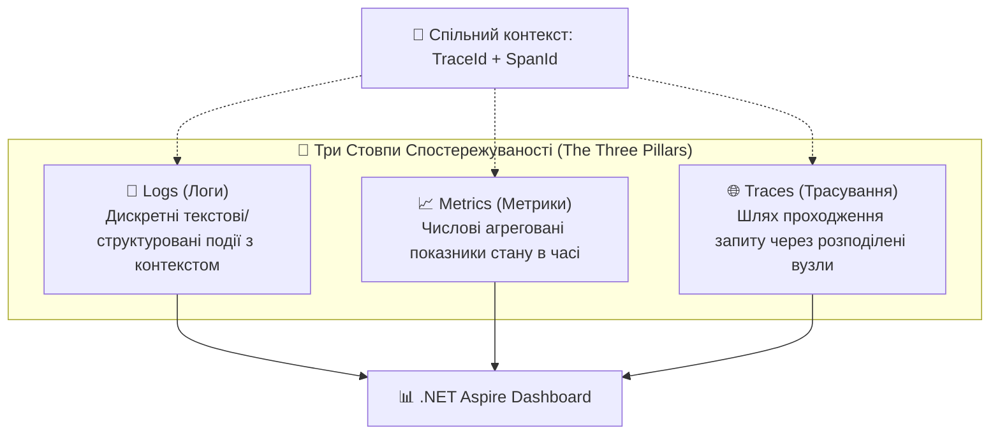
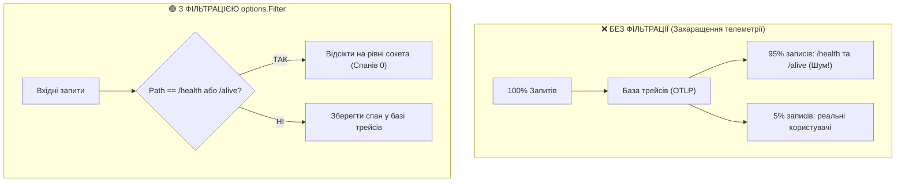
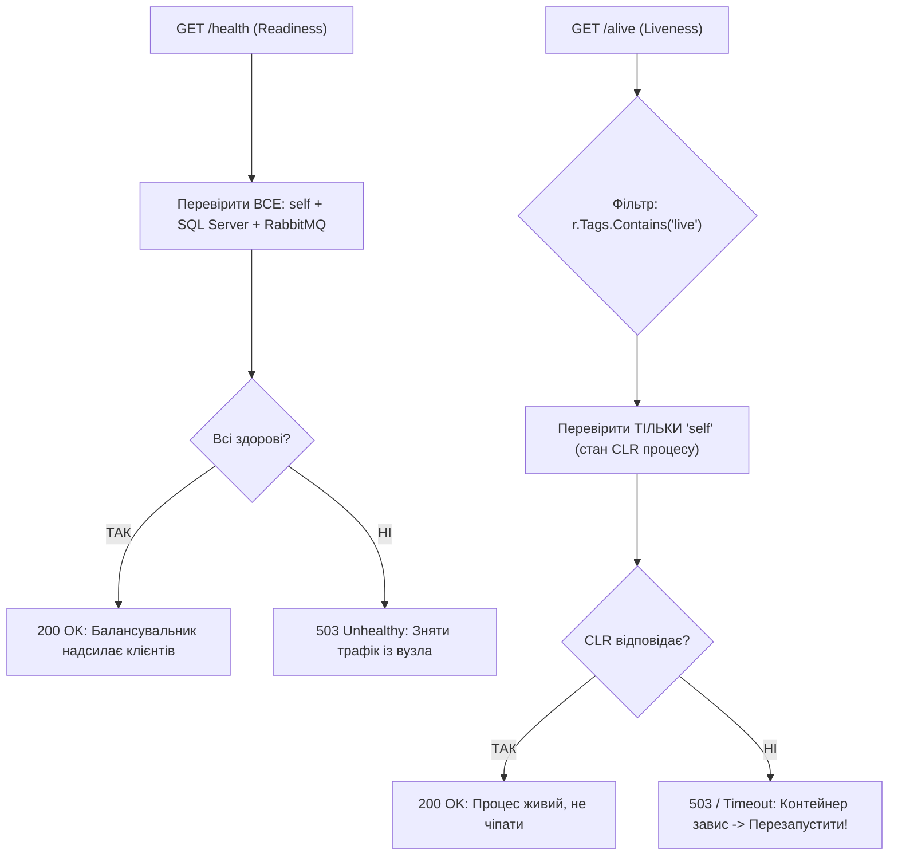

# 🛠️ 02. Анатомія ServiceDefaults: Архітектура Спільних Стандартів та Параметризація

> **Розділ:** `02-Microservices-Craftsman` • **Модуль:** `02-01-Aspire-Documentation`  
> **Роль матеріалу:** Поглиблене керівництво з проєктування крос-сервісних стандартів спостережуваності (Observability), надійності та системної діагностики.  
> **Стек:** .NET 10, C# 13, OpenTelemetry .NET SDK, Polly v8, Microsoft.Extensions.Diagnostics.HealthChecks, Microsoft.Extensions.ServiceDiscovery.  
> **Офіційна специфікація Microsoft:** [.NET Aspire Service Defaults Architecture](https://learn.microsoft.com/dotnet/aspire/fundamentals/service-defaults)

---

## 📑 Зміст Архітектурного Модуля

- [1. Теоретичний базис: Наскрізна функціональність (Cross-Cutting Concerns) та 12-Factor App](#section-1)
- [2. Три стовпи спостережуваності (Observability): Traces, Metrics та Logs](#section-2)
- [3. Архітектурне місце ServiceDefaults у конвеєрі ASP.NET Core](#section-3)
- [4. Повний розбір вихідного коду Extensions.cs: Блок за блоком](#section-4)
- [5. Деконструкція ConfigureOpenTelemetry: Параметри, джерела та фільтрація шумів](#section-5)
- [6. Проблема кардинальності та відсікання псевдо-трафіку Health Checks](#section-6)
- [7. Інтелектуальний OTLP Експортер: Гібридний Fallback для юніт-тестів](#section-7)
- [8. Система діагностичних зондів: Розподіл за тегами 'live' та 'ready'](#section-8)
- [9. Глобальний тюнінг HttpClient: Polly Resilience та Service Discovery](#section-9)
- [10. Інженерна матриця параметризації: Development vs High-Throughput Production](#section-10)

---

<a id="section-1"></a>
## 1. Теоретичний базис: Наскрізна функціональність (Cross-Cutting Concerns) та 12-Factor App

У розподіленій системі бізнес-код кожного мікросервісу повинен фокусуватися виключно на своєму Bounded Context (водії, замовлення, блог). Проте кожен сервіс одночасно повинен вирішувати однакові системні задачі, які називаються **Наскрізною функціональністю (Cross-Cutting Concerns)**:
1. Збір та експорт телеметрії єдиним протоколом.
2. Діагностика працездатності для оркестратора (Health Checks).
3. Динамічне перетворення імен мережевих ресурсів (Service Discovery).
4. Захист вихідних мережевих сокетів від зависання та збоїв (Resilience).

Згідно з методологією **The Twelve-Factor App** (розділи IV — Backing Services, IX — Disposability, XI — Logs):
> *"Застосунок не повинен займатися управлінням чи збереженням власних логів. Кожен запущений процес повинен писати небуферизований потік подій у стандартний вивід або передавати через структурований агент збору."*

Якщо в моноліті логи писалися у локальні текстові файли на диск (`logs/app.txt`), то в контейнеризованій системі диск є ефемерним (тимчасовим). Будь-який перезапуск контейнера знищує файли. Тому стандарт **ServiceDefaults** переводить усі мікросервіси на єдиний OTLP-конвеєр (OpenTelemetry Protocol).

---

<a id="section-2"></a>
## 2. Три стовпи спостережуваності (Observability): Traces, Metrics та Logs

Сучасна спостережуваність спирається на три взаємопов'язані типи даних:



1. **Структуровані логи (Structured Logs):** Не просто текст `"Водія знайдено"`, а пара ключ-значення `{"Event": "DriverFound", "DriverId": "3fa85f64...", "TraceId": "4bf92f35..."}`.
2. **Метрики (Metrics):** Лічильники (Counters), гістограми (Histograms) та шкали (Gauges), які відображають затримки HTTP, використання пам'яті CLR GC, розміри черг.
3. **Розподілені трейси (Distributed Traces):** Ланцюжок спанів (Spans), що показує точний час перебування запиту в кожному мікросервісі.

---

<a id="section-3"></a>
## 3. Архітектурне місце ServiceDefaults у конвеєрі ASP.NET Core

Проєкт `CargoDelivery.ServiceDefaults` є спільною бібліотекою, яка розширює стандартний інтерфейс `IHostApplicationBuilder`:

```mermaid
flowchart LR
    Program["Program.cs Мікросервісу"] -->|builder.AddServiceDefaults()| SD["🛠️ CargoDelivery.ServiceDefaults"]
    
    subgraph SD_Internals ["Внутрішні конфігураційні розширення"]
        OTEL["1. ConfigureOpenTelemetry()<br/>• Logging OTLP<br/>• Runtime Metrics<br/>• Tracing (EF Core, MassTransit)"]
        HC["2. AddDefaultHealthChecks()<br/>• /health (Readiness)<br/>• /alive (Liveness)"]
        SD_Prov["3. AddServiceDiscovery()<br/>• Dynamic Endpoint Resolver"]
        HTTP_Polly["4. ConfigureHttpClientDefaults()<br/>• Polly 5-Stage Resilience Pipeline<br/>• Automatic Discovery"]
    end

    SD --> OTEL & HC & SD_Prov & HTTP_Polly
```

---

<a id="section-4"></a>
## 4. Повний розбір вихідного коду Extensions.cs: Блок за блоком

> 📍 **Вихідний файл у рішенні:**  
> [Extensions.cs](file:///c:/Users/Yurii/source/repos/Demo-CargoDeliveryService/02-Microservices-Craftsman/Aspire/CargoDelivery.ServiceDefaults/Extensions.cs)

### 4.1. Дженерик-обмеження `IHostApplicationBuilder`
```csharp
public static class Extensions
{
    private const string HealthEndpointPath = "/health";
    private const string AlivenessEndpointPath = "/alive";

    public static TBuilder AddServiceDefaults<TBuilder>(this TBuilder builder) 
        where TBuilder : IHostApplicationBuilder
    {
        builder.ConfigureOpenTelemetry();
        builder.AddDefaultHealthChecks();
        builder.Services.AddServiceDiscovery();

        builder.Services.ConfigureHttpClientDefaults(http =>
        {
            http.AddStandardResilienceHandler();
            http.AddServiceDiscovery();
        });

        return builder;
    }
    // ...
}
```

#### Чому застосовано патерн `where TBuilder : IHostApplicationBuilder`?
У .NET 8/9/10 `IHostApplicationBuilder` — це уніфікований інтерфейс, який реалізують:
* `WebApplicationBuilder` — для класичних REST/gRPC мікросервісів.
* `HostApplicationBuilder` — для консольних фонових воркерів (Background Services, що слухають лише черги RabbitMQ без відкриття веб-портів).
* `DistributedApplicationBuilder` — для AppHost.

Завдяки цьому методу конфігурація стає **100% поліморфною**: одна й та сама збірка `ServiceDefaults` підключається як до веб-API, так і до фонового обробника подій!

---

<a id="section-5"></a>
## 5. Деконструкція ConfigureOpenTelemetry: Параметри, джерела та фільтрація шумів

Розглянемо найскладніший блок конфігурації:

```csharp
public static TBuilder ConfigureOpenTelemetry<TBuilder>(this TBuilder builder) 
    where TBuilder : IHostApplicationBuilder
{
    // 1. НАЛАШТУВАННЯ ЛОГУВАННЯ
    builder.Logging.AddOpenTelemetry(logging =>
    {
        logging.IncludeFormattedMessage = true;
        logging.IncludeScopes = true;
    });

    // 2. НАЛАШТУВАННЯ МЕТРИК
    builder.Services.AddOpenTelemetry()
        .WithMetrics(metrics =>
        {
            metrics.AddAspNetCoreInstrumentation()
                   .AddHttpClientInstrumentation()
                   .AddRuntimeInstrumentation();
        })
        // 3. НАЛАШТУВАННЯ ТРАСУВАННЯ
        .WithTracing(tracing =>
        {
            tracing.AddSource(builder.Environment.ApplicationName)
                   .AddSource("MassTransit")
                   .AddSource("Microsoft.EntityFrameworkCore.SqlServer")
                   .AddAspNetCoreInstrumentation(options =>
                   {
                       options.Filter = context =>
                           !context.Request.Path.StartsWithSegments(HealthEndpointPath)
                           && !context.Request.Path.StartsWithSegments(AlivenessEndpointPath);
                   })
                   .AddHttpClientInstrumentation();
        });

    builder.AddOpenTelemetryExporters();
    return builder;
}
```

### Детальний розбір параметрів:

#### 1. `logging.IncludeFormattedMessage = true`
* **Що означає:** Дозволяє зберігати у вихідному OTLP-пакеті не лише шаблон рядка `LogInformation("Driver {Id}", id)`, а й готовий згенерований рядок `"Driver 123"`.
* **Інженерний компроміс:** Спрощує читання логів людиною в Aspire Dashboard, проте збільшує розмір логу на $20-30\%$. У критично високонавантажених системах можна встановити `false`, щоб десеріалізація відбувалася на стороні сервера логів.

#### 2. `logging.IncludeScopes = true`
* **Що означає:** Включає контекстні області `ILogger.BeginScope(...)`.
* **Чому це критично:** Кожен запит ASP.NET Core створює внутрішній скоуп, що містить `TraceId` та `SpanId`. Завдяки `IncludeScopes = true` кожен запис логу автоматично стає клікабельним у дашборді та перенаправляє інженера до відповідного розподіленого трейсу.

#### 3. `metrics.AddRuntimeInstrumentation()`
* **Що збирає:** Вбудований інструментарій збирає глибинні показники віртуальної машини CLR:
  * Частоту збірок сміття `dotnet.gc.collections` (Gen 0, Gen 1, Gen 2).
  * Час паузи під час зупинки світу: `dotnet.gc.pause.time`.
  * Використання оперативної пам'яті: `dotnet.process.memory.working_set`.
  * Стан черги завдань пулу потоків: `dotnet.thread_pool.queue.length`.

#### 4. `tracing.AddSource(...)`
* `builder.Environment.ApplicationName`: Реєструє провайдер `ActivitySource` самого сервісу.
* `"MassTransit"`: Дозволяє відстежувати події черг RabbitMQ.
* `"Microsoft.EntityFrameworkCore.SqlServer"`: Фіксує кожен SQL-запит до БД з точним часом його виконання у мілісекундах.

---

<a id="section-6"></a>
## 6. Проблема кардинальності та відсікання псевдо-трафіку Health Checks

Уважно розглянемо рядок фільтрації:
```csharp
options.Filter = context =>
    !context.Request.Path.StartsWithSegments(HealthEndpointPath)
    && !context.Request.Path.StartsWithSegments(AlivenessEndpointPath);
```

### Математика проблеми високої кардинальності (Cardinality Explosion)
Оркестратор Aspire або кластер Kubernetes опитує ендпоінти `/health` та `/alive` кожні **2.5 секунди**:

$$\text{Запитів від одного сервісу за добу} = \frac{86400\text{ с}}{2.5\text{ с}} \times 2\text{ зонди} = 69\,120\text{ запитів}$$

Для 4 мікросервісів системи це становить:
$$69\,120 \times 4 = 276\,480\text{ штучних трейсів на добу!}$$



Якщо не встановити `options.Filter`, база даних OpenTelemetry буде на $95\%$ заповнена беззмістовними перевірками здоров'я, що ускладнить пошук реальних бізнес-помилок користувачів.

---

<a id="section-7"></a>
## 7. Інтелектуальний OTLP Експортер: Гібридний Fallback для юніт-тестів

```csharp
private static TBuilder AddOpenTelemetryExporters<TBuilder>(this TBuilder builder) 
    where TBuilder : IHostApplicationBuilder
{
    var useOtlpExporter = !string.IsNullOrWhiteSpace(builder.Configuration["OTEL_EXPORTER_OTLP_ENDPOINT"]);

    if (useOtlpExporter)
    {
        builder.Services.AddOpenTelemetry().UseOtlpExporter();
    }

    return builder;
}
```

### Принцип роботи захисного механізму:
1. **Режим оркестрації Aspire:** AppHost автоматично встановлює змінну `OTEL_EXPORTER_OTLP_ENDPOINT=http://localhost:18889`. Умова виконується, і сервіс починає передавати OTLP-пакети в дашборд.
2. **Режим автоматизованого тестування (xUnit / WebApplicationFactory):** Змінна відсутня. Якби ми жорстко викликали `UseOtlpExporter()`, кожен тест намагався б відкрити gRPC-з'єднання до неіснуючого порту і падав з помилкою:
   `System.Net.Http.HttpRequestException: Connection refused (localhost:4317)`.
3. Завдяки цій перевірці наші тести в проєкті `CargoDelivery.HttpAggregator.Tests` виконуються миттєво та без жодного мережевого шуму!

---

<a id="section-8"></a>
## 8. Система діагностичних зондів: Розподіл за тегами 'live' та 'ready'

```csharp
public static TBuilder AddDefaultHealthChecks<TBuilder>(this TBuilder builder) 
    where TBuilder : IHostApplicationBuilder
{
    builder.Services.AddHealthChecks()
        .AddCheck("self", () => HealthCheckResult.Healthy(), ["live"]);

    return builder;
}

public static WebApplication MapDefaultEndpoints(this WebApplication app)
{
    if (app.Environment.IsDevelopment())
    {
        // 1. READINESS: Всі зареєстровані перевірки
        app.MapHealthChecks(HealthEndpointPath);

        // 2. LIVENESS: Тільки перевірки з тегом "live"
        app.MapHealthChecks(AlivenessEndpointPath, new HealthCheckOptions
        {
            Predicate = r => r.Tags.Contains("live")
        });
    }

    return app;
}
```



---

<a id="section-9"></a>
## 9. Глобальний тюнінг HttpClient: Polly Resilience та Service Discovery

У файлі `Extensions.cs` блок:
```csharp
builder.Services.ConfigureHttpClientDefaults(http =>
{
    http.AddStandardResilienceHandler();
    http.AddServiceDiscovery();
});
```
Забезпечує такі гарантії:
1. **Глобальність:** Будь-який типізований клієнт, зареєстрований через `builder.Services.AddHttpClient<TClient, TImpl>()`, автоматично успадковує ці налаштування.
2. **Service Discovery:** Дозволяє писати `client.BaseAddress = new Uri("http://cargoorderingservice")` без попереднього налаштування DNS.
3. **Resilience Handler:** Захищає сокети конвеєром з 5 рівнів (детально розглянуто в модулі `06`).

---

<a id="section-10"></a>
## 10. Інженерна матриця параметризації: Development vs High-Throughput Production

| Компонент / Опція | Значення у Development (ServiceDefaults) | Значення у High-Load Production ($>10\,000\text{ rps}$) | Інженерне обґрунтування різниці |
| :--- | :--- | :--- | :--- |
| **OpenTelemetry Sampling** | `AlwaysOnSampler` (100% трейсів) | `ParentBasedSampler(0.01)` (1% трейсів) | Запобігання вичерпанню сховища телеметрії при мільйонах запитів на секунду |
| **IncludeFormattedMessage** | `true` | `false` | Усуває зайві алокації рядків у купі керованої пам'яті (LOH/GC) |
| **Total Request Timeout** | 30 секунд | 5–8 секунд | Зменшує час блокування клієнтських сокетів при мережевих аваріях |
| **Retry Attempt Count** | 3 спроби | 1–2 спроби | Запобігає лавиноподібному ефекту шторму повторів (Retry Storm) |
| **Endpoint Environment** | `app.Environment.IsDevelopment()` | Завжди відкрито для приватного порту кластера | У продакшні зонди здоров'я потрібні для Kubernetes Kubelet |
