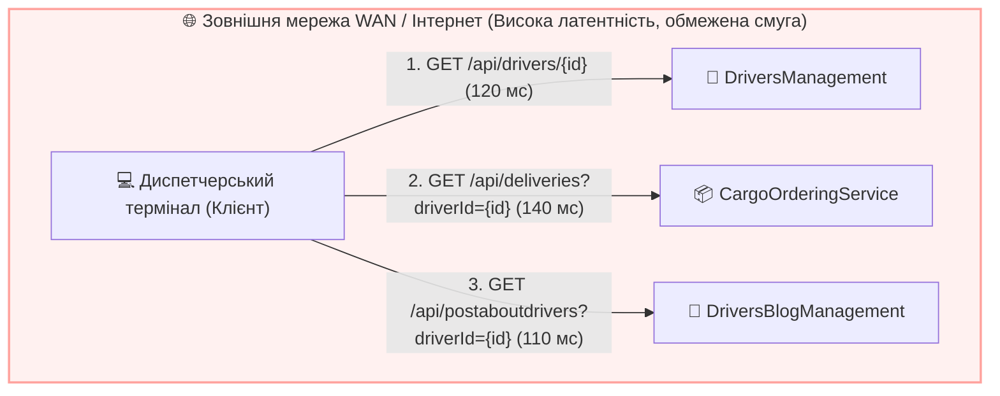
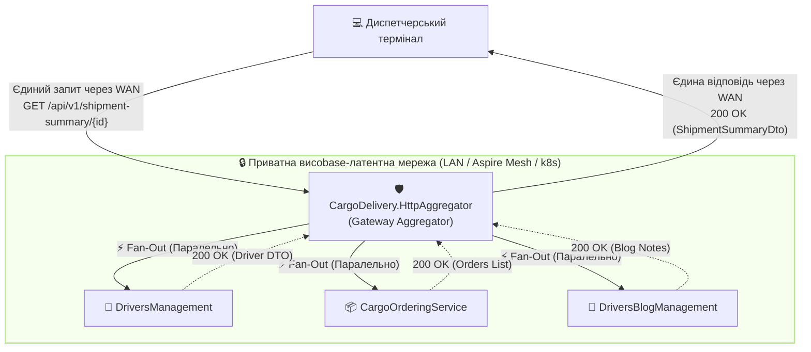
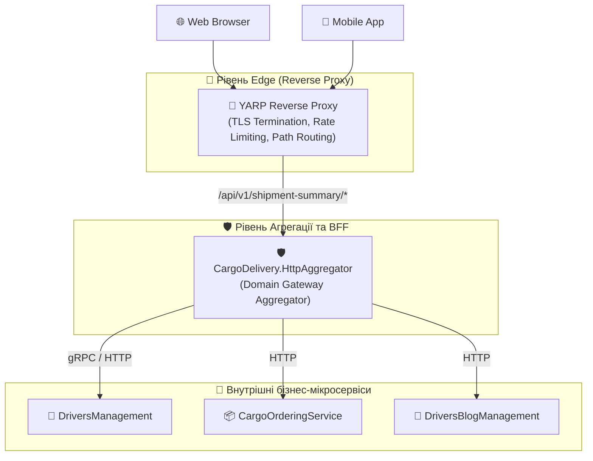
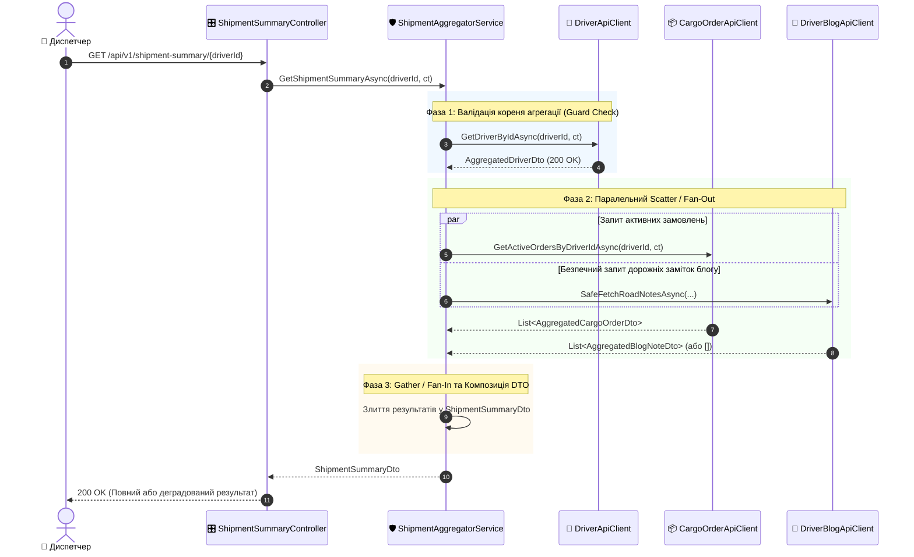
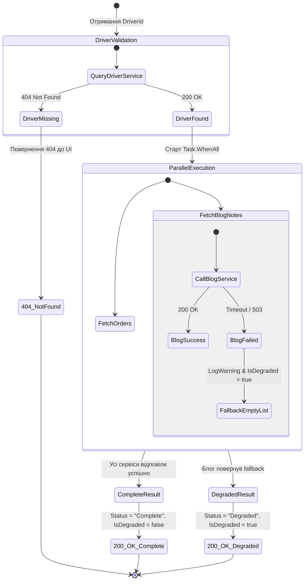

# 🛡️ 03. Архітектура Gateway Aggregator: Проєктування та Реалізація Сервісу Агрегації

> **Розділ курсу:** `02-Microservices-Craftsman` • **Модуль:** `02-01-Aspire-Documentation`  
> **Стек:** .NET 10, C# 13, ASP.NET Core Web API, `IHttpClientFactory`, Typed HttpClients, `Task.WhenAll`, Polly v8, OpenTelemetry  
> **Цільова аудиторія:** Архітектори розподілених систем, Senior/Lead .NET інженери, викладачі та студенти курсів мікросервісної архітектури  
> **Офіційна документація Microsoft:**  
> - [Architecting Container-based Applications: API Gateways](https://learn.microsoft.com/dotnet/architecture/microservices/architect-microservice-container-applications/direct-client-to-microservice-communication-versus-the-api-gateway-pattern)  
> - [Make HTTP requests using IHttpClientFactory in ASP.NET Core](https://learn.microsoft.com/aspnet/core/fundamentals/http-requests)  
> - [Enterprise Integration Patterns: Scatter-Gather (Hohpe & Woolf)](https://www.enterpriseintegrationpatterns.com/patterns/messaging/BroadcastAggregate.html)

---

## 📑 Академічний зміст лекції

- [1. Теоретичний базис: Проблема прямої взаємодії (Direct Client-to-Microservice)](#section-1)
- [2. Патерн Gateway Aggregator та патерни інтеграції підприємства (EIP Scatter-Gather)](#section-2)
- [3. Матриця розмежування архітектурних стилів: YARP vs BFF vs Gateway Aggregator](#section-3)
- [4. Економіка затримок: Математичний аналіз RTT послідовних та паралельних викликів](#section-4)
- [5. Архітектура нового проєкту CargoDelivery.HttpAggregator](#section-5)
- [6. Проєктування типізованих HTTP-клієнтів та керування сокетами через IHttpClientFactory](#section-6)
- [7. Реалізація патерну Scatter-Gather у ShipmentAggregatorService (Fan-Out / Fan-In)](#section-7)
- [8. Патерн Graceful Degradation (Часткова деградація) та ізоляція відмов](#section-8)
- [9. Контролери та лабораторний полігон симуляції відмов (SimulationController)](#section-9)
- [10. Архітектурна матриця: Антипатерни vs Еталонні практики](#section-10)
- [11. Практичні завдання та контрольні запитання для самоперевірки](#section-11)

---

<a id="section-1"></a>
## 1. Теоретичний базис: Проблема прямої взаємодії (Direct Client-to-Microservice)

У розподіленій системі, де кожен бізнес-домен виділено в окремий автономний мікросервіс (у нашому випадку: управління водіями `DriversManagement`, замовлення вантажів `CargoOrderingService`, дорожні публікації `DriversBlogManagement`), клієнтський застосунок (Web SPA, мобільний застосунок або автоматизоване робоче місце диспетчера) стикається з фундаментальною проблемою оркестрації даних.

### Антипатерн «Товстий клієнт-оркестратор» (Client-Driven Aggregation)

Якщо клієнт звертається безпосередньо до кожного сервісу самостійно, виникає каскад системних вад:



#### Анатомія недоліків прямої взаємодії:

1. **Мережева балакучість (Chattiness / Round-Trip Tax):**
   * Клієнт змушений виконувати $N$ послідовних або квазі-паралельних HTTP-запитів через публічну мережу Інтернет або мобільні стільникові канали (WAN).
   * Кожен Round-Trip Time (RTT) через WAN займає від 50 до 200 мілісекунд через фізичну відстань, рукостискання TLS, проходження через маршрутизатори інтернет-провайдерів.
   * У результаті загальний час завантаження одного екрана перевищує $400-600\text{ мс}$, що порушує вимоги до сучасного UX (Core Web Vitals, Responsive UI).

2. **Витік внутрішніх доменних моделей та надмірне зачеплення (Coupling Leakage):**
   * Клієнтський застосунок стає жорстко прив'язаним до внутрішньої декомпозиції бекенду, внутрішніх URL-шляхів, схем автентифікації та форматів DTO кожного з трьох сервісів.
   * Якщо архітектори вирішать об'єднати або перейменувати ендпоінти в `DriversBlogManagement`, клієнтський додаток зламається і вимагатиме релізу нової версії в App Store / Google Play або очищення кешу браузерів тисяч користувачів.

3. **Розмивання периметра безпеки (Security Perimeter Dilution):**
   * Кожен мікросервіс змушений бути виставленим назовні (Public Ingress), мати публічну IP-адресу, відкритий порт та перевіряти складні токени аутентифікації клієнта.
   * Збільшується вектор потенційної атаки (Attack Surface).

4. **Проблема надлишковості та недостатності даних (Over-fetching & Under-fetching):**
   * Клієнт отримує з `DriversManagement` 30 полів водія (включаючи паспорти, домашні адреси, дату проходження медичного огляду), хоча на зведеному екрані диспетчера потрібні лише `FullName`, `Phone` та `VehiclePlate`. Це марнує мобільний трафік і пам'ять пристрою.

---

<a id="section-2"></a>
## 2. Патерн Gateway Aggregator та патерни інтеграції підприємства (EIP Scatter-Gather)

Для вирішення вищевказаних проблем застосовується патерн **Gateway Aggregator** (Шлюз-Агрегатор), який є прикладною реалізацією класичного патерну *Scatter-Gather* (Розкидай-Збери) з фундаментальної праці Грегора Хопе та Боббі Вулфа *"Enterprise Integration Patterns"*.

### Формальне визначення

> **Gateway Aggregator** — це спеціалізований сервіс-посередник, розташований всередині захищеного периметра приватної мережі (LAN/VPC), який приймає єдиний високорівневий бізнес-запит від клієнта, розбиває його на паралельні підзапити до відповідних мікросервісів, очікує на їх відповіді, зливає (агрегує) отримані гетерогенні дані в єдину цілісну модель і повертає компактний результат клієнту.



### Ключові архітектурні переваги патерну:
1. **Зниження мережевих витрат WAN до 1 RTT:** Клієнт платить ціну затримки зовнішньої мережі рівно один раз. Вся подальша комунікація відбувається у внутрішньому кластері зі швидкістю $\le 1-3\text{ мс}$ на запит.
2. **Адаптація контракту під користувацький сценарій (Tailored Contract):** Формується спеціальний зведений DTO (`ShipmentSummaryDto`), який містить лише ті атрибути, що необхідні конкретному бізнес-процесу.
3. **Шар запобігання пошкодженню (Anti-Corruption Layer — ACL):** Агрегатор виступає буфером. Зміни внутрішніх контрактів бекенду адаптуються всередині агрегатора, не вимагаючи оновлення коду фронтенду.
4. **Централізована реалізація стійкості (Resilience Boundary):** Всі тайм-аути, політики повторних спроб (Retry) та автоматичне розмикання ланцюга (Circuit Breaker) інкапсулюються в агрегаторі.

---

<a id="section-3"></a>
## 3. Матриця розмежування архітектурних стилів: YARP vs BFF vs Gateway Aggregator

В інженерних дискусіях терміни *Reverse Proxy*, *Backend for Frontend (BFF)* та *Gateway Aggregator* нерідко помилково вживають як синоніми. Це призводить до грубих архітектурних помилок — наприклад, спроб писати складну бізнес-логіку злиття JSON-об'єктів у конфігурації зворотного проксі.

У наступній матриці наведено суворе академічне розмежування цих трьох концепцій за 8 вимірами:

| Архітектурний вимір | Reverse Proxy (YARP, Envoy, NGINX) | Gateway Aggregator (`CargoDelivery.HttpAggregator`) | Backend for Frontend (BFF) |
| :--- | :--- | :--- | :--- |
| **Головне призначення** | Низькорівнева маршрутизація, балансування навантаження, SSL-термінація | **Прикладна композиція даних** від декількох сервісів для бізнес-сценарію | Спеціалізація інтерфейсу під конкретний клієнтський форм-фактор |
| **Рівень моделі OSI** | Рівень 4 (Транспортний) або Рівень 7 (HTTP протокол без зміни payload) | Рівень 7 (Прикладний рівень, глибока десеріалізація та обробка C# об'єктів) | Рівень 7 (Прикладний рівень, оркестрація сесій, cookie-to-token, оптимізація медіа) |
| **Бізнес-логіка** | **Категорично заборонена.** Не знає семантики домену. Працює з потоками байтів (`Stream`). | **Присутня логіка агрегації:** перевірка існування водія, злиття списків, розрахунок агрегованого статусу. | **Присутня логіка подання:** фільтрація полів для смартфона, стиснення картинок під екран Retina. |
| **Кількість цільових викликів на 1 вхідний запит** | Строго 1 до 1 ($1 \to 1$). Перенаправляє запит на один обраний бекенд-інстанс. | 1 до багатьох ($1 \to N$). Виконує паралельний Fan-Out на 2, 3 або більше сервісів. | Варіюється: може бути як $1 \to 1$ проксі, так і $1 \to N$ агрегація для свого UI. |
| **Споживання пам'яті та процесора** | Мінімальне. Zero-copy проксіювання потоків без десеріалізації JSON у пам'ять. | Помірне. Вимагає алокації C# DTO-об'єктів у GC Heap та роботи серіалізатора `System.Text.Json`. | Помірне. Алокація структур даних під специфічний інтерфейс. |
| **Стійкість до відмов (Failure Handling)** | HTTP 502/504 Bad Gateway, перемикання на інший інстанс того самого сервісу. | **Graceful Degradation:** повернення часткового результату при відмові некритичного джерела. | Graceful Degradation або рендеринг резервного UI-екрана. |
| **Аутентифікація та Авторизація** | Перевірка TLS-сертифікатів, валідація JWT-підпису, Rate Limiting за IP. | Перевірка бізнес-ролей, валідація доступу до конкретної сутності (`DriverId`). | Захист сесій через SameSite Cookies, обмін Cookie на JWT токен (BFF Token Handler). |
| **Кількість екземплярів / сервісів** | Зазвичай єдиний вхідний вузол (Edge Ingress) на весь кластер. | Може бути кілька агрегаторів для різних бізнес-доменів (Logistics, Billing, CRM). | Окремий сервіс для кожного типу клієнта (`Web.BFF`, `Mobile.BFF`, `Partner.BFF`). |

### Архітектурний стек у реальній системі:



> 💡 **Висновок архітектора:**  
> `CargoDelivery.HttpAggregator` є саме **Domain Gateway Aggregator**. Він не замінює зворотний проксі (YARP), а розташовується за ним, беручи на себе виключно прикладну задачу збирання розрізнених даних логістичного рейсу.

---

<a id="section-4"></a>
## 4. Економіка затримок: Математичний аналіз RTT послідовних та паралельних викликів

Одним з найважливіших інженерних обґрунтувань створення агрегатора є розрахунок загального часу затримки (Total Latency Budget).

Нехай для формування зведеної інформації рейсу необхідно отримати дані від трьох мікросервісів:
* $S_1$ (`DriversManagement`): затримка обробки $t_1 = 45\text{ мс}$.
* $S_2$ (`CargoOrderingService`): затримка обробки $t_2 = 65\text{ мс}$.
* $S_3$ (`DriversBlogManagement`): затримка обробки $t_3 = 40\text{ мс}$.
* Затримка внутрішньої локальної мережі (LAN Round-Trip) $t_{\text{lan}} = 2\text{ мс}$ на кожен запит.
* Затримка зовнішньої клієнтської мережі (WAN Round-Trip) $t_{\text{wan}} = 100\text{ мс}$.

### Модель 1: Прямі виклики клієнтом (Послідовно)
Загальний час для клієнта обчислюється як сума трьох послідовних WAN-транзакцій:
$$T_{\text{direct\_seq}} = \sum_{i=1}^{3} (t_{\text{wan}} + t_i) = (100 + 45) + (100 + 65) + (100 + 40) = 450\text{ мс}$$

### Модель 2: Агрегатор з послідовним виконанням запитів (`await` один за одним)
Клієнт робить один WAN-запит, але агрегатор опитує сервіси по черзі:
$$T_{\text{agg\_seq}} = t_{\text{wan}} + \sum_{i=1}^{3} (t_{\text{lan}} + t_i) + \delta_{\text{cpu}} = 100 + (2 + 45) + (2 + 65) + (2 + 40) + 1 = 257\text{ мс}$$

### Модель 3: Еталонний Gateway Aggregator з паралельним Fan-Out (`Task.WhenAll`)
Клієнт робить один WAN-запит. Агрегатор спочатку валідує кореневу сутність (водія), після чого одночасно ініціює виклики до замовлень і блогу:
$$T_{\text{step1}} = t_{\text{lan}} + t_1 = 2 + 45 = 47\text{ мс}$$
$$T_{\text{step2}} = \max(t_{\text{lan}} + t_2, \; t_{\text{lan}} + t_3) = \max(2 + 65, \; 2 + 40) = 67\text{ мс}$$
$$T_{\text{agg\_parallel}} = t_{\text{wan}} + T_{\text{step1}} + T_{\text{step2}} + \delta_{\text{cpu}} = 100 + 47 + 67 + 2 = 216\text{ мс}$$

```mermaid
gantt
    title Порівняння затримок: Послідовні виклики проти Паралельного Fan-Out (мс)
    dateFormat X
    axisFormat %s мс

    section Послідовний клієнт (WAN)
    Driver через WAN (145ms)       :0, 145
    Orders через WAN (165ms)       :145, 310
    Blog через WAN (140ms)         :310, 450

    section Агрегатор (Fan-Out)
    WAN Ingress (50ms)             :0, 50
    Driver Validation LAN (47ms)   :50, 97
    Fan-Out - Orders LAN (67ms)    :97, 164
    Fan-Out - Blog LAN (42ms)      :97, 139
    WAN Egress (50ms)              :164, 214
```



> 📊 **Результат оптимізації:**  
> Застосування патерну Gateway Aggregator з паралельним `Task.WhenAll` скорочує сумарний час очікування диспетчера більш ніж **вдвічі** (з $450\text{ мс}$ до $214\text{ мс}$), повністю ліквідуючи затримку повторних WAN-рукостискань.

---

<a id="section-5"></a>
## 5. Архітектура нового проєкту CargoDelivery.HttpAggregator

Для забезпечення чистоти архітектури, ізоляції демонстраційних ендпоінтів та уникнення захаращення доменного коду водіїв у рішенні створено виділений проєкт:

> 📍 **Файл проєкту:**  
> [CargoDelivery.HttpAggregator.csproj](file:///c:/Users/Yurii/source/repos/Demo-CargoDeliveryService/02-Microservices-Craftsman/CargoDelivery.HttpAggregator/CargoDelivery.HttpAggregator.csproj)

### Структура файлової системи проєкту:

```
CargoDelivery.HttpAggregator/
├── Controllers/
│   ├── ShipmentSummaryController.cs   <-- Головний контролер агрегації
│   └── SimulationController.cs        <-- Лабораторний полігон збоїв
├── Domain/
│   ├── Clients/                       <-- Типізовані клієнти IHttpClientFactory
│   │   ├── IDriverApiClient.cs / DriverApiClient.cs
│   │   ├── ICargoOrderApiClient.cs / CargoOrderApiClient.cs
│   │   └── IDriverBlogApiClient.cs / DriverBlogApiClient.cs
│   ├── Dtos/                          <-- Контракти даних агрегації
│   │   ├── ShipmentSummaryDto.cs      <-- Композитний DTO диспетчера
│   │   ├── AggregatedDriverDto.cs
│   │   ├── AggregatedCargoOrderDto.cs
│   │   └── AggregatedBlogNoteDto.cs
│   └── Services/                      <-- Прикладна бізнес-оркестрація
│       ├── IShipmentAggregatorService.cs
│       └── ShipmentAggregatorService.cs
├── Program.cs                         <-- DI контейнер та підключення ServiceDefaults
└── appsettings.json
```

### Оркестрація в AppHost

У файлі [AppHost.cs](file:///c:/Users/Yurii/source/repos/Demo-CargoDeliveryService/02-Microservices-Craftsman/CargoDelivery.AppHost/AppHost.cs) агрегатор зареєстрований як повноцінний вузол графу розподіленої системи з декларативними залежностями:

```csharp
var httpAggregator = builder.AddProject<Projects.CargoDelivery_HttpAggregator>("httpaggregator")
    .WithReference(driversManagement)
    .WithReference(cargoOrderingService)
    .WithReference(driversBlogManagement)
    .WaitFor(driversManagement)
    .WaitFor(cargoOrderingService);
```

#### Семантика налаштування:
1. `WithReference(service)`: Впроваджує конфігурацію Service Discovery. Aspire автоматично передає агрегатору змінні оточення `services__driversmanagement__http__0`, що дозволяє `HttpClient` розв'язувати логічні імена сервісів.
2. `WaitFor(service)`: Формує орієнтований ациклічний граф (DAG) запуску. Агрегатор переходить у стан виконання лише після успішного підтвердження готовності (Readiness) сервісів водіїв та замовлень.

---

<a id="section-6"></a>
## 6. Проєктування типізованих HTTP-клієнтів та керування сокетами через IHttpClientFactory

### Проблема сокетного голодування (Socket Exhaustion)
У ранніх версіях .NET розробники створювали клієнт через `using var client = new HttpClient()`. При інтенсивному навантаженні сокети операційної системи залишалися в стані `TIME_WAIT` протягом 4 хвилин, вичерпуючи ліміт ефемерних портів ОС Windows/Linux (`SocketException: Only one usage of each socket address is normally permitted`). З іншого боку, використання єдиного `static HttpClient` призводило до ігнорування змін DNS-записів під час масштабування контейнерів.

### Рішення: Typed HttpClients в ASP.NET Core
У `CargoDelivery.HttpAggregator` кожен клієнт реалізовано як типізований клас, життєвим циклом пулу з'єднань якого керує `IHttpClientFactory`:

> 📍 **Реєстрація у [Program.cs](file:///c:/Users/Yurii/source/repos/Demo-CargoDeliveryService/02-Microservices-Craftsman/CargoDelivery.HttpAggregator/Program.cs):**

```csharp
// Реєстрація типізованих HTTP-клієнтів з використанням Service Discovery імен
builder.Services.AddHttpClient<IDriverApiClient, DriverApiClient>(client =>
{
    // Логічне ім'я сервісу, яке автоматично резолвиться через Aspire Service Discovery
    client.BaseAddress = new Uri("http://driversmanagement");
});

builder.Services.AddHttpClient<ICargoOrderApiClient, CargoOrderApiClient>(client =>
{
    client.BaseAddress = new Uri("http://cargoorderingservice");
});

builder.Services.AddHttpClient<IDriverBlogApiClient, DriverBlogApiClient>(client =>
{
    client.BaseAddress = new Uri("http://driversblogmanagement");
});
```

### Деконструкція коду типізованого клієнта DriverApiClient

> 📍 **Файл:** [DriverApiClient.cs](file:///c:/Users/Yurii/source/repos/Demo-CargoDeliveryService/02-Microservices-Craftsman/CargoDelivery.HttpAggregator/Domain/Clients/DriverApiClient.cs)

```csharp
namespace CargoDelivery.HttpAggregator.Domain.Clients;

public sealed class DriverApiClient : IDriverApiClient
{
    private readonly HttpClient _httpClient;
    private readonly ILogger<DriverApiClient> _logger;

    public DriverApiClient(HttpClient httpClient, ILogger<DriverApiClient> logger)
    {
        _httpClient = httpClient ?? throw new ArgumentNullException(nameof(httpClient));
        _logger = logger ?? throw new ArgumentNullException(nameof(logger));
    }

    public async Task<AggregatedDriverDto?> GetDriverByIdAsync(Guid driverId, CancellationToken cancellationToken = default)
    {
        _logger.LogInformation("Надсилання запиту GET до DriversManagement для водія {DriverId}", driverId);
        
        // Виклик виконується за відносним шляхом; BaseAddress встановлено на 'http://driversmanagement'
        var response = await _httpClient.GetAsync($"api/drivers/{driverId}", cancellationToken);

        // Обробка очікуваного доменного результату 404 без викидання важкого винятку
        if (response.StatusCode == HttpStatusCode.NotFound)
        {
            _logger.LogWarning("Водія з ID {DriverId} не знайдено у сервісі DriversManagement (404)", driverId);
            return null;
        }

        // Викидає HttpRequestException для статусів 5xx/4xx (активуючи Retry-політику Polly)
        response.EnsureSuccessStatusCode();

        // Стрімінгова асинхронна десеріалізація через System.Text.Json без проміжного виділення string в пам'яті
        return await response.Content.ReadFromJsonAsync<AggregatedDriverDto>(cancellationToken: cancellationToken);
    }
}
```

#### Ключові інженерні акценти реалізації:
1. **Інжекція `HttpClient`:** Екземпляр `HttpClient` створюється контейнером як `Transient`, але його внутрішній обробник `SocketsHttpHandler` береться з пулу `IHttpClientFactory` з автоматичною ротацією кожні 2 хвилини для оновлення DNS.
2. **Обробка `HttpStatusCode.NotFound`:** Ми не викликаємо `EnsureSuccessStatusCode()` сліпо. Статус 404 є валідним бізнес-результатом («водія не існує»), тому ми повертаємо `null`. Це захищає від створення непотрібних важких винятків (`HttpRequestException`), які створюють навантаження на Garbage Collector.
3. **Ефективне читання через `ReadFromJsonAsync`:** Десеріалізатор працює безпосередньо з вхідним байтовим потоком відповіді (`Stream`), мінімізуючи алокацію тимчасових рядків у пам'яті (LOH/GC Gen 0).

---

<a id="section-7"></a>
## 7. Реалізація патерну Scatter-Gather у ShipmentAggregatorService (Fan-Out / Fan-In)

Центральним ядром агрегатора є сервіс [ShipmentAggregatorService.cs](file:///c:/Users/Yurii/source/repos/Demo-CargoDeliveryService/02-Microservices-Craftsman/CargoDelivery.HttpAggregator/Domain/Services/ShipmentAggregatorService.cs).

### Покроковий алгоритм роботи сервісу:



### Детальний розбір реалізації методу злиття

> 📍 **Вихідний код:** [ShipmentAggregatorService.cs](file:///c:/Users/Yurii/source/repos/Demo-CargoDeliveryService/02-Microservices-Craftsman/CargoDelivery.HttpAggregator/Domain/Services/ShipmentAggregatorService.cs)

```csharp
public async Task<ShipmentSummaryDto?> GetShipmentSummaryAsync(Guid driverId, CancellationToken cancellationToken = default)
{
    _logger.LogInformation("Початок агрегації рейсу для водія {DriverId}", driverId);

    // КРОК 1. Валідація кореневої сутності
    // Водій є стрижневим доменом. Якщо його не існує, опитувати решту сервісів немає сенсу!
    var driver = await _driverApiClient.GetDriverByIdAsync(driverId, cancellationToken);
    if (driver is null)
    {
        _logger.LogWarning("Агрегацію скасовано: водія {DriverId} не знайдено", driverId);
        return null;
    }

    // Прапорець для відстеження часткової відмови другорядних компонентів
    var isDegraded = false;

    // КРОК 2. Паралельний Fan-Out (Scatter)
    // Зверніть увагу: ми НЕ викликаємо await негайно, а запускаємо асинхронні завдання!
    var ordersTask = _cargoOrderApiClient.GetActiveOrdersByDriverIdAsync(driverId, cancellationToken);
    
    var roadNotesTask = SafeFetchRoadNotesAsync(
        fetchAction: () => _driverBlogApiClient.GetRoadNotesByDriverIdAsync(driverId, cancellationToken),
        onFailure: () => isDegraded = true
    );

    // КРОК 3. Синхронізація Fan-In (Gather) через Task.WhenAll
    // Очікуємо завершення обох асинхронних операцій паралельно
    await Task.WhenAll(ordersTask, roadNotesTask);

    var orders = await ordersTask;
    var notes = await roadNotesTask;

    // КРОК 4. Побудова композитного результату
    return new ShipmentSummaryDto
    {
        DriverId = driverId,
        Driver = driver,
        ActiveOrders = orders,
        RoadNotes = notes,
        IsDegraded = isDegraded,
        AggregationStatus = isDegraded ? "Degraded (Blog unavailable)" : "Complete",
        AggregatedAtUtc = DateTime.UtcNow
    };
}
```

### Чому `await Task.WhenAll(t1, t2)` краще за послідовний виклик?
Якщо виконати:
```csharp
var orders = await _cargoOrderApiClient.GetActiveOrdersByDriverIdAsync(...);
var notes = await _driverBlogApiClient.GetRoadNotesByDriverIdAsync(...);
```
Другий запит навіть не розпочне встановлення TCP-з'єднання, доки перший повністю не отримає всі байти та не десеріалізує відповідь. При паралельному виклику обидва запити відправляються одночасно через окремі сокети пулу `SocketsHttpHandler`, а процесорні ядра сервера ефективно утилізують механізм асинхронних портів завершення вводу-виводу (IOCP - I/O Completion Ports).

---

<a id="section-8"></a>
## 8. Патерн Graceful Degradation (Часткова деградація) та ізоляція відмов

У мікросервісній архітектурі діє фундаментальне правило: **«Відмова одного некритичного сервісу не повинна призводити до збою всієї бізнес-операції»**.

У нашому сценарії:
* **Критична залежність (Hard Dependency):** `DriversManagement` (дані про водія) та `CargoOrderingService` (вантажні замовлення). Без них диспетчер не може відправити машину в рейс.
* **Некритична залежність (Soft Dependency):** `DriversBlogManagement` (нотатки водія про стан дороги, погоду та враження). Якщо сервіс блогу падає через навантаження або перезапуск бази даних, диспетчер все одно повинен мати можливість працювати з водієм і вантажем!

### Реалізація механізму безпечного виконання `SafeFetchRoadNotesAsync`

```csharp
private async Task<List<AggregatedBlogNoteDto>> SafeFetchRoadNotesAsync(
    Func<Task<List<AggregatedBlogNoteDto>>> fetchAction,
    Action onFailure)
{
    try
    {
        return await fetchAction();
    }
    catch (Exception ex)
    {
        // 1. Фіксуємо інцидент у логах OpenTelemetry з рівнем Warning (не Error, бо збій опрацьований!)
        _logger.LogWarning(ex, "DriversBlogManagement тимчасово недоступний. Застосовано патерн Graceful Degradation.");
        
        // 2. Сповіщаємо агрегатор про перехід у режим деградації
        onFailure();
        
        // 3. Повертаємо безпечне порожнє значення замість збою з помилкою HTTP 500
        return [];
    }
}
```

### Діаграма станів результату агрегації (State Machine)



### Інтерфейсний ефект для користувача
Коли `DriversBlogManagement` не працює, клієнтський додаток диспетчера отримує наступний JSON:

```json
{
  "driverId": "3fa85f64-5717-4562-b3fc-2c963f66afa6",
  "driver": {
    "fullName": "Тарас Григорович Шевченко",
    "email": "shevchenko@cargodelivery.ua",
    "phoneNumber": "+380501234567"
  },
  "activeOrders": [
    {
      "orderId": "7cb4a2b1-1234-4a56-8abc-9def01234567",
      "cargoDescription": "Будівельні матеріали",
      "destinationAddress": "м. Львів, вул. Городоцька, 15"
    }
  ],
  "roadNotes": [],
  "isDegraded": true,
  "aggregationStatus": "Degraded (Blog unavailable)",
  "aggregatedAtUtc": "2026-10-09T02:00:00Z"
}
```
Фронтенд малює жовтий бейдж: `⚠️ Замітки водія тимчасово недоступні`, але **робота логістичного хабу не паралізується!**

---

<a id="section-9"></a>
## 9. Контролери та лабораторний полігон симуляції відмов (SimulationController)

Щоб у практичних роботах наочно досліджувати можливості .NET Aspire, трасування OpenTelemetry та поведінку resilience-пайплайнів Polly, у проєкті реалізовано два контролери.

### 1. Робочий контролер агрегатора: ShipmentSummaryController

> 📍 **Файл:** [ShipmentSummaryController.cs](file:///c:/Users/Yurii/source/repos/Demo-CargoDeliveryService/02-Microservices-Craftsman/CargoDelivery.HttpAggregator/Controllers/ShipmentSummaryController.cs)

```csharp
[ApiController]
[Route("api/v1/shipment-summary")]
[Produces("application/json")]
public sealed class ShipmentSummaryController : ControllerBase
{
    private readonly IShipmentAggregatorService _aggregatorService;
    private readonly ILogger<ShipmentSummaryController> _logger;

    public ShipmentSummaryController(
        IShipmentAggregatorService aggregatorService,
        ILogger<ShipmentSummaryController> logger)
    {
        _aggregatorService = aggregatorService;
        _logger = logger;
    }

    [HttpGet("{driverId:guid}")]
    [ProducesResponseType(typeof(ShipmentSummaryDto), StatusCodes.Status200OK)]
    [ProducesResponseType(StatusCodes.Status404NotFound)]
    public async Task<ActionResult<ShipmentSummaryDto>> GetShipmentSummary(
        Guid driverId,
        CancellationToken cancellationToken)
    {
        _logger.LogInformation("Отримано HTTP GET запит зведення рейсу для водія {DriverId}", driverId);
        
        var summary = await _aggregatorService.GetShipmentSummaryAsync(driverId, cancellationToken);
        if (summary is null)
        {
            return NotFound(new { Message = $"Водія з ідентифікатором {driverId} не знайдено." });
        }

        return Ok(summary);
    }
}
```

### 2. Лабораторний контролер симуляції: SimulationController

> 📍 **Файл:** [SimulationController.cs](file:///c:/Users/Yurii/source/repos/Demo-CargoDeliveryService/02-Microservices-Craftsman/CargoDelivery.HttpAggregator/Controllers/SimulationController.cs)

Цей контролер є керованим полігоном для створення контрольованих збоїв у розподіленій системі:

```csharp
[ApiController]
[Route("api/simulation")]
public sealed class SimulationController : ControllerBase
{
    private static int _flakyCounter = 0;

    // Симуляція високої латентності для перевірки Polly TimeoutStrategy
    [HttpGet("slow")]
    public async Task<IActionResult> SlowEndpoint([FromQuery] int delaySeconds = 3, CancellationToken cancellationToken = default)
    {
        await Task.Delay(TimeSpan.FromSeconds(delaySeconds), cancellationToken);
        return Ok(new { Status = "Slow response completed", DelaySeconds = delaySeconds });
    }

    // Симуляція транзієнтних збоїв: перші N спроб повертають 503, наступна — успіх
    [HttpGet("flaky")]
    public IActionResult FlakyEndpoint([FromQuery] int failUntil = 2)
    {
        var current = Interlocked.Increment(ref _flakyCounter);
        if (current <= failUntil)
        {
            return StatusCode(StatusCodes.Status503ServiceUnavailable, new
            {
                Error = "Транзієнтний збій",
                Attempt = current,
                RequiredAttempts = failUntil + 1
            });
        }

        Interlocked.Exchange(ref _flakyCounter, 0); // Скидання для наступного експерименту
        return Ok(new { Status = "Success after retries", CompletedAtAttempt = current });
    }

    // Симуляція стабільної відмови для тестування Circuit Breaker (розмикання ланцюга)
    [HttpGet("error")]
    public IActionResult AlwaysError()
    {
        return StatusCode(StatusCodes.Status503ServiceUnavailable, new
        {
            Error = "Фатальна відмова сервісу для тестування розмикача Circuit Breaker"
        });
    }

    // Еталонний ендпоінт для перевірки функціональних тестів
    [HttpGet("ok")]
    public IActionResult AlwaysOk() => Ok(new { Status = "Healthy" });
}
```

---

<a id="section-10"></a>
## 10. Архітектурна матриця: Антипатерни vs Еталонні практики

| Область | ❌ Помилковий антипатерн | 🟢 Еталонна архітектурна практика |
| :--- | :--- | :--- |
| **Управління життєвим циклом HttpClient** | `using var client = new HttpClient();` у кожному методі (Socket Exhaustion) або глобальний статичний синглтон (DNS Stale). | Реєстрація типізованих клієнтів через `AddHttpClient<TClient, TImpl>` під керуванням `IHttpClientFactory`. |
| **Паралелізм у Gateway** | Послідовний виклик `await client1; await client2;` (Сумування всіх затримок). | Запуск незалежних асинхронних задач та їх об'єднання через `Task.WhenAll`. |
| **Обробка винятків другорядних сервісів** | Відсутність `try-catch`: відмова сервісу коментарів спричиняє 500 Internal Server Error для всього екрана. | Патерн **Graceful Degradation**: логування події, повернення значення за замовчуванням та виставлення прапорця `IsDegraded`. |
| **Адресація мікросервісів** | Жорстко прописані IP-адреси та порти (`http://192.168.1.55:5001`) у коді або конфігураціях. | Використання логічних імен Service Discovery (`http://driversmanagement`), розв'язуваних .NET Aspire. |
| **Робота зі статус-кодом 404** | Викидання `HttpRequestException` та перехоплення винятку через важкий `catch`. | Явна перевірка `if (response.StatusCode == HttpStatusCode.NotFound) return null;` без генерації винятків. |
| **Відповідальність Gateway** | Розміщення важкої бізнес-логіки розрахунку заробітної плати водія всередині агрегатора. | Агрегатор займається **виключно композицією, фільтрацією та адаптацією** транспортних моделей. |

---

<a id="section-11"></a>
## 11. Практичні завдання та контрольні запитання для самоперевірки

### 🎯 Контрольні запитання:
1. Чому спроба написати агрегацію бізнес-даних безпосередньо у зворотній проксі (наприклад, YARP) порушує принцип єдиної відповідальності (SRP) та знижує загальну пропускну здатність системи?
2. Яка різниця між поведінкою винятків у `Task.WhenAll` при падінні одного із завдань порівняно з падінням обох завдань? Як `await` розгортає `AggregateException`?
3. Чому перевірка існування водія у `ShipmentAggregatorService` виконується послідовно перед запуском `Task.WhenAll`, а не паралельно разом із замовленнями?
4. Які переваги надає прапорець `IsDegraded` для інтерфейсу користувача та моніторингу SLO/SLA системи?

### 🛠️ Практичне лабораторне завдання:
1. Запустіть рішення через `CargoDelivery.AppHost`.
2. Відкрийте Aspire Dashboard (`http://localhost:18888`) та знайдіть ресурс `httpaggregator`.
3. Виконайте GET-запит до ендпоінту `api/simulation/flaky?failUntil=2` через Swagger або `curl`.
4. Зверніть увагу на зміну кількості спроб у логах та трасуваннях OpenTelemetry.
5. Зупиніть сервіс `DriversBlogManagement` у дашборді та виконайте запит на отримання рейсу `GET /api/v1/shipment-summary/{id}`. Переконайтеся, що агрегатор повернув статус 200 OK з позначкою `isDegraded: true`.
