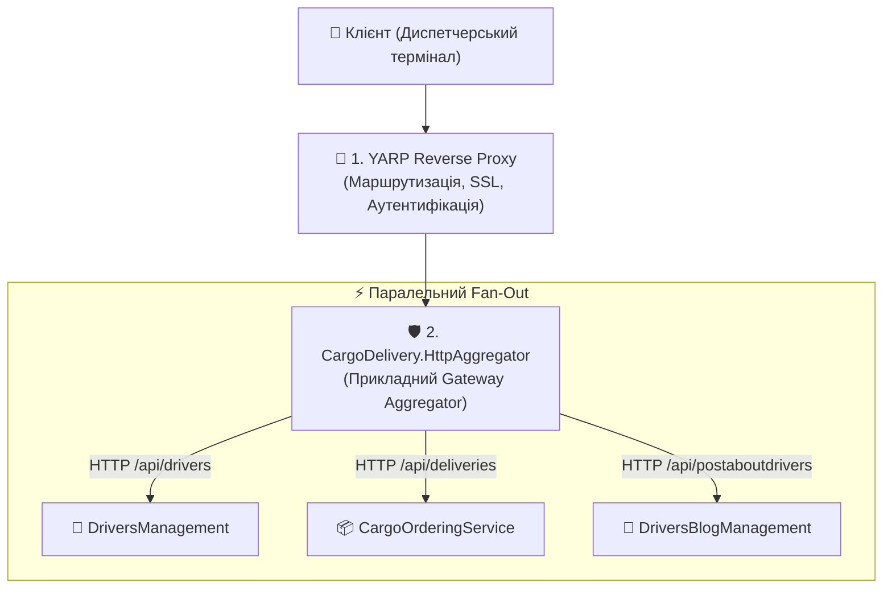
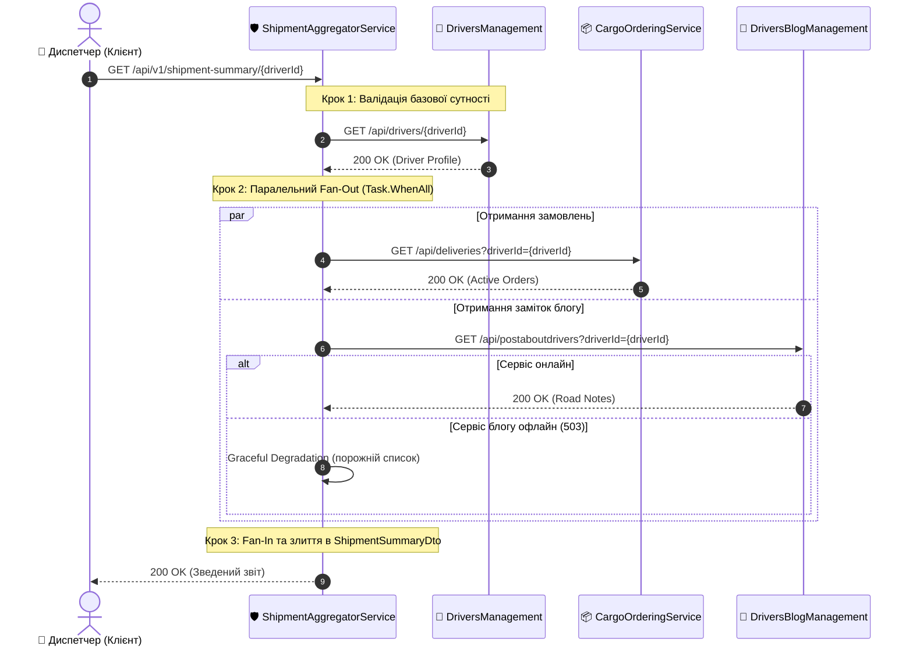

# 🛡️ 03. Архітектура Gateway Aggregator: Проєктування та Реалізація Сервісу

> **Розділ:** `02-Microservices-Craftsman` • **Модуль:** `02-01-Aspire-Documentation`  
> **Стек:** .NET 10, C# 13, `IHttpClientFactory`, Typed HttpClients, `Task.WhenAll`, Graceful Degradation.  
> **Офіційна архітектурна документація Microsoft:** [API Gateway and Aggregator Pattern in .NET Microservices](https://learn.microsoft.com/dotnet/architecture/microservices/architect-microservice-container-applications/direct-client-to-microservice-communication-versus-the-api-gateway-pattern)

---

## 📑 Зміст модуля

- [Слайд 1. Чітке розмежування термінів: Aggregator vs BFF vs YARP Reverse Proxy](#slide-1)
- [Слайд 2. Чому новий проєкт CargoDelivery.HttpAggregator виділено окремо](#slide-2)
- [Слайд 3. Доменна модель: Композитний DTO диспетчера (ShipmentSummaryDto)](#slide-3)
- [Слайд 4. Типізовані HTTP-клієнти: DriverApiClient, CargoOrderApiClient, DriverBlogApiClient](#slide-4)
- [Слайд 5. Патерн Scatter-Gather: Fan-Out та Fan-In через Task.WhenAll](#slide-5)
- [Слайд 6. Порівняння затримок: Послідовні await проти паралельного Task.WhenAll](#slide-6)
- [Слайд 7. Захист від збоїв: Патерн Graceful Degradation (Часткова деградація)](#slide-7)
- [Слайд 8. Контролери та ендпоінти симуляції для наочних тестів Aspire](#slide-8)

---

<a id="slide-1"></a>
### ⚖️ Слайд 1. Чітке розмежування термінів: Aggregator vs BFF vs YARP Reverse Proxy

У сучасній мікросервісній інженерії важливо не змішувати три фундаментальні концепції:

| Концепція | Основне призначення | Типовий стек / Інструмент | Де знаходиться бізнес-логіка? |
| :--- | :--- | :--- | :--- |
| **Reverse Proxy (YARP)** | Маршрутизація, термінація SSL, балансування, rate limiting, безпека | [YARP (Yet Another Reverse Proxy)](https://microsoft.github.io/reverse-proxy/), Envoy | **Немає бізнес-логіки.** Працює на рівні байтів і HTTP-пакетів. |
| **Gateway Aggregator** | **Композиція бізнес-даних:** опитати 3 мікросервіси паралельно та зібрати спільний DTO | ASP.NET Core Web API, `Task.WhenAll`, `IHttpClientFactory` | **Прикладна логіка агрегації:** обробка помилок, злиття моделей, fallback. |
| **Backend for Frontend (BFF)** | Адаптація API під специфіку платформи (Mobile vs Web vs Desktop) | Окремий сервіс Web-BFF, Mobile-BFF | Адаптує розмір payload та картинки під конкретні екрани. |



> 🎯 **Висновок:**  
> Наш проєкт `CargoDelivery.HttpAggregator` є **чистим Gateway Aggregator**. Він не є звичайним роутером або проксі — він володіє чіткою бізнес-задачею: сформувати зведене досьє рейсу доставки (Shipment Summary).

---

<a id="slide-2"></a>
### 🏗️ Слайд 2. Чому новий проєкт CargoDelivery.HttpAggregator виділено окремо

Раніше в навчальному репозиторії роль агрегатора частково виконував контролер всередині `DriversManagement`. Однак це створювало архітектурні проблеми:
1. **Змішування контекстів:** Домен водіїв не повинен знати про деталі доставки або публікації блогу.
2. **Захаращення коду:** Додавання тестів на Polly та трасування заважало базовим CRUD-тестам водіїв.
3. **Ізоляція демонстрації:** Окремий мікросервіс дозволяє на 100% сфокусуватися на взаємодії через HTTP, спостережуваності Aspire та тестуванні стійкості.

> 📍 **Розташування нового проєкту в рішенні:**  
> [CargoDelivery.HttpAggregator.csproj](file:///c:/Users/Yurii/source/repos/Demo-CargoDeliveryService/02-Microservices-Craftsman/CargoDelivery.HttpAggregator/CargoDelivery.HttpAggregator.csproj)

---

<a id="slide-3"></a>
### 📦 Слайд 3. Доменна модель: Композитний DTO диспетчера (ShipmentSummaryDto)

> 📍 **Файл у рішенні:**  
> [ShipmentSummaryDto.cs](file:///c:/Users/Yurii/source/repos/Demo-CargoDeliveryService/02-Microservices-Craftsman/CargoDelivery.HttpAggregator/Domain/Dtos/ShipmentSummaryDto.cs)

Клієнтський диспетчерський інтерфейс отримує одну компактну типізовану модель:

```csharp
public sealed class ShipmentSummaryDto
{
    public Guid DriverId { get; set; }
    public AggregatedDriverDto Driver { get; set; } = new();
    public List<AggregatedCargoOrderDto> ActiveOrders { get; set; } = [];
    public List<AggregatedBlogNoteDto> RoadNotes { get; set; } = [];
    
    // Ключове поле патерну Graceful Degradation:
    public bool IsDegraded { get; set; }
    public string AggregationStatus { get; set; } = "Complete";
    public DateTime AggregatedAtUtc { get; set; } = DateTime.UtcNow;
}
```

---

<a id="slide-4"></a>
### 🔌 Слайд 4. Типізовані HTTP-клієнти: DriverApiClient, CargoOrderApiClient, DriverBlogApiClient

Замість антипатерну створення `new HttpClient()` у циклі, кожен сервіс має власний типізований клієнт, зареєстрований через `IHttpClientFactory`:

| Клієнт | Цільовий сервіс | Логічний URL у Service Discovery | Вихідний код |
| :--- | :--- | :--- | :--- |
| **`DriverApiClient`** | `DriversManagement` | `http://driversmanagement` | [DriverApiClient.cs](file:///c:/Users/Yurii/source/repos/Demo-CargoDeliveryService/02-Microservices-Craftsman/CargoDelivery.HttpAggregator/Domain/Clients/DriverApiClient.cs) |
| **`CargoOrderApiClient`** | `CargoOrderingService` | `http://cargoorderingservice` | [CargoOrderApiClient.cs](file:///c:/Users/Yurii/source/repos/Demo-CargoDeliveryService/02-Microservices-Craftsman/CargoDelivery.HttpAggregator/Domain/Clients/CargoOrderApiClient.cs) |
| **`DriverBlogApiClient`** | `DriversBlogManagement` | `http://driversblogmanagement` | [DriverBlogApiClient.cs](file:///c:/Users/Yurii/source/repos/Demo-CargoDeliveryService/02-Microservices-Craftsman/CargoDelivery.HttpAggregator/Domain/Clients/DriverBlogApiClient.cs) |

Приклад реалізації клієнта водіїв:
```csharp
public sealed class DriverApiClient : IDriverApiClient
{
    private readonly HttpClient _httpClient;
    private readonly ILogger<DriverApiClient> _logger;

    public DriverApiClient(HttpClient httpClient, ILogger<DriverApiClient> logger)
    {
        _httpClient = httpClient;
        _logger = logger;
    }

    public async Task<AggregatedDriverDto?> GetDriverByIdAsync(Guid driverId, CancellationToken cancellationToken = default)
    {
        _logger.LogInformation("Надсилання запиту GET до DriversManagement для водія {DriverId}", driverId);
        var response = await _httpClient.GetAsync($"api/drivers/{driverId}", cancellationToken);

        if (response.StatusCode == HttpStatusCode.NotFound)
            return null;

        response.EnsureSuccessStatusCode();
        return await response.Content.ReadFromJsonAsync<AggregatedDriverDto>(cancellationToken: cancellationToken);
    }
}
```

---

<a id="slide-5"></a>
### 🔄 Слайд 5. Патерн Scatter-Gather: Fan-Out та Fan-In через Task.WhenAll

> 📍 **Файл у рішенні:**  
> [ShipmentAggregatorService.cs](file:///c:/Users/Yurii/source/repos/Demo-CargoDeliveryService/02-Microservices-Craftsman/CargoDelivery.HttpAggregator/Domain/Services/ShipmentAggregatorService.cs)

Діаграма послідовності виклику:



---

<a id="slide-6"></a>
### ⏱️ Слайд 6. Порівняння затримок: Послідовні await проти паралельного Task.WhenAll

Чому ми категорично не пишемо послідовні виклики `await clientA(); await clientB();`?

```csharp
// ❌ АНТИПАТЕРН: Послідовне очікування блокує потік черги
var orders = await _cargoOrderApiClient.GetActiveOrdersByDriverIdAsync(...); // 55 мс
var notes = await _driverBlogApiClient.GetRoadNotesByDriverIdAsync(...);     // 45 мс
// Загальний час: 55 + 45 = 100 мс!

// 🟢 ЕТАЛОН: Паралельний запуск через пул завдань Task
var ordersTask = _cargoOrderApiClient.GetActiveOrdersByDriverIdAsync(...);
var notesTask = _driverBlogApiClient.GetRoadNotesByDriverIdAsync(...);

// Чекаємо завершення обох асинхронних операцій вводу-виводу
await Task.WhenAll(ordersTask, notesTask);
// Загальний час: Max(55, 45) = 55 мс! (Прискорення майже в 2 рази!)
```

---

<a id="slide-7"></a>
### 🛡️ Слайд 7. Захист від збоїв: Патерн Graceful Degradation (Часткова деградація)

Що станеться, якщо сервіс блогу `DriversBlogManagement` раптово зазнає збою (наприклад, перевантаження CPU або оновлення контейнера)?

```csharp
private async Task<List<AggregatedBlogNoteDto>> SafeFetchRoadNotesAsync(
    Func<Task<List<AggregatedBlogNoteDto>>> fetchAction,
    Action onFailure)
{
    try
    {
        return await fetchAction();
    }
    catch (Exception ex)
    {
        // 1. Фіксуємо попередження у логах OpenTelemetry
        _logger.LogWarning(ex, "DriversBlogManagement недоступний. Застосовано Graceful Degradation.");
        
        // 2. Встановлюємо прапорець часткової деградації
        onFailure();
        
        // 3. Повертаємо безпечне значення за замовчуванням
        return [];
    }
}
```

#### Чому це критично важливо?
* Диспетчеру **терміново потрібні дані водія та статус вантажу**, щоб не зірвати рейс.
* Якщо відсутні дорожні замітки водія — це неприємно, але **не критично**.
* Завдяки Graceful Degradation диспетчер бачить замовлення, а на екрані з'являється невелике попередження: *"Частина даних тимчасово недоступна"*.
* Застосунок **не падає з 500 помилкою**!

---

<a id="slide-8"></a>
### 🧪 Слайд 8. Контролери та ендпоінти симуляції для наочних тестів Aspire

Для інтерактивної демонстрації створено два спеціалізовані контролери:

1. **`ShipmentSummaryController`**:
   > 📍 [ShipmentSummaryController.cs](file:///c:/Users/Yurii/source/repos/Demo-CargoDeliveryService/02-Microservices-Craftsman/CargoDelivery.HttpAggregator/Controllers/ShipmentSummaryController.cs)  
   Головний робочий маршрут: `GET /api/v1/shipment-summary/{driverId}`.

2. **`SimulationController`**:
   > 📍 [SimulationController.cs](file:///c:/Users/Yurii/source/repos/Demo-CargoDeliveryService/02-Microservices-Craftsman/CargoDelivery.HttpAggregator/Controllers/SimulationController.cs)  
   Керовані маршрути для перевірки реакції платформи:
   * `GET /api/simulation/slow?delaySeconds=5` — імітація повільної мережі для тесту таймаутів.
   * `GET /api/simulation/flaky?failUntil=2` — перші 2 спроби повертають 503, 3-я повертає 200 OK (перевірка Polly Retry).
   * `GET /api/simulation/error` — повертає стабільний 503 для перевірки розмикання Circuit Breaker.
