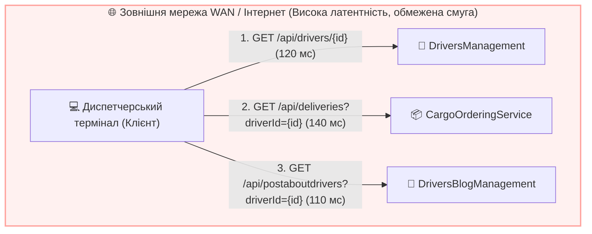
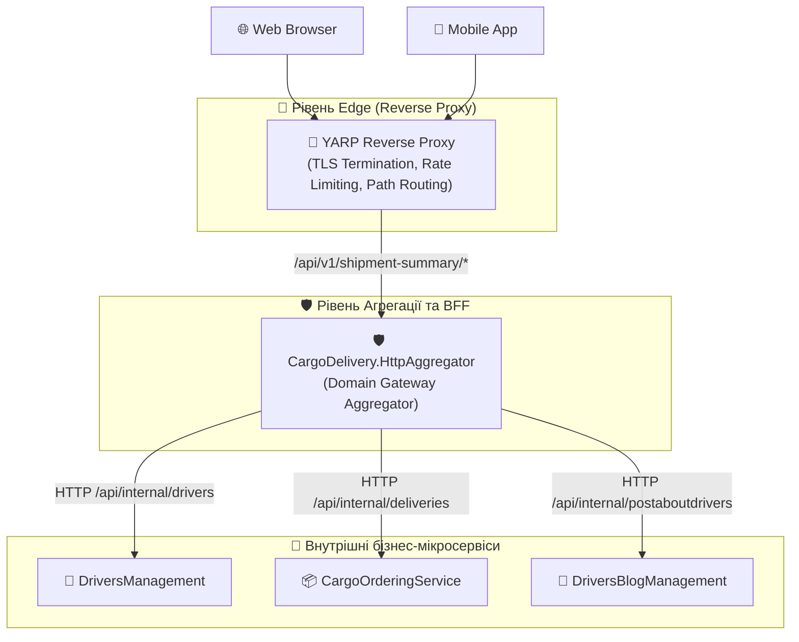
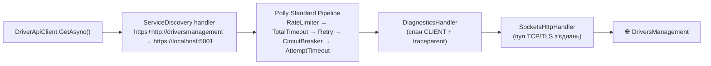
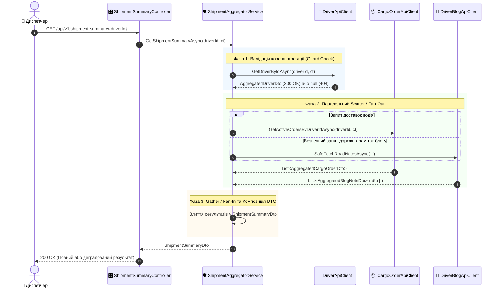
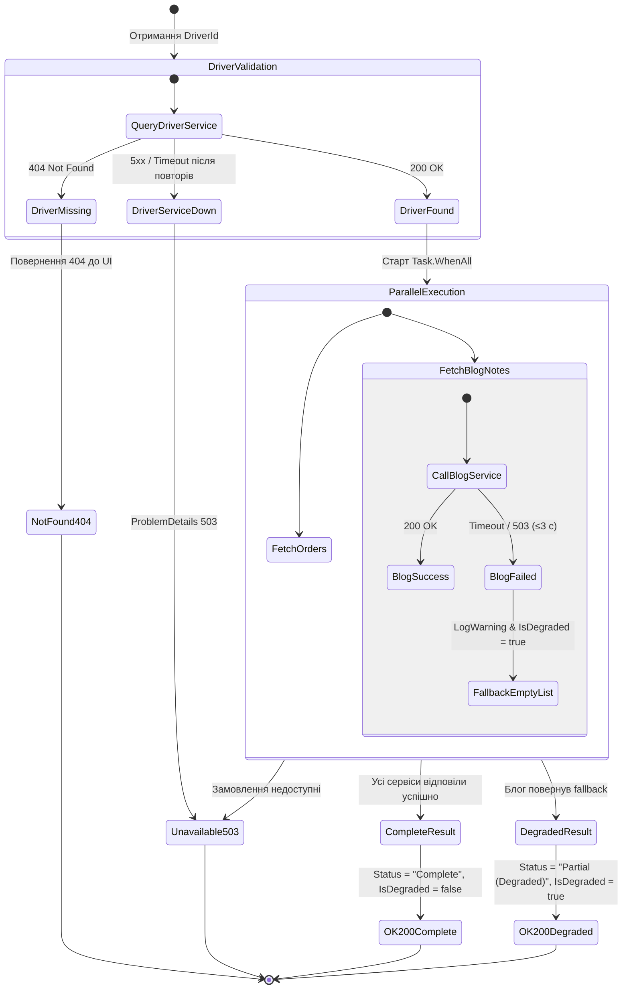

# 🛡️ 03. Архітектура Gateway Aggregator: Проєктування та Реалізація Сервісу Агрегації

> **Розділ курсу:** `02-Microservices-Craftsman` • **Модуль:** `02-01-Aspire-Documentation`  
> **Стек:** .NET 10, ASP.NET Core Web API, `IHttpClientFactory`, Typed HttpClients, `Task.WhenAll`, Polly v8 (`Microsoft.Extensions.Http.Resilience`), Aspire Service Discovery, OpenTelemetry  
> **Цільова аудиторія:** Архітектори розподілених систем, Senior/Lead .NET інженери, викладачі та студенти курсів мікросервісної архітектури  
> **Офіційна документація Microsoft:**  
> - [Architecting Container-based Applications: API Gateways](https://learn.microsoft.com/dotnet/architecture/microservices/architect-microservice-container-applications/direct-client-to-microservice-communication-versus-the-api-gateway-pattern)  
> - [Make HTTP requests using IHttpClientFactory in ASP.NET Core](https://learn.microsoft.com/aspnet/core/fundamentals/http-requests)  
> - [Enterprise Integration Patterns: Scatter-Gather (Hohpe & Woolf)](https://www.enterpriseintegrationpatterns.com/patterns/messaging/BroadcastAggregate.html)
> - [Azure Architecture Center: Gateway Aggregation pattern](https://learn.microsoft.com/azure/architecture/patterns/gateway-aggregation)

---

## 📑 Академічний зміст лекції

- [1. Теоретичний базис: Проблема прямої взаємодії (Direct Client-to-Microservice)](#section-1)
- [2. Патерн Gateway Aggregator та патерни інтеграції підприємства (EIP Scatter-Gather)](#section-2)
- [3. Матриця розмежування архітектурних стилів: YARP vs BFF vs Gateway Aggregator](#section-3)
- [4. Економіка затримок: Математичний аналіз RTT послідовних та паралельних викликів](#section-4)
- [5. Архітектура проєкту CargoDelivery.HttpAggregator](#section-5)
- [6. Проєктування типізованих HTTP-клієнтів та керування сокетами через IHttpClientFactory](#section-6)
- [7. Реалізація патерну Scatter-Gather у ShipmentAggregatorService (Fan-Out / Fan-In)](#section-7)
- [8. Патерн Graceful Degradation (Часткова деградація) та ізоляція відмов](#section-8)
- [9. Контролери та лабораторний полігон симуляції відмов (SimulationController)](#section-9)
- [10. Внутрішні (service-to-service) API: окремий контур для агрегатора](#section-10)
- [11. Архітектурна матриця: Антипатерни vs Еталонні практики](#section-11)
- [12. Практичні завдання та контрольні запитання для самоперевірки](#section-12)

---

<a id="section-1"></a>
## 1. Теоретичний базис: Проблема прямої взаємодії (Direct Client-to-Microservice)

У розподіленій системі, де кожен бізнес-домен виділено в окремий автономний мікросервіс (у нашому випадку: управління водіями `DriversManagement`, замовлення вантажів `CargoOrderingService`, дорожні публікації `DriversBlogManagement`), клієнтський застосунок (Web SPA, мобільний застосунок або автоматизоване робоче місце диспетчера) стикається з фундаментальною проблемою оркестрації даних.

### Антипатерн «Товстий клієнт-оркестратор» (Client-Driven Aggregation)

Якщо клієнт звертається безпосередньо до кожного сервісу самостійно, виникає каскад системних вад:



#### Анатомія недоліків прямої взаємодії:

1. **Мережева балакучість (Chattiness / Round-Trip Tax):**
   * Клієнт змушений виконувати $N$ послідовних або квазі-паралельних HTTP-запитів через публічну мережу Інтернет або мобільні стільникові канали (WAN).
   * Кожен Round-Trip Time (RTT) через WAN займає від 50 до 200 мілісекунд через фізичну відстань, рукостискання TLS, проходження через маршрутизатори інтернет-провайдерів.
   * У результаті загальний час завантаження одного екрана перевищує $400-600\text{ мс}$, що порушує вимоги до сучасного UX (Core Web Vitals, Responsive UI).
   * Браузер до того ж обмежує кількість одночасних з'єднань до одного хоста (для HTTP/1.1 — 6), тож «паралельність» на клієнті теж не безмежна.

2. **Витік внутрішніх доменних моделей та надмірне зачеплення (Coupling Leakage):**
   * Клієнтський застосунок стає жорстко прив'язаним до внутрішньої декомпозиції бекенду, внутрішніх URL-шляхів, схем автентифікації та форматів DTO кожного з трьох сервісів.
   * Якщо архітектори вирішать об'єднати або перейменувати ендпоінти в `DriversBlogManagement`, клієнтський додаток зламається і вимагатиме релізу нової версії в App Store / Google Play або очищення кешу браузерів тисяч користувачів.

3. **Розмивання периметра безпеки (Security Perimeter Dilution):**
   * Кожен мікросервіс змушений бути виставленим назовні (Public Ingress), мати публічну IP-адресу, відкритий порт та перевіряти складні токени аутентифікації клієнта.
   * Збільшується вектор потенційної атаки (Attack Surface).

4. **Проблема надлишковості та недостатності даних (Over-fetching & Under-fetching):**
   * Клієнт отримує з `DriversManagement` 30 полів водія (включаючи паспорти, домашні адреси, дату проходження медичного огляду), хоча на зведеному екрані диспетчера потрібні лише `FullName`, `LicenseNumber` та `CompanyName`. Це марнує мобільний трафік, пам'ять пристрою і — що важливіше — **розкриває персональні дані**, яких клієнту бачити не треба.

---

<a id="section-2"></a>
## 2. Патерн Gateway Aggregator та патерни інтеграції підприємства (EIP Scatter-Gather)

Для вирішення вищевказаних проблем застосовується патерн **Gateway Aggregator** (Шлюз-Агрегатор), який є прикладною реалізацією класичного патерну *Scatter-Gather* (Розкидай-Збери) з фундаментальної праці Грегора Хопе та Боббі Вулфа *"Enterprise Integration Patterns"*.

### Формальне визначення

> **Gateway Aggregator** — це спеціалізований сервіс-посередник, розташований всередині захищеного периметра приватної мережі (LAN/VPC), який приймає єдиний високорівневий бізнес-запит від клієнта, розбиває його на паралельні підзапити до відповідних мікросервісів, очікує на їх відповіді, зливає (агрегує) отримані гетерогенні дані в єдину цілісну модель і повертає компактний результат клієнту.

```mermaid
flowchart TD
    Client["💻 Диспетчерський термінал"] -->|"Єдиний запит через WAN<br/>GET /api/v1/shipment-summary/{id}"| Agg["🛡️ CargoDelivery.HttpAggregator<br/>(Gateway Aggregator)"]
    
    subgraph PrivateNet ["🔒 Приватна низьколатентна мережа (LAN / Aspire / k8s)"]
        Agg -->|"⚡ Fan-Out (Паралельно)"| DM["🚚 DriversManagement"]
        Agg -->|"⚡ Fan-Out (Паралельно)"| CO["📦 CargoOrderingService"]
        Agg -->|"⚡ Fan-Out (Паралельно)"| DB["📝 DriversBlogManagement"]
        
        DM -.->|"200 OK (Driver DTO)"| Agg
        CO -.->|"200 OK (Orders List)"| Agg
        DB -.->|"200 OK (Blog Notes)"| Agg
    end
    
    Agg -->|"Єдина відповідь через WAN<br/>200 OK (ShipmentSummaryDto)"| Client
    
    style PrivateNet fill:#f6ffed,stroke:#b7eb8f,stroke-width:2px;
```



### Ключові архітектурні переваги патерну:
1. **Зниження мережевих витрат WAN до 1 RTT:** Клієнт платить ціну затримки зовнішньої мережі рівно один раз. Вся подальша комунікація відбувається у внутрішньому кластері зі швидкістю $\le 1-3\text{ мс}$ на запит.
2. **Адаптація контракту під користувацький сценарій (Tailored Contract):** Формується спеціальний зведений DTO (`ShipmentSummaryDto`), який містить лише ті атрибути, що необхідні конкретному бізнес-процесу.
3. **Шар запобігання пошкодженню (Anti-Corruption Layer — ACL):** Агрегатор виступає буфером. Зміни внутрішніх контрактів бекенду адаптуються всередині агрегатора, не вимагаючи оновлення коду фронтенду.
4. **Централізована реалізація стійкості (Resilience Boundary):** Всі тайм-аути, політики повторних спроб (Retry) та автоматичне розмикання ланцюга (Circuit Breaker) інкапсулюються в агрегаторі.

### Ціна патерну (про що часто забувають)
| Недолік | Як він проявляється | Як пом'якшуємо |
| :--- | :--- | :--- |
| Ще один мережевий «хоп» | +1–3 мс у LAN на кожен запит | Паралельний Fan-Out з лишком компенсує цю ціну |
| Ще одна точка відмови | Якщо агрегатор лежить — екрана немає | Кілька реплік за балансувальником, `/health` для оркестратора |
| Ризик «розподіленого моноліту» | Агрегатор обростає бізнес-логікою всіх доменів | Агрегатор лише **компонує** дані; бізнес-правила живуть у сервісах-власниках |
| Зв'язність за часом (temporal coupling) | Агрегатор чекає на всі джерела | Таймаути + Graceful Degradation для некритичних джерел |

---

<a id="section-3"></a>
## 3. Матриця розмежування архітектурних стилів: YARP vs BFF vs Gateway Aggregator

В інженерних дискусіях терміни *Reverse Proxy*, *Backend for Frontend (BFF)* та *Gateway Aggregator* нерідко помилково вживають як синоніми. Це призводить до грубих архітектурних помилок — наприклад, спроб писати складну бізнес-логіку злиття JSON-об'єктів у конфігурації зворотного проксі.

У наступній матриці наведено суворе академічне розмежування цих трьох концепцій за 8 вимірами:

| Архітектурний вимір | Reverse Proxy (YARP, Envoy, NGINX) | Gateway Aggregator (`CargoDelivery.HttpAggregator`) | Backend for Frontend (BFF) |
| :--- | :--- | :--- | :--- |
| **Головне призначення** | Низькорівнева маршрутизація, балансування навантаження, SSL-термінація | **Прикладна композиція даних** від декількох сервісів для бізнес-сценарію | Спеціалізація інтерфейсу під конкретний клієнтський форм-фактор |
| **Рівень моделі OSI** | Рівень 4 (Транспортний) або Рівень 7 (HTTP протокол без зміни payload) | Рівень 7 (Прикладний рівень, глибока десеріалізація та обробка C# об'єктів) | Рівень 7 (Прикладний рівень, оркестрація сесій, cookie-to-token, оптимізація медіа) |
| **Бізнес-логіка** | **Категорично заборонена.** Не знає семантики домену. Працює з потоками байтів (`Stream`). | **Присутня логіка агрегації:** перевірка існування водія, злиття списків, розрахунок агрегованого статусу. | **Присутня логіка подання:** фільтрація полів для смартфона, стиснення картинок під екран Retina. |
| **Кількість цільових викликів на 1 вхідний запит** | Строго 1 до 1 ($1 \to 1$). Перенаправляє запит на один обраний бекенд-інстанс. | 1 до багатьох ($1 \to N$). Виконує паралельний Fan-Out на 2, 3 або більше сервісів. | Варіюється: може бути як $1 \to 1$ проксі, так і $1 \to N$ агрегація для свого UI. |
| **Споживання пам'яті та процесора** | Мінімальне. Zero-copy проксіювання потоків без десеріалізації JSON у пам'ять. | Помірне. Вимагає алокації C# DTO-об'єктів у GC Heap та роботи серіалізатора `System.Text.Json`. | Помірне. Алокація структур даних під специфічний інтерфейс. |
| **Стійкість до відмов (Failure Handling)** | HTTP 502/504 Bad Gateway, перемикання на інший інстанс того самого сервісу. | **Graceful Degradation:** повернення часткового результату при відмові некритичного джерела. | Graceful Degradation або рендеринг резервного UI-екрана. |
| **Аутентифікація та Авторизація** | Перевірка TLS-сертифікатів, валідація JWT-підпису, Rate Limiting за IP. | Перевірка бізнес-ролей, валідація доступу до конкретної сутності (`DriverId`). | Захист сесій через SameSite Cookies, обмін Cookie на JWT токен (BFF Token Handler). |
| **Кількість екземплярів / сервісів** | Зазвичай єдиний вхідний вузол (Edge Ingress) на весь кластер. | Може бути кілька агрегаторів для різних бізнес-доменів (Logistics, Billing, CRM). | Окремий сервіс для кожного типу клієнта (`Web.BFF`, `Mobile.BFF`, `Partner.BFF`). |

> 🔁 **У нашому рішенні є обидва підходи.** `CargoDelivery.HttpAggregator` — виділений Gateway Aggregator (цей гайд). А в `DriversManagement` живе вбудований BFF-ендпоінт `GET /api/v1/driver-dashboard/{id}` ([DriverDashboardController.cs#L49](../DriversManagement/src/DriversManagement/Controllers/v1/DriverDashboardController.cs#L49)), розібраний у [02_Patterns_Synchronous_HttpClient_Aggregator_BFF.md](../02-02-Communication-Documentation/02_Patterns_Synchronous_HttpClient_Aggregator_BFF.md). Порівняння двох реалізацій — гарна вправа: BFF читає водія з **власної** БД, а агрегатор — по мережі.

### Архітектурний стек у реальній системі:



> 💡 **Висновок архітектора:**  
> `CargoDelivery.HttpAggregator` є саме **Domain Gateway Aggregator**. Він не замінює зворотний проксі (YARP), а розташовується за ним, беручи на себе виключно прикладну задачу збирання розрізнених даних логістичного рейсу.

---

<a id="section-4"></a>
## 4. Економіка затримок: Математичний аналіз RTT послідовних та паралельних викликів

Одним з найважливіших інженерних обґрунтувань створення агрегатора є розрахунок загального часу затримки (Total Latency Budget).

Нехай для формування зведеної інформації рейсу необхідно отримати дані від трьох мікросервісів:
* $S_1$ (`DriversManagement`): затримка обробки $t_1 = 45\text{ мс}$.
* $S_2$ (`CargoOrderingService`): затримка обробки $t_2 = 65\text{ мс}$.
* $S_3$ (`DriversBlogManagement`): затримка обробки $t_3 = 40\text{ мс}$.
* Затримка внутрішньої локальної мережі (LAN Round-Trip) $t_{\text{lan}} = 2\text{ мс}$ на кожен запит.
* Затримка зовнішньої клієнтської мережі (WAN Round-Trip) $t_{\text{wan}} = 100\text{ мс}$.

### Модель 1: Прямі виклики клієнтом (Послідовно)
Загальний час для клієнта обчислюється як сума трьох послідовних WAN-транзакцій:
$$T_{\text{direct\_seq}} = \sum_{i=1}^{3} (t_{\text{wan}} + t_i) = (100 + 45) + (100 + 65) + (100 + 40) = 450\text{ мс}$$

### Модель 2: Агрегатор з послідовним виконанням запитів (`await` один за одним)
Клієнт робить один WAN-запит, але агрегатор опитує сервіси по черзі:
$$T_{\text{agg\_seq}} = t_{\text{wan}} + \sum_{i=1}^{3} (t_{\text{lan}} + t_i) + \delta_{\text{cpu}} = 100 + (2 + 45) + (2 + 65) + (2 + 40) + 1 = 257\text{ мс}$$

### Модель 3: Еталонний Gateway Aggregator з паралельним Fan-Out (`Task.WhenAll`)
Клієнт робить один WAN-запит. Агрегатор спочатку валідує кореневу сутність (водія), після чого одночасно ініціює виклики до замовлень і блогу:
$$T_{\text{step1}} = t_{\text{lan}} + t_1 = 2 + 45 = 47\text{ мс}$$
$$T_{\text{step2}} = \max(t_{\text{lan}} + t_2, \; t_{\text{lan}} + t_3) = \max(2 + 65, \; 2 + 40) = 67\text{ мс}$$
$$T_{\text{agg\_parallel}} = t_{\text{wan}} + T_{\text{step1}} + T_{\text{step2}} + \delta_{\text{cpu}} = 100 + 47 + 67 + 2 = 216\text{ мс}$$


> 📊 **Результат оптимізації:**  
> Застосування патерну Gateway Aggregator з паралельним `Task.WhenAll` скорочує сумарний час очікування диспетчера більш ніж **вдвічі** (з $450\text{ мс}$ до $216\text{ мс}$), повністю ліквідуючи затримку повторних WAN-рукостискань.

### Узагальнення: закон «найповільнішої гілки»
Для $N$ незалежних викликів час паралельного Fan-Out дорівнює **максимуму**, а не сумі: $T = \max_i(t_i)$. Але це ж і пастка — *хвостова латентність* (tail latency). Якщо кожен сервіс у 1% випадків відповідає повільно (p99), то ймовірність, що **хоча б один** із $N$ буде повільним, дорівнює $1 - 0.99^N$: для $N=3$ це ≈3%, для $N=20$ — вже ≈18%. Саме тому для кожної гілки потрібен власний таймаут (див. §8 і [гайд 06](06_ServiceDiscovery_Resilience_Polly_HttpClient.md)).

> 🔬 **Реальні виміри на стенді:** `GET /api/v1/shipment-summary/{id}` з даними з усіх трьох сервісів — ≈0.45–0.55 с на «холодному» першому запиті (встановлення TLS-з'єднань, JIT) і десятки мілісекунд на «теплих» повторних.

---

<a id="section-5"></a>
## 5. Архітектура проєкту CargoDelivery.HttpAggregator

Для забезпечення чистоти архітектури, ізоляції демонстраційних ендпоінтів та уникнення захаращення доменного коду водіїв у рішенні створено виділений проєкт:

> 📍 **Файл проєкту:**  
> [CargoDelivery.HttpAggregator.csproj](../CargoDelivery.HttpAggregator/CargoDelivery.HttpAggregator.csproj)

### Структура файлової системи проєкту:

```
CargoDelivery.HttpAggregator/
├── Controllers/
│   ├── ShipmentSummaryController.cs   <-- Головний контролер агрегації (200 / 404 / 503)
│   ├── ResilienceDemoController.cs    <-- Лабораторія Polly: /retry, /timeout, /circuit-breaker
│   └── SimulationController.cs        <-- Полігон збоїв: /slow, /flaky, /error, /ok
├── Domain/
│   ├── Clients/                       <-- Типізовані клієнти IHttpClientFactory
│   │   ├── IDriverApiClient.cs / DriverApiClient.cs
│   │   ├── ICargoOrderApiClient.cs / CargoOrderApiClient.cs
│   │   ├── IDriverBlogApiClient.cs / DriverBlogApiClient.cs
│   │   └── ISimulationApiClient.cs / SimulationApiClient.cs   <-- іменовані клієнти лабораторії
│   ├── Dtos/                          <-- Контракти даних агрегації
│   │   ├── ShipmentSummaryDto.cs      <-- Композитний DTO диспетчера
│   │   ├── AggregatedDriverDto.cs
│   │   ├── AggregatedCargoOrderDto.cs
│   │   ├── AggregatedBlogNoteDto.cs
│   │   └── ResilienceDemoResultDto.cs
│   └── Services/                      <-- Прикладна бізнес-оркестрація
│       ├── IShipmentAggregatorService.cs
│       └── ShipmentAggregatorService.cs
├── Properties/launchSettings.json     <-- Фіксовані порти: https 57390, http 57391
├── CargoDelivery.HttpAggregator.http  <-- Готові запити для всіх лабораторних
└── Program.cs                         <-- DI контейнер та підключення ServiceDefaults
```

### Оркестрація в AppHost

У файлі [AppHost.cs#L116-L123](../Aspire/CargoDelivery.AppHost/AppHost.cs#L116-L123) агрегатор зареєстрований як повноцінний вузол графу розподіленої системи з декларативними залежностями:

```csharp
var httpAggregator = builder.AddProject<Projects.CargoDelivery_HttpAggregator>("httpaggregator")
    .WithReference(driversApi)
    .WithReference(cargoApi)
    .WithReference(blogApi)
    .WithHttpHealthCheck("/health")
    .WaitFor(driversApi)
    .WaitFor(cargoApi)
    .WaitFor(blogApi);
```

#### Семантика налаштування:
1. `WithReference(service)`: Впроваджує конфігурацію Service Discovery. Aspire автоматично передає агрегатору змінні оточення `services__driversmanagement__https__0` тощо, що дозволяє `HttpClient` розв'язувати логічні імена сервісів.
2. `WaitFor(service)`: Формує орієнтований ациклічний граф (DAG) запуску. Агрегатор переходить у стан виконання лише після того, як сервіси водіїв, замовлень і блогу стали `Healthy` (їхній `/health` відповів 200).
3. `WithHttpHealthCheck("/health")`: дає змогу Aspire (і будь-кому, хто колись зробить `.WaitFor(httpAggregator)`) знати, коли сам агрегатор готовий.

---

<a id="section-6"></a>
## 6. Проєктування типізованих HTTP-клієнтів та керування сокетами через IHttpClientFactory

### Проблема сокетного голодування (Socket Exhaustion)
У ранніх версіях .NET розробники створювали клієнт через `using var client = new HttpClient()`. При інтенсивному навантаженні закриті з'єднання залишалися в стані `TIME_WAIT` (у Windows за замовчуванням до 4 хвилин), вичерпуючи ліміт ефемерних портів ОС (`SocketException: Only one usage of each socket address is normally permitted`). З іншого боку, використання єдиного `static HttpClient` призводило до ігнорування змін DNS-записів під час масштабування контейнерів.

### Рішення: Typed HttpClients в ASP.NET Core
У `CargoDelivery.HttpAggregator` кожен клієнт реалізовано як типізований клас, життєвим циклом пулу з'єднань якого керує `IHttpClientFactory`:

> 📍 **Реєстрація у [Program.cs#L45-L64](../CargoDelivery.HttpAggregator/Program.cs#L45):**

```csharp
// Логічні імена сервісів з AppHost + схема "https+http" (спершу HTTPS, потім HTTP).
// Стандартний конвеєр Polly вже доданий ГЛОБАЛЬНО через builder.AddServiceDefaults().
builder.Services.AddHttpClient<IDriverApiClient, DriverApiClient>(client =>
    client.BaseAddress = new Uri("https+http://driversmanagement"));

builder.Services.AddHttpClient<ICargoOrderApiClient, CargoOrderApiClient>(client =>
    client.BaseAddress = new Uri("https+http://cargoorderingservice"));

// Блог — НЕКРИТИЧНА залежність: замінюємо глобальний конвеєр на короткий бюджет часу
builder.Services.AddHttpClient<IDriverBlogApiClient, DriverBlogApiClient>(client =>
        client.BaseAddress = new Uri("https+http://driversblogmanagement"))
    .RemoveAllResilienceHandlers()
    .AddStandardResilienceHandler(options =>
    {
        options.AttemptTimeout.Timeout = TimeSpan.FromSeconds(1);
        options.Retry.MaxRetryAttempts = 1;
        options.Retry.Delay = TimeSpan.FromMilliseconds(200);
        options.TotalRequestTimeout.Timeout = TimeSpan.FromSeconds(3);
    });
```

> 🐞 **Що було виправлено.** Раніше кожен клієнт: (1) читав адресу вручну з `builder.Configuration["services:...:http:0"]`, оминаючи Service Discovery, і (2) додавав `.AddStandardResilienceHandler()` **поверх** глобального з ServiceDefaults. Через подвійний конвеєр при недоступному сервісі запит агрегатора висів рівно 30 с і повертав 500 (див. [гайд 06](06_ServiceDiscovery_Resilience_Polly_HttpClient.md#section-4)).

### Деконструкція коду типізованого клієнта DriverApiClient

> 📍 **Файл:** [DriverApiClient.cs](../CargoDelivery.HttpAggregator/Domain/Clients/DriverApiClient.cs) — ключові рядки [#L47](../CargoDelivery.HttpAggregator/Domain/Clients/DriverApiClient.cs#L47) (виклик), [#L52](../CargoDelivery.HttpAggregator/Domain/Clients/DriverApiClient.cs#L52) (404), [#L59](../CargoDelivery.HttpAggregator/Domain/Clients/DriverApiClient.cs#L59) (інші помилки)

```csharp
public sealed class DriverApiClient : IDriverApiClient
{
    private readonly HttpClient _httpClient;
    private readonly ILogger<DriverApiClient> _logger;

    public DriverApiClient(HttpClient httpClient, ILogger<DriverApiClient> logger)
    {
        _httpClient = httpClient;
        _logger = logger;
    }

    public async Task<AggregatedDriverDto?> GetDriverByIdAsync(Guid driverId, CancellationToken cancellationToken = default)
    {
        _logger.LogInformation("Надсилання запиту GET до DriversManagement для водія {DriverId}", driverId);

        try
        {
            // Внутрішній (service-to-service) ендпоінт повертає компактну картку водія
            var response = await _httpClient.GetAsync($"api/internal/drivers/{driverId}", cancellationToken);

            // 404 — очікуваний БІЗНЕС-результат, а не збій: обробляємо без винятку
            if (response.StatusCode == HttpStatusCode.NotFound)
            {
                _logger.LogWarning("Водія {DriverId} не знайдено в DriversManagement (404)", driverId);
                return null;
            }

            // Для інших неуспішних кодів (500, 503 після всіх повторів...) кидаємо HttpRequestException
            response.EnsureSuccessStatusCode();

            // Потокова десеріалізація System.Text.Json напряму з мережевого Stream
            return await response.Content.ReadFromJsonAsync<AggregatedDriverDto>(cancellationToken: cancellationToken);
        }
        catch (HttpRequestException ex)
        {
            _logger.LogError(ex, "Мережевий збій при зверненні до DriversManagement для водія {DriverId}", driverId);
            throw;
        }
    }
}
```

#### Ключові інженерні акценти реалізації:
1. **Інжекція `HttpClient`:** Екземпляр `HttpClient` створюється контейнером як `Transient`, але його внутрішній ланцюжок обробників (`HttpMessageHandler`: Service Discovery → Polly → `SocketsHttpHandler`) береться з пулу `IHttpClientFactory` і за замовчуванням оновлюється кожні 2 хвилини (`HandlerLifetime`), щоб підхоплювати зміни DNS.
2. **Обробка `HttpStatusCode.NotFound`:** Ми не викликаємо `EnsureSuccessStatusCode()` сліпо. Статус 404 є валідним бізнес-результатом («водія не існує»), тому ми повертаємо `null`. Це захищає від створення непотрібних винятків (`HttpRequestException`) і від марних повторів: стандартний Retry Polly повторює лише транзієнтні коди (408, 429, 5xx), 404 він пропускає одразу.
3. **Ефективне читання через `ReadFromJsonAsync`:** Десеріалізатор працює безпосередньо з вхідним байтовим потоком відповіді (`Stream`), мінімізуючи алокацію тимчасових рядків у пам'яті.
4. **`GetFromJsonAsync` як скорочення.** У [CargoOrderApiClient.cs#L43](../CargoDelivery.HttpAggregator/Domain/Clients/CargoOrderApiClient.cs#L43) і [DriverBlogApiClient.cs#L39](../CargoDelivery.HttpAggregator/Domain/Clients/DriverBlogApiClient.cs#L39) використано `GetFromJsonAsync<T>()` = `GetAsync` + `EnsureSuccessStatusCode` + `ReadFromJsonAsync` одним викликом — там 404 не має окремої семантики.

### Ланцюжок обробників одного HTTP-виклику



---

<a id="section-7"></a>
## 7. Реалізація патерну Scatter-Gather у ShipmentAggregatorService (Fan-Out / Fan-In)

Центральним ядром агрегатора є сервіс [ShipmentAggregatorService.cs](../CargoDelivery.HttpAggregator/Domain/Services/ShipmentAggregatorService.cs).

### Покроковий алгоритм роботи сервісу:



### Детальний розбір реалізації методу злиття

> 📍 **Вихідний код:** [ShipmentAggregatorService.cs#L42-L94](../CargoDelivery.HttpAggregator/Domain/Services/ShipmentAggregatorService.cs#L42) — Guard Check [#L49](../CargoDelivery.HttpAggregator/Domain/Services/ShipmentAggregatorService.cs#L49), Fan-Out [#L63-L67](../CargoDelivery.HttpAggregator/Domain/Services/ShipmentAggregatorService.cs#L63), Fan-In [#L72](../CargoDelivery.HttpAggregator/Domain/Services/ShipmentAggregatorService.cs#L72), композиція [#L79](../CargoDelivery.HttpAggregator/Domain/Services/ShipmentAggregatorService.cs#L79)

```csharp
public async Task<ShipmentSummaryDto> GetShipmentSummaryAsync(Guid driverId, CancellationToken cancellationToken = default)
{
    _logger.LogInformation("Початок агрегації рейсу для водія {DriverId}", driverId);

    // КРОК 1: Перевірка водія (ПОСЛІДОВНИЙ бар'єр, Guard Check).
    var driver = await _driverApiClient.GetDriverByIdAsync(driverId, cancellationToken);
    if (driver == null)
    {
        _logger.LogWarning("Водія {DriverId} не знайдено при агрегації. Повертаємо 404.", driverId);
        throw new KeyNotFoundException($"Водія з ID {driverId} не знайдено в системі DriversManagement.");
    }

    // Прапорець часткової деградації
    bool isDegraded = false;

    // КРОК 2: Паралельний Fan-Out (Scatter) — задачі лише ЗАПУСКАЮТЬСЯ, без await
    var ordersTask = _cargoOrderApiClient.GetActiveOrdersByDriverIdAsync(driverId, cancellationToken);

    var blogNotesTask = SafeFetchRoadNotesAsync(
        () => _driverBlogApiClient.GetRoadNotesByDriverIdAsync(driverId, cancellationToken),
        onFailure: () => isDegraded = true);

    // КРОК 3: Fan-In (Gather) через Task.WhenAll
    await Task.WhenAll(ordersTask, blogNotesTask);

    var orders = await ordersTask;   // задачі вже завершені — миттєвий результат
    var notes = await blogNotesTask;

    // КРОК 4: Композиція підсумкового DTO
    return new ShipmentSummaryDto
    {
        DriverId = driverId,
        Driver = driver,
        ActiveOrders = orders,
        RoadNotes = notes,
        IsDegraded = isDegraded,
        AggregationStatus = isDegraded ? "Partial (Degraded)" : "Complete",
        AggregatedAtUtc = DateTime.UtcNow
    };
}
```

> 🧩 **Чому «не знайдено» — це виняток `KeyNotFoundException`, а не `null`?** Сервіс повертає ненульовий `ShipmentSummaryDto`, а відсутність водія сигналізує доменним винятком, який контролер транслює в 404 ([ShipmentSummaryController.cs#L59](../CargoDelivery.HttpAggregator/Controllers/ShipmentSummaryController.cs#L59)). Це свідомий вибір між двома стилями: у HTTP-клієнті ([DriverApiClient.cs#L52](../CargoDelivery.HttpAggregator/Domain/Clients/DriverApiClient.cs#L52)) 404 — це нормальне значення `null` (без винятку), а на рівні прикладного сервісу «водія немає» — це порушення передумови операції. Юніт-тест [ShipmentAggregatorServiceTests.cs#L106](../CargoDelivery.HttpAggregator.Tests/UnitTests/ShipmentAggregatorServiceTests.cs#L106) фіксує цю поведінку і перевіряє, що замовлення та блог **не викликались**.

### Чому `await Task.WhenAll(t1, t2)` краще за послідовний виклик?
Якщо виконати:
```csharp
var orders = await _cargoOrderApiClient.GetActiveOrdersByDriverIdAsync(...);
var notes = await _driverBlogApiClient.GetRoadNotesByDriverIdAsync(...);
```
Другий запит навіть не розпочне відправку, доки перший повністю не отримає всі байти та не десеріалізує відповідь. При паралельному виклику обидва запити відправляються одночасно (через окремі з'єднання пулу `SocketsHttpHandler` або мультиплексовано через HTTP/2), а потоки пулу під час очікування не блокуються — завершення I/O операційна система повідомляє асинхронно (на Windows через IOCP — I/O Completion Ports, на Linux через epoll).

### Тонкощі `Task.WhenAll`, які варто знати
| Ситуація | Поведінка |
| :--- | :--- |
| Одна задача впала | `Task.WhenAll` чекає завершення **всіх** задач, потім завершується з помилкою; `await` перекидає **перший** виняток (решта лежать у `task.Exception.InnerExceptions`) |
| Обидві впали | `await` знову кидає лише перший; щоб побачити всі — перевіряйте `whenAllTask.Exception` |
| Клієнт закрив з'єднання | Спрацьовує `cancellationToken` → обидва HTTP-виклики скасовуються → `OperationCanceledException` (його `SafeFetchRoadNotesAsync` свідомо **не** перехоплює — [#L111](../CargoDelivery.HttpAggregator/Domain/Services/ShipmentAggregatorService.cs#L111)) |
| Захоплений прапорець `isDegraded` | Змінюється в іншій гілці виконання, але читається **після** `await Task.WhenAll` — `await` гарантує видимість змін (memory barrier), тож гонитви немає |

---

<a id="section-8"></a>
## 8. Патерн Graceful Degradation (Часткова деградація) та ізоляція відмов

У мікросервісній архітектурі діє фундаментальне правило: **«Відмова одного некритичного сервісу не повинна призводити до збою всієї бізнес-операції»**.

У нашому сценарії:
* **Критична залежність (Hard Dependency):** `DriversManagement` (дані про водія) та `CargoOrderingService` (вантажні замовлення). Без них диспетчер не може відправити машину в рейс. При їх недоступності агрегатор чесно повертає **503 Service Unavailable** (ProblemDetails), а не вигадані дані.
* **Некритична залежність (Soft Dependency):** `DriversBlogManagement` (нотатки водія про стан дороги, погоду та враження). Якщо сервіс блогу падає через навантаження або перезапуск бази даних, диспетчер все одно повинен мати можливість працювати з водієм і вантажем!

> 🐞 **Що було виправлено.** Раніше `CargoOrderApiClient` при будь-якій помилці повертав **вигаданий** рейс «Терміновий медичний вантаж Київ → Львів». Для критичної залежності це небезпечно: диспетчер бачив «дані», яких не існує. Тепер виняток прокидається, і контролер відповідає 503 ([ShipmentSummaryController.cs#L64-L73](../CargoDelivery.HttpAggregator/Controllers/ShipmentSummaryController.cs#L64)).

### Реалізація механізму безпечного виконання `SafeFetchRoadNotesAsync`
> 📍 [ShipmentAggregatorService.cs#L103-L118](../CargoDelivery.HttpAggregator/Domain/Services/ShipmentAggregatorService.cs#L103)

```csharp
private async Task<List<AggregatedBlogNoteDto>> SafeFetchRoadNotesAsync(
    Func<Task<List<AggregatedBlogNoteDto>>> fetchAction,
    Action onFailure)
{
    try
    {
        return await fetchAction();
    }
    catch (Exception ex) when (ex is not OperationCanceledException)
    {
        // 1. Warning, а не Error: збій передбачений і опрацьований
        _logger.LogWarning(ex, "Мікросервіс DriversBlogManagement недоступний. Застосовано Graceful Degradation.");
        
        // 2. Сповіщаємо агрегатор про перехід у режим деградації
        onFailure();
        
        // 3. Повертаємо безпечне порожнє значення замість збою з помилкою HTTP 500
        return [];
    }
}
```

### Деградація має бути ШВИДКОЮ: бюджет часу для м'якої залежності
Перехопити виняток мало — важливо, **коли** він з'явиться. Якщо блог «завис» (порт приймає з'єднання, але не відповідає — саме так поводиться зупинений через дашборд Aspire сервіс), стандартний конвеєр Polly чекатиме до 30 с. Тому клієнт блогу має короткий бюджет: спроба 1 с, 1 повтор, загалом ≤ 3 с ([Program.cs#L55-L64](../CargoDelivery.HttpAggregator/Program.cs#L55)).

| Вимір на стенді (блог зупинено) | До виправлення | Після |
| :--- | :--- | :--- |
| Відповідь агрегатора | 200, `isDegraded: true` | 200, `isDegraded: true` |
| Час відповіді | **≈ 30 с** | **≈ 2.2 с** |

### Діаграма станів результату агрегації (State Machine)



### Інтерфейсний ефект для користувача
Коли `DriversBlogManagement` не працює, клієнтський додаток диспетчера отримує наступний JSON (реальна відповідь стенду; структура DTO — [ShipmentSummaryDto.cs](../CargoDelivery.HttpAggregator/Domain/Dtos/ShipmentSummaryDto.cs)):

```json
{
  "driverId": "2dc25740-aeb6-438a-be60-bc451562120e",
  "driver": {
    "id": "2dc25740-aeb6-438a-be60-bc451562120e",
    "fullName": "Тарас Коваленко",
    "licenseNumber": "DL-994421",
    "companyName": null,
    "status": "Active"
  },
  "activeOrders": [
    {
      "orderId": "ee4bfc67-66c5-4302-9869-425514fefaf3",
      "cargoDescription": "Будівельні матеріали, 18 палет",
      "pickupAddress": "Київ, вул. Промислова, 12",
      "destinationAddress": "Львів, вул. Городоцька, 15",
      "deliveryDate": "2026-10-10",
      "status": "InTransit"
    }
  ],
  "roadNotes": [],
  "isDegraded": true,
  "aggregationStatus": "Partial (Degraded)",
  "aggregatedAtUtc": "2026-10-09T00:33:12.0000000Z"
}
```
Фронтенд малює жовтий бейдж: `⚠️ Замітки водія тимчасово недоступні`, але **робота логістичного хабу не паралізується!**

> 📈 **Деградація — це сигнал для моніторингу.** `IsDegraded` варто рахувати як метрику (частка деградованих відповідей). Якщо вона довго тримається вище порогу, це привід для алерту, навіть коли HTTP-статуси «зелені». Саме такі SLO (Service Level Objectives) відрізняють «працює» від «працює добре».

---

<a id="section-9"></a>
## 9. Контролери та лабораторний полігон симуляції відмов (SimulationController)

Щоб у практичних роботах наочно досліджувати можливості .NET Aspire, трасування OpenTelemetry та поведінку resilience-пайплайнів Polly, у проєкті реалізовано три контролери.

### 1. Робочий контролер агрегатора: ShipmentSummaryController

> 📍 **Файл:** [ShipmentSummaryController.cs](../CargoDelivery.HttpAggregator/Controllers/ShipmentSummaryController.cs) — ендпоінт [#L46](../CargoDelivery.HttpAggregator/Controllers/ShipmentSummaryController.cs#L46)

```csharp
[ApiController]
[Route("api/v1/shipment-summary")]
public sealed class ShipmentSummaryController : ControllerBase
{
    // ... конструктор з IShipmentAggregatorService та ILogger

    [HttpGet("{driverId:guid}")]
    [ProducesResponseType(typeof(ShipmentSummaryDto), StatusCodes.Status200OK)]
    [ProducesResponseType(StatusCodes.Status404NotFound)]
    [ProducesResponseType(StatusCodes.Status503ServiceUnavailable)]
    public async Task<ActionResult<ShipmentSummaryDto>> GetSummary(
        [FromRoute] Guid driverId,
        CancellationToken cancellationToken)
    {
        try
        {
            var summary = await _aggregatorService.GetShipmentSummaryAsync(driverId, cancellationToken);
            return Ok(summary);
        }
        catch (KeyNotFoundException ex)
        {
            _logger.LogWarning("{Message}", ex.Message);
            return NotFound(new { message = ex.Message });
        }
        catch (Exception ex) when (ex is HttpRequestException or TimeoutRejectedException or BrokenCircuitException)
        {
            // Жорстка залежність недоступна → стандартизований ProblemDetails (RFC 9457) зі статусом 503
            _logger.LogError(ex, "Критична залежність недоступна під час агрегації для водія {DriverId}", driverId);
            return Problem(
                statusCode: StatusCodes.Status503ServiceUnavailable,
                title: "Критичний мікросервіс тимчасово недоступний",
                detail: $"{ex.GetType().Name}: {ex.Message}");
        }
    }
}
```

| Виняток | Хто його кидає | HTTP-відповідь |
| :--- | :--- | :--- |
| `KeyNotFoundException` | `ShipmentAggregatorService` (водія немає) | 404 |
| `HttpRequestException` | `EnsureSuccessStatusCode()` після вичерпання повторів | 503 |
| `TimeoutRejectedException` | Polly: спрацював `TotalRequestTimeout` | 503 |
| `BrokenCircuitException` | Polly: Circuit Breaker розімкнений (Fail-Fast) | 503 |

### 2. Лабораторний контролер симуляції: SimulationController

> 📍 **Файл:** [SimulationController.cs](../CargoDelivery.HttpAggregator/Controllers/SimulationController.cs)

Цей контролер є керованим полігоном для створення контрольованих збоїв у розподіленій системі:

| Ендпоінт | Рядок | Поведінка |
| :--- | :--- | :--- |
| `GET api/simulation/slow?delaySeconds=5` | [#L22](../CargoDelivery.HttpAggregator/Controllers/SimulationController.cs#L22) | Відповідає із затримкою (за замовчуванням 5 с) — для таймаутів |
| `GET api/simulation/flaky?failUntil=2` | [#L29](../CargoDelivery.HttpAggregator/Controllers/SimulationController.cs#L29) | Перші `failUntil` викликів — 503, наступний — 200 і скидання лічильника |
| `GET api/simulation/error` | [#L51](../CargoDelivery.HttpAggregator/Controllers/SimulationController.cs#L51) | Завжди 503 — для Circuit Breaker |
| `GET api/simulation/ok` | [#L60](../CargoDelivery.HttpAggregator/Controllers/SimulationController.cs#L60) | Завжди 200 — використовується у функціональному тесті |

```csharp
[ApiController]
[Route("api/simulation")]
public sealed class SimulationController : ControllerBase
{
    private static int _flakyAttemptCounter = 0;

    [HttpGet("slow")]
    public async Task<IActionResult> SimulateSlowCall([FromQuery] int delaySeconds = 5, CancellationToken cancellationToken = default)
    {
        await Task.Delay(TimeSpan.FromSeconds(delaySeconds), cancellationToken);
        return Ok(new { status = "Recovered", delayedBySeconds = delaySeconds });
    }

    [HttpGet("flaky")]
    public IActionResult SimulateFlakyCall([FromQuery] int failUntil = 2)
    {
        var current = Interlocked.Increment(ref _flakyAttemptCounter);   // потокобезпечний лічильник
        if (current <= failUntil)
        {
            return StatusCode(StatusCodes.Status503ServiceUnavailable, new
            {
                attempt = current,
                error = "Тимчасовий збій сервісу (503 Service Unavailable). Очікується повтор від Polly."
            });
        }

        Interlocked.Exchange(ref _flakyAttemptCounter, 0); // Скидання для наступного експерименту
        return Ok(new { attempt = current, message = "Успіх після повторних спроб Polly!" });
    }

    [HttpGet("error")]
    public IActionResult SimulatePersistentError() =>
        StatusCode(StatusCodes.Status503ServiceUnavailable, new { error = "Критична помилка сервера ..." });

    [HttpGet("ok")]
    public IActionResult SimulateSuccess() => Ok("Healthy");
}
```

> ⚠️ `_flakyAttemptCounter` — `static`, тобто спільний для всіх запитів процесу. Якщо два студенти одночасно викликають `/flaky`, їхні спроби перемішаються. Для навчального стенду це прийнятно; у реальній системі такий стан тримали б окремо для кожного «сценарію» (наприклад, за ключем у заголовку).

### 3. Лабораторія стійкості: ResilienceDemoController
> 📍 [ResilienceDemoController.cs](../CargoDelivery.HttpAggregator/Controllers/ResilienceDemoController.cs) — `/retry` [#L52](../CargoDelivery.HttpAggregator/Controllers/ResilienceDemoController.cs#L52), `/timeout` [#L92](../CargoDelivery.HttpAggregator/Controllers/ResilienceDemoController.cs#L92), `/circuit-breaker` [#L145](../CargoDelivery.HttpAggregator/Controllers/ResilienceDemoController.cs#L145)

Контролер робить **реальні** HTTP-виклики до `SimulationController` того ж агрегатора через окремі іменовані клієнти з «навчальними» параметрами Polly. Детальний розбір і заміри — у [гайді 06, §6–8](06_ServiceDiscovery_Resilience_Polly_HttpClient.md#section-6).

> 🐞 **Що було виправлено.** Раніше демо зверталось до `api/simulation/*` у сервісі **блогу**, де такого контролера немає — кожен виклик закінчувався 404 і статусом `Exhausted`. Тепер демо адресує власний `SimulationController` агрегатора.

---

<a id="section-10"></a>
## 10. Внутрішні (service-to-service) API: окремий контур для агрегатора

Публічні контролери Craftsman (`/api/drivers`, `/api/deliveries`, `/api/postaboutdrivers`) розраховані на **користувачів**: вони повертають повні DTO з пагінацією і (в оригіналі) вимагають JWT користувача. Агрегатору ж потрібна вузька вибірка «по водію» від імені **сервісу**. Тому кожен сервіс має окремий внутрішній ендпоінт:

| Сервіс | Ендпоінт | Файл | Що повертає |
| :--- | :--- | :--- | :--- |
| DriversManagement | `GET api/internal/drivers/{id}` | [InternalDriversController.cs#L43](../DriversManagement/src/DriversManagement/Controllers/v1/InternalDriversController.cs#L43) | Компактну картку водія або 404 |
| CargoOrderingService | `GET api/internal/deliveries?driverId=` | [InternalDeliveriesController.cs#L46](../CargoOrderingService/src/CargoOrderingService/Controllers/v1/InternalDeliveriesController.cs#L46) | Доставки, призначені водієві |
| DriversBlogManagement | `GET api/internal/postaboutdrivers?driverId=` | [InternalPostAboutDriversController.cs#L45](../DriversBlogManagement/src/DriversBlogManagement/Controllers/v1/InternalPostAboutDriversController.cs#L45) | До 10 останніх постів з коротким анонсом |

Плюс два **демо-сіди** для лабораторних (публічне API не вміє прив'язати доставку чи пост до водія): `POST api/internal/deliveries/demo-seed?driverId=` ([#L78](../CargoOrderingService/src/CargoOrderingService/Controllers/v1/InternalDeliveriesController.cs#L78)) і `POST api/internal/postaboutdrivers/demo-seed?driverId=` ([#L78](../DriversBlogManagement/src/DriversBlogManagement/Controllers/v1/InternalPostAboutDriversController.cs#L78)).

### Чому окремий контур — це добра практика
1. **Принцип мінімально необхідних даних:** внутрішня картка водія не містить паспорта чи адреси — навіть якщо агрегатор скомпрометовано, ці дані з нього не витечуть.
2. **Незалежна еволюція:** публічний контракт для фронтенду і внутрішній контракт для сервісів змінюються з різною швидкістю і з різними гарантіями сумісності.
3. **Різна модель безпеки:** користувацький JWT (хто людина?) проти сервісної ідентичності (хто цей сервіс?).

> 🔐 **Безпека в навчальному стенді та в продакшні.** Внутрішні ендпоінти позначені `[AllowAnonymous]`, а авторизація публічних контролерів вимкнена (маркер `[AUTH-DISABLED]`), бо Keycloak у стенді не запускається. У продакшні внутрішній контур захищають інакше, ніж зовнішній: (1) мережеві політики — ендпоінт недоступний з Ingress; (2) mTLS між сервісами (service mesh); (3) OAuth2 **Client Credentials** — агрегатор отримує власний токен зі scope на кшталт `drivers.read`.

---

<a id="section-11"></a>
## 11. Архітектурна матриця: Антипатерни vs Еталонні практики

| Область | ❌ Помилковий антипатерн | 🟢 Еталонна архітектурна практика |
| :--- | :--- | :--- |
| **Управління життєвим циклом HttpClient** | `using var client = new HttpClient();` у кожному методі (Socket Exhaustion) або глобальний статичний синглтон (DNS Stale). | Реєстрація типізованих клієнтів через `AddHttpClient<TClient, TImpl>` під керуванням `IHttpClientFactory`. |
| **Паралелізм у Gateway** | Послідовний виклик `await client1; await client2;` (Сумування всіх затримок). | Запуск незалежних асинхронних задач та їх об'єднання через `Task.WhenAll`. |
| **Обробка винятків другорядних сервісів** | Відсутність `try-catch`: відмова сервісу коментарів спричиняє 500 Internal Server Error для всього екрана. | Патерн **Graceful Degradation**: логування події, повернення значення за замовчуванням та виставлення прапорця `IsDegraded`. |
| **Обробка збоїв критичних сервісів** | Повернення «заглушки» з вигаданими даними. | Чесний `503` з ProblemDetails — клієнт знає, що треба повторити пізніше. |
| **Час деградації** | Некритична залежність з бюджетом 30 с — «деградація», яка триває пів хвилини. | Окремий короткий бюджет часу (1 с на спробу, ≤3 с загалом) для м'яких залежностей. |
| **Адресація мікросервісів** | Жорстко прописані IP-адреси та порти (`http://192.168.1.55:5001`) або ручне читання `services:x:http:0` з конфігурації. | Логічні імена Service Discovery (`https+http://driversmanagement`), розв'язувані .NET Aspire. |
| **Polly-конвеєр** | `.AddStandardResilienceHandler()` поверх глобального з ServiceDefaults (вкладені повтори). | Один конвеєр на клієнт; для змін — `RemoveAllResilienceHandlers()` + власні параметри. |
| **Робота зі статус-кодом 404** | Викидання `HttpRequestException` та перехоплення винятку через важкий `catch`. | Явна перевірка `if (response.StatusCode == HttpStatusCode.NotFound) return null;` без генерації винятків. |
| **Відповідальність Gateway** | Розміщення важкої бізнес-логіки розрахунку заробітної плати водія всередині агрегатора. | Агрегатор займається **виключно композицією, фільтрацією та адаптацією** транспортних моделей. |

---

<a id="section-12"></a>
## 12. Практичні завдання та контрольні запитання для самоперевірки

### 🎯 Контрольні запитання:
1. Чому спроба написати агрегацію бізнес-даних безпосередньо у зворотній проксі (наприклад, YARP) порушує принцип єдиної відповідальності (SRP) та знижує загальну пропускну здатність системи?
2. Яка різниця між поведінкою винятків у `Task.WhenAll` при падінні одного із завдань порівняно з падінням обох завдань? Як `await` розгортає `AggregateException`?
3. Чому перевірка існування водія у `ShipmentAggregatorService` виконується послідовно перед запуском `Task.WhenAll`, а не паралельно разом із замовленнями? Коли варто було б зробити навпаки?
4. Які переваги надає прапорець `IsDegraded` для інтерфейсу користувача та моніторингу SLO/SLA системи?
5. Чому для критичної залежності «заглушка з вигаданими даними» гірша за помилку 503?
6. Порахуйте ймовірність того, що хоча б одна з 5 паралельних гілок перевищить свій p99, якщо всі гілки незалежні.

### 🛠️ Практичне лабораторне завдання:
Усі запити є у файлі [CargoDelivery.HttpAggregator.http](../CargoDelivery.HttpAggregator/CargoDelivery.HttpAggregator.http) (Visual Studio / Rider — вбудовано, VS Code — розширення REST Client).
1. Запустіть рішення через `CargoDelivery.AppHost`.
2. Створіть водія (запит 1️⃣), додайте демо-доставку і демо-пост (3️⃣, 4️⃣).
3. Викличте `GET /api/v1/shipment-summary/{id}` (7️⃣) і переконайтеся, що `aggregationStatus` = `Complete`, а `activeOrders` і `roadNotes` заповнені.
4. Відкрийте Aspire Dashboard (`https://localhost:17048`) → **Traces** і знайдіть трейс `httpaggregator: GET api/v1/shipment-summary/{driverId:guid}`. Переконайтеся, що спани до `cargoorderingservice` і `driversblogmanagement` починаються одночасно.
5. Зупиніть ресурс `driversblogmanagement` у дашборді (кнопка ■) та повторіть запит. Переконайтеся, що агрегатор повернув `200 OK` з `isDegraded: true` приблизно за 2 с. Запустіть блог знову (▶) і переконайтеся, що статус повернувся до `Complete`.
6. Зупиніть `cargoorderingservice` і переконайтеся, що агрегатор повертає `503` з ProblemDetails (`TimeoutRejectedException … 00:00:30`). Зверніть увагу на час: ≈30 с — це стандартний бюджет Polly для критичної залежності. Подумайте, чи прийнятно для диспетчера чекати пів хвилини, і який бюджет ви б обрали.
