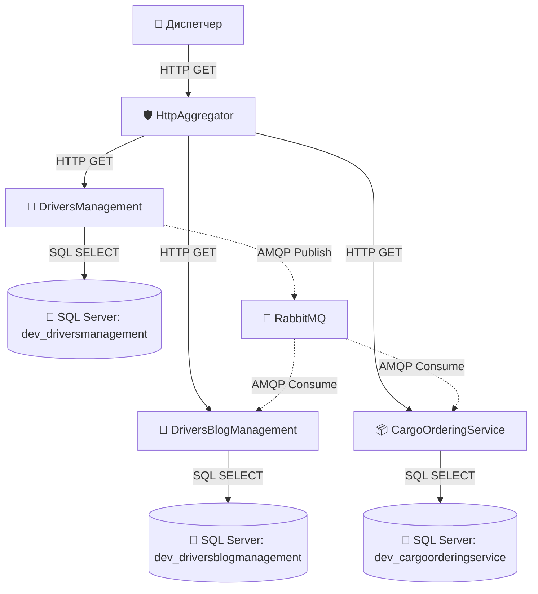
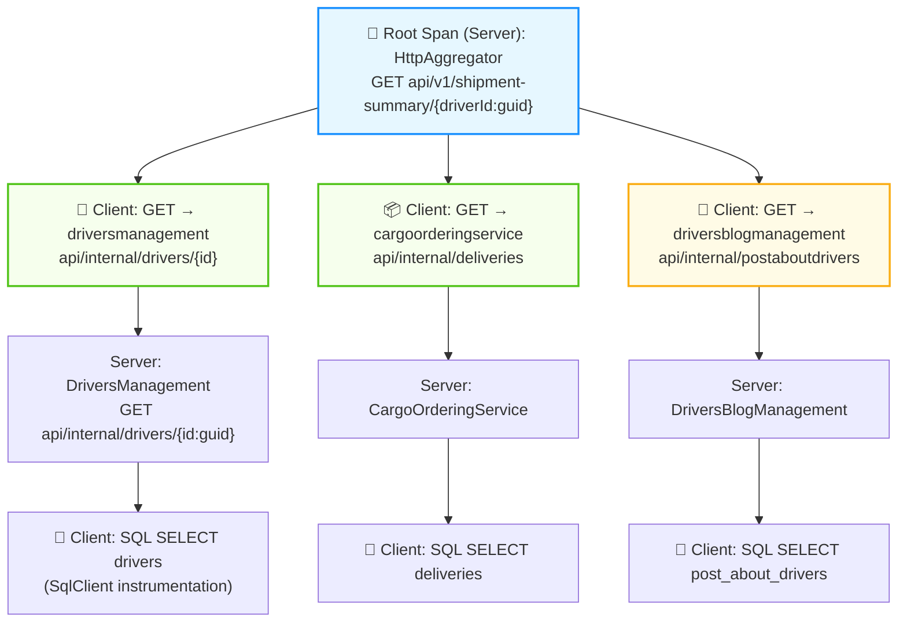
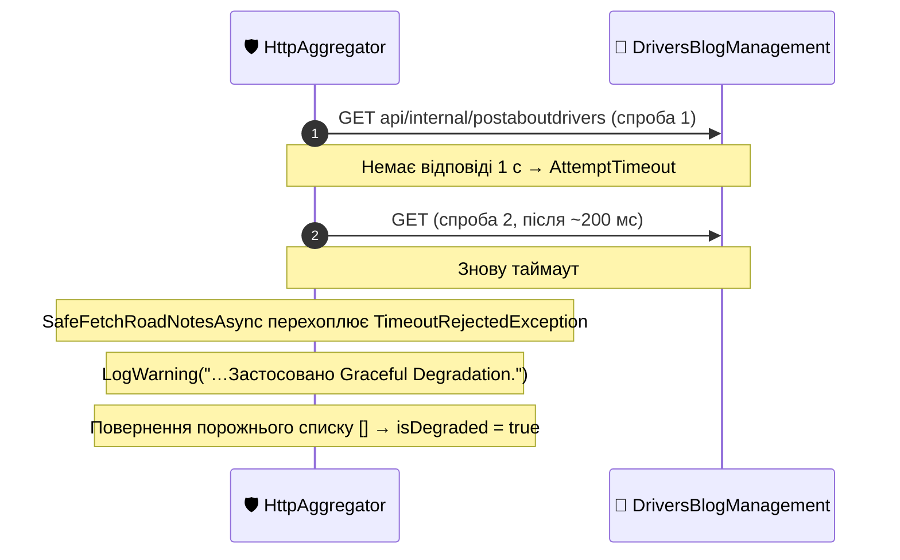
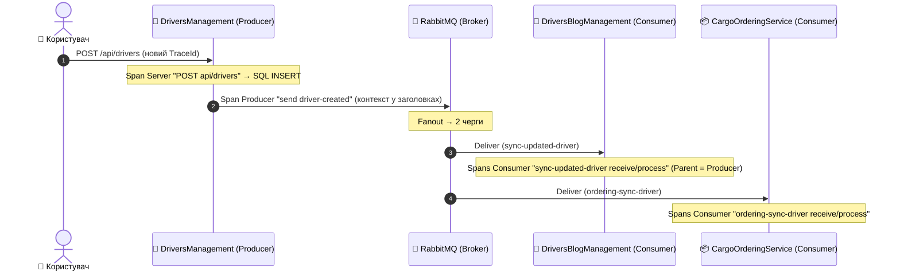
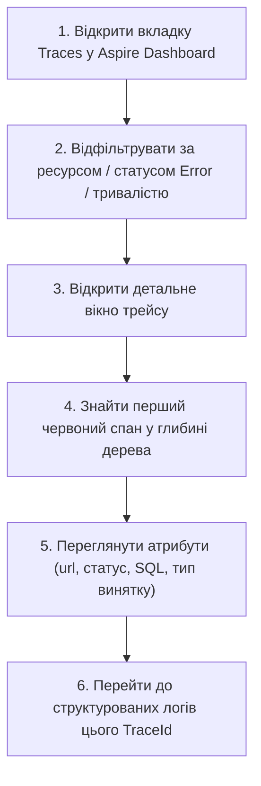

# 🌐 04. Наскрізне трасування: OpenTelemetry Tracing у .NET Aspire

> **Розділ курсу:** `02-Microservices-Craftsman` • **Модуль:** `02-01-Aspire-Documentation`  
> **Стек:** .NET 10, OpenTelemetry .NET SDK 1.19, `System.Diagnostics.Activity`, W3C TraceContext, OTLP (OpenTelemetry Protocol), MassTransit 8 Tracing, `OpenTelemetry.Instrumentation.SqlClient`  
> **Цільова аудиторія:** Архітектори систем спостережуваності (Observability Architects), Senior/Lead .NET інженери, DevOps/SRE спеціалісти  
> **Офіційна специфікація та документація:**  
> - [W3C Recommendation: Trace Context](https://www.w3.org/TR/trace-context/)  
> - [OpenTelemetry Tracing Specification](https://opentelemetry.io/docs/concepts/signals/traces/)  
> - [.NET Diagnostics: System.Diagnostics.Activity API Guide](https://learn.microsoft.com/dotnet/core/diagnostics/distributed-tracing)  
> - [Google Dapper Paper: Large-scale Distributed Systems Tracing Infrastructure (2010)](https://research.google/pubs/pub36356/)

---

## 📑 Академічний зміст лекції

- [1. Теоретичний базис: Еволюція діагностики від монолітних логів до OpenTelemetry](#section-1)
- [2. Математична та графова модель розподіленого трейсу (Spans as a Tree)](#section-2)
- [3. Архітектура BCL у .NET: System.Diagnostics.Activity vs OpenTelemetry API](#section-3)
- [4. Специфікація стандарту W3C TraceContext: Глибокий розбір заголовка traceparent](#section-4)
- [5. Конфігурація трейсингу в CargoDelivery.ServiceDefaults (Extensions.cs)](#section-5)
- [6. Наскрізне трасування запиту Gateway Aggregator (Діаграми спанів та Ганта)](#section-6)
- [7. Візуалізація збоїв, повторів Polly та патерну Graceful Degradation](#section-7)
- [8. Трасування асинхронних черг повідомлень RabbitMQ через MassTransit](#section-8)
- [9. Аналітична матриця: Діагностика архітектурних проблем за формою каскаду спанів](#section-9)
- [10. Практичний посібник: Алгоритм розслідування інцидентів в Aspire Dashboard](#section-10)
- [11. Контрольні запитання та лабораторні завдання](#section-11)

---

<a id="section-1"></a>
## 1. Теоретичний базис: Еволюція діагностики від монолітних логів до OpenTelemetry

У класичній монолітній архітектурі життєвий цикл запиту ізольований у межах єдиного процесу операційної системи. Якщо транзакція зазнає невдачі або виконується повільно, інженер відкриває стек викликів (Stack Trace), прив'язаний до ідентифікатора потоку (Thread ID), і точно встановлює рядок коду, де виник виняток.

У мікросервісній архітектурі одинична користувацька операція (наприклад, «Завантажити досьє рейсу доставки») розпадається на мережевий каскад через десятки автономних вузлів.



### Три етапи еволюції діагностики:

1. **Етап 1: Локальні файлові логи (Isolated File Logs)**
   * Кожен сервіс пише текстові логи у локальний файл на диску.
   * *Криза підходу:* Неможливо зіставити лог агрегатора з логом сервісу замовлень. При наявності 50 контейнерів пошук помилки перетворюється на нездійсненну ручну працю.

2. **Етап 2: Централізовані структуровані логи (Centralized Structured Logging - ELK, Seq, Loki)**
   * Логи агрегуються в єдине сховище у форматі JSON з кореляційним ідентифікатором (`CorrelationId`).
   * *Криза підходу:* Логи фіксують **дискретні події** в часі, але не відображають **тривалості операцій**, взаємного блокування потоків, паралелізму та структури батьківсько-дочірніх зв'язків. Неможливо відповісти на питання: *"Чому запит тривав 1.4 секунди: через повільний SQL чи через чергу на TCP-сокеті?"*.

3. **Етап 3: Розподілене трасування (Distributed Tracing - Dapper, Zipkin, OpenTelemetry)**
   * Концепція, вперше масштабно описана Google у статті *Dapper* (2010).
   * Кожна операція фіксується як часовий інтервал (**Span**), що має точний час початку, тривалість, метадані (теги/атрибути) та вказівник на операцію, що її породила (**Parent-Child relationship**).
   * Всі спани однієї користувацької операції об'єднуються глобальним ідентифікатором **TraceId**.

> 🧭 **OpenTelemetry (OTel)** — це об'єднання двох попередніх стандартів (OpenTracing і OpenCensus) під егідою CNCF. Він стандартизує три речі: **API** (як створювати спани в коді), **SDK** (як їх обробляти й семплювати) і **протокол OTLP** (як передавати в будь-який бекенд). Тому код сервісу не залежить від того, куди піде телеметрія — в Aspire Dashboard, Jaeger, Grafana Tempo чи Azure Monitor.

---

<a id="section-2"></a>
## 2. Математична та графова модель розподіленого трейсу (Spans as a Tree)

З погляду теорії графів, розподілений трейс (без урахування Span Links) є **кореневим деревом** — окремим випадком Орієнтованого Ациклічного Графа (DAG): у кожного спану рівно один батько (крім кореня), а ребра — причинно-наслідкові зв'язки викликів. Span Links (див. §11, питання 4) додають «бічні» ребра, і тоді структура стає загальним DAG.

### Структура елементів трейсу:

$$Trace = \{ S_{\text{root}}, S_1, S_2, \dots, S_n \}$$

Де кожен спан $S_i$ являє собою кортеж:
$$S_i = \langle \text{TraceId}, \; \text{SpanId}, \; \text{ParentSpanId}, \; \text{Kind}, \; t_{\text{start}}, \; \Delta t, \; \mathcal{A}, \; \mathcal{E}, \; \mathcal{S} \rangle$$

* $\text{TraceId} \in \{0..9, a..f\}^{32}$ — глобальний 128-бітний ідентифікатор транзакції.
* $\text{SpanId} \in \{0..9, a..f\}^{16}$ — унікальний 64-бітний ідентифікатор конкретного спану.
* $\text{ParentSpanId} \in \{0..9, a..f\}^{16} \cup \{\emptyset\}$ — посилання на батьківський спан (для $S_{\text{root}}$ значення $\emptyset$).
* $\text{Kind} \in \{\text{Server}, \text{Client}, \text{Producer}, \text{Consumer}, \text{Internal}\}$ — роль спану (вхідний запит, вихідний виклик, публікація/споживання повідомлення, внутрішня операція).
* $t_{\text{start}}$ — часова мітка початку операції за стандартом UTC.
* $\Delta t$ — тривалість виконання ($t_{\text{end}} - t_{\text{start}}$).
* $\mathcal{A} = \{ \text{key}_k \mapsto \text{value}_k \}$ — множина атрибутів (тегів) відповідно до OpenTelemetry Semantic Conventions (наприклад, `http.response.status_code = 200`, `db.system.name = "microsoft.sql_server"`).
* $\mathcal{E} = \{ \langle t_e, \text{name}_e, \text{attrs}_e \rangle \}$ — внутрішні мікроподії спану (Events), наприклад, фіксація точки виникнення винятку.
* $\mathcal{S} \in \{ \text{Unset}, \; \text{Ok}, \; \text{Error} \}$ — канонічний статус завершення операції.



> 💡 Кожен HTTP-виклик між сервісами — це **пара** спанів: `Client` у викликаючому сервісі та `Server` у викликаному. Різниця їхніх тривалостей — це час у мережі та в черзі на сокеті. Якщо `Client` = 300 мс, а `Server` = 20 мс, проблема не в коді сервісу, а «між» ними.

---

<a id="section-3"></a>
## 3. Архітектура BCL у .NET: System.Diagnostics.Activity vs OpenTelemetry API

У багатьох мовах програмування (Java, Python, Go) для трасування необхідно підключати окремі бібліотеки OpenTelemetry API та вручну створювати екземпляри `Tracer`.

У платформі .NET команда Microsoft прийняла інше рішення: **примітиви трасування вбудовані безпосередньо в базову бібліотеку класів (BCL - Base Class Library)** у простір імен `System.Diagnostics`. OpenTelemetry SDK для .NET лише «слухає» ці вбудовані об'єкти.

| Концепція OpenTelemetry | Еквівалент у .NET BCL (`System.Diagnostics`) | Опис та роль у рантаймі |
| :--- | :--- | :--- |
| **Tracer** | `ActivitySource` | Фабрика для створення нових спанів у межах конкретної підсистеми або бібліотеки. |
| **Span** | `Activity` | Об'єкт, що фіксує операцію в часі, її теги, статус та батьківський контекст. |
| **TracerProvider** | `OpenTelemetry.Trace.TracerProvider` | Конвеєр обробки телеметрії: збирає `Activity`, фільтрує, семплює та відправляє по OTLP. |
| **SpanContext** | `ActivityContext` | Легковажна незмінна структура (Struct), що передає `TraceId`, `SpanId` та `TraceFlags`. |
| **Attributes** | `Activity.SetTag(key, value)` | Метадані операції (HTTP методи, URL, параметри запитів). |
| **Events** | `Activity.AddEvent(new ActivityEvent(name))` | Точкові позначки подій всередині інтервалу спану (наприклад, викидання винятку). |

### Чому підхід .NET має нульову ціну простою (Zero-Allocation When Disabled):
Якщо для сервісу відключено моніторинг або ніхто не слухає `ActivitySource`, виклик:
```csharp
using var activity = myActivitySource.StartActivity("CustomOperation");
```
Повертає `null`! У пам'яті взагалі не виділяється об'єкт у купі (Heap Allocation = 0 bytes), що гарантує гранично високу продуктивність критичних секцій коду. Тому в коді завжди пишуть `activity?.SetTag(...)` з оператором `?.`.

### Як «передається» поточний спан усередині процесу
`Activity.Current` зберігається в `AsyncLocal<T>` — значенні, яке «пливе» разом з `ExecutionContext` через усі `await`. Тому, коли `ShipmentAggregatorService` запускає дві задачі для `Task.WhenAll`, обидві автоматично отримують той самий батьківський спан — і в дашборді вони відображаються як «сестри» під одним коренем.

---

<a id="section-4"></a>
## 4. Специфікація стандарту W3C TraceContext: Глибокий розбір заголовка traceparent

Як контекст трасування передається між ізольованими процесами через кордони HTTP?  
Історично існували несумісні пропрієтарні формати заголовків: `X-B3-TraceId` (Zipkin), `x-datadog-trace-id` (Datadog), `Request-Id` (старий ASP.NET).

Консорціум W3C затвердив єдиний стандарт: **W3C Trace Context**.

Коли типізований клієнт `DriverApiClient` у нашому агрегаторі виконує запит до `DriversManagement`, бібліотека інструментації автоматично формує та додає заголовок `traceparent`:

```http
GET /api/internal/drivers/3fa85f64-5717-4562-b3fc-2c963f66afa6 HTTP/1.1
Host: localhost:5001
traceparent: 00-4bf92f3577b34da6a3ce929d0e0e4736-00f067aa0ba902b7-01
tracestate: congo=ucfJifl5GOE,rojo=00f067aa0ba902b7
```

### Побайтова деконструкція поля `traceparent`:

$$\underbrace{\text{00}}_{\text{Версія}} - \underbrace{\text{4bf92f3577b34da6a3ce929d0e0e4736}}_{\text{TraceId (32 hex)}} - \underbrace{\text{00f067aa0ba902b7}}_{\text{Parent SpanId (16 hex)}} - \underbrace{\text{01}}_{\text{TraceFlags (2 hex)}}$$

```
+--------+----------------------------------+------------------+------------+
| Версія | TraceId                          | Parent SpanId    | TraceFlags |
| 2 hex  | 32 hex (128 біт)                 | 16 hex (64 біти) | 2 hex      |
+--------+----------------------------------+------------------+------------+
|   00   | 4bf92f3577b34da6a3ce929d0e0e4736 | 00f067aa0ba902b7 |     01     |
+--------+----------------------------------+------------------+------------+
```

1. **Версія (`00`):** Наразі поточною специфікацією W3C є версія 0. Значення `ff` зарезервоване як недійсне.
2. **`TraceId` (`4bf92f3577b34da6a3ce929d0e0e4736`):** 16 байт ентропії. Забезпечує глобальну унікальність серед мільярдів запитів у розподілених дата-центрах без координації вузлів.
3. **`Parent SpanId` (`00f067aa0ba902b7`):** 8 байт. Ідентифікатор спану клієнта-відправника. Отримувач (сервер `DriversManagement`) створить свій власний новий `SpanId`, але вкаже це значення як свій `ParentSpanId`.
4. **`TraceFlags` (`01`):** Бітова маска прапорців.
   * Біт 0 (`01` — Sampled): вказує системі, що цей запит відібраний для збереження в базі даних телеметрії.
   * Якщо прапорець `00`, контекст трасування все одно прокидається крізь сервіси (для кореляції логів), але спани в сховище не записуються (зниження накладних витрат).
5. **`tracestate`:** необов'язковий заголовок для вендор-специфічних даних (до 32 пар `ключ=значення`); W3C гарантує, що проміжні системи передадуть його далі без змін.

> 🔒 **Безпека заголовків.** `traceparent` приходить ззовні, тому публічний edge-шлюз часто **ігнорує** вхідний контекст від інтернет-клієнтів і починає новий трейс — інакше зловмисник міг би «підклеїти» свої запити до чужих трейсів або нав'язати 100% семплювання.

---

<a id="section-5"></a>
## 5. Конфігурація трейсингу в CargoDelivery.ServiceDefaults (Extensions.cs)

Усе налаштування OpenTelemetry централізовано у спільному проєкті:

> 📍 **Файл:** [Extensions.cs#L147-L161](../Aspire/CargoDelivery.ServiceDefaults/Extensions.cs#L147)

### Деконструкція коду реєстрації OpenTelemetry Tracing (реальний код):

```csharp
builder.Services.AddOpenTelemetry()
    .WithTracing(tracing =>
    {
        tracing.AddSource(builder.Environment.ApplicationName)   // 1. Власні спани сервісу
            .AddSource("MassTransit")                            // 2. Асинхронний AMQP трафік
            .AddAspNetCoreInstrumentation(options =>             // 3. Вхідний HTTP/gRPC трафік
            {
                options.Filter = context =>
                    !context.Request.Path.StartsWithSegments("/health")
                    && !context.Request.Path.StartsWithSegments("/alive");
            })
            .AddHttpClientInstrumentation()                      // 4. Вихідний HTTP трафік
            .AddSqlClientInstrumentation();                      // 5. SQL-запити до SQL Server
    });

// 6. Експорт телеметрії через стандартизований OTLP протокол
builder.AddOpenTelemetryExporters();
```

#### Інженерний аналіз підключених модулів:

1. **`AddSource(builder.Environment.ApplicationName)`:**
   * Підписка на `ActivitySource` з іменем збірки сервісу (наприклад, `CargoDelivery.HttpAggregator`). Якщо в коді створити `new ActivitySource("CargoDelivery.HttpAggregator")`, його спани автоматично потраплять у трейс.
2. **`AddSource("MassTransit")`:**
   * Інтегрує MassTransit з OpenTelemetry: MassTransit сам створює `Activity` для операцій send/receive/process, а цей рядок «вмикає» їх запис.
   * Забезпечує наскрізну передачу `TraceId` через черги брокера RabbitMQ у заголовках повідомлення.
3. **`AddAspNetCoreInstrumentation()`:**
   * Підключається до діагностичного конвеєра Kestrel та ASP.NET Core MVC.
   * Автоматично витягує W3C заголовок `traceparent` з кожного вхідного HTTP-запиту.
   * Створює вхідний серверний спан (`Server`) і записує семантичні атрибути: `http.request.method`, `http.route`, `http.response.status_code`, `url.path`. Для gRPC-викликів додаються `grpc.method` та `grpc.status_code`.
4. **`AddHttpClientInstrumentation()`:**
   * Перед відправкою будь-якого виклику через `HttpClient` генерує клієнтський спан (`Client`) і автоматично інжектує поточний `Activity.Current` у W3C заголовок `traceparent`.
   * Фіксує точну тривалість очікування мережевої відповіді та статус-код цільового сервісу.
5. **`AddSqlClientInstrumentation()`:**
   * Слухає діагностичні події `Microsoft.Data.SqlClient` (через нього працює EF Core) і створює спан на кожну SQL-команду з атрибутами БД.
   * ⚠️ Раніше тут був `AddSource("Microsoft.EntityFrameworkCore.SqlServer")` — неіснуюче джерело, через що SQL-спанів у трейсах не було взагалі. Детальніше — [гайд 02, §5](02_ServiceDefaults_Architecture_And_Parameters.md#section-5).
6. **`builder.AddOpenTelemetryExporters()`** ([Extensions.cs#L185](../Aspire/CargoDelivery.ServiceDefaults/Extensions.cs#L185)):
   * Зчитує адресу OTLP-ендпоінта з конфігурації `OTEL_EXPORTER_OTLP_ENDPOINT` (яку .NET Aspire встановлює автоматично для кожного проєкту).
   * Пакує накопичені спани пакетами (batch) за протоколом Protobuf і передає їх через gRPC або HTTP до Aspire Dashboard.

> ⏱️ **Чому спани з'являються в дашборді з невеликою затримкою?** Експортер працює пакетно: спани накопичуються в буфері й відправляються раз на кілька секунд (Aspire скорочує інтервал змінними `OTEL_BSP_SCHEDULE_DELAY` / `OTEL_BLRP_SCHEDULE_DELAY`). Це компроміс між «живістю» і накладними витратами.

---

<a id="section-6"></a>
## 6. Наскрізне трасування запиту Gateway Aggregator (Діаграми спанів та Ганта)

Розглянемо повну картину виконання запиту `GET /api/v1/shipment-summary/{driverId}` через `CargoDelivery.HttpAggregator` (код: [ShipmentAggregatorService.cs#L42](../CargoDelivery.HttpAggregator/Domain/Services/ShipmentAggregatorService.cs#L42)).

### Діаграма Ганта розподіленого трейсу (Aspire Dashboard Trace View)

```mermaid
gantt
    title Розподілений трейс операції агрегації (TraceId: 4bf92f3577b34da6a3ce929d0e0e4736)
    dateFormat X
    axisFormat %s ms

    section HttpAggregator
    Server GET api/v1/shipment-summary/{driverId}         :active, root, 0, 85

    section DriversManagement
    Client GET driversmanagement                          :crit, dm_http, 5, 30
    Server GET api/internal/drivers/{id}                  :active, dm_srv, 7, 28
    SQL SELECT drivers                                    :active, dm_sql, 11, 23

    section CargoOrdering
    Client GET cargoorderingservice                       :active, co_http, 32, 78
    Server GET api/internal/deliveries                    :active, co_srv, 34, 76
    SQL SELECT deliveries                                 :active, co_sql, 38, 70

    section DriversBlog
    Client GET driversblogmanagement                      :active, db_http, 32, 64
    Server GET api/internal/postaboutdrivers              :active, db_srv, 34, 62
    SQL SELECT post_about_drivers                         :active, db_sql, 37, 56
```



### Ключові висновки з часової діаграми (Waterfall Analysis):
1. **Фаза валідації (0 - 30 мс):** Виклик до `DriversManagement` є послідовним бар'єром. Лише після успішного підтвердження існування водія та закриття спану `dm_http` стартує наступна фаза.
2. **Фаза паралелізму Scatter (32 - 78 мс):** Спани клієнтських викликів `co_http` (CargoOrdering) та `db_http` (DriversBlog) починаються **в один і той самий момент (t = 32 ms)**. Вони виконуються паралельно!
3. **Ієрархія глибини:** Клієнтський HTTP-спан агрегатора породжує серверний HTTP-спан всередині цільового сервісу, який, своєю чергою, породжує дочірній SQL-спан. Усі вони мають однаковий `TraceId`, але утворюють чітке дерево підпорядкування завдяки `ParentSpanId`.

> 🧪 **Як побачити це наживо:** виконайте запити 1️⃣–4️⃣ та 7️⃣ з [CargoDelivery.HttpAggregator.http](../CargoDelivery.HttpAggregator/CargoDelivery.HttpAggregator.http), відкрийте **Traces** і оберіть трейс `httpaggregator: GET api/v1/shipment-summary/{driverId:guid}`. У колонці *Resources* трейсу буде 4 сервіси.

---

<a id="section-7"></a>
## 7. Візуалізація збоїв, повторів Polly та патерну Graceful Degradation

Трасування OpenTelemetry у поєднанні з Aspire Dashboard дає унікальну можливість наочно побачити, як система поводиться під час відмов.

### Сценарій 1: Частковий збій та Graceful Degradation
Припустимо, мікросервіс `DriversBlogManagement` зупинено (кнопка ■ у дашборді) або він повертає помилку 503.



#### Відображення в дашборді:
* Клієнтські спани виклику до `DriversBlogManagement` позначаються як **помилкові** (червоні) — по одному спану на **кожну спробу** Polly.
* Клік по спану розгортає атрибути: `error.type`, `http.response.status_code = 503` (якщо сервер відповів) або тип винятку таймауту.
* **АЛЕ кореневий спан `HttpAggregator` залишається успішним (`200 OK`)!**
* Це наочно доводить працездатність нашого захисного коду: аварія другорядного сервісу локалізована, а користувач отримав валідну зведену сторінку рейсу.

### Сценарій 2: Візуалізація транзієнтних повторів Polly (Retry Pattern)
При виклику `GET /api/v1/resilience-demo/retry` (демо-клієнт з базовою затримкою повтору 200 мс — [Program.cs#L83](../CargoDelivery.HttpAggregator/Program.cs#L83)):

```
[Trace: httpaggregator: GET api/v1/resilience-demo/retry]   (≈ 0.4–0.6 с)
 ├── Server GET api/v1/resilience-demo/retry
 │    ├── Client GET /api/simulation/flaky  [503]  — спроба 1
 │    │      ⏳ пауза ≈ 200 мс + jitter
 │    ├── Client GET /api/simulation/flaky  [503]  — спроба 2
 │    │      ⏳ пауза ≈ 400 мс + jitter
 │    └── Client GET /api/simulation/flaky  [200]  — спроба 3
 │           └── Server GET api/simulation/flaky (той самий процес агрегатора)
```

Інженер бачить у дереві трасування:
1. Кількість реальних спроб виклику (окремий клієнтський спан на кожну).
2. Тривалість експоненційної паузи (Backoff Delay) між спробами — як «проміжки» між спанами.
3. Точну причину попередніх невдач без необхідності дебажити код у Visual Studio!

А в **Structured logs** Polly пише власні записи з тим самим `TraceId` — їх легко знайти за текстом:

| Запис у логах | Що означає |
| :--- | :--- |
| `Execution attempt. Source: 'simulation-retry-standard//Standard-Retry', Result: '503', Handled: 'True', Attempt: '0'` | Спроба №0 завершилась 503, стратегія Retry її «обробила» (буде повтор) |
| `Resilience event occurred. EventName: 'OnTimeout', Source: '…//Standard-AttemptTimeout'` | Спрацював таймаут однієї спроби |
| `Resilience event occurred. EventName: 'OnTimeout', Source: '…//Standard-TotalRequestTimeout'` | Вичерпано загальний бюджет часу |
| `Resilience event occurred. EventName: 'OnCircuitOpened', Source: '…//Standard-CircuitBreaker'` | Ланцюг розімкнено (Fail-Fast) |

> 💡 Ці записи мають рівень Warning/Error, тому в дашборді на ресурсі `httpaggregator` після лабораторних з'являється червоний бейдж із кількістю помилок — це очікувано: так Polly повідомляє про **опрацьовані** збої.

---

<a id="section-8"></a>
## 8. Трасування асинхронних черг повідомлень RabbitMQ через MassTransit

Коли комунікація переходить від синхронного HTTP до асинхронних черг повідомлень (Event-Driven Architecture), контекст більше не може передаватися через HTTP-заголовки запиту — між продюсером і споживачем стоїть брокер, а обробка може статися через хвилини.

### Механізм передачі контексту в AMQP 0-9-1:

Коли сервіс `DriversManagement` викликає `_publishEndpoint.Publish<IDriverCreated>(message)` ([AddDriver.cs#L85](../DriversManagement/src/DriversManagement/Domain/Drivers/Features/AddDriver.cs#L85)):
1. MassTransit створює спан типу `Producer` (`send driver-created`) як дочірній до поточного `Activity.Current` (спану HTTP-запиту `POST api/drivers`).
2. Ідентифікатор цього спану (у W3C-форматі) записується в **заголовки повідомлення** AMQP (`BasicProperties.Headers`) разом з іншими службовими заголовками MassTransit.
3. Повідомлення потрапляє в Fanout Exchange `driver-created` і копіюється в усі прив'язані черги (`sync-updated-driver`, `ordering-sync-driver`).
4. Споживач у сервісі отримує повідомлення, MassTransit вичитує контекст із заголовків і створює спани `Consumer` (`… receive`, `… process`) з батьком = спан продюсера.



### Реальний трейс зі стенду
Після `POST /api/drivers` у вкладці **Traces** з'являється один трейс `driversmanagement: POST api/drivers` (≈1 с) з такими спанами:

| Спан | Ресурс | Тривалість (приклад) |
| :--- | :--- | :--- |
| `POST api/drivers` | driversmanagement | 0.52 с |
| `send driver-created` | driversmanagement | 99 мс |
| `ordering-sync-driver receive` → `process` | cargoorderingservice | 0.59 с / 0.51 с |
| `sync-updated-driver receive` → `process` | driversblogmanagement | 0.55 с / 0.47 с |

А в **Structured logs** записи `==>> [MassTransit Blog] …` та `==>> [MassTransit Ordering] …` з обох споживачів мають **той самий** TraceId, що і HTTP-запит.

> 🎯 **Результат:**  
> В інтерфейсі Aspire Dashboard асинхронна фонова обробка повідомлення відображається у тому самому дереві трейсу, що й первинний HTTP-запит користувача, дозволяючи бачити затримку доставки повідомлення через брокер!

> 🤔 **Child чи Link?** Для одиничного повідомлення MassTransit робить спожиття *дочірнім* спаном продюсера — трейс читається як одне дерево. Але якщо споживач обробляє **пакет** із 100 повідомлень від різних запитів, «батьків» стає 100 — тоді використовують **Span Links** (посилання на кілька контекстів), щоб не склеювати 100 різних трейсів в один.

---

<a id="section-9"></a>
## 9. Аналітична матриця: Діагностика архітектурних проблем за формою каскаду спанів

Досвідчений архітектор або інженер надійності (SRE) здатний за формою діаграми Ганта спанів у Aspire Dashboard миттєво визначити архітектурну хворобу розподіленої системи:

| Форма водоспаду спанів (Waterfall Pattern) | Архітектурний діагноз | Причина у вихідному коді | Метод лікування |
| :--- | :--- | :--- | :--- |
| **"Сходинки сходів" (Cascading Staircase)** | Послідовне блокування операцій | Використання послідовних `await` для незалежних I/O викликів. | Заміна на паралельний **Fan-Out** через `Task.WhenAll`. |
| **"Довгий товстий блок" (Thick Monolith Block)** | Зависання в базі даних або I/O | Відсутність індексу в БД, блокування таблиці або CPU-інтенсивний цикл. | Аналіз вкладеного SQL-спану, додавання індексів. |
| **"Гребінка N+1" (Comb of identical SQL spans)** | Проблема N+1 запитів | Ліниве завантаження навігацій EF Core у циклі. | `Include(...)` або проєкція `Select(...)` одним запитом. |
| **"Зубчаста пилка" (Sawtooth Repetitions)** | Агресивний транзієнтний шторм | Політика Polly Retry багаторазово штурмує сервіс, що безнадійно лежить; або **вкладені** конвеєри Polly. | **Circuit Breaker** для негайного відсікання + один конвеєр на клієнт. |
| **"Паралельна вилка" (Healthy Fork)** | **Еталонна асинхронна агрегація** | Одночасний запуск незалежних запитів до різних мікросервісів. | Збереження архітектурного патерну без змін. |
| **"Миттєвий спалах" (Instant Spike)** | Розімкнений Circuit Breaker (Fail-Fast) | Запит завершився за ~0 мс з помилкою `BrokenCircuitException`, без клієнтського HTTP-спану. | Очікування відновлення бекенду (стан Half-Open). |
| **"Рівна плита 30 с"** | Вичерпаний `TotalRequestTimeout` | Залежність «зависла» (порт відкритий, відповіді немає). | Короткий бюджет часу для некритичних залежностей. |

---

<a id="section-10"></a>
## 10. Практичний посібник: Алгоритм розслідування інцидентів в Aspire Dashboard

Коли в системі виникає збій, дотримуйтесь наступного стандартизованого алгоритму роботи в **Aspire Dashboard**:



### Покроковий регламент:
1. **Ідентифікація:** Відкрийте вебінтерфейс Aspire Dashboard (`https://localhost:17048`) та перейдіть у розділ **Traces**.
2. **Фільтрація:** Оберіть ресурс `httpaggregator` у фільтрі *Resource* або введіть частину імені операції в поле пошуку; трейси з помилками позначені червоним.
3. **Локалізація точки відмови:**
   * У дереві спанів знайдіть найглибший дочірній спан, позначений як помилковий.
   * Зверніть увагу: батьківські спани можуть бути червоними лише тому, що дочірній повернув помилку, або успішними, якщо спрацював механізм деградації.
4. **Аналіз атрибутів (Tags):**
   * Перевірте `error.type` та подію винятку (Events → `exception`) з `exception.message` і `exception.stacktrace`.
   * Для HTTP-викликів перевірте `url.full` / `url.path` та `http.response.status_code`.
   * Для gRPC — `grpc.status_code` (наприклад, `2` = Unknown означає необроблений виняток на сервері; саме так ми знайшли помилку DI у `DriverRpcService`).
   * Для викликів бази даних перевірте атрибути `db.*` (система БД, назва БД, текст запиту — якщо його захоплення ввімкнене).
5. **Наскрізна кореляція з логами (Log Correlation):**
   * У вкладці **Structured logs** колонка *Trace* містить посилання на трейс; і навпаки — для спану можна відкрити пов'язані логи.
   * Ви бачите контекст подій лише цього `TraceId`, без шуму від сусідніх користувачів.

> 🕵️ **Реальний кейс зі стенду.** Ендпоінт `GET /api/drivers/{id}` завжди повертав 200, але без постів. Трейс показав спан `driversblogmanagement: POST /DriverRpc/GetDriverWithPosts` з `grpc.status_code = 2` і **жодного SQL-спану** під ним — отже, падіння сталося ще до звернення до БД. Причина: `DriverRpcService` інжектував конкретний клас `DriverRepository`, який DI не реєстрував. Клієнт мовчки застосовував Graceful Degradation, тож без трасування помилку було б не помітно.

---

<a id="section-11"></a>
## 11. Контрольні запитання та лабораторні завдання

### 🎯 Контрольні запитання:
1. Чому використання власного заголовка `X-Correlation-ID` у сучасних розподілених системах поступається стандарту W3C `traceparent`?
2. Яким чином клас `System.Diagnostics.Activity` забезпечує нульові накладні витрати пам'яті (Zero Allocations), коли збір телеметрії вимкнено?
3. Що станеться з деревом трейсів, якщо мікросервіс отримає заголовок `traceparent`, але не матиме підключеного інструментатора `AddAspNetCoreInstrumentation()`?
4. У чому полягає різниця між дочірнім спаном (Child Span) та зв'язком спанів (Span Link) в екосистемі OpenTelemetry? У яких випадках слід використовувати Span Links?
5. Чому при Graceful Degradation кореневий спан успішний, а дочірні — червоні? Чи є це проблемою для алертингу?

### 🛠️ Практичне лабораторне завдання:
1. Запустіть рішення через `CargoDelivery.AppHost`.
2. Виконайте GET-запит `api/simulation/slow?delaySeconds=2` на агрегаторі (`https://localhost:57390`).
3. Знайдіть створений трейс у дашборді. Переконайтеся, що на діаграмі Ганта чітко видно затримку тривалістю ≈2000 мс.
4. Викличте `GET /api/v1/resilience-demo/retry` і знайдіть у трейсі три клієнтські спани до `/api/simulation/flaky`. Виміряйте паузи між ними.
5. Створіть водія (`POST /api/drivers`) і знайдіть трейс, у якому присутні **три** сервіси: driversmanagement, driversblogmanagement, cargoorderingservice.
