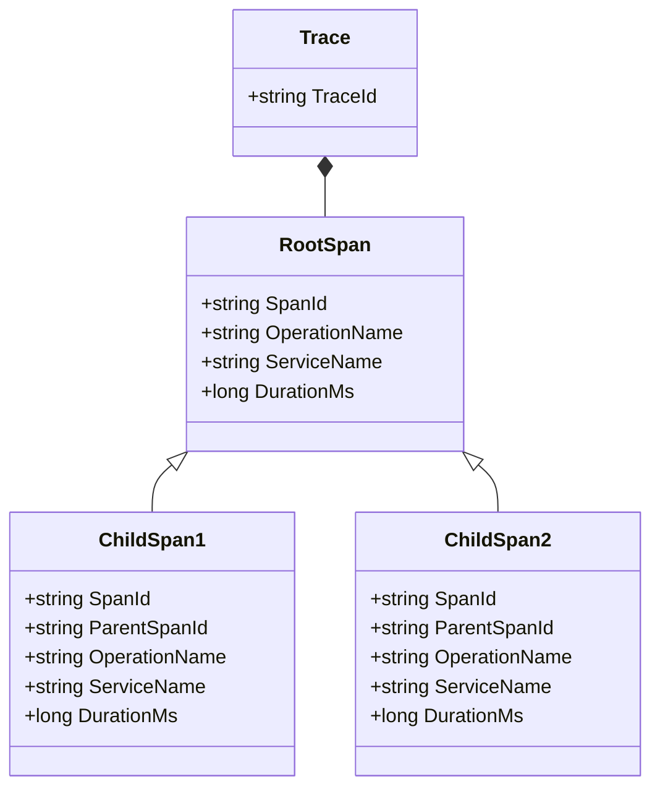

# 🌐 04. Наскрізне трасування: OpenTelemetry Tracing у .NET Aspire

> **Розділ:** `02-Microservices-Craftsman` • **Модуль:** `02-01-Aspire-Documentation`  
> **Стек:** .NET 10, OpenTelemetry .NET, OTLP Protocol, W3C TraceContext, System.Diagnostics.Activity.  
> **Офіційна документація Microsoft:** [.NET Aspire Telemetry and OpenTelemetry Guide](https://learn.microsoft.com/dotnet/aspire/fundamentals/telemetry)

---

## 📑 Зміст модуля

- [Слайд 1. Чому звичайних логів недостатньо у мікросервісних системах](#slide-1)
- [Слайд 2. Анатомія розподіленого трейсу: TraceId, SpanId, ParentSpanId](#slide-2)
- [Слайд 3. Стандарт W3C TraceContext: Заголовок "traceparent" у HTTP-запитах](#slide-3)
- [Слайд 4. Дерево трейсів для виклику Gateway Aggregator (Діаграма)](#slide-4)
- [Слайд 5. Візуалізація сбоїв, повторів Polly та винятків у Aspire Dashboard](#slide-5)
- [Слайд 6. Наскрізне трасування через черги RabbitMQ та MassTransit](#slide-6)
- [Слайд 7. Практичний посібник: Як читати трейси в Aspire Dashboard](#slide-7)

---

<a id="slide-1"></a>
### 🎬 Слайд 1. Чому звичайних логів недостатньо у мікросервісних системах

У монолітному застосунку помилка в коді супроводжується простим стек-трейсом. У розподіленій системі один клієнтський клік викликає ланцюжок із десятків мережевих викликів через 4 різні процеси.
* Якщо користувач бачить помилку *"Помилка завантаження замовлення"*, у якому саме з 4 сервісів стався збій?
* Чому запит виконувався 1.8 секунди замість 50 мілісекунд? Який саме сервіс повільно відповідав?

**Distributed Tracing (Розподілене трасування)** — це технологія відстеження шляху виконання запиту крізь усі мікросервіси, бази даних та черги повідомлень з точною фіксацією часу початку та завершення кожної операції.

---

<a id="slide-2"></a>
### 🧬 Слайд 2. Анатомія розподіленого трейсу: TraceId, SpanId, ParentSpanId

В екосистемі .NET та OpenTelemetry трасування базується на класі `System.Diagnostics.Activity`:



1. **`TraceId` (32 hex-символи):** Унікальний ідентифікатор всього користувацького запиту. Він однаковий для всіх сервісів у ланцюжку!
2. **`SpanId` (16 hex-символів):** Ідентифікатор конкретного кроку або виклику.
3. **`ParentSpanId`:** Посилання на викликаючий спан, що дозволяє дашборду будувати деревоподібну ієрархію викликів.

---

<a id="slide-3"></a>
### 📡 Слайд 3. Стандарт W3C TraceContext: Заголовок "traceparent" у HTTP-запитах

Як мікросервіс `CargoOrderingService` дізнається, що його викликав саме `HttpAggregator`?  
Завдяки бібліотеці `OpenTelemetry.Instrumentation.Http`, підключеній у [`Extensions.cs`](file:///c:/Users/Yurii/source/repos/Demo-CargoDeliveryService/02-Microservices-Craftsman/Aspire/CargoDelivery.ServiceDefaults/Extensions.cs#L93), кожен вихідний HTTP-запит автоматично доповнюється стандартизованим заголовком W3C:

```http
GET /api/deliveries?driverId=... HTTP/1.1
Host: cargoorderingservice
traceparent: 00-4bf92f3577b34da6a3ce929d0e0e4736-00f067aa0ba902b7-01
```

#### Анатомія заголовка `traceparent`:
* `00` — версія протоколу W3C.
* `4bf92f3577b34da6a3ce929d0e0e4736` — **єдиний TraceId**.
* `00f067aa0ba902b7` — **Parent SpanId** (спан відправника).
* `01` — прапорці трасування (`01` = Sampled, зберігати в базі телеметрії).

---

<a id="slide-4"></a>
### 🌳 Слайд 4. Дерево трейсів для виклику Gateway Aggregator (Діаграма)

Коли виконується запит диспетчера до нового агрегатора `CargoDelivery.HttpAggregator`, у вебінтерфейсі **Aspire Dashboard (вкладка Traces)** формується наочна діаграма Ганта:

```mermaid
gantt
    title Розподілений трейс: GET /api/v1/shipment-summary (TraceId: 4bf92f3...)
    dateFormat X
    axisFormat %s ms

    section HttpAggregator
    GET /api/v1/shipment-summary :active, root, 0, 70

    section DriversManagement
    GET /api/drivers/{id} :crit, dm, 5, 30
    SQL SELECT Drivers WHERE Id=... :active, dmsql, 10, 25

    section CargoOrdering
    GET /api/deliveries :active, co, 32, 68
    SQL SELECT Deliveries WHERE... :active, cosql, 38, 62

    section DriversBlog
    GET /api/postaboutdrivers :active, db, 32, 65
```



Зверніть увагу:
* Спочатку викликається `DriversManagement` (перевірка водія).
* Потім **одночасно** (паралельно) стартують `CargoOrdering` та `DriversBlog`!
* Усередині кожного сервісу видно дочірні спани SQL-запитів EF Core.

---

<a id="slide-5"></a>
### 🚨 Слайд 5. Візуалізація сбоїв, повторів Polly та винятків у Aspire Dashboard

#### 1. Частковий збій (Graceful Degradation)
Якщо `DriversBlogManagement` повертає помилку 503:
* Дочірній спан `GET /api/postaboutdrivers` забарвлюється в **яскраво-червоний колір**.
* Клік по спану відкриває точний текст винятку: `HttpRequestException: Response status code does not indicate success: 503 (Service Unavailable)`.
* При цьому кореневий спан `HttpAggregator` залишається **зеленим (200 OK)**, оскільки спрацював захисний механізм деградації!

#### 2. Повторні спроби Polly (Retry Policy)
При виклику тестового маршруту `/api/v1/resilience-demo/retry`:
* У дереві трейсу видно не один, а **три послідовних спани** з однаковою операцією `GET /api/simulation/flaky`.
* Перші два спани червоні (503).
* Третій спан зелений (200 OK).
* Ви чітко бачите експоненційну паузу між спробами (Backoff Jitter).

---

<a id="slide-6"></a>
### 🐰 Слайд 6. Наскрізне трасування через черги RabbitMQ та MassTransit

Завдяки рядку в [`Extensions.cs`](file:///c:/Users/Yurii/source/repos/Demo-CargoDeliveryService/02-Microservices-Craftsman/Aspire/CargoDelivery.ServiceDefaults/Extensions.cs#L84):
```csharp
tracing.AddSource("MassTransit")
```
Трейсинг не переривається навіть при асинхронній передачі повідомлень через шину:
1. Коли `DriversManagement` публікує подію `IDriverCreated`, MassTransit запаковує `TraceId` у бінарні заголовки AMQP 0-9-1.
2. Консьюмери в `DriversBlogManagement` та `CargoOrderingService` витягують `TraceId` з повідомлення та продовжують той самий трейс.
3. У результаті ви бачите в одному вікні створення сутності через HTTP та її реплікацію через брокер черг!

---

<a id="slide-7"></a>
### 🖥️ Слайд 7. Практичний посібник: Як читати трейси в Aspire Dashboard

1. Відкрийте вебінтерфейс **Aspire Dashboard**.
2. У лівому меню виберіть розділ **Traces**.
3. У таблиці знайдіть рядок із сервісом `httpaggregator` та шляхом `GET api/v1/shipment-summary/{id}`.
4. Натисніть кнопку **View Details**:
   * **Діаграма спанів:** Показує відносний час кожного мікросервісу.
   * **Вкладка Attributes:** Показує HTTP метод, статус-код, цільовий URL.
   * **Кнопка "View logs":** Миттєво фільтрує структуровані логи саме для цього `TraceId`!
