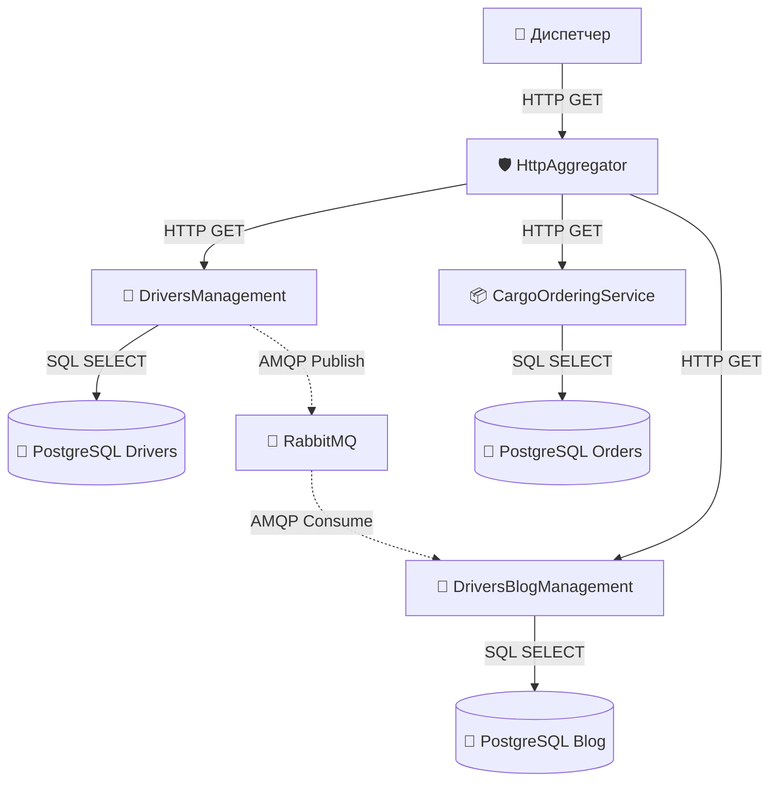
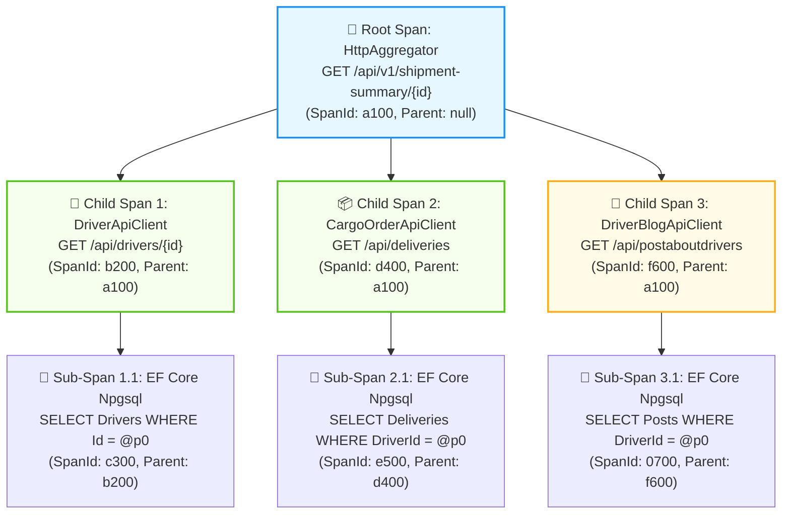
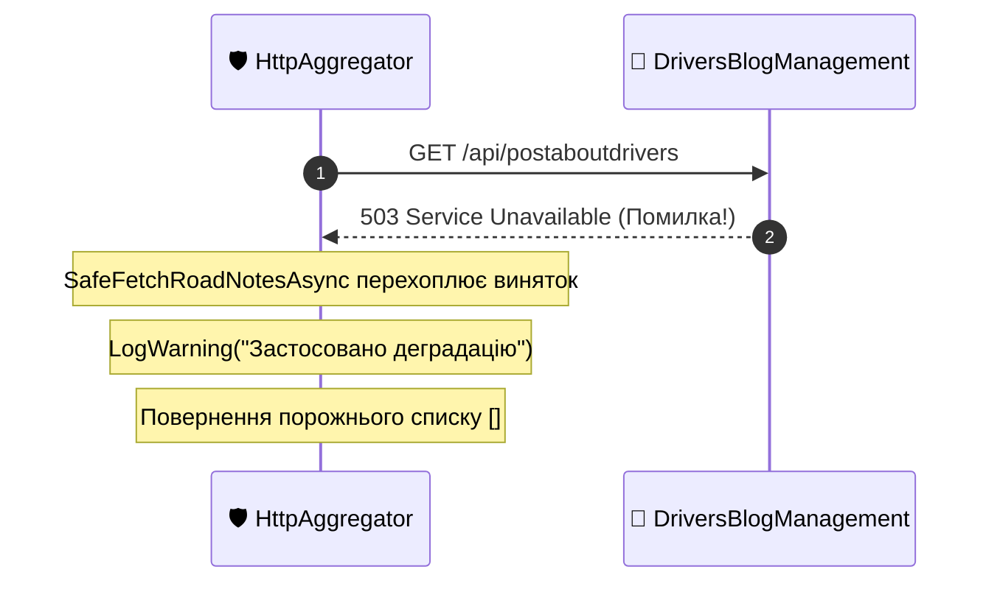
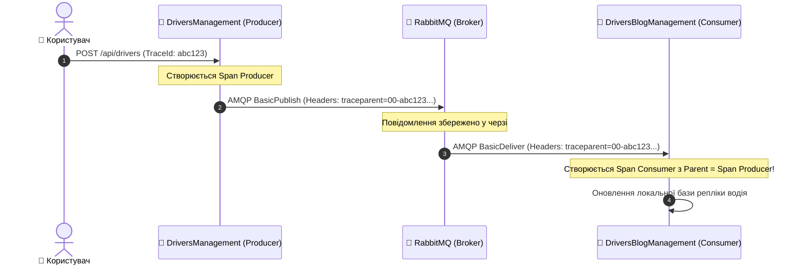
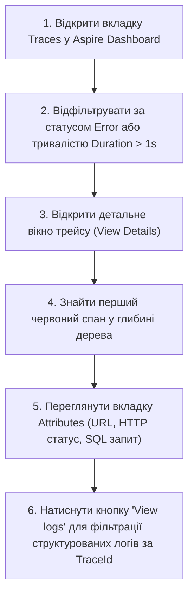

# 🌐 04. Наскрізне трасування: OpenTelemetry Tracing у .NET Aspire

> **Розділ курсу:** `02-Microservices-Craftsman` • **Модуль:** `02-01-Aspire-Documentation`  
> **Стек:** .NET 10, C# 13, OpenTelemetry .NET SDK, `System.Diagnostics.Activity`, W3C TraceContext RFC, OTLP (OpenTelemetry Protocol), MassTransit Tracing  
> **Цільова аудиторія:** Архітектори систем спостережуваності (Observability Architects), Senior/Lead .NET інженери, DevOps/SRE спеціалісти  
> **Офіційна специфікація та документація:**  
> - [W3C Recommendation: Trace Context Level 1](https://www.w3.org/TR/trace-context/)  
> - [OpenTelemetry Tracing Specification](https://opentelemetry.io/docs/concepts/signals/traces/)  
> - [.NET Diagnostics: System.Diagnostics.Activity API Guide](https://learn.microsoft.com/dotnet/core/diagnostics/distributed-tracing)  
> - [Google Dapper Paper: Large-scale Distributed Systems Tracing Infrastructure (2010)](https://research.google/pubs/pub36356/)

---

## 📑 Академічний зміст лекції

- [1. Теоретичний базис: Еволюція діагностики від монолітних логів до OpenTelemetry](#section-1)
- [2. Математична та графова модель розподіленого трейсу (Spans as a DAG)](#section-2)
- [3. Архітектура BCL у .NET: System.Diagnostics.Activity vs OpenTelemetry API](#section-3)
- [4. Специфікація стандарту W3C TraceContext: Глибокий розбір заголовка traceparent](#section-4)
- [5. Конфігурація трейсингу в CargoDelivery.ServiceDefaults (Extensions.cs)](#section-5)
- [6. Наскрізне трасування запиту Gateway Aggregator (Діаграми спанів та Ганта)](#section-6)
- [7. Візуалізація збоїв, повторів Polly та патерну Graceful Degradation](#section-7)
- [8. Трасування асинхронних черг повідомлень RabbitMQ через MassTransit](#section-8)
- [9. Аналітична матриця: Діагностика архітектурних проблем за формою каскаду спанів](#section-9)
- [10. Практичний посібник: Алгоритм розслідування інцидентів в Aspire Dashboard](#section-10)
- [11. Контрольні запитання та лабораторні завдання](#section-11)

---

<a id="section-1"></a>
## 1. Теоретичний базис: Еволюція діагностики від монолітних логів до OpenTelemetry

У класичній монолітній архітектурі життєвий цикл запиту ізольований у межах єдиного процесу операційної системи. Якщо транзакція зазнає невдачі або виконується повільно, інженер відкриває стек викликів (Stack Trace), прив'язаний до ідентифікатора потоку (Thread ID), і точно встановлює рядок коду, де виник виняток.

У мікросервісній архітектурі одинична користувацька операція (наприклад, «Завантажити досьє рейсу доставки») розпадається на мережевий каскад через десятки автономних вузлів.



### Три етапи еволюції діагностики:

1. **Етап 1: Локальні файлові логи (Isolated File Logs)**
   * Кожен сервіс пише текстові логи у локальний файл на диску.
   * *Криза підходу:* Неможливо зіставити лог агрегатора з логом сервісу замовлень. При наявності 50 контейнерів пошук помилки перетворюється на нездійсненну ручну працю.

2. **Етап 2: Централізовані структуровані логи (Centralized Structured Logging - ELK, Seq, Loki)**
   * Логи агрегуються в єдине сховище у форматі JSON з кореляційним ідентифікатором (`CorrelationId`).
   * *Криза підходу:* Логи фіксують **дискретні події** в часі, але не відображають **тривалості операцій**, взаємного блокування потоків, паралелізму та структури батьківсько-дочірніх зв'язків. Неможливо відповісти на питання: *"Чому запит тривав 1.4 секунди: через повільний SQL чи через чергу на TCP-сокеті?"*.

3. **Етап 3: Розподілене трасування (Distributed Tracing - Dapper, Zipkin, OpenTelemetry)**
   * Концепція, вперше масштабно описана Google у статті *Dapper* (2010).
   * Кожна операція фіксується як часовий інтервал (**Span**), що має точний час початку, тривалість, метадані (теги/атрибути) та вказівник на операцію, що її породила (**Parent-Child relationship**).
   * Всі спани однієї користувацької операції об'єднуються глобальним ідентифікатором **TraceId**.

---

<a id="section-2"></a>
## 2. Математична та графова модель розподіленого трейсу (Spans as a DAG)

З погляду дискретної математики та теорії графів, розподілений трейс є **Орієнтованим Ациклічним Графом (Directed Acyclic Graph — DAG)**, вершинами якого є спани, а орієнтованими ребрами — причинно-наслідкові зв'язки викликів.

### Структура елементів трейсу:

$$Trace = \{ S_{\text{root}}, S_1, S_2, \dots, S_n \}$$

Де кожен спан $S_i$ являє собою кортеж:
$$S_i = \langle \text{TraceId}, \; \text{SpanId}, \; \text{ParentSpanId}, \; t_{\text{start}}, \; \Delta t, \; \mathcal{A}, \; \mathcal{E}, \; \mathcal{S} \rangle$$

* $\text{TraceId} \in \{0..9, a..f\}^{32}$ — глобальний 128-бітний ідентифікатор транзакції.
* $\text{SpanId} \in \{0..9, a..f\}^{16}$ — унікальний 64-бітний ідентифікатор конкретного спану.
* $\text{ParentSpanId} \in \{0..9, a..f\}^{16} \cup \{\emptyset\}$ — посилання на батьківський спан (для $S_{\text{root}}$ значення $\emptyset$).
* $t_{\text{start}}$ — часова мітка початку операції за стандартом UTC з точністю до наносекунд.
* $\Delta t$ — тривалість виконання ($t_{\text{end}} - t_{\text{start}}$).
* $\mathcal{A} = \{ \text{key}_k \mapsto \text{value}_k \}$ — множина атрибутів (тегів) відповідно до OpenTelemetry Semantic Conventions (наприклад, `http.status_code = 200`, `db.system = "postgresql"`).
* $\mathcal{E} = \{ \langle t_e, \text{name}_e, \text{attrs}_e \rangle \}$ — внутрішні мікроподії спану (Events), наприклад, фіксація точки виникнення винятку.
* $\mathcal{S} \in \{ \text{Unset}, \; \text{Ok}, \; \text{Error} \}$ — канонічний статус завершення операції.



---

<a id="section-3"></a>
## 3. Архітектура BCL у .NET: System.Diagnostics.Activity vs OpenTelemetry API

У багатьох мовах програмування (Java, Python, Go) для трасування необхідно підключати окремі важкі бібліотеки OpenTelemetry API та вручну створювати екземпляри `Tracer`.

У платформі .NET команда Microsoft прийняла революційне рішення: **примітиви трасування вбудовані безпосередньо в базову бібліотеку класів (BCL - Base Class Library)** у простір імен `System.Diagnostics`.

| Концепція OpenTelemetry | Еквівалент у .NET BCL (`System.Diagnostics`) | Опис та роль у рантаймі |
| :--- | :--- | :--- |
| **Tracer** | `ActivitySource` | Фабрика для створення нових спанів у межах конкретної підсистеми або бібліотеки. |
| **Span** | `Activity` | Об'єкт, що фіксує операцію в часі, її теги, статус та батьківський контекст. |
| **TracerProvider** | `OpenTelemetry.Trace.TracerProvider` | Конвеєр обробки телеметрії: збирає `Activity`, фільтрує, семплює та відправляє по OTLP. |
| **SpanContext** | `ActivityContext` | Легковажна незмінна структура (Struct), що передає `TraceId`, `SpanId` та `TraceFlags`. |
| **Attributes** | `Activity.SetTag(key, value)` | Метадані операції (HTTP методи, URL, параметри запитів). |
| **Events** | `Activity.AddEvent(new ActivityEvent(name))` | Точкові позначки подій всередині інтервалу спану (наприклад, викидання винятку). |

### Чому підхід .NET має нульову ціну простою (Zero-Allocation When Disabled):
Якщо для сервісу відключено моніторинг або ніхто не слухає `ActivitySource`, виклик:
```csharp
using var activity = myActivitySource.StartActivity("CustomOperation");
```
Повертає `null`! У пам'яті взагалі не виділяється об'єкт у купі (Heap Allocation = 0 bytes), що гарантує гранично високу продуктивність критичних секцій коду.

---

<a id="section-4"></a>
## 4. Специфікація стандарту W3C TraceContext: Глибокий розбір заголовка traceparent

Як контекст трасування передається між ізольованими процесами через кордони HTTP?  
Історично існували несумісні пропрієтарні формати заголовків: `X-B3-TraceId` (Zipkin), `x-datadog-trace-id` (Datadog), `Request-Id` (старий ASP.NET).

Консорціум W3C затвердив єдиний обов'язковий міжнародний стандарт: **W3C Trace Context Level 1**.

Коли типізований клієнт `DriverApiClient` у нашому агрегаторі виконує запит до `DriversManagement`, бібліотека інструментації автоматично формує та додає заголовок `traceparent`:

```http
GET /api/drivers/3fa85f64-5717-4562-b3fc-2c963f66afa6 HTTP/1.1
Host: driversmanagement
traceparent: 00-4bf92f3577b34da6a3ce929d0e0e4736-00f067aa0ba902b7-01
tracestate: congo=ucfJifl5GOE,rojo=ld0Template
```

### Побайтова деконструкція поля `traceparent`:

$$\underbrace{\text{00}}_{\text{Версія}} - \underbrace{\text{4bf92f3577b34da6a3ce929d0e0e4736}}_{\text{TraceId (32 hex)}} - \underbrace{\text{00f067aa0ba902b7}}_{\text{Parent SpanId (16 hex)}} - \underbrace{\text{01}}_{\text{TraceFlags (2 hex)}}$$

```
+--------+----------------------------------+------------------+------------+
| Версія | TraceId                          | Parent SpanId    | TraceFlags |
| 2 hex  | 32 hex (128 біт)                 | 16 hex (64 біти) | 2 hex      |
+--------+----------------------------------+------------------+------------+
|   00   | 4bf92f3577b34da6a3ce929d0e0e4736 | 00f067aa0ba902b7 |     01     |
+--------+----------------------------------+------------------+------------+
```

1. **Версія (`00`):** Наразі поточною специфікацією W3C є версія 0. Значення `ff` зарезервоване для майбутніх стандартів.
2. **`TraceId` (`4bf92f3577b34da6a3ce929d0e0e4736`):** 16 байт ентропії. Забезпечує глобальну унікальність серед мільярдів запитів у розподілених дата-центрах без координації вузлів.
3. **`Parent SpanId` (`00f067aa0ba902b7`):** 8 байт. Ідентифікатор спану клієнта-відправника. Отримувач (сервер `DriversManagement`) створить свій власний новий `SpanId`, але вкаже це значення як свій `ParentSpanId`.
4. **`TraceFlags` (`01`):** Бітова маска прапорців.
   * Біт 0 (`01` — Sampled): вказує системі, що цей запит відібраний для постійного збереження в базі даних телеметрії.
   * Якщо прапорець `00`, трасування прокидається крізь сервіси для кореляції логів, але важкі спани в сховище не записуються (зниження накладних витрат мережі).

---

<a id="section-5"></a>
## 5. Конфігурація трейсингу в CargoDelivery.ServiceDefaults (Extensions.cs)

Усе налаштування OpenTelemetry централізовано у спільному проєкті:

> 📍 **Файл:** [Extensions.cs](file:///c:/Users/Yurii/source/repos/Demo-CargoDeliveryService/02-Microservices-Craftsman/Aspire/CargoDelivery.ServiceDefaults/Extensions.cs)

### Деконструкція коду реєстрації OpenTelemetry Tracing:

```csharp
builder.Services.AddOpenTelemetry()
    .WithTracing(tracing =>
    {
        tracing.AddAspNetCoreInstrumentation()   // 1. Вхідний HTTP трафік
               .AddHttpClientInstrumentation()   // 2. Вихідний HTTP трафік
               .AddSource("MassTransit");        // 3. Асинхронний AMQP трафік

        // 4. Реєстрація користувацьких джерел активностей доменних сервісів
        tracing.AddSource("CargoDelivery.*");
    });

// 5. Експорт телеметрії через стандартизований OTLP протокол
builder.AddOpenTelemetryExporters();
```

#### Інженерний аналіз підключених модулів:

1. **`AddAspNetCoreInstrumentation()`:**
   * Підключається до діагностичного конвеєра Kestrel та ASP.NET Core MVC.
   * Автоматично витягує W3C заголовок `traceparent` з кожного вхідного HTTP-запиту.
   * Створює вхідний серверний спан (`SERVER`) і записує семантичні атрибути: `http.request.method`, `http.route`, `http.response.status_code`, `client.address`.
2. **`AddHttpClientInstrumentation()`:**
   * Підключається до `DiagnosticSource` бібліотеки `System.Net.Http`.
   * Перед відправкою будь-якого виклику через `HttpClient` генерує клієнтський спан (`CLIENT`) і автоматично інжектує поточний `Activity.Current` у W3C заголовок `traceparent`.
   * Фіксує точну тривалість очікування мережевої відповіді та статус-код цільового сервісу.
3. **`AddSource("MassTransit")`:**
   * Інтегрує MassTransit з OpenTelemetry.
   * Забезпечує наскрізну передачу `TraceId` через черги брокера RabbitMQ у бінарних метаданих повідомлення.
4. **`builder.AddOpenTelemetryExporters()`:**
   * Зчитує адресу OTLP-ендпоінта з конфігурації `OTEL_EXPORTER_OTLP_ENDPOINT` (яку .NET Aspire встановлює автоматично для кожного контейнера).
   * Пакує накопичені спани за протоколом Protobuf і передає їх через gRPC або HTTP/POST до Aspire Dashboard.

---

<a id="section-6"></a>
## 6. Наскрізне трасування запиту Gateway Aggregator (Діаграми спанів та Ганта)

Розглянемо повну картину виконання запиту `GET /api/v1/shipment-summary/{driverId}` через новостворений `CargoDelivery.HttpAggregator`.

### Діаграма Ганта розподіленого трейсу (Aspire Dashboard Trace View)

```mermaid
gantt
    title Розподілений трейс операції агрегації (TraceId: 4bf92f3577b34da6a3ce929d0e0e4736)
    dateFormat X
    axisFormat %s ms

    section HttpAggregator
    Server GET api/v1/shipment-summary/{id}               :active, root, 0, 85

    section DriversManagement
    Client GET DriversManagement                          :crit, dm_http, 5, 30
    Server GET api/drivers/{id}                           :active, dm_srv, 7, 28
    DB Npgsql SELECT Drivers WHERE Id = @id               :active, dm_sql, 11, 23

    section CargoOrdering
    Client GET CargoOrderingService                       :active, co_http, 32, 78
    Server GET api/deliveries                             :active, co_srv, 34, 76
    DB Npgsql SELECT Deliveries WHERE DriverId = @id      :active, co_sql, 38, 70

    section DriversBlog
    Client GET DriversBlogManagement                      :active, db_http, 32, 64
    Server GET api/postaboutdrivers                       :active, db_srv, 34, 62
    DB Npgsql SELECT Posts WHERE DriverId = @id           :active, db_sql, 37, 56
```



### Ключові висновки з часової діаграми (Waterfall Analysis):
1. **Фаза валідації (0 - 30 мс):** Виклик до `DriversManagement` є послідовним бар'єром. Лише після успішного підтвердження існування водія та закриття спану `dm_http` стартує наступна фаза.
2. **Фаза паралелізму Scatter (32 - 78 мс):** Спани клієнтських викликів `co_http` (CargoOrdering) та `db_http` (DriversBlog) починаються **в один і той самий мілісекундний інтервал (t = 32 ms)**. Вони виконуються строго паралельно!
3. **Ієрархія глибини:** Клієнтський HTTP-спан агрегатора породжує серверний HTTP-спан всередині цільового сервісу, який, своєю чергою, породжує дочірній спан бази даних Npgsql. Усі вони мають однаковий `TraceId`, але утворюють чітке дерево підпорядкування завдяки `ParentSpanId`.

---

<a id="section-7"></a>
## 7. Візуалізація збоїв, повторів Polly та патерну Graceful Degradation

Трасування OpenTelemetry у поєднанні з Aspire Dashboard дає унікальну можливість наочно побачити, як система поводиться під час відмов.

### Сценарій 1: Частковий збій та Graceful Degradation
Припустимо, мікросервіс `DriversBlogManagement` тимчасово впав або повертає помилку 503.



#### Відображення в дашборді:
* Спан виклику до `DriversBlogManagement` забарвлюється у **яскраво-червоний колір** зі статусом `Error`.
* Клік по спану розгортає атрибути: `http.status_code = 503`, `exception.type = "HttpRequestException"`.
* **АЛЕ кореневий спан `HttpAggregator` залишається зеленим (`200 OK`)!**
* Це наочно доводить працездатність нашого захисного коду: аварія другорядного сервісу локалізована, а користувач отримав валідну зведену сторінку рейсу.

### Сценарій 2: Візуалізація транзієнтних повторів Polly (Retry Pattern)
При тестуванні ендпоінта `GET /api/simulation/flaky?failUntil=2` через стійкий клієнт Polly:

```
[Trace: 8a7f1...]
 ├── GET /api/v1/resilience-demo/retry (Total: 420 ms)
 │    ├── Attempt 1: GET /api/simulation/flaky [503 Error] (Duration: 5 ms)
 │    │    └── Delay / Backoff: 50 ms (Polly Sleep)
 │    ├── Attempt 2: GET /api/simulation/flaky [503 Error] (Duration: 4 ms)
 │    │    └── Delay / Backoff: 100 ms (Polly Sleep)
 │    └── Attempt 3: GET /api/simulation/flaky [200 OK]    (Duration: 6 ms)
```

Інженер бачить у дереві трасування:
1. Кількість реальних спроб виклику.
2. Тривалість експоненційної паузи (Backoff Delay) між спробами.
3. Точну причину попередніх невдач без необхідності дебажити код у Visual Studio!

---

<a id="section-8"></a>
## 8. Трасування асинхронних черг повідомлень RabbitMQ через MassTransit

Коли комунікація переходить від синхронного HTTP до асинхронних черг повідомлень (Event-Driven Architecture), контекст більше не може передаватися через стандартні HTTP-заголовки.

### Механізм передачі W3C контексту в AMQP 0-9-1:

Коли сервіс `DriversManagement` викликає `publishEndpoint.Publish<IDriverCreated>(message)`:
1. Провайдер MassTransit перехоплює поточний `Activity.Current`.
2. MassTransit серіалізує значення `traceparent` у словник властивостей AMQP (BasicProperties.Headers):
   * Ключ: `traceparent`, Значення: `00-4bf92f35...-01`
   * Ключ: `diagnostic-context`, Значення: контекст транзакції.
3. Повідомлення потрапляє в Exchange та маршрутизується в чергу RabbitMQ.
4. Консьюмер у сервісі `DriversBlogManagement` отримує байтовий пакет, MassTransit вичитує `traceparent` з заголовків AMQP і викликає:
   ```csharp
   ActivitySource.StartActivity("MassTransit.Consume", ActivityKind.Consumer, parentContext);
   ```



> 🎯 **Результат:**  
> В інтерфейсі Aspire Dashboard асинхронна фонова обробка повідомлення відображається у тому самому дереві трейсу, що й первинний HTTP-запит користувача, дозволяючи бачити затримку доставки повідомлення через брокер!

---

<a id="section-9"></a>
## 9. Аналітична матриця: Діагностика архітектурних проблем за формою каскаду спанів

Досвідчений архітектор або інженер надійності (SRE) здатний за формою діаграми Ганта спанів у Aspire Dashboard миттєво визначити архітектурну хворобу розподіленої системи:

| Форма водоспаду спанів (Waterfall Pattern) | Архітектурний діагноз | Причина у вихідному коді | Метод лікування |
| :--- | :--- | :--- | :--- |
| **"Сходинки сходів" (Cascading Staircase)** | Послідовне блокування операцій | Використання послідовних `await` для незалежних I/O викликів. | Заміна на паралельний **Fan-Out** через `Task.WhenAll`. |
| **"Довгий товстий блок" (Thick Monolith Block)** | Зависання в базі даних або I/O | Відсутність індексу в БД, блокування таблиці або CPU-інтенсивний цикл. | Аналіз вкладеного спану EF Core Npgsql, додавання індексів. |
| **"Зубчаста пилка" (Sawtooth Repetitions)** | Агресивний транзієнтний шторм | Політика Polly Retry багаторазово штурмує сервіс, що безнадійно лежить. | Налаштування **Circuit Breaker** для негайного відсікання безнадійних викликів. |
| **"Паралельна вилка" (Healthy Fork)** | **Еталонна асинхронна агрегація** | Одночасний запуск незалежних запитів до різних мікросервісів. | Збереження архітектурного патерну без змін. |
| **"Миттєвий спалах" (Instant Spike)** | Розімкнений Circuit Breaker (Fail-Fast) | Запит завершився за 0.5 мс з помилкою `BrokenCircuitException`. | Очікування відновлення бекенду (стан Half-Open). |

---

<a id="section-10"></a>
## 10. Практичний посібник: Алгоритм розслідування інцидентів в Aspire Dashboard

Коли в системі виникає збій, дотримуйтесь наступного стандартизованого алгоритму роботи в **Aspire Dashboard**:



### Покроковий регламент:
1. **Ідентифікація:** Відкрийте вебінтерфейс Aspire Dashboard (`http://localhost:18888`) та перейдіть у розділ **Traces**.
2. **Фільтрація:** У полі пошуку введіть ім'я сервісу `httpaggregator` або встановіть фільтр `State: Failed`.
3. **Локалізація точки відмови:**
   * У дереві спанів знайдіть найглибший дочірній спан, забарвлений червоним.
   * Зверніть увагу: батьківські спани можуть бути червоними лише тому, що дочірній повернув помилку, або зеленими, якщо спрацював механізм деградації.
4. **Аналіз атрибутів (Tags):**
   * Перевірте атрибут `exception.message` та `exception.stacktrace`.
   * Для HTTP-викликів перевірте `http.url` та `http.status_code`.
   * Для викликів бази даних перевірте `db.statement` (повний текст виконаного SQL-запиту).
5. **Наскрізна кореляція з логами (Log Correlation):**
   * Натисніть кнопку **View Logs** навпроти спану.
   * Дашборд миттєво відкриє журнал структурованих логів, відфільтрований виключно для цього конкретного `TraceId`, демонструючи контекст подій без шуму від сусідніх користувачів.

---

<a id="section-11"></a>
## 11. Контрольні запитання та лабораторні завдання

### 🎯 Контрольні запитання:
1. Чому використання заголовка `X-Correlation-ID` у сучасних розподілених системах вважається застарілим і поступається стандарту W3C `traceparent`?
2. Яким чином клас `System.Diagnostics.Activity` забезпечує нульові накладні витрати пам'яті (Zero Allocations), коли збір телеметрії вимкнено?
3. Що станеться з деревом трейсів, якщо мікросервіс отримає заголовок `traceparent`, але не матиме підключеного інструментатора `AddAspNetCoreInstrumentation()`?
4. У чому полягає різниця між дочірнім спаном (Child Span) та зв'язком спанів (Span Link) в екосистемі OpenTelemetry? У яких випадках слід використовувати Span Links?

### 🛠️ Практичне лабораторне завдання:
1. Запустіть рішення через `CargoDelivery.AppHost`.
2. Виконайте GET-запит до ендпоінту `api/simulation/slow?delaySeconds=2` на агрегаторі.
3. Знайдіть створений трейс у дашборді. Переконайтеся, що на діаграмі Ганта чітко видно затримку тривалістю 2000 мс.
4. Спровокуйте збій, викликавши ендпоінт `api/simulation/flaky?failUntil=2`.
5. Знайдіть відповідний трейс і проаналізуйте часові інтервали між повторними спробами Polly.
