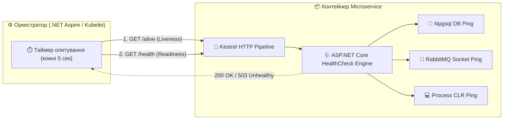
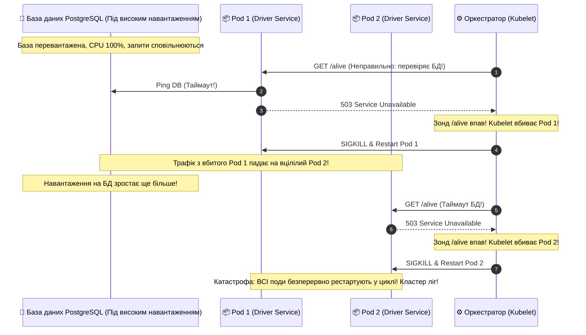
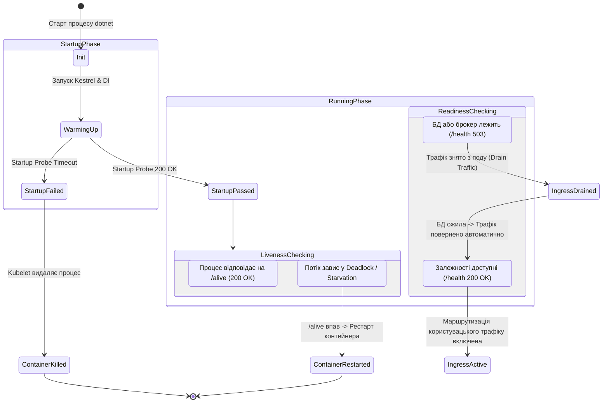

# 🩺 05. Діагностика мікросервісів: Health Checks, Liveness та Readiness Probes

> **Розділ курсу:** `02-Microservices-Craftsman` • **Модуль:** `02-01-Aspire-Documentation`  
> **Стек:** .NET 10, C# 13, ASP.NET Core Health Checks, Kubernetes Probes RFC, Aspire Dashboard Health Status, WebApplicationFactory  
> **Цільова аудиторія:** Архітектори надійності (SRE), системні аналітики, Lead .NET інженери, розробники хмарної інфраструктури  
> **Офіційна специфікація та документація:**  
> - [ASP.NET Core Health Checks in .NET](https://learn.microsoft.com/aspnet/core/host-and-deploy/health-checks)  
> - [Kubernetes Documentation: Configure Liveness, Readiness and Startup Probes](https://kubernetes.io/docs/tasks/configure-pod-container/configure-liveness-readiness-startup-probes/)  
> - [IETF Draft: Health Check Response Format for HTTP APIs](https://inadarei.github.io/rfc-healthcheck/)

---

## 📑 Академічний зміст лекції

- [1. Теоретичний базис: Активне зондування проти пасивного моніторингу](#section-1)
- [2. Модель відмов: Чому працюючий процес ОС може бути мертвим для бізнесу](#section-2)
- [3. Триєдина специфікація зондів: Startup, Liveness та Readiness Probes](#section-3)
- [4. Антипатерн "Спіраль смерті" (The Cascading Death Spiral)](#section-4)
- [5. Архітектурна реалізація у ServiceDefaults: Теги, предикати та конфігурація маршрутів](#section-5)
- [6. Проєктування перевірок для зовнішніх залежностей (БД, RabbitMQ, HTTP)](#section-6)
- [7. Стандартизація формату відповіді зондів: Простий текст проти IETF JSON](#section-7)
- [8. Діаграма станів життєвого циклу контейнера під контролем зондів](#section-8)
- [9. Автоматизоване тестування зондів у CargoDelivery.HttpAggregator.Tests](#section-9)
- [10. Архітектурна матриця: Антипатерни vs Еталонні практики проектування зондів](#section-10)
- [11. Контрольні запитання та лабораторні вправи](#section-11)

---

<a id="section-1"></a>
## 1. Теоретичний базис: Активне зондування проти пасивного моніторингу

У надійних розподілених системах моніторинг стану здоров'я вузлів розділяється на дві принципово різні парадигми:

1. **Пасивний моніторинг (Passive Monitoring / Metrics & Telemetry):**
   * Система збирає метрики за фактом проходження реальних користувацьких запитів (кількість помилок HTTP 500, середній час затримки $p95/p99$, навантаження на CPU).
   * *Недолік:* Якщо на сервіс не надходить трафік (наприклад, у нічний час або під час очікування події), пасивний моніторинг не знає, чи здатний сервіс обробляти запити взагалі. Першим, хто дізнається про катастрофу, буде користувач.

2. **Активне зондування (Active Probing / Health Checking):**
   * Зовнішній спостерігач (Kubelet у Kubernetes, Orchestrator у .NET Aspire, Consul або балансувальник AWS ALB / Azure Application Gateway) з фіксованим періодом $T_{\text{probe}}$ (наприклад, кожні 5-10 секунд) надсилає стандартизований синтетичний HTTP-запит до виділеного ендпоінта діагностики.
   * Сервіс виконує самодіагностику (перевіряє зв'язок з БД, вільне місце на диску, працездатність черги) і повертає статус-код.



---

<a id="section-2"></a>
## 2. Модель відмов: Чому працюючий процес ОС може бути мертвим для бізнесу

Типова ілюзія розробників-початківців: *"Якщо процес `dotnet.exe` або контейнер Docker запущений і PID існує в системі — сервіс працює"*.

У реальних високонавантажених системах існує цілий спектр станів так званої **«прихованої відмови» (Silent Failure)**:

1. **Виснаження пулу потоків (ThreadPool Starvation):**
   * Через використання блокуючих синхронних очікувань асинхронного коду (`.Result`, `.Wait()`, `Task.WaitAll()`) або надмірну кількість CPU-інтенсивних обчислень усі потоки пулу виявляються заблокованими.
   * Нові вхідні TCP-запити стають у чергу й очікують виділення потоку. Для зовнішнього світу сервіс виглядає завислим (тайм-аут 30 секунд).
2. **Взаємне блокування (Deadlock на Monitor/lock або синхронізаторах транзакцій):**
   * Два фонові потоки заблокували спільні ресурси у перехресному порядку. Процес споживає 0% CPU, але жоден запит не обробляється.
3. **Вичерпання пулу з'єднань з базою даних (Database Connection Pool Exhaustion):**
   * Розробники забули закрити підключення (`NpgsqlConnection` / `SqlConnection`). Пул вичерпав ліміт у 100 підключень. Наступні бізнес-запити зависають на 15 секунд і падають з помилкою `TimeoutException`.
4. **Нескінченна пауза збирача сміття (Garbage Collection Pause / Heap Fragmentation):**
   * Через витік пам'яті в Large Object Heap (LOH) процес знаходиться у стані агресивного збирання Full GC Gen 2, блокуючи виконання коду на кілька секунд.

> 🎯 **Висновок:**  
> Перевірка працездатності процесу на рівні операційної системи (наявність PID) є абсолютно недостатньою. Необхідний прикладний зонд, що виконує реальний код всередині середовища виконання .NET CLR.

---

<a id="section-3"></a>
## 3. Триєдина специфікація зондів: Startup, Liveness та Readiness Probes

Сучасний хмарний стандарт оркестрації вимагає чіткого розмежування трьох зондів з принципово різною семантикою:

| Критерій | 1. Startup Probe | 2. Liveness Probe (`/alive`) | 3. Readiness Probe (`/health`) |
| :--- | :--- | :--- | :--- |
| **Семантичне питання** | *"Чи завершилась ініціалізація застосунку?"* | *"Чи живий внутрішній цикл виконання процесу CLR?"* | *"Чи готовий сервіс обробляти реальні бізнес-запити клієнтів?"* |
| **Що перевіряє?** | Міграції бази даних, розігрів кешів, JIT-компільовані структури. | Виключно стан процесу, пам'ять та цикл потоків (перевірка `"self"`). | Доступність бази даних, брокера RabbitMQ, обов'язкових зовнішніх API. |
| **Реакція оркестратора при збої** | Чекає до закінчення ліміту `failureThreshold`. При перевищенні — рестарт. | **Негайне примусове вбивство контейнера (SIGKILL / Container Restart).** | **Зняття контейнера з балансувальника навантаження (Remove from Ingress).** Контейнер НЕ вбивають! |
| **Тег у коді .NET** | `tags: ["startup"]` | `tags: ["live"]` | `tags: ["ready"]` (або всі зареєстровані перевірки). |
| **Вплив на інфраструктуру** | Тимчасовий на етапі старту. | Захищає від безвихідних Deadlock. | Захищає користувачів від отримання помилок 502/503. |

---

<a id="section-4"></a>
## 4. Антипатерн "Спіраль смерті" (The Cascading Death Spiral)

Найнебезпечнішою помилкою інженерів є включення зовнішніх залежностей (бази даних PostgreSQL або черги RabbitMQ) до зонда **Liveness (`/alive`)**.

### Сценарій виникнення катастрофічної спіралі смерті:



### Чому це катастрофа?
1. Перезапуск процесу C# не може полагодити перевантажену базу даних!
2. Навпаки, коли 20 щойно перезапущених контейнерів одночасно піднімаються, вони ініціалізують пули з'єднань, надсилають важкі запити перевірки міграцій та JIT-компіляції, остаточно вбиваючи базу даних.

> 🛑 **Золоте правило архітектури:**  
> **Liveness Probe (`/alive`) ніколи, за жодних обставин не повинен перевіряти зовнішні мережеві ресурси!**  
> Доступність бази даних перевіряється **виключно у Readiness Probe (`/health`)**. При збої бази даних контейнер просто перестає приймати трафік, але спокійно очікує відновлення БД без самознищення.

---

<a id="section-5"></a>
## 5. Архітектурна реалізація у ServiceDefaults: Теги, предикати та конфігурація маршрутів

Усі перевірки централізовані у спільному проєкті `CargoDelivery.ServiceDefaults`.

> 📍 **Вихідний код:** [Extensions.cs](file:///c:/Users/Yurii/source/repos/Demo-CargoDeliveryService/02-Microservices-Craftsman/Aspire/CargoDelivery.ServiceDefaults/Extensions.cs)

### 1. Реєстрація базового зонда життя процесу

```csharp
public static TBuilder AddDefaultHealthChecks<TBuilder>(this TBuilder builder) 
    where TBuilder : IHostApplicationBuilder
{
    builder.Services.AddHealthChecks()
        // Реєструємо легковажну перевірку "self" з тегом "live".
        // Вона повертає Healthy(), якщо внутрішній цикл Kestrel здатний прийняти та обробити запит.
        .AddCheck("self", () => HealthCheckResult.Healthy(), ["live"]);

    return builder;
}
```

### 2. Маршрутизація з фільтрацією за предикатами

```csharp
public static WebApplication MapDefaultEndpoints(this WebApplication app)
{
    // У Development-середовищі мапимо ендпоінти для моніторингу через Aspire Dashboard
    if (app.Environment.IsDevelopment())
    {
        // 1. Ендпоінт /health (Readiness Probe):
        // За замовчуванням виконує ВСІ зареєстровані перевірки (self + БД + RabbitMQ + зовнішні API)
        app.MapHealthChecks("/health");

        // 2. Ендпоінт /alive (Liveness Probe):
        // Використовує Predicate для запуску ВИКЛЮЧНО перевірок з тегом "live".
        // Жодна зовнішня залежність сюди не потрапляє!
        app.MapHealthChecks("/alive", new HealthCheckOptions
        {
            Predicate = r => r.Tags.Contains("live")
        });
    }

    return app;
}
```

---

<a id="section-6"></a>
## 6. Проєктування перевірок для зовнішніх залежностей (БД, RabbitMQ, HTTP)

Для повноцінної перевірки готовності мікросервісів обробляти бізнес-запити до конвеєра `builder.Services.AddHealthChecks()` додаються спеціалізовані перевірки:

### Приклад розширення для мікросервісу з БД та чергою:

```csharp
builder.Services.AddHealthChecks()
    // Перевірка доступності PostgreSQL через відкриття з'єднання та легкий SELECT 1;
    .AddNpgSql(
        connectionString: builder.Configuration.GetConnectionString("cargo-db")!,
        name: "postgresql_check",
        failureStatus: HealthStatus.Unhealthy,
        tags: ["ready", "db"],
        timeout: TimeSpan.FromSeconds(3))
    
    // Перевірка доступності брокера повідомлень RabbitMQ
    .AddRabbitMQ(
        rabbitConnectionString: builder.Configuration.GetConnectionString("messaging")!,
        name: "rabbitmq_check",
        failureStatus: HealthStatus.Degraded, // Якщо черга впала, можемо працювати в режимі деградації!
        tags: ["ready", "broker"],
        timeout: TimeSpan.FromSeconds(2));
```

### Три статуси перевірки здоров'я (`HealthStatus`):
* `HealthStatus.Healthy` (HTTP 200) — підсистема повністю функціональна.
* `HealthStatus.Degraded` (HTTP 200) — підсистема працює з підвищеними затримками або відмовою другорядного компонента (наприклад, кешу Redis). Балансувальник не відключає сервіс, але інженери бачать попередження в дашборді.
* `HealthStatus.Unhealthy` (HTTP 503) — критична підсистема недоступна. Сервіс негайно ізолюється від клієнтського трафіку.

---

<a id="section-7"></a>
## 7. Стандартизація формату відповіді зондів: Простий текст проти IETF JSON

За замовчуванням виклик `MapHealthChecks("/health")` повертає клієнту плоский текстовий рядок: `Healthy` або `Unhealthy` з відповідним статус-кодом.

Однак для великих розподілених систем стандартом де-факто є повернення структурованого JSON-звіту згідно з чернеткою стандарту IETF (*Health Check Response Format for HTTP APIs*):

```csharp
app.MapHealthChecks("/health/details", new HealthCheckOptions
{
    ResponseWriter = async (context, report) =>
    {
        context.Response.ContentType = "application/json";
        
        var payload = new
        {
            status = report.Status.ToString(),
            totalDurationMs = report.TotalDuration.TotalMilliseconds,
            entries = report.Entries.Select(e => new
            {
                name = e.Key,
                status = e.Value.Status.ToString(),
                durationMs = e.Value.Duration.TotalMilliseconds,
                description = e.Value.Description,
                data = e.Value.Data,
                exception = e.Value.Exception?.Message
            })
        };

        await context.Response.WriteAsJsonAsync(payload);
    }
});
```

### Приклад згенерованого детального звіту JSON:

```json
{
  "status": "Unhealthy",
  "totalDurationMs": 312.4,
  "entries": [
    {
      "name": "self",
      "status": "Healthy",
      "durationMs": 0.2,
      "description": null,
      "exception": null
    },
    {
      "name": "postgresql_check",
      "status": "Unhealthy",
      "durationMs": 310.1,
      "description": "Timeout connecting to host 'localhost:5432'",
      "exception": "Npgsql.NpgsqlException: Connection refused"
    }
  ]
}
```

---

<a id="section-8"></a>
## 8. Діаграма станів життєвого циклу контейнера під контролем зондів



---

<a id="section-9"></a>
## 9. Автоматизоване тестування зондів у CargoDelivery.HttpAggregator.Tests

Для гарантії того, що зонди здоров'я завжди сконфігуровані коректно і не зламаються при зміні залежностей або рефакторингу, у тестовому проєкті реалізовано автоматизовані функціональні тести:

> 📍 **Вихідний код:** [HttpAggregatorEndpointTests.cs](file:///c:/Users/Yurii/source/repos/Demo-CargoDeliveryService/02-Microservices-Craftsman/CargoDelivery.HttpAggregator.Tests/FunctionalTests/HttpAggregatorEndpointTests.cs)

```csharp
public sealed class HttpAggregatorEndpointTests : IClassFixture<WebApplicationFactory<Program>>
{
    private readonly HttpClient _client;

    public HttpAggregatorEndpointTests(WebApplicationFactory<Program> factory)
    {
        // Створює тестовий клієнт з конфігурацією інфраструктури в пам'яті (In-Memory TestServer)
        _client = factory.CreateClient();
    }

    [Fact]
    public async Task HealthEndpoint_ReadinessProbe_Returns200Ok()
    {
        // Act: запит до readiness зонда
        var response = await _client.GetAsync("/health");

        // Assert: перевірка, що статус-код 200 OK та контент містить 'Healthy'
        response.StatusCode.Should().Be(HttpStatusCode.OK);
        var content = await response.Content.ReadAsStringAsync();
        content.Should().Be("Healthy");
    }

    [Fact]
    public async Task AliveEndpoint_LivenessProbe_Returns200Ok()
    {
        // Act: запит до liveness зонда
        var response = await _client.GetAsync("/alive");

        // Assert: перевірка базової працездатності процесу
        response.StatusCode.Should().Be(HttpStatusCode.OK);
        var content = await response.Content.ReadAsStringAsync();
        content.Should().Be("Healthy");
    }
}
```

### Чому ці тести критичні?
* Вони виконуються в CI/CD конвеєрі за 380 мілісекунд.
* Якщо будь-який розробник помилково видалить `.AddDefaultHealthChecks()` або зламає `MapDefaultEndpoints()`, білд негайно впаде ще до потрапляння в репозиторій.

---

<a id="section-10"></a>
## 10. Архітектурна матриця: Антипатерни vs Еталонні практики проектування зондів

| Область проектування | ❌ Небезпечний антипатерн | 🟢 Еталонна хмарна практика |
| :--- | :--- | :--- |
| **Склад зонда Liveness** | Перевірка бази даних або зовнішнього шлюзу всередині `/alive`. | Зонд `/alive` перевіряє **тільки локальний стан процесу** (перевірка `"self"`). |
| **Реакція на відмову бази даних** | Сервіс падає з перезапуском контейнера. | Зонд `/health` повертає 503, балансувальник знімає трафік, процес залишається живим. |
| **Таймаути зондів (Probe Timeout)** | Зонд очікує відповіді БД 30 секунд (зависання черги опитування Kubelet). | Жорсткий таймаут зонда: 1-3 секунди за допомогою `timeout: TimeSpan.FromSeconds(2)`. |
| **Фільтрація перевірок** | Всі типи перевірок злиті в єдиний ендпоінт без використання тегів. | Чітка сегрегація за тегами: `tags: ["live"]` для Liveness, `tags: ["ready"]` для Readiness. |
| **Формат звітності** | Неінформативний рядок тексту, що не дає зрозуміти, яка саме з 5 баз даних упала. | Структурований JSON з деталями кожної перевірки (`name`, `duration`, `exception`). |
| **Режим Degraded** | Будь-яка некритична помилка (наприклад, недоступність кешу Redis) призводить до статусу Unhealthy. | Використання `HealthStatus.Degraded`, що дозволяє сервісу продовжувати обслуговування з дещо меншою швидкістю. |

---

<a id="section-11"></a>
## 11. Контрольні запитання та лабораторні вправи

### 🎯 Контрольні запитання:
1. Опишіть фізичний механізм виникнення «Спіралі смерті» (Cascading Death Spiral) при додаванні перевірки SQL Server до зонда Liveness.
2. Чим відрізняється поведінка балансувальника трафіку (Ingress/Kube-Proxy) при отриманні статусу `Unhealthy` від зонда Readiness порівняно зі статусом `Degraded`?
3. Чому ендпоінти діагностики здоров'я у файлі `Extensions.cs` мапляться виключно за умови `if (app.Environment.IsDevelopment())`, або за наявності захисту вхідного периметра в продакшні?
4. Які переваги надає використання класу `WebApplicationFactory<Program>` для тестування Health Checks порівняно з ручним запуском сервісу через консоль?

### 🛠️ Практичне лабораторне завдання:
1. Запустіть проєкт `CargoDelivery.AppHost`.
2. Відкрийте браузер і надішліть GET-запити на:
   * `http://localhost:<порт_агрегатора>/alive`
   * `http://localhost:<порт_агрегатора>/health`
3. Перевірте статус сервісу у стовпчику **Health** в інтерфейсі **Aspire Dashboard**.
4. Створіть власну перевірку здоров'я `SlowDependencyHealthCheck`, яка штучно затримує відповідь на 4 секунди, та протестуйте роботу таймауту діагностики.
