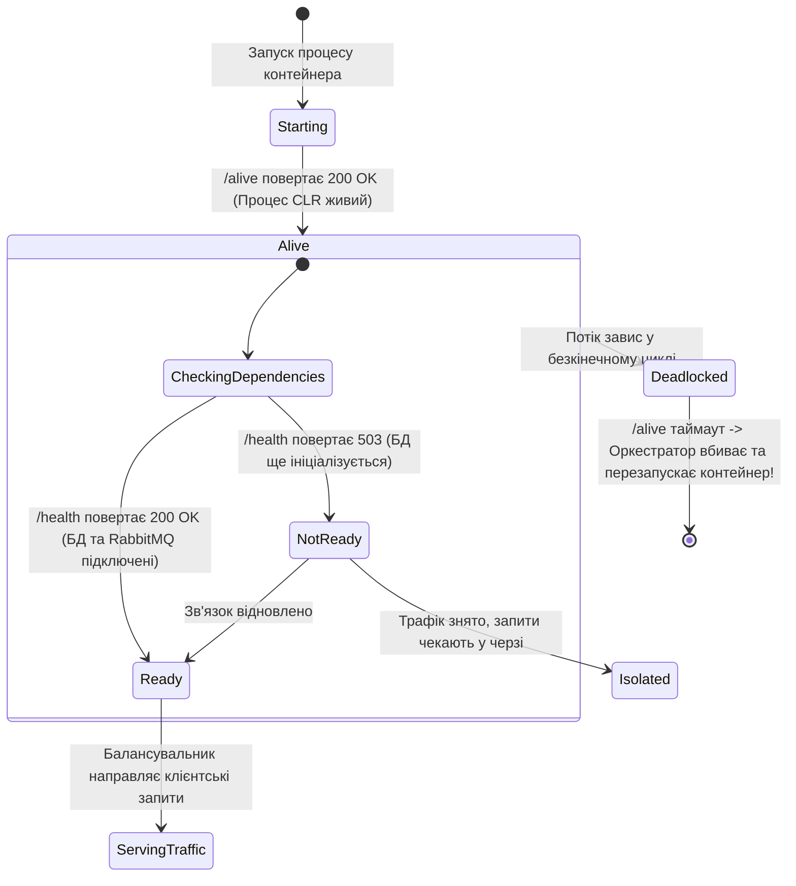

# 🩺 05. Діагностика мікросервісів: Health Checks, Liveness та Readiness Probes

> **Розділ:** `02-Microservices-Craftsman` • **Модуль:** `02-01-Aspire-Documentation`  
> **Стек:** .NET 10, ASP.NET Core Diagnostics, Kubernetes Probes, Aspire Dashboard Health Status.  
> **Офіційна документація Microsoft:** [.NET Aspire Health Checks Integration](https://learn.microsoft.com/dotnet/aspire/fundamentals/health-checks)

---

## 📑 Зміст модуля

- [Слайд 1. Чому мікросервісам потрібні окремі зонди діагностики](#slide-1)
- [Слайд 2. Liveness Probe (/alive) проти Readiness Probe (/health): Головна різниця](#slide-2)
- [Слайд 3. Анатомія реалізації у ServiceDefaults: Теги та предикати](#slide-3)
- [Слайд 4. Життєвий цикл контейнера під контролем зондів (State Diagram)](#slide-4)
- [Слайд 5. Підключення перевірок зовнішніх ресурсів: SQL Server та RabbitMQ](#slide-5)
- [Слайд 6. Відображення здоров'я сервісів у вебінтерфейсі Aspire Dashboard](#slide-6)
- [Слайд 7. Автоматизоване тестування ендпоінтів здоров'я через WebApplicationFactory](#slide-7)

---

<a id="slide-1"></a>
### 🎬 Слайд 1. Чому мікросервісам потрібні окремі зонди діагностики

У продакшн-середовищі (Kubernetes, Azure Container Apps, Docker Swarm) оркестратор не знає внутрішнього стану вашого C#-коду:
* Процес `dotnet` може працювати і споживати 100% CPU, але через внутрішній Deadlock у пулі потоків він не здатен відповісти на жоден HTTP-запит.
* База даних MS SQL Server може бути перевантажена або тимчасово недоступна через збій мережі.
* Якщо спрямувати трафік користувача на "хворий" сервіс, користувач побачить білий екран або помилку 502/503.

**Health Checks (Перевірки стану здоров'я)** — це стандартизовані HTTP-ендпоінти, через які оркестратор та Aspire Dashboard регулярно опитують сервіс для прийняття рішень щодо маршрутизації трафіку та автоматичного перезапуску.

---

<a id="slide-2"></a>
### ⚖️ Слайд 2. Liveness Probe (/alive) проти Readiness Probe (/health): Головна різниця

У .NET Aspire реалізовано чітке архітектурне розділення на два типи зондів:

| Критерій | 1. Liveness Probe (`/alive`) | 2. Readiness Probe (`/health`) |
| :--- | :--- | :--- |
| **Головне питання** | *"Чи живий процес застосунку?"* | *"Чи готовий сервіс обробляти бізнес-запити?"* |
| **Що перевіряє?** | Лише пам'ять, CLR та базовий цикл обробки потоків | Базу даних, чергу RabbitMQ, сторонні API |
| **Дія при збої** | **Перезапуск контейнера (Restart):** Вважається, що процес безнадійно завис у deadlock | **Відключення від трафіку (Remove from load balancer):** Запити перенаправляються на інші екземпляри |
| **Тег у коді** | `tags: ["live"]` | Усі зареєстровані перевірки (без фільтрації) |
| **Статус-коди** | 200 OK (Healthy) або 503 (Unhealthy) | 200 OK (Healthy) або 503 (Unhealthy) |

---

<a id="slide-3"></a>
### 🔍 Слайд 3. Анатомія реалізації у ServiceDefaults: Теги та предикати

> 📍 **Вихідний файл у рішенні:**  
> [Extensions.cs (рядки 118–149)](file:///c:/Users/Yurii/source/repos/Demo-CargoDeliveryService/02-Microservices-Craftsman/Aspire/CargoDelivery.ServiceDefaults/Extensions.cs#L118-L149)

#### 1. Реєстрація базової перевірки процесу:
```csharp
public static TBuilder AddDefaultHealthChecks<TBuilder>(this TBuilder builder) 
    where TBuilder : IHostApplicationBuilder
{
    builder.Services.AddHealthChecks()
        .AddCheck("self", () => HealthCheckResult.Healthy(), ["live"]);

    return builder;
}
```
* Перевірка `"self"` мітить себе тегом `["live"]`. Вона повертає `Healthy()`, якщо потік ASP.NET Core спроможний відповісти на запит.

#### 2. Мапінг маршрутів у конвеєрі HTTP:
```csharp
public static WebApplication MapDefaultEndpoints(this WebApplication app)
{
    if (app.Environment.IsDevelopment())
    {
        // 1. /health: викликає ВСІ перевірки (Readiness)
        app.MapHealthChecks("/health");

        // 2. /alive: викликає ТІЛЬКИ перевірки з тегом "live" (Liveness)
        app.MapHealthChecks("/alive", new HealthCheckOptions
        {
            Predicate = r => r.Tags.Contains("live")
        });
    }

    return app;
}
```

---

<a id="slide-4"></a>
### 🔄 Слайд 4. Життєвий цикл контейнера під контролем зондів (State Diagram)



---

<a id="slide-5"></a>
### 🔌 Слайд 5. Підключення перевірок зовнішніх ресурсів: SQL Server та RabbitMQ

У продакшн-мікросервісах до конвеєра `builder.Services.AddHealthChecks()` додаються готові пакети діагностики:

```csharp
// Приклад розширення для сервісу з базою даних та брокером:
builder.Services.AddHealthChecks()
    // Перевірка підключення до SQL Server (тег "ready"):
    .AddSqlServer(
        connectionString: builder.Configuration.GetConnectionString("DriversManagement")!,
        name: "sqlserver-check",
        tags: ["ready"])
    // Перевірка доступності брокера RabbitMQ (тег "ready"):
    .AddRabbitMQ(
        name: "rabbitmq-check",
        tags: ["ready"]);
```

* Коли падає SQL Server:
  * `/alive` повертає **200 OK** (контейнер не треба вбивати, проблема не в коді!).
  * `/health` повертає **503 Service Unavailable** (оркестратор не надсилає користувачів на цей сервіс, поки база не підніметься).

---

<a id="slide-6"></a>
### 📊 Слайд 6. Відображення здоров'я сервісів у вебінтерфейсі Aspire Dashboard

У вебінтерфейсі Aspire Dashboard інформація про Health Checks виведена на головну панель:
1. **Стовпчик "State":** Відображає загальний статус життєвого циклу (`Running`, `Starting`, `Exited`).
2. **Стовпчик "Health":**
   * 🟢 **Healthy (Зелений):** Усі зонди `/health` та `/alive` повернули статус 200 OK.
   * 🟡 **Degraded (Жовтий):** Сервіс працює, але одна з допоміжних перевірок сигналізує про затримки або часткову недоступність.
   * 🔴 **Unhealthy (Червоний):** Критична залежність недоступна. У логах дашборду одразу підсвічується точна помилка.

---

<a id="slide-7"></a>
### 🧪 Слайд 7. Автоматизоване тестування ендпоінтів здоров'я через WebApplicationFactory

> 📍 **Вихідний файл у рішенні:**  
> [HttpAggregatorEndpointTests.cs](file:///c:/Users/Yurii/source/repos/Demo-CargoDeliveryService/02-Microservices-Craftsman/CargoDelivery.HttpAggregator.Tests/FunctionalTests/HttpAggregatorEndpointTests.cs)

Ми переконуємося в працездатності обох зондів за допомогою автоматизованих тестів:

```csharp
public sealed class HttpAggregatorEndpointTests : IClassFixture<WebApplicationFactory<Program>>
{
    private readonly HttpClient _client;

    public HttpAggregatorEndpointTests(WebApplicationFactory<Program> factory)
    {
        _client = factory.CreateClient();
    }

    [Fact]
    public async Task HealthEndpoint_ReadinessProbe_Returns200Ok()
    {
        var response = await _client.GetAsync("/health");
        response.StatusCode.Should().Be(HttpStatusCode.OK);
        
        var content = await response.Content.ReadAsStringAsync();
        content.Should().Be("Healthy");
    }

    [Fact]
    public async Task AliveEndpoint_LivenessProbe_Returns200Ok()
    {
        var response = await _client.GetAsync("/alive");
        response.StatusCode.Should().Be(HttpStatusCode.OK);
        
        var content = await response.Content.ReadAsStringAsync();
        content.Should().Be("Healthy");
    }
}
```

* Усі тести виконуються в пам'яті за 350 мілісекунд і гарантують, що діагностичні маршрути ніколи не будуть випадково зламані рефакторингом!
