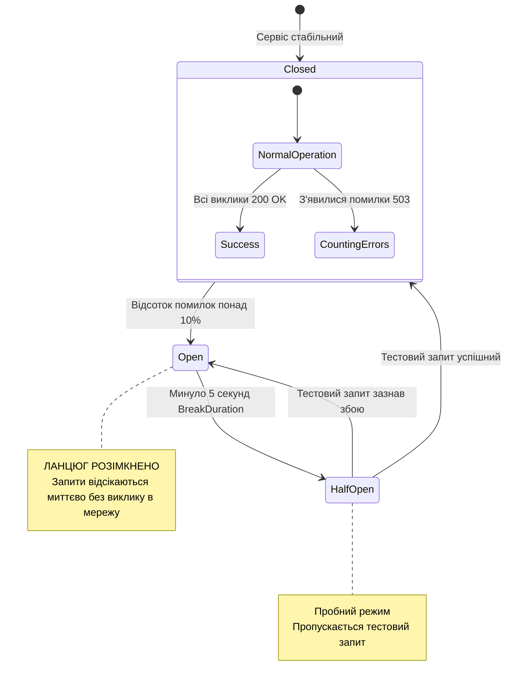

# 🛡️ 06. Service Discovery та Polly Resilience: Стійкість Мережевих Викликів

> **Розділ:** `02-Microservices-Craftsman` • **Модуль:** `02-01-Aspire-Documentation`  
> **Стек:** .NET 10, Microsoft.Extensions.Http.Resilience, Polly v8, Aspire Service Discovery.  
> **Офіційна документація Microsoft:** [.NET Aspire Service Discovery](https://learn.microsoft.com/dotnet/aspire/service-discovery/overview) • [Building Resilient HTTP Clients with Polly](https://learn.microsoft.com/dotnet/core/resilience/http-resilience)

---

## 📑 Зміст модуля

- [Слайд 1. Чому хардкод IP-адрес — це критична помилка в мікросервісах](#slide-1)
- [Слайд 2. Як працює .NET Aspire Service Discovery: Логічні імена замість портів](#slide-2)
- [Слайд 3. Конвеєр стійкості: 5 рівнів захисту в AddStandardResilienceHandler](#slide-3)
- [Слайд 4. Життєвий цикл автоматичного вимикача (Circuit Breaker State Machine)](#slide-4)
- [Слайд 5. Інтерактивна демонстрація Retry: Сценарій з симуляцією помилки 503](#slide-5)
- [Слайд 6. Інтерактивна демонстрація Timeout: Запобігання вичерпанню сокетів ОС](#slide-6)
- [Слайд 7. Налаштування власних опцій стійкості (HttpStandardResilienceOptions)](#slide-7)

---

<a id="slide-1"></a>
### 🎬 Слайд 1. Чому хардкод IP-адрес — це критична помилка в мікросервісах

У динамічних хмарних кластерах (Kubernetes, хмарні віртуальні машини, локальний запуск у Docker) IP-адреси та порти мікросервісів постійно змінюються:
* Сьогодні сервіс замовлень запущений на `http://localhost:5124`, завтра в контейнері на `http://172.18.0.5:8080`.
* Якщо записувати адреси в `appsettings.json`, кожна зміна оточення вимагає ручного редагування конфігурацій.
* **Service Discovery (Виявлення сервісів)** повністю вирішує цю проблему, дозволяючи звертатися до мікросервісу за його стабільним логічним ім'ям: `http://cargoorderingservice`.

---

<a id="slide-2"></a>
### 🗺️ Слайд 2. Як працює .NET Aspire Service Discovery: Логічні імена замість портів

У нашому проєкті `CargoDelivery.HttpAggregator` у файлі [`Program.cs`](file:///c:/Users/Yurii/source/repos/Demo-CargoDeliveryService/02-Microservices-Craftsman/CargoDelivery.HttpAggregator/Program.cs#L29-L55) адреси налаштовані лаконічно:

```csharp
builder.Services.AddHttpClient<IDriverApiClient, DriverApiClient>(client =>
{
    // Логічне ім'я сервісу в системі Aspire:
    client.BaseAddress = new Uri("http://driversmanagement");
}).AddStandardResilienceHandler();
```

#### Механізм роботи під капотом:
1. `HttpClient` намагається відправити запит за адресою `http://driversmanagement/api/drivers/1`.
2. Провайдер `Microsoft.Extensions.ServiceDiscovery` перехоплює запит перед відправкою у сокет.
3. Провайдер запитує у конфігурації Aspire поточну актуальну адресу інстансу.
4. Назва підміняється на реальний хост і порт (наприклад, `http://localhost:5201/api/drivers/1`).
5. Запит успішно виконується без жодного рядка захардкоджених IP-адрес!

---

<a id="slide-3"></a>
### 🛡️ Слайд 3. Конвеєр стійкості: 5 рівнів захисту в AddStandardResilienceHandler

У файлі [`Extensions.cs`](file:///c:/Users/Yurii/source/repos/Demo-CargoDeliveryService/02-Microservices-Craftsman/Aspire/CargoDelivery.ServiceDefaults/Extensions.cs#L45-L52) викликається розширення:

```csharp
http.AddStandardResilienceHandler();
```

Це вбудований у .NET конвеєр Polly v8, який складається з **5 послідовних стратегій стійкості**:


#### Детальний опис кожної ланки:
1. **Total Request Timeout (Загальний таймаут):** Гарантує, що вся операція (включаючи всі повторні спроби та паузи) не перевищить граничний час (за замовчуванням 30 секунд).
2. **Retry Policy (Політика повторів):** При отриманні тимчасових мережевих збоїв (`SocketException`) або кодів HTTP 5xx (500, 502, 503, 504, 408) робить до 3 повторів з експоненційною затримкою та випадковим відхиленням (*Jitter*), щоб не влаштувати перевантаження сервера (*Retry Storm*).
3. **Circuit Breaker (Автоматичний вимикач):** Якщо відсоток помилок перевищує поріг, ланцюг розмикається, і наступні запити відхиляються миттєво, даючи цільовому сервісу час відновитися.
4. **Attempt Timeout (Таймаут однієї спроби):** Обмежує час очікування кожної окремої спроби (10 секунд). Якщо віддалений сервер завис, потік не чекає 100 секунд, а перериває спробу і переходить до наступного повтору.
5. **Rate Limiter / Concurrency Limiter:** Обмежує кількість одночасних запитів, захищаючи пул сокетів операційної системи.

---

<a id="slide-4"></a>
### ⚡ Слайд 4. Життєвий цикл автоматичного вимикача (Circuit Breaker State Machine)



---

<a id="slide-5"></a>
### 🔄 Слайд 5. Інтерактивна демонстрація Retry: Сценарій з симуляцією помилки 503

У проєкті `CargoDelivery.HttpAggregator` додано спеціальний ендпоінт для наочної перевірки:
> 📍 **Вихідний код:**  
> [ResilienceDemoController.cs](file:///c:/Users/Yurii/source/repos/Demo-CargoDeliveryService/02-Microservices-Craftsman/CargoDelivery.HttpAggregator/Controllers/ResilienceDemoController.cs#L35-L66)

#### Як це працює на практиці:
1. Клієнт викликає:
   ```http
   GET /api/v1/resilience-demo/retry
   ```
2. Контролер робить виклик до симулятора `SimulationController.SimulateFlakyCall`.
3. Перша спроба повертає **503 Service Unavailable**.
4. Конвеєр Polly перехоплює 503, робить паузу і автоматично відправляє другу спробу.
5. Друга спроба знову повертає **503**.
6. Третя спроба повертає **200 OK**!
7. Клієнт отримує успішну відповідь:
   ```json
   {
     "scenario": "Polly Automatic Retry (Exponential Backoff)",
     "status": "Success",
     "message": "Запит успішно виконано після відпрацювання повторних спроб Polly!",
     "elapsedMilliseconds": 1420
   }
   ```
8. У вебінтерфейсі **Aspire Dashboard (вкладка Traces)** видно всі 3 спроби в рамках одного трейсу!

---

<a id="slide-6"></a>
### ⏱️ Слайд 6. Інтерактивна демонстрація Timeout: Запобігання вичерпанню сокетів ОС

> 📍 **Вихідний код:**  
> [ResilienceDemoController.cs (рядки 68–95)](file:///c:/Users/Yurii/source/repos/Demo-CargoDeliveryService/02-Microservices-Craftsman/CargoDelivery.HttpAggregator/Controllers/ResilienceDemoController.cs#L68-L95)

#### Небезпека відсутності таймауту:
Якщо віддалений мікросервіс завис через внутрішню блокування (Deadlock), за замовчуванням `HttpClient` у .NET очікує відповіді **100 секунд**!
* 100 завислих користувачів повністю вичерпують пул потоків ASP.NET Core.
* Сервіс-агрегатор перестає відповідати на будь-які інші запити.

#### Робота політики Polly Timeout:
1. Запит надсилається до маршруту з штучною затримкою 5 секунд.
2. Політика таймауту перериває операцію точно у встановлений строк.
3. Агрегатор перехоплює виняток і активує **Fallback-значення**, миттєво звільняючи мережевий сокет.

---

<a id="slide-7"></a>
### 🎛️ Слайд 7. Налаштування власних опцій стійкості (HttpStandardResilienceOptions)

Якщо дефолтні налаштування `AddStandardResilienceHandler()` потребують тонкого тюнінгу під вимоги бізнесу, використовується перевантаження з конфігурацією:

```csharp
builder.Services.AddHttpClient<ICustomApiClient, CustomApiClient>()
    .AddStandardResilienceHandler(options =>
    {
        // 1. Зміна загального таймауту з 30с на 10с
        options.TotalRequestTimeout.Timeout = TimeSpan.FromSeconds(10);

        // 2. Налаштування повторів: 2 спроби замість 3
        options.Retry.MaxRetryAttempts = 2;
        options.Retry.BackoffType = DelayBackoffType.Exponential;
        options.Retry.UseJitter = true;

        // 3. Тюнінг автоматичного вимикача
        options.CircuitBreaker.SamplingDuration = TimeSpan.FromSeconds(20);
        options.CircuitBreaker.FailureRatio = 0.2; // Розмикати при 20% помилок
        options.CircuitBreaker.BreakDuration = TimeSpan.FromSeconds(10);

        // 4. Таймаут окремої спроби
        options.AttemptTimeout.Timeout = TimeSpan.FromSeconds(3);
    });
```
