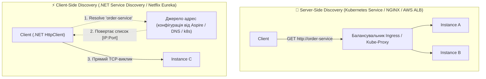
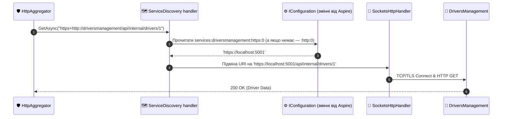
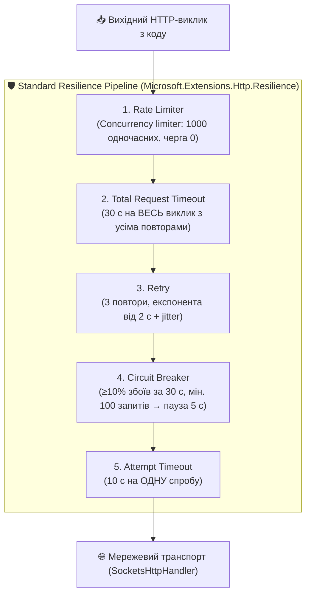
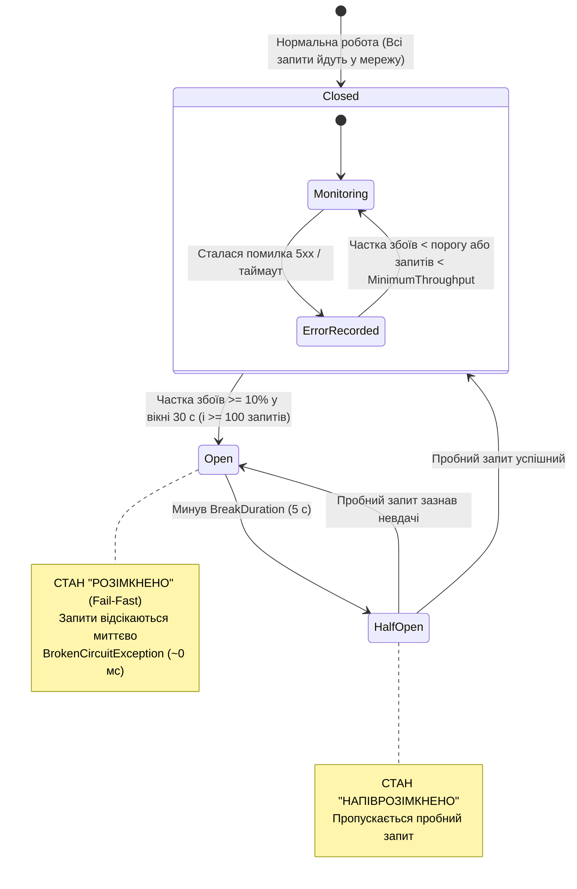

# 🛡️ 06. Service Discovery та Polly Resilience: Стійкість Мережевих Викликів

> **Розділ курсу:** `02-Microservices-Craftsman` • **Модуль:** `02-01-Aspire-Documentation`  
> **Стек:** .NET 10, `Microsoft.Extensions.Http.Resilience` 10.x (Polly v8), `Microsoft.Extensions.ServiceDiscovery` 10.x, Aspire 13.6, `SocketsHttpHandler`  
> **Цільова аудиторія:** Архітектори високонавантажених систем, Senior .NET розробники, DevOps/SRE інженери  
> **Офіційна специфікація та документація:**  
> - [.NET Aspire Service Discovery Overview](https://learn.microsoft.com/dotnet/aspire/service-discovery/overview)  
> - [Building Resilient HTTP Applications with Polly v8 in .NET](https://learn.microsoft.com/dotnet/core/resilience/http-resilience)  
> - [Polly Documentation: Official Resilience Strategies](https://www.pollydocs.org/strategies/index.html)  
> - [AWS Architecture Blog: Exponential Backoff And Jitter (Marc Brooker)](https://aws.amazon.com/blogs/architecture/exponential-backoff-and-jitter/)

---

## 📑 Академічний зміст лекції

- [1. Теоретичний базис: Динамічне виявлення сервісів (Client vs Server Discovery)](#section-1)
- [2. Архітектура .NET Aspire Service Discovery: Резолв логічних імен](#section-2)
- [3. Теорія транзієнтних збоїв та математика повторних спроб (Backoff & Full Jitter)](#section-3)
- [4. Деконструкція конвеєра AddStandardResilienceHandler у Polly v8](#section-4)
- [5. Математична модель та скінченний автомат Circuit Breaker (Автоматичний вимикач)](#section-5)
- [6. Реалізація демонстраційного полігону у CargoDelivery.HttpAggregator](#section-6)
- [7. Практичний експеримент 1: Симуляція Retry при отриманні коду 503](#section-7)
- [8. Практичний експеримент 2: Симуляція Timeout та захист сокетів ОС](#section-8)
- [9. Практичний експеримент 3: Circuit Breaker — від Closed до Open](#section-9a)
- [10. Тонке налаштування конфігурацій (HttpStandardResilienceOptions) для різних профілів](#section-9)
- [11. Архітектурна матриця: Антипатерни vs Еталонні практики стійкості](#section-10)
- [12. Контрольні запитання та лабораторні завдання](#section-11)

---

<a id="section-1"></a>
## 1. Теоретичний базис: Динамічне виявлення сервісів (Client vs Server Discovery)

У сучасних хмарних кластерах (Kubernetes, Nomad, локальний стек .NET Aspire) фізичне розташування мікросервісів є динамічним і ефемерним:
* Контейнери регулярно перезапускаються, масштабуються (Autoscaling від 1 до 50 реплік), мігрують між фізичними серверами дата-центру.
* Внаслідок цього IP-адреси та TCP-порти постійно змінюються.

### Чому статична конфігурація IP/портів неприпустима:
1. Запис адрес типу `http://192.168.1.12:5105` у файл `appsettings.json` робить систему крихкою: будь-який рестарт контейнера Docker призводить до зміни його IP і вимагає редагування конфігурацій.
2. Ручне оновлення адрес унеможливлює динамічне масштабування (Horizontal Pod Autoscaling).

### Порівняння архітектур Service Discovery:



| Критерій | Server-Side Discovery (Kubernetes Ingress / ALB) | Client-Side Discovery (.NET Aspire Service Discovery) |
| :--- | :--- | :--- |
| **Точка балансування** | Зовнішній проміжний вузол (Proxy / Load Balancer) | Безпосередньо всередині клієнтського процесу C# |
| **Мережеві накладні витрати** | Додатковий мережевий хоп ($+1\text{ RTT}$) через проксі | **0 додаткових мережевих хопів.** Пряме TCP-з'єднання від клієнта до цільового інстансу |
| **Точка відмови (SPOF)** | Якщо проксі перевантажений, падає зв'язок між усіма сервісами | Немає єдиної точки відмови для передачі даних |
| **Складність клієнта** | Клієнт простий (звичайний HTTP-виклик) | Клієнт повинен мати бібліотеку резолвінгу адрес |

> 💡 **Зауваження про Kubernetes.** У k8s DNS-ім'я сервісу (`cargoorderingservice.default.svc`) уже є server-side discovery через `kube-proxy`. Бібліотека `Microsoft.Extensions.ServiceDiscovery` вміє працювати і там (провайдер DNS SRV), тому код клієнта з логічним ім'ям однаковий локально в Aspire і в кластері.

> ⚠️ **Нюанс локального Aspire.** Порти наших проєктів фіксовані в `launchSettings.json` (5001–5003, 57390), а DCP ставить перед кожним проєктом **проксі**. Тому навіть з Service Discovery в адресах ви бачите стабільні `https://localhost:500x` — динамічні порти отримують лише контейнери (RabbitMQ, SQL Server).

---

<a id="section-2"></a>
## 2. Архітектура .NET Aspire Service Discovery: Резолв логічних імен

У рішенні .NET Aspire клієнтське виявлення сервісів інтегровано на рівні базової конфігурації через пакет `Microsoft.Extensions.ServiceDiscovery` (підключається в [Extensions.cs#L65](../Aspire/CargoDelivery.ServiceDefaults/Extensions.cs#L65) і [#L86](../Aspire/CargoDelivery.ServiceDefaults/Extensions.cs#L86)).

> 📍 **Реєстрація у [Program.cs#L45-L49](../CargoDelivery.HttpAggregator/Program.cs#L45):**

```csharp
builder.Services.AddHttpClient<IDriverApiClient, DriverApiClient>(client =>
    // Логічне ім'я ресурсу з AppHost + схема "https+http"
    client.BaseAddress = new Uri("https+http://driversmanagement"));
// Стандартний конвеєр Polly вже доданий ГЛОБАЛЬНО в ServiceDefaults — повторно НЕ додаємо
```

### Фізичний механізм трансляції імен під капотом:



1. **Декларація залежності в AppHost:**  
   Рядок `.WithReference(driversApi)` ([AppHost.cs#L117](../Aspire/CargoDelivery.AppHost/AppHost.cs#L117)) автоматично інжектує в оточення агрегатора змінну конфігурації (перевірено в деталях ресурсу в дашборді):
   ```
   services__driversmanagement__https__0 = https://localhost:5001
   ```
   Подвійне підкреслення `__` у змінній середовища — це роздільник рівнів конфігурації `:` (`services:driversmanagement:https:0`). Ключа `http__0` немає, бо в `launchSettings.json` DriversManagement оголошено лише HTTPS.
2. **Схема `https+http://`:** означає «візьми HTTPS-ендпоінт, якщо його немає — HTTP». Можна вказати й лише `https://` чи `http://` — тоді резолвер шукатиме ендпоінт тільки з цією назвою.
3. **Перехоплення через ServiceDiscovery handler:**  
   Спеціальний `DelegatingHandler` у конвеєрі `HttpClient` витягує ім'я хоста `driversmanagement`, звертається до провайдерів (спершу конфігурація, далі — «pass-through», що передає звичайні DNS-імена на кшталт `localhost` без змін) і на льоту замінює віртуальне ім'я на реальну адресу.
4. **Кілька інстансів:** якщо в конфігурації кілька адрес (`…__0`, `…__1`), резолвер балансує між ними (за замовчуванням — round-robin).

> 🐞 **Що було виправлено.** Раніше клієнти агрегатора і BFF вручну читали `builder.Configuration["services:x:http:0"]` (якого не існувало — є лише `https:0`) і падали на fallback-адресу. Тепер адреса задається логічним іменем, а резолв робить Service Discovery.

---

<a id="section-3"></a>
## 3. Теорія транзієнтних збоїв та математика повторних спроб (Backoff & Full Jitter)

У розподілених мережах значна частка збоїв має **транзієнтний (тимчасовий) характер**:
* Короткочасна втрата мережевого пакета через перемикання комутатора.
* Тимчасове перевантаження пулу з'єднань віддаленого сервісу на 100-200 мілісекунд.
* Перезапуск або переміщення контейнера оркестратором.

Якщо клієнт при першому збої одразу повертає помилку користувачеві, надійність системи падає в рази. Проте **наївний негайний повтор (Immediate Retry) є ще більшим злом** — він породжує катастрофічну проблему «Шторму повторів» (*Retry Storm* або *Thundering Herd Problem*).

### Порівняння математичних моделей повторних спроб:

1. **Постійна затримка (Constant Delay):**
   $$t_k = C$$
   Усі клієнти, що впали одночасно, одночасно здійснюють повторний виклик через $C$ секунд, створюючи резонансний сплеск трафіку і знову вбиваючи сервер.

2. **Експоненційне уповільнення (Exponential Backoff):**
   $$t_k = C \times 2^{k-1}$$
   Час очікування подвоюється з кожною спробою ($200\text{ мс} \to 400\text{ мс} \to 800\text{ мс}$ у демо; $2\text{ с} \to 4\text{ с} \to 8\text{ с}$ у стандартному конвеєрі). Це дає системі більше часу на відновлення, але клієнти все ще рухаються синхронними "пакетами".

3. **Експоненційне уповільнення з джитером (Jitter — Рекомендовано AWS та Polly v8):**
   $$t_k = \text{random}\left(0, \; \min(\text{MaxDelay}, \; C \times 2^{k-1})\right) \quad \text{(Full Jitter, AWS)}$$
   До експоненційного часу додається випадковий шум. Це розмазує навантаження в часі, перетворюючи піковий шторм на плавний фоновий потік! Polly v8 при `UseJitter = true` використовує більш «гладкий» алгоритм *decorrelated jitter* (за мотивами роботи Тімоті Беннета / Polly.Contrib), який зберігає середню експоненційну затримку, але прибирає синхронність клієнтів.

```mermaid
gantt
    title Порівняння навантаження: Повтори без Jitter проти Повторів з Jitter
    dateFormat X
    axisFormat %s ms

    section Без Jitter (Синхронний резонанс)
    Клієнт 1 Повтор (200ms)    :crit, 200, 205
    Клієнт 2 Повтор (200ms)    :crit, 200, 205
    Клієнт 3 Повтор (200ms)    :crit, 200, 205

    section З Jitter (Рівномірний розподіл)
    Клієнт 1 Повтор (85ms)     :active, 85, 90
    Клієнт 2 Повтор (160ms)    :active, 160, 165
    Клієнт 3 Повтор (120ms)    :active, 120, 125
```



### Retry Budget: скільки запитів насправді йде в мережу
При $r$ повторах кожен логічний виклик може стати $r+1$ фізичними. Якщо сервіс викликає залежність, яка викликає ще одну, і **кожен** рівень робить 3 повтори, то на нижній рівень прилітає до $4 \times 4 = 16$ запитів на один запит користувача — експоненційне посилення навантаження саме тоді, коли система й так страждає. Звідси два правила: повтори — **на одному рівні**, і обов'язково разом із Circuit Breaker.

---

<a id="section-4"></a>
## 4. Деконструкція конвеєра AddStandardResilienceHandler у Polly v8

У файлі [Extensions.cs#L83](../Aspire/CargoDelivery.ServiceDefaults/Extensions.cs#L83) виклик `http.AddStandardResilienceHandler()` активує офіційний конвеєр стійкості Microsoft. Він побудований на архітектурі **Polly v8** (мінімум алокацій на «щасливому шляху») та складається з **5 стратегій**, які запит проходить **ззовні всередину**:



| Стратегія | Параметр за замовчуванням | Властивість у `HttpStandardResilienceOptions` |
| :--- | :--- | :--- |
| Rate Limiter | 1000 одночасних запитів, черга 0 | `RateLimiter` |
| Total Request Timeout | 30 с | `TotalRequestTimeout.Timeout` |
| Retry | 3 повтори, `Delay` = 2 с, експоненційно, з jitter; обробляє 408, 429, 5xx, `HttpRequestException`, `TimeoutRejectedException` | `Retry.*` |
| Circuit Breaker | `FailureRatio` = 0.1, `SamplingDuration` = 30 с, `MinimumThroughput` = 100, `BreakDuration` = 5 с | `CircuitBreaker.*` |
| Attempt Timeout | 10 с | `AttemptTimeout.Timeout` |

### Чому порядок розташування шарів є критично важливим?

1. **Rate Limiter (найзовнішній):** обмежує кількість **одночасних** вихідних викликів через цей клієнт, захищаючи **власний** процес від вичерпання сокетів і пам'яті під лавиною запитів. Зайві запити відхиляються одразу (`RateLimiterRejectedException`), навіть не входячи в повтори.
2. **Total Request Timeout:** охоплює весь подальший конвеєр. Якщо загальний час із урахуванням повторів та їхніх пауз перевищує 30 секунд, операція гарантовано переривається, захищаючи клієнта від вічного очікування.
3. **Retry (перед Circuit Breaker):** знаходиться зовні автоматичного вимикача. Кожна повторна спроба проходить крізь Circuit Breaker — тож розімкнений ланцюг миттєво «з'їдає» і повтори.
4. **Circuit Breaker (перед окремою спробою):** якщо ланцюг розімкнено, він **негайно блокує спробу** без виходу в мережу і без запуску внутрішнього таймауту спроби. Кожна завершена спроба (успіх/збій) потрапляє в статистику вимикача.
5. **Attempt Timeout (найвнутрішніший):** обмежує завислий одиночний сокет 10 секундами, ініціюючи виняток `TimeoutRejectedException`, який перехоплюється зовнішнім Retry (і рахується Circuit Breaker'ом як збій).

> ⏱️ **Як рахується найгірший випадок?** Сервіс «завис» (не відповідає): спроба 1 — 10 с, пауза ≈2 с, спроба 2 — 10 с, пауза ≈4 с, спроба 3 обривається вже **загальним** таймаутом на 30-й секунді. Тому зупинений через дашборд Aspire сервіс (проксі DCP приймає з'єднання, але не відповідає) змушує клієнта чекати **рівно ~30 с**. Саме це ми бачили у вимірах до налаштування короткого бюджету для блогу ([гайд 03, §8](03_HttpAggregator_Gateway_Architecture_And_Design.md#section-8)).

> 🐞 **Вкладені конвеєри.** Якщо до клієнта, який уже отримав стандартний конвеєр через `ConfigureHttpClientDefaults`, ще раз дописати `.AddStandardResilienceHandler()`, то утвориться **два** конвеєри один в одному: зовнішній Retry повторює **увесь** внутрішній конвеєр з його власними повторами. Саме так було в агрегаторі та BFF до виправлення. Правильно — `RemoveAllResilienceHandlers()` і потім `AddStandardResilienceHandler(options => …)` з потрібними параметрами ([Program.cs#L55-L64](../CargoDelivery.HttpAggregator/Program.cs#L55)).

---

<a id="section-5"></a>
## 5. Математична модель та скінченний автомат Circuit Breaker (Автоматичний вимикач)

Патерн **Circuit Breaker** покликаний захистити систему від каскадних відмов: коли віддалений мікросервіс лежить, немає жодного сенсу продовжувати надсилати на нього тисячі запитів, марнуючи процесорний час, сокети та пам'ять — і заважаючи йому піднятися.

### Скінченний автомат станів:



### Математична модель прийняття рішень:
Розмикач оцінює стан за **ковзним вікном вибірки (Sliding Sampling Window)**:
$$\text{FailureRatio} = \frac{N_{\text{errors}}}{N_{\text{total}}} \ge \theta \quad \text{та} \quad N_{\text{total}} \ge \text{MinimumThroughput}$$

У дефолтній конфігурації `AddStandardResilienceHandler()`:
* Поріг відмов $\theta = 0.1$ ($10\%$).
* Тривалість ковзного вікна $\text{SamplingDuration} = 30\text{ секунд}$.
* Мінімальна пропускна здатність $\text{MinimumThroughput} = 100\text{ запитів}$.
* Тривалість стану спокою $\text{BreakDuration} = 5\text{ секунд}$.

> 💡 **Чому важливий параметр MinimumThroughput?**  
> Якщо за перші 10 секунд надійшов лише 1 запит і він упав через випадковий збій, співвідношення відмов складе $1/1 = 100\%$. Якби не було ліміту мінімальної кількості запитів (100), вимикач помилково розімкнувся б через одиничний збій!  
> Зворотний бік: у навчальному стенді ви ніколи не зробите 100 запитів за 30 с вручну — тому для демонстрації ми знижуємо `MinimumThroughput` до 5 (§9).

> 📏 **Обмеження валідації Polly:** `SamplingDuration` має бути щонайменше вдвічі більшим за `AttemptTimeout`, а `TotalRequestTimeout` — більшим за `AttemptTimeout`. Порушення цих правил дає `OptionsValidationException` під час першого використання клієнта.

---

<a id="section-6"></a>
## 6. Реалізація демонстраційного полігону у CargoDelivery.HttpAggregator

Для наочної експериментальної перевірки Polly в агрегаторі є три складники:

| Компонент | Файл | Роль |
| :--- | :--- | :--- |
| Полігон збоїв | [SimulationController.cs](../CargoDelivery.HttpAggregator/Controllers/SimulationController.cs) | `/slow`, `/flaky`, `/error`, `/ok` — контрольована «погана поведінка» |
| Клієнт лабораторії | [SimulationApiClient.cs#L35](../CargoDelivery.HttpAggregator/Domain/Clients/SimulationApiClient.cs#L35) | Робить реальні HTTP-виклики через іменований клієнт обраного сценарію |
| Сценарії | [ResilienceDemoController.cs](../CargoDelivery.HttpAggregator/Controllers/ResilienceDemoController.cs) | `/retry`, `/timeout`, `/circuit-breaker` — запускають експеримент і повертають звіт |

### Окремий конвеєр Polly на кожен сценарій
Стандартні параметри (затримка 2 с, таймаут спроби 10 с, Circuit Breaker після 100 запитів) непридатні для живої демонстрації. Тому кожен сценарій має **власний іменований клієнт** зі своїми параметрами ([Program.cs#L80-L119](../CargoDelivery.HttpAggregator/Program.cs#L80)):

```csharp
builder.Services.AddTransient<ISimulationApiClient, SimulationApiClient>();

// /retry: швидкі повтори 200 → 400 → 800 мс (+ jitter)
AddSimulationClient(SimulationClients.Retry, options =>
{
    options.Retry.MaxRetryAttempts = 3;
    options.Retry.Delay = TimeSpan.FromMilliseconds(200);
});

// /timeout: спроба обривається через 2 с, увесь виклик — не довше 8 с
AddSimulationClient(SimulationClients.Timeout, options =>
{
    options.Retry.MaxRetryAttempts = 3;
    options.Retry.Delay = TimeSpan.FromMilliseconds(200);
    options.AttemptTimeout.Timeout = TimeSpan.FromSeconds(2);
    options.TotalRequestTimeout.Timeout = TimeSpan.FromSeconds(8);
});

// /circuit-breaker: чутливий розмикач (≥5 спроб і ≥50% збоїв за 10 с → Open на 15 с)
AddSimulationClient(SimulationClients.CircuitBreaker, options =>
{
    options.Retry.MaxRetryAttempts = 2;
    options.Retry.Delay = TimeSpan.FromMilliseconds(100);
    options.AttemptTimeout.Timeout = TimeSpan.FromSeconds(2);
    options.CircuitBreaker.MinimumThroughput = 5;
    options.CircuitBreaker.FailureRatio = 0.5;
    options.CircuitBreaker.SamplingDuration = TimeSpan.FromSeconds(10);
    options.CircuitBreaker.BreakDuration = TimeSpan.FromSeconds(15);
});

void AddSimulationClient(string name, Action<HttpStandardResilienceOptions> configure)
{
    builder.Services.AddHttpClient(name)
        .RemoveAllResilienceHandlers()          // прибрати глобальний конвеєр із ServiceDefaults
        .AddStandardResilienceHandler(configure); // і додати той самий, але з «навчальними» параметрами
}
```

> 🧠 **Чому окремі клієнти, а не один?** Стан Circuit Breaker належить конкретному екземпляру конвеєра. Якби всі сценарії ділили один клієнт, то збої з `/timeout` розмикали б ланцюг для `/retry`, і результат залежав би від порядку експериментів. З окремими іменами (`simulation-retry`, `simulation-timeout`, `simulation-circuit-breaker`) кожен експеримент ізольований.

> 🔧 `RemoveAllResilienceHandlers()` у `Microsoft.Extensions.Http.Resilience` 10.x позначений як експериментальний (діагностика `EXTEXP0001`), тому його використання дозволено явно в [CargoDelivery.HttpAggregator.csproj](../CargoDelivery.HttpAggregator/CargoDelivery.HttpAggregator.csproj) через `<NoWarn>`.

### Як клієнт знаходить «сам себе»
Агрегатор не має посилання на себе в AppHost (це був би цикл у графі), тому для лабораторії немає логічного імені. Контролер бере адресу з поточного запиту (`Request.Scheme + Request.Host`) і передає її клієнту, а абсолютний URI має пріоритет над `BaseAddress` ([ResilienceDemoController.cs](../CargoDelivery.HttpAggregator/Controllers/ResilienceDemoController.cs), властивість `SelfBaseAddress`).

---

<a id="section-7"></a>
## 7. Практичний експеримент 1: Симуляція Retry при отриманні коду 503

Маршрут `/api/v1/resilience-demo/retry` ([ResilienceDemoController.cs#L52](../CargoDelivery.HttpAggregator/Controllers/ResilienceDemoController.cs#L52)) демонструє проходження крізь транзієнтний збій:

```csharp
[HttpGet("retry")]
public async Task<ActionResult<ResilienceDemoResultDto>> DemonstrateRetry(CancellationToken cancellationToken)
{
    var stopwatch = Stopwatch.StartNew();
    try
    {
        // /flaky перші 2 рази повертає 503, а на 3-й раз — 200 OK
        var content = await _simulationClient.GetAsync(
            SimulationClients.Retry, SelfBaseAddress, "flaky?failUntil=2", cancellationToken);

        return Ok(new ResilienceDemoResultDto
        {
            Scenario = "Polly Automatic Retry (Exponential Backoff + Jitter)",
            Status = "Success",
            Message = "Запит успішно виконано після відпрацювання повторних спроб Polly!",
            ElapsedMilliseconds = stopwatch.ElapsedMilliseconds,
            Details = content
        });
    }
    catch (Exception ex) when (ex is HttpRequestException or BrokenCircuitException or TimeoutRejectedException)
    {
        // Повтори вичерпано (або ланцюг розімкнено)
        return StatusCode(StatusCodes.Status503ServiceUnavailable, new ResilienceDemoResultDto { /* ... */ });
    }
}
```

### Фіксація результату експерименту (реальні заміри стенду):
* Клієнт отримує успішний статус **200 OK**, у `details` — `{"attempt":3,"message":"Успіх після повторних спроб Polly!"}`.
* Час виконання становить приблизно **0.4–0.6 с**: дві паузи (~200 мс і ~400 мс з урахуванням jitter) плюс три короткі виклики.
* У **Aspire Dashboard → Traces** у трейсі видно три клієнтські спани до `/api/simulation/flaky`: два з кодом 503 і фінальний 200. У **Structured logs** — записи `Execution attempt. Source: 'simulation-retry-standard//Standard-Retry' … Result: '503', Handled: 'True'`.

> ❓ Чому сервер не бачить «помилки» взагалі? Тому що для **викликаючого коду** Retry прозорий: `await GetAsync(...)` просто повертає успішну відповідь трохи пізніше.

---

<a id="section-8"></a>
## 8. Практичний експеримент 2: Симуляція Timeout та захист сокетів ОС

Маршрут `/api/v1/resilience-demo/timeout` ([ResilienceDemoController.cs#L92](../CargoDelivery.HttpAggregator/Controllers/ResilienceDemoController.cs#L92)) демонструє захист від повільного сервісу:

```csharp
[HttpGet("timeout")]
public async Task<ActionResult<ResilienceDemoResultDto>> DemonstrateTimeout(CancellationToken cancellationToken)
{
    var stopwatch = Stopwatch.StartNew();
    try
    {
        // /slow відповідає за 5 с, а AttemptTimeout цього клієнта — 2 с
        var content = await _simulationClient.GetAsync(
            SimulationClients.Timeout, SelfBaseAddress, "slow?delaySeconds=5", cancellationToken);
        return Ok(/* Success */);
    }
    catch (TimeoutRejectedException ex)
    {
        // Fallback: контрольована відповідь замість вічного очікування
        return Ok(new ResilienceDemoResultDto
        {
            Scenario = "Polly Timeout -> Fallback Activated",
            Status = "TimeoutHandled",
            Message = "Спрацював таймаут Polly. Запит перехоплено, запобігши зависанню сокетів.",
            ElapsedMilliseconds = stopwatch.ElapsedMilliseconds,
            Details = $"Виняток: {ex.GetType().Name} - {ex.Message}"
        });
    }
}
```

### Що відбувається по секундах
| Час | Подія |
| :--- | :--- |
| 0 с | Спроба 1 до `/slow` |
| 2 с | `AttemptTimeout` обриває спробу (`OnTimeout … Standard-AttemptTimeout`), Retry чекає ~200 мс |
| ≈2.2 с | Спроба 2 … обривається на ≈4.2 с |
| ≈4.6 с | Спроба 3 … обривається на ≈6.6 с |
| ≈7.4 с | Спроба 4 стартує, але на **8 с** спрацьовує `TotalRequestTimeout` (`OnTimeout … Standard-TotalRequestTimeout`) |
| 8 с | Код отримує `TimeoutRejectedException` → fallback `200 TimeoutHandled` |

Реальний замір стенду: `elapsedMilliseconds ≈ 8017`, у `details` — `The operation didn't complete within the allowed timeout of '00:00:08'`.

> 🔌 **Чому це «захист сокетів».** Без таймаутів кожен завислий запит тримає відкрите TCP-з'єднання і пам'ять до 100 с (дефолтний `HttpClient.Timeout`). Під навантаженням це вичерпує пул з'єднань і потоки, і проблема «повільного сусіда» перетворюється на падіння вашого сервісу. Таймаут — це обмеження ресурсів, які ви погоджуєтесь «позичити» чужій повільності.

> ℹ️ Скасування спроби поширюється й на сервер: `SimulateSlowCall` приймає `CancellationToken`, тож `Task.Delay` на сервері теж переривається, коли клієнт обірвав з'єднання.

---

<a id="section-9a"></a>
## 9. Практичний експеримент 3: Circuit Breaker — від Closed до Open

Маршрут `/api/v1/resilience-demo/circuit-breaker` ([ResilienceDemoController.cs#L145](../CargoDelivery.HttpAggregator/Controllers/ResilienceDemoController.cs#L145)) робить 5 логічних викликів до `/error` (завжди 503) і для кожного записує, що сталося:

```csharp
for (var call = 1; call <= 5; call++)
{
    var callWatch = Stopwatch.StartNew();
    try
    {
        await _simulationClient.GetAsync(SimulationClients.CircuitBreaker, SelfBaseAddress, "error", cancellationToken);
    }
    catch (BrokenCircuitException)
    {
        // Розмикач відхилив виклик без мережевого запиту — тому це займає ~0 мс
        log.Add($"#{call}: BrokenCircuitException — Fail-Fast ({callWatch.ElapsedMilliseconds} мс)");
    }
    catch (Exception ex) when (ex is HttpRequestException or TimeoutRejectedException)
    {
        log.Add($"#{call}: {ex.GetType().Name} після повторів ({callWatch.ElapsedMilliseconds} мс)");
    }
}
```

### Реальний результат зі стенду
```
#1: HttpRequestException після повторів (233 мс)
#2: BrokenCircuitException — Fail-Fast (200 мс)
#3: BrokenCircuitException — Fail-Fast (0 мс)
#4: BrokenCircuitException — Fail-Fast (0 мс)
#5: BrokenCircuitException — Fail-Fast (0 мс)
```

Як це прочитати:
1. **Виклик #1:** 3 фізичні спроби (1 + 2 повтори), усі 503 → статистика вимикача: 3 збої з 3.
2. **Виклик #2:** перша ж спроба — 4-й збій, ще одна — 5-й: тепер $N_{\text{total}} = 5 \ge \text{MinimumThroughput}$ і частка збоїв 100% ≥ 50% → **ланцюг розмикається** (`OnCircuitOpened` у логах). Наступна спроба цього ж виклику вже отримує `BrokenCircuitException`.
3. **Виклики #3–#5:** відхиляються **за 0 мс**, жодного запиту в мережу (у трейсі під ними немає клієнтських HTTP-спанів) — це і є Fail-Fast.
4. Через 15 с (`BreakDuration`) ланцюг перейде в Half-Open: наступний виклик буде пробним.

> 🧪 Повторіть запит одразу — усі 5 викликів будуть Fail-Fast. Зачекайте 15 с і повторіть — перший виклик знову піде в мережу (Half-Open), впаде, і ланцюг знову розімкнеться.

---

<a id="section-9"></a>
## 10. Тонке налаштування конфігурацій (HttpStandardResilienceOptions) для різних профілів

Дефолтні налаштування `AddStandardResilienceHandler()` оптимізовані під загальні сценарії. Проте в реальних системах існують різні профілі трафіку.

### Профіль «некритична залежність» (реальний код проєкту)
Блог водіїв — «приємне доповнення» до екрана. Краще швидко показати екран без заміток, ніж чекати 30 с ([агрегатор Program.cs#L55-L64](../CargoDelivery.HttpAggregator/Program.cs#L55), [BFF WebAppServiceConfiguration.cs#L94](../DriversManagement/src/DriversManagement/Extensions/Services/WebAppServiceConfiguration.cs#L94)):

```csharp
builder.Services.AddHttpClient<IDriverBlogApiClient, DriverBlogApiClient>(client =>
        client.BaseAddress = new Uri("https+http://driversblogmanagement"))
    .RemoveAllResilienceHandlers()
    .AddStandardResilienceHandler(options =>
    {
        options.AttemptTimeout.Timeout = TimeSpan.FromSeconds(1);       // одна спроба — максимум 1 с
        options.Retry.MaxRetryAttempts = 1;                              // лише один повтор
        options.Retry.Delay = TimeSpan.FromMilliseconds(200);
        options.TotalRequestTimeout.Timeout = TimeSpan.FromSeconds(3);   // увесь виклик ≤ 3 с
    });
```
Результат на стенді: при зупиненому блозі агрегатор, BFF і gRPC-шлях відповідають за **≈2.2 с** замість 30 с.

### Профіль «критична інтерактивна операція» (приклад)
```csharp
builder.Services.AddHttpClient<ICriticalPaymentClient, CriticalPaymentClient>()
    .RemoveAllResilienceHandlers()
    .AddStandardResilienceHandler(options =>
    {
        // 1. Знижуємо загальний таймаут до 5 секунд
        options.TotalRequestTimeout.Timeout = TimeSpan.FromSeconds(5);

        // 2. Лише 1 повторна спроба (не змушувати користувача чекати 30 секунд!)
        options.Retry.MaxRetryAttempts = 1;
        options.Retry.Delay = TimeSpan.FromMilliseconds(200);

        // 3. Не повторювати небезпечні методи (POST/PATCH) — див. §11
        options.Retry.DisableForUnsafeHttpMethods();

        // 4. Більш чутливий автоматичний вимикач
        options.CircuitBreaker.FailureRatio = 0.05; // Розмикати при 5% помилок
        options.CircuitBreaker.SamplingDuration = TimeSpan.FromSeconds(10);
        options.CircuitBreaker.MinimumThroughput = 20;

        // 5. Жорсткий таймаут одиночної спроби
        options.AttemptTimeout.Timeout = TimeSpan.FromSeconds(2);
    });
```

### Профіль «конфігурація з appsettings»
Параметри можна винести в конфігурацію і змінювати без перекомпіляції:
```csharp
.AddStandardResilienceHandler(builder.Configuration.GetSection("Resilience:Blog"));
```

---

<a id="section-10"></a>
## 11. Архітектурна матриця: Антипатерни vs Еталонні практики стійкості

| Область стійкості | ❌ Небезпечний антипатерн | 🟢 Еталонна практика Polly v8 |
| :--- | :--- | :--- |
| **Повтори без паузи (Immediate Retry)** | Цикл `while(retry < 5)` без пауз (допомагає остаточно «добити» вмираючий сервер). | Використання **Exponential Backoff з Jitter**. |
| **Повтори POST запитів** | Повтор неідемпотентного запиту створення платежу або списання коштів. | Повторювати лише ідемпотентні методи (GET, PUT, DELETE) або запити з заголовком `Idempotency-Key`; `Retry.DisableForUnsafeHttpMethods()`. |
| **Вкладені конвеєри** | `.AddStandardResilienceHandler()` поверх глобального з ServiceDefaults. | Один конвеєр на клієнт; зміни — через `RemoveAllResilienceHandlers()` + власні параметри. |
| **Відсутність Circuit Breaker** | Тисячі запитів продовжують штурмувати сервіс, що перебуває в глибокому збої. | Застосування **Circuit Breaker** з миттєвим Fail-Fast (`BrokenCircuitException`). |
| **Нескінченний таймаут** | Дефолтний таймаут `HttpClient` у 100 секунд блокує ресурси сервісу. | Жорсткий таймаут спроби (Attempt Timeout) у межах 1-10 секунд + загальний бюджет. |
| **Однаковий бюджет для всіх** | Некритична залежність з тим самим 30-секундним бюджетом, що й критична. | Окремі профілі: короткий для «soft», ширший для «hard» залежностей. |
| **Хардкод адрес сервісів** | Жорстке прописування IP та портів або ручне читання `services:x:http:0`. | Використання **Aspire Service Discovery** (`https+http://servicename`). |

---

<a id="section-11"></a>
## 12. Контрольні запитання та лабораторні завдання

### 🎯 Контрольні запитання:
1. Чому використання випадкового шуму (Jitter) у формулі повторних спроб є обов'язковим для запобігання явищу Thundering Herd?
2. Поясніть, чому стратегія Retry у конвеєрі Polly v8 розташована зовні Circuit Breaker, а стратегія Attempt Timeout — всередині? Навіщо Rate Limiter стоїть найзовні?
3. Чому неідемпотентні HTTP POST запити вимагають особливої обережності при налаштуванні повторних спроб?
4. Яким чином Aspire Service Discovery підміняє логічні URI під час виконання запиту і що означає схема `https+http://`?
5. Скільки фізичних запитів може піти в мережу, якщо до клієнта з глобальним стандартним конвеєром додати ще один стандартний конвеєр? Чому?
6. Чому в експерименті з Circuit Breaker виклики #3–#5 не мають дочірніх HTTP-спанів у трейсі?

### 🛠️ Практичне лабораторне завдання:
Готові запити — у [CargoDelivery.HttpAggregator.http](../CargoDelivery.HttpAggregator/CargoDelivery.HttpAggregator.http) (запити 9️⃣–1️⃣2️⃣). Swagger в агрегаторі не підключено, тому використовуйте `.http`-файл, браузер або `curl -k`.
1. Запустіть проєкт через `CargoDelivery.AppHost`.
2. Виконайте `GET /api/v1/resilience-demo/retry`. Зафіксуйте час виконання та перегляньте відповідний трейс у Aspire Dashboard (три клієнтські спани).
3. Виконайте `GET /api/v1/resilience-demo/timeout` і переконайтеся, що контролер повернув `TimeoutHandled` приблизно через 8 с. Знайдіть у *Structured logs* події `OnTimeout`.
4. Виконайте `GET /api/v1/resilience-demo/circuit-breaker` двічі поспіль, потім ще раз через 15 с. Поясніть різницю результатів.
5. У [Program.cs#L83](../CargoDelivery.HttpAggregator/Program.cs#L83) змініть для сценарію Retry `MaxRetryAttempts` на 1 і повторіть експеримент 2 — чому тепер повертається `Exhausted`?
6. Зупиніть `driversblogmanagement` у дашборді та порівняйте час відповіді `GET /api/v1/shipment-summary/{id}` з поточним коротким бюджетом і з тимчасово видаленим блоком `.RemoveAllResilienceHandlers().AddStandardResilienceHandler(...)` для клієнта блогу.
