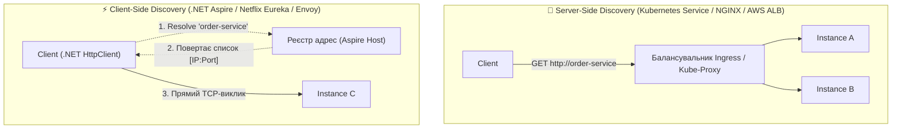
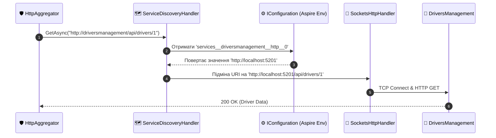
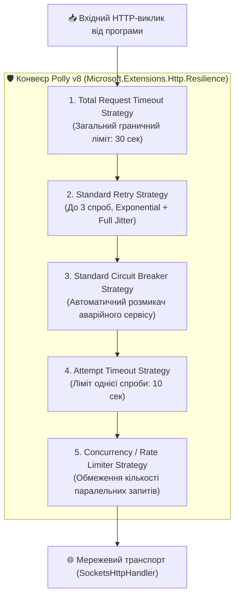
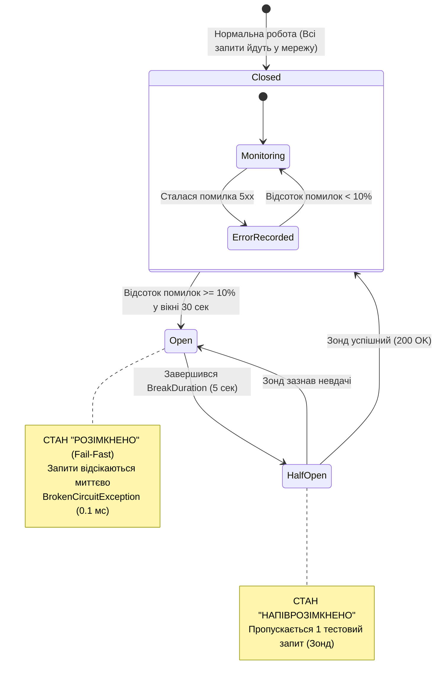

# 🛡️ 06. Service Discovery та Polly Resilience: Стійкість Мережевих Викликів

> **Розділ курсу:** `02-Microservices-Craftsman` • **Модуль:** `02-01-Aspire-Documentation`  
> **Стек:** .NET 10, C# 13, `Microsoft.Extensions.Http.Resilience`, Polly v8 Core Engine, Aspire Service Discovery, SocketsHttpHandler  
> **Цільова аудиторія:** Архітектори високонавантажених систем, Senior .NET розробники, DevOps/SRE інженери  
> **Офіційна специфікація та документація:**  
> - [.NET Aspire Service Discovery Overview](https://learn.microsoft.com/dotnet/aspire/service-discovery/overview)  
> - [Building Resilient HTTP Applications with Polly v8 in .NET](https://learn.microsoft.com/dotnet/core/resilience/http-resilience)  
> - [Polly Documentation: Official Resilience Strategies](https://www.pollydocs.org/strategies/index.html)  
> - [AWS Architecture Blog: Exponential Backoff And Jitter (Marc Brooker)](https://aws.amazon.com/blogs/architecture/exponential-backoff-and-jitter/)

---

## 📑 Академічний зміст лекції

- [1. Теоретичний базис: Динамічне виявлення сервісів (Client vs Server Discovery)](#section-1)
- [2. Архітектура .NET Aspire Service Discovery: Резолв логічних імен](#section-2)
- [3. Теорія транзієнтних збоїв та математика повторних спроб (Backoff & Full Jitter)](#section-3)
- [4. Деконструкція конвеєра AddStandardResilienceHandler у Polly v8](#section-4)
- [5. Математична модель та скінченний автомат Circuit Breaker (Автоматичний вимикач)](#section-5)
- [6. Реалізація демонстраційного полігону у CargoDelivery.HttpAggregator](#section-6)
- [7. Практичний експеримент 1: Симуляція Retry при отриманні коду 503](#section-7)
- [8. Практичний експеримент 2: Симуляція Timeout та захист сокетів ОС](#section-8)
- [9. Тонке налаштування конфігурацій (HttpStandardResilienceOptions) для різних профілів](#section-9)
- [10. Архітектурна матриця: Антипатерни vs Еталонні практики стійкості](#section-10)
- [11. Контрольні запитання та лабораторні завдання](#section-11)

---

<a id="section-1"></a>
## 1. Теоретичний базис: Динамічне виявлення сервісів (Client vs Server Discovery)

У сучасних хмарних кластерах (Kubernetes, Nomad, локальний стек .NET Aspire) фізичне розташування мікросервісів є динамічним і ефемерним:
* Контейнери регулярно перезапускаються, масштабуються (Autoscaling від 1 до 50 реплік), мігрують між фізичними серверами дата-центру.
* Внаслідок цього IP-адреси та TCP-порти постійно змінюються.

### Чому статична конфігурація IP/портів неприпустима:
1. Запис адрес типу `http://192.168.1.12:5105` у файл `appsettings.json` робить систему крихкою: будь-який рестарт контейнера Docker призводить до зміни його IP і вимагає редагування конфігурацій.
2. Ручне оновлення адрес унеможливлює динамічне масштабування (Horizontal Pod Autoscaling).

### Порівняння архітектур Service Discovery:



| Критерій | Server-Side Discovery (Kubernetes Ingress / ALB) | Client-Side Discovery (.NET Aspire Service Discovery) |
| :--- | :--- | :--- |
| **Точка балансування** | Зовнішній проміжний вузол (Proxy / Load Balancer) | Безпосередньо всередині клієнтського процесу C# |
| **Мережеві накладні витрати** | Додатковий мережевий хоп ($+1\text{ RTT}$) через проксі | **0 додаткових мережевих хопів.** Пряме TCP-з'єднання від клієнта до цільового інстансу |
| **Точка відмови (SPOF)** | Якщо проксі перевантажений, падає зв'язок між усіма сервісами | Немає єдиної точки відмови для передачі даних |
| **Складність клієнта** | Клієнт простий (звичайний HTTP-виклик) | Клієнт повинен мати бібліотеку резолвінгу адрес |

---

<a id="section-2"></a>
## 2. Архітектура .NET Aspire Service Discovery: Резолв логічних імен

У рішенні .NET Aspire клієнтське виявлення сервісів інтегровано на рівні базової конфігурації через пакет `Microsoft.Extensions.ServiceDiscovery`.

> 📍 **Реєстрація у [Program.cs](file:///c:/Users/Yurii/source/repos/Demo-CargoDeliveryService/02-Microservices-Craftsman/CargoDelivery.HttpAggregator/Program.cs):**

```csharp
builder.Services.AddHttpClient<IDriverApiClient, DriverApiClient>(client =>
{
    // Ми вказуємо логічне ім'я сервісу з AppHost, а не жорсткий IP чи порт!
    client.BaseAddress = new Uri("http://driversmanagement");
}).AddStandardResilienceHandler();
```

### Фізичний механізм трансляції імен під капотом:



1. **Декларація залежності в AppHost:**  
   У файлі `AppHost.cs` рядок `.WithReference(driversManagement)` автоматично інжектує в оточення агрегатора змінні конфігурації:
   ```
   services__driversmanagement__http__0 = http://localhost:5201
   services__driversmanagement__https__0 = https://localhost:7201
   ```
2. **Перехоплення через `ServiceDiscoveryHandler`:**  
   Спеціальний обробник конвеєра `HttpMessageHandler` витягує ім'я хоста `driversmanagement`, звертається до провайдера конфігурацій і на льоту замінює віртуальне ім'я на реальну IP-адресу або локальний порт.

---

<a id="section-3"></a>
## 3. Теорія транзієнтних збоїв та математика повторних спроб (Backoff & Full Jitter)

У розподілених мережах понад 70% збоїв мають **транзієнтний (тимчасовий) характер**:
* Короткочасна втрата мережевого пакета через перемикання комутатора.
* Тимчасове перевантаження пулу з'єднань віддаленого сервісу на 100-200 мілісекунд.
* Перезапуск або переміщення контейнера оркестратором.

Якщо клієнт при першому збої одразу повертає помилку користувачеві, надійність системи падає в рази. Проте **наївний негайний повтор (Immediate Retry) є ще більшим злом** — він породжує катастрофічну проблему «Шторму повторів» (*Retry Storm* або *Thundering Herd Problem*).

### Порівняння математичних моделей повторних спроб:

1. **Постійна затримка (Constant Delay):**
   $$t_k = C$$
   Усі клієнти, що впали одночасно, одночасно здійснюють повторний виклик через $C$ секунд, створюючи резонансний сплеск трафіку і знову вбиваючи сервер.

2. **Експоненційне уповільнення (Exponential Backoff):**
   $$t_k = C \times 2^{k-1}$$
   Час очікування подвоюється з кожною спробою ($100\text{ мс} \to 200\text{ мс} \to 400\text{ мс}$). Це дає системі більше часу на відновлення, але клієнти все ще рухаються синхронними "пакетами".

3. **Експоненційне уповільнення з повним джитером (Full Jitter — Рекомендовано AWS та Polly v8):**
   $$t_k = \text{random}\left(0, \; \min(\text{MaxDelay}, \; C \times 2^{k-1})\right)$$
   До експоненційного часу додається рівномірний випадковий шум. Це повністю розмазує навантаження в часі, перетворюючи піковий шторм на плавний фоновий потік!


---

<a id="section-4"></a>
## 4. Деконструкція конвеєра AddStandardResilienceHandler у Polly v8

У файлі `CargoDelivery.ServiceDefaults/Extensions.cs` виклик `http.AddStandardResilienceHandler()` активує офіційний конвеєр стійкості Microsoft.

Він побудований на новій архітектурі **Polly v8**, яка має нульові накладні витрати пам'яті (Zero Allocations) та складається з **5 послідовних шарів захисту**:



### Чому порядок розташування шарів є критично важливим?

1. **Total Request Timeout (Верхній рівень):** Охоплює весь конвеєр. Якщо загальний час із урахуванням 3 повторів та їхніх пауз перевищує 30 секунд, операція гарантовано переривається, захищаючи клієнта від вічного очікування.
2. **Retry Strategy (Перед Circuit Breaker):** Знаходиться зовні автоматичного вимикача. Кожна повторна спроба буде проходити крізь перевірку Circuit Breaker!
3. **Circuit Breaker (Перед окремою спробою):** Якщо сервіс розімкнено, він **негайно блокує спробу** за $0.1\text{ мс}$ без виходу в мережу і без запуску внутрішнього таймауту спроби.
4. **Attempt Timeout (Всередині кожної спроби):** Обмежує завислий одиночний сокет 10 секундами, ініціюючи виняток `TimeoutRejectedException`, який перехоплюється зовнішнім Retry.
5. **Rate Limiter (Біля сокета):** Запобігає лавиноподібному вичерпанню сокетів операційної системи Windows/Linux.

---

<a id="section-5"></a>
## 5. Математична модель та скінченний автомат Circuit Breaker (Автоматичний вимикач)

Паттерн **Circuit Breaker** покликаний захистити систему від каскадних відмов: коли віддалений мікросервіс лежить, немає жодного сенсу продовжувати надсилати на нього тисячі запитів, марнуючи процесорний час та пам'ять.

### Скінченний автомат станів:



### Математична модель прийняття рішень:
Розмикач оцінює стан за **ковзним вікном вибірки (Sliding Sampling Window)**:
$$\text{FailureRatio} = \frac{N_{\text{errors}}}{N_{\text{total}}} \ge \theta$$

У дефолтній конфігурації `AddStandardResilienceHandler()`:
* Поріг відмов $\theta = 0.1$ ($10\%$).
* Тривалість ковзного вікна $\text{SamplingDuration} = 30\text{ секунд}$.
* Мінімальна пропускна здатність $\text{MinimumThroughput} = 100\text{ запитів}$.
* Тривалість стану спокою $\text{BreakDuration} = 5\text{ секунд}$.

> 💡 **Чому важливий параметр MinimumThroughput?**  
> Якщо за перші 10 секунд надійшов лише 1 запит і він упав через випадковий збій, співвідношення відмов складе $1/1 = 100\%$. Якби не було ліміту мінімальної кількості запитів (100), вимикач помилково розімкнувся б через одиничний збій!

---

<a id="section-6"></a>
## 6. Реалізація демонстраційного полігону у CargoDelivery.HttpAggregator

Для наочної експериментальної перевірки Polly у новий проєкт додано спеціалізований контролер стійкості:

> 📍 **Вихідний код:** [ResilienceDemoController.cs](file:///c:/Users/Yurii/source/repos/Demo-CargoDeliveryService/02-Microservices-Craftsman/CargoDelivery.HttpAggregator/Controllers/ResilienceDemoController.cs)

Контролер підключає `IHttpClientFactory` та звертається до ендпоінтів контрольованої нестабільності [SimulationController.cs](file:///c:/Users/Yurii/source/repos/Demo-CargoDeliveryService/02-Microservices-Craftsman/CargoDelivery.HttpAggregator/Controllers/SimulationController.cs):

```csharp
[ApiController]
[Route("api/v1/resilience-demo")]
public sealed class ResilienceDemoController : ControllerBase
{
    private readonly IHttpClientFactory _httpClientFactory;
    private readonly ILogger<ResilienceDemoController> _logger;

    public ResilienceDemoController(IHttpClientFactory httpClientFactory, ILogger<ResilienceDemoController> logger)
    {
        _httpClientFactory = httpClientFactory;
        _logger = logger;
    }
    // ...
}
```

---

<a id="section-7"></a>
## 7. Практичний експеримент 1: Симуляція Retry при отриманні коду 503

Маршрут `/api/v1/resilience-demo/retry` демонструє проходження крізь транзієнтний збій:

```csharp
[HttpGet("retry")]
public async Task<ActionResult<ResilienceDemoResultDto>> DemonstrateRetry(CancellationToken cancellationToken)
{
    var client = _httpClientFactory.CreateClient("ResilienceDemoClient");
    var sw = Stopwatch.StartNew();

    try
    {
        // Звертаємося до ендпоінта, що перші 2 рази повертає 503, а на 3-й раз — 200 OK
        var response = await client.GetAsync("api/simulation/flaky?failUntil=2", cancellationToken);
        response.EnsureSuccessStatusCode();

        sw.Stop();
        return Ok(new ResilienceDemoResultDto
        {
            Scenario = "Polly Automatic Retry (Exponential Backoff with Jitter)",
            Status = "Success",
            Message = "Запит успішно виконано після відпрацювання серії повторних спроб Polly!",
            ElapsedMilliseconds = sw.ElapsedMilliseconds
        });
    }
    catch (Exception ex)
    {
        // Обробка випадків, коли вичерпано всі ліміти повторів
        return StatusCode(503, new ResilienceDemoResultDto { Status = "Failed", Message = ex.Message });
    }
}
```

### Фіксація результату експерименту:
* Клієнт отримує успішний статус **200 OK**.
* Час виконання становить близько **1400 мс** (через експоненційні паузи між першою та другою спробами).
* У журналі **Aspire Dashboard Traces** відображаються три послідовні спани: два червоні (503) та фінальний зелений (200).

---

<a id="section-8"></a>
## 8. Практичний експеримент 2: Симуляція Timeout та захист сокетів ОС

Маршрут `/api/v1/resilience-demo/timeout` демонструє захист від повільного сервісу:

```csharp
[HttpGet("timeout")]
public async Task<ActionResult<ResilienceDemoResultDto>> DemonstrateTimeout(CancellationToken cancellationToken)
{
    var client = _httpClientFactory.CreateClient("ResilienceDemoClient");
    var sw = Stopwatch.StartNew();

    try
    {
        // Запитуємо ендпоінт зі штучною затримкою 5 секунд
        var response = await client.GetAsync("api/simulation/slow?delaySeconds=5", cancellationToken);
        response.EnsureSuccessStatusCode();

        return Ok(new ResilienceDemoResultDto { Status = "Success" });
    }
    catch (TimeoutRejectedException ex)
    {
        // Політика AttemptTimeout спрацювала і перервала завислий сокет!
        sw.Stop();
        return StatusCode(StatusCodes.Status504GatewayTimeout, new ResilienceDemoResultDto
        {
            Scenario = "Polly Attempt Timeout",
            Status = "Handled Timeout",
            Message = $"Політика таймауту відсікла завислий запит через {sw.ElapsedMilliseconds} мс. Сокети ОС збережено!",
            ElapsedMilliseconds = sw.ElapsedMilliseconds
        });
    }
}
```

---

<a id="section-9"></a>
## 9. Тонке налаштування конфігурацій (HttpStandardResilienceOptions) для різних профілів

Дефолтні налаштування `AddStandardResilienceHandler()` оптимізовані під загальні сценарії. Проте в реальних системах існують різні профілі трафіку:

```csharp
builder.Services.AddHttpClient<ICriticalPaymentClient, CriticalPaymentClient>()
    .AddStandardResilienceHandler(options =>
    {
        // ПРОФІЛЬ: Критичні інтерактивні операції користувача (Low Latency)
        // 1. Знижуємо загальний таймаут до 5 секунд
        options.TotalRequestTimeout.Timeout = TimeSpan.FromSeconds(5);

        // 2. Лише 1 повторна спроба (не змушувати користувача чекати 30 секунд!)
        options.Retry.MaxRetryAttempts = 1;
        options.Retry.Delay = TimeSpan.FromMilliseconds(200);

        // 3. Більш чутливий автоматичний вимикач
        options.CircuitBreaker.FailureRatio = 0.05; // Розмикати при 5% помилок
        options.CircuitBreaker.SamplingDuration = TimeSpan.FromSeconds(10);
        options.CircuitBreaker.MinimumThroughput = 20;

        // 4. Жорсткий таймаут одиночної спроби
        options.AttemptTimeout.Timeout = TimeSpan.FromSeconds(2);
    });
```

---

<a id="section-10"></a>
## 10. Архітектурна матриця: Антипатерни vs Еталонні практики стійкості

| Область стійкості | ❌ Небезпечний антипатерн | 🟢 Еталонна практика Polly v8 |
| :--- | :--- | :--- |
| **Повтори без паузи (Immediate Retry)** | Цикл `while(retry < 5)` без пауз (допомагає остаточно «добити» вмираючий сервер). | Використання **Exponential Backoff з обов'язковим Full Jitter**. |
| **Повтори POST запитів** | Повтор неідемпотентного запиту створення платежу або списання коштів. | Повторювати лише безпечні ідемпотентні методи (GET, PUT, DELETE) або запити з заголовком `Idempotency-Key`. |
| **Відсутність Circuit Breaker** | Тисячі запитів продовжують штурмувати сервіс, що перебуває в глибокому збої. | Застосування **Circuit Breaker** з миттєвим Fail-Fast (`BrokenCircuitException`). |
| **Нескінченний таймаут** | Дефолтний таймаут `HttpClient` у 100 секунд блокує потік ASP.NET Core. | Встановлення жорсткого таймауту спроби (Attempt Timeout) у межах 2-10 секунд. |
| **Хардкод адрес сервісів** | Жорстке прописування IP та портів у рядках підключення. | Використання **Aspire Service Discovery** (`http://servicename`). |

---

<a id="section-11"></a>
## 11. Контрольні запитання та лабораторні завдання

### 🎯 Контрольні запитання:
1. Чому використання випадкового шуму (Full Jitter) у формулі повторних спроб є обов'язковим для запобігання явищу Thundering Herd?
2. Поясніть, чому стратегія Retry у конвеєрі Polly v8 розташована зовні Circuit Breaker, а стратегія Attempt Timeout — всередині?
3. Чому неідемпотентні HTTP POST запити вимагають особливої обережності при налаштуванні повторних спроб?
4. Яким чином Aspire Service Discovery підміняє логічні URI під час виконання запиту?

### 🛠️ Практичне лабораторне завдання:
1. Запустіть проєкт через `CargoDelivery.AppHost`.
2. Відкрийте Swagger UI для сервісу `CargoDelivery.HttpAggregator`.
3. Виконайте виклик `GET /api/v1/resilience-demo/retry`. Зафіксуйте час виконання та перегляньте відповідний трейс у Aspire Dashboard.
4. Виконайте виклик `GET /api/v1/resilience-demo/timeout` і переконайтеся, що контролер коректно перехопив виняток таймауту і повернув статус 504.
5. Змініть у `Program.cs` параметри `AddStandardResilienceHandler`, зменшивши кількість спроб до 1, та повторіть експеримент.
