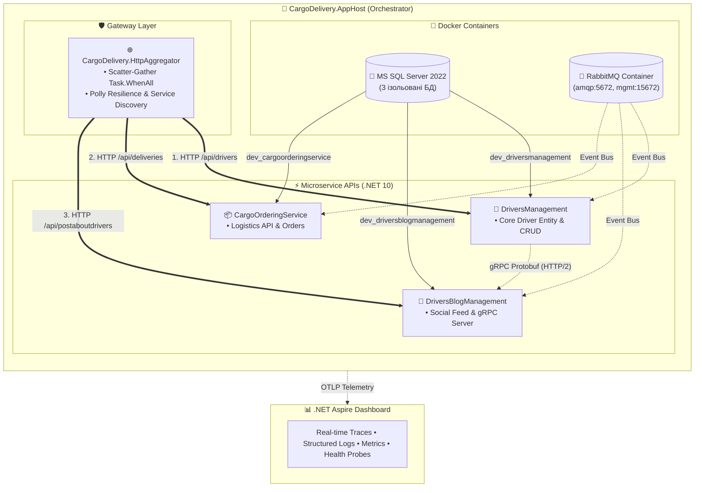

# 📚 02-01-Aspire-Documentation: Оркестрація та Розподілена Телеметрія .NET 10 Aspire

> Документаційний та навчальний модуль Блоку 2 (`02-Microservices-Craftsman`), присвячений архітектурі, налаштуванню та діагностиці розподіленої системи вантажоперевезень за допомогою **.NET 10 Aspire Orchestration**.

---

## 🗺️ Модульна навчальна програма (Навігація по розділах)

Кожна тема винесена в окремий вичерпний посібник зі слайдами, фрагментами коду, інтерактивними переходами, Mermaid-діаграмами та посиланнями на офіційну документацію Microsoft Learn:

| № | Посібник | Ключова тема та практичний фокус | Офіційна документація Microsoft |
| :---: | :--- | :--- | :--- |
| **01** | [01_Aspire_Orchestration_AppHost_DeepDive.md](01_Aspire_Orchestration_AppHost_DeepDive.md) | **Оркестрація розподіленої системи:** C# AppHost замість Docker Compose, керування контейнерами RabbitMQ та SQL Server, усунення Race Conditions через `.WaitFor()`, підключення сервісів. | [Aspire AppHost](https://learn.microsoft.com/dotnet/aspire/fundamentals/app-host) |
| **02** | [02_ServiceDefaults_Architecture_And_Parameters.md](02_ServiceDefaults_Architecture_And_Parameters.md) | **Анатомія ServiceDefaults:** Повний розбір `Extensions.cs`, параметри логування, метрик та трейсів OpenTelemetry, фільтрація шумів, OTLP експортери, таблиця тюнінгу під продакшн. | [Service Defaults](https://learn.microsoft.com/dotnet/aspire/fundamentals/service-defaults) |
| **03** | [03_HttpAggregator_Gateway_Architecture_And_Design.md](03_HttpAggregator_Gateway_Architecture_And_Design.md) | **Gateway Aggregator Service:** Розмежування Aggregator vs BFF vs YARP, паралельний Scatter-Gather (`Task.WhenAll`), патерн Graceful Degradation, новий виділений мікросервіс `CargoDelivery.HttpAggregator`. | [Aggregator Pattern](https://learn.microsoft.com/dotnet/architecture/microservices/architect-microservice-container-applications/direct-client-to-microservice-communication-versus-the-api-gateway-pattern) |
| **04** | [04_Distributed_Tracing_OpenTelemetry_Guide.md](04_Distributed_Tracing_OpenTelemetry_Guide.md) | **OpenTelemetry Distributed Tracing:** Стандарт W3C `traceparent`, TraceId/SpanId, візуалізація дерева спанів паралельного Fan-Out у дашборді, наскрізне трасування подій черг RabbitMQ MassTransit. | [Aspire Telemetry](https://learn.microsoft.com/dotnet/aspire/fundamentals/telemetry) |
| **05** | [05_HealthChecks_Probes_Liveness_Readiness.md](05_HealthChecks_Probes_Liveness_Readiness.md) | **Зонди діагностики:** Відмінність Liveness (`/alive`, `tags: ["live"]`) від Readiness (`/health`), життєвий цикл контейнера у Kubernetes, інтеграція з Aspire Dashboard, модульні та функціональні тести. | [Aspire Health Checks](https://learn.microsoft.com/dotnet/aspire/fundamentals/health-checks) |
| **06** | [06_ServiceDiscovery_Resilience_Polly_HttpClient.md](06_ServiceDiscovery_Resilience_Polly_HttpClient.md) | **Service Discovery та Polly Resilience:** Динамічні логічні імена `http://...`, розбір 5 рівнів конвеєра `AddStandardResilienceHandler()` (Timeout, Retry, Circuit Breaker, Rate Limiter), живі демо-сценарії збоїв. | [Service Discovery](https://learn.microsoft.com/dotnet/aspire/service-discovery/overview) • [Polly Resilience](https://learn.microsoft.com/dotnet/core/resilience/http-resilience) |
| 🎓 | [02-01-Aspire-MasterClass.md](02-01-Aspire-MasterClass.md) | **Загальний архітектурний майстер-клас:** 15 слайдів, що охоплюють міграцію на .NET 10, порівняльні таблиці та підсумковий огляд усієї інфраструктури проєкту. | [Aspire Overview](https://learn.microsoft.com/dotnet/aspire/get-started/aspire-overview) |

---

## 🏗️ Повна архітектурна топологія системи під керуванням Aspire



---

## ⚡ Швидкий старт для розробника

> 📍 **Вихідний файл оркестратора:**  
> [AppHost.cs](file:///c:/Users/Yurii/source/repos/Demo-CargoDeliveryService/02-Microservices-Craftsman/Aspire/CargoDelivery.AppHost/AppHost.cs)

Запуск усієї розподіленої системи (БД SQL Server + Брокер RabbitMQ + 4 мікросервіси + Веб-дашборд) однією командою:

```powershell
dotnet run --project "02-Microservices-Craftsman\Aspire\CargoDelivery.AppHost\CargoDelivery.AppHost.csproj"
```

Після старту браузер автоматично відкриє дашборд Aspire, де доступні всі ресурси, наскрізні трейси, логи та системні метрики в реальному часі.
