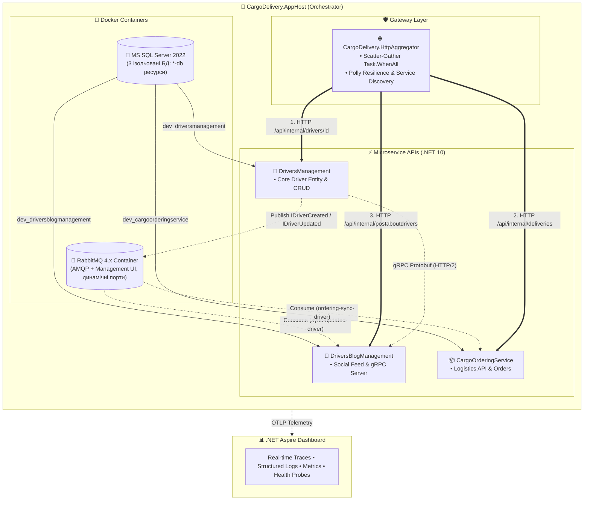

# 📚 02-01-Aspire-Documentation: Оркестрація та Розподілена Телеметрія .NET 10 Aspire

> Документаційний та навчальний модуль Блоку 2 (`02-Microservices-Craftsman`), присвячений архітектурі, налаштуванню та діагностиці розподіленої системи вантажоперевезень за допомогою **.NET 10 Aspire Orchestration**.

---

## 🗺️ Модульна навчальна програма (Навігація по розділах)

Кожна тема винесена в окремий вичерпний посібник зі слайдами, фрагментами коду, інтерактивними переходами, Mermaid-діаграмами та посиланнями на офіційну документацію Microsoft Learn.

> 🧭 **Рекомендований порядок читання:** `🎓 MasterClass` (загальна картина за 20 хвилин) → `01` (як система стартує) → `02` (що отримує кожен сервіс) → `03` (як сервіси спілкуються синхронно) → `04` (як це побачити) → `05` (як оркестратор знає, що сервіс живий) → `06` (як пережити збої мережі). Комунікаційні патерни (gRPC, RabbitMQ) детально розібрані в сусідньому модулі [02-02-Communication-Documentation](../02-02-Communication-Documentation/README.md).

> 🔗 **Як працюють посилання на код.** Усі посилання відносні та ведуть одразу до потрібного рядка, наприклад [`AppHost.cs#L60`](../Aspire/CargoDelivery.AppHost/AppHost.cs#L60). У **VS Code** (Markdown Preview, `Ctrl+Shift+V`) клік відкриває файл на цьому рядку; на **GitHub** рядок підсвічується; у **Visual Studio / Rider** відкривається сам файл.

| № | Посібник | Ключова тема та практичний фокус | Офіційна документація Microsoft |
| :---: | :--- | :--- | :--- |
| **01** | [01_Aspire_Orchestration_AppHost_DeepDive.md](01_Aspire_Orchestration_AppHost_DeepDive.md) | **Оркестрація розподіленої системи:** C# AppHost замість Docker Compose, керування контейнерами RabbitMQ та SQL Server, усунення Race Conditions через `.WaitFor()`, підключення сервісів. | [Aspire AppHost](https://learn.microsoft.com/dotnet/aspire/fundamentals/app-host) |
| **02** | [02_ServiceDefaults_Architecture_And_Parameters.md](02_ServiceDefaults_Architecture_And_Parameters.md) | **Анатомія ServiceDefaults:** Повний розбір `Extensions.cs`, параметри логування, метрик та трейсів OpenTelemetry, фільтрація шумів, OTLP експортери, таблиця тюнінгу під продакшн. | [Service Defaults](https://learn.microsoft.com/dotnet/aspire/fundamentals/service-defaults) |
| **03** | [03_HttpAggregator_Gateway_Architecture_And_Design.md](03_HttpAggregator_Gateway_Architecture_And_Design.md) | **Gateway Aggregator Service:** Розмежування Aggregator vs BFF vs YARP, паралельний Scatter-Gather (`Task.WhenAll`), патерн Graceful Degradation, новий виділений мікросервіс `CargoDelivery.HttpAggregator`. | [Aggregator Pattern](https://learn.microsoft.com/dotnet/architecture/microservices/architect-microservice-container-applications/direct-client-to-microservice-communication-versus-the-api-gateway-pattern) |
| **04** | [04_Distributed_Tracing_OpenTelemetry_Guide.md](04_Distributed_Tracing_OpenTelemetry_Guide.md) | **OpenTelemetry Distributed Tracing:** Стандарт W3C `traceparent`, TraceId/SpanId, візуалізація дерева спанів паралельного Fan-Out у дашборді, наскрізне трасування подій черг RabbitMQ MassTransit. | [Aspire Telemetry](https://learn.microsoft.com/dotnet/aspire/fundamentals/telemetry) |
| **05** | [05_HealthChecks_Probes_Liveness_Readiness.md](05_HealthChecks_Probes_Liveness_Readiness.md) | **Зонди діагностики:** Відмінність Liveness (`/alive`, `tags: ["live"]`) від Readiness (`/health`), життєвий цикл контейнера у Kubernetes, інтеграція з Aspire Dashboard, модульні та функціональні тести. | [Aspire Health Checks](https://learn.microsoft.com/dotnet/aspire/fundamentals/health-checks) |
| **06** | [06_ServiceDiscovery_Resilience_Polly_HttpClient.md](06_ServiceDiscovery_Resilience_Polly_HttpClient.md) | **Service Discovery та Polly Resilience:** Динамічні логічні імена `http://...`, розбір 5 рівнів конвеєра `AddStandardResilienceHandler()` (Timeout, Retry, Circuit Breaker, Rate Limiter), живі демо-сценарії збоїв. | [Service Discovery](https://learn.microsoft.com/dotnet/aspire/service-discovery/overview) • [Polly Resilience](https://learn.microsoft.com/dotnet/core/resilience/http-resilience) |
| 🎓 | [02-01-Aspire-MasterClass.md](02-01-Aspire-MasterClass.md) | **Загальний архітектурний майстер-клас:** 15 слайдів, що охоплюють міграцію на .NET 10, порівняльні таблиці та підсумковий огляд усієї інфраструктури проєкту. | [Aspire Overview](https://learn.microsoft.com/dotnet/aspire/get-started/aspire-overview) |

---

## 🏗️ Повна архітектурна топологія системи під керуванням Aspire



---

## ⚡ Швидкий старт для розробника

> 📍 **Вихідний файл оркестратора:**  
> [AppHost.cs](../Aspire/CargoDelivery.AppHost/AppHost.cs)

Запуск усієї розподіленої системи (БД SQL Server + Брокер RabbitMQ + 4 мікросервіси + Веб-дашборд) однією командою:

```powershell
dotnet run --project "02-Microservices-Craftsman\Aspire\CargoDelivery.AppHost\CargoDelivery.AppHost.csproj"
```

Після старту браузер автоматично відкриє дашборд Aspire, де доступні всі ресурси, наскрізні трейси, логи та системні метрики в реальному часі.

### Що ви маєте побачити (перевірено на цьому стенді)

| Що | Де / Значення |
| :--- | :--- |
| **Адреса дашборду** | `https://localhost:17048` — задана в [launchSettings.json AppHost](../Aspire/CargoDelivery.AppHost/Properties/launchSettings.json#L8). У консолі друкується рядок `Login to the dashboard at https://localhost:17048/login?t=...` — токен у URL і є «паролем» до дашборду. |
| **Ресурсів у вкладці Resources** | **9**: `rabbitmq`, `sqlserver` (+3 бази `*-db`), `cargoorderingservice`, `driversblogmanagement`, `driversmanagement`, `httpaggregator`. Усі — `Running`, у колонці health — `Healthy`. |
| **Порти сервісів** | Фіксовані з `launchSettings.json` кожного проєкту: DriversManagement `5001`, DriversBlogManagement `5002`, CargoOrderingService `5003`, HttpAggregator `57390` (HTTPS). Порти контейнерів (RabbitMQ, SQL) — **динамічні**, дивіться колонку *URLs*. |
| **Готові запити для перевірки** | [CargoDelivery.HttpAggregator.http](../CargoDelivery.HttpAggregator/CargoDelivery.HttpAggregator.http) — створення водія, демо-дані, gRPC, BFF, агрегатор, сценарії Polly. |
| **Демо-дані** | Наповнюються **автоматично** при кожному запуску (Bogus, українська локаль): 50 водіїв, 30 компаній, 15 вантажівок у DriversManagement → події `IDriverCreated` реплікують водіїв у блог і замовлення → там створюються 50 постів і 50 замовлень із доставками. Повна картина з'являється приблизно за 10–20 с після старту. Деталі — [гайд 01, §9.3](01_Aspire_Orchestration_AppHost_DeepDive.md#section-9). |
| **Swagger** | У всіх чотирьох сервісах: `https://localhost:5001/swagger`, `:5002/swagger`, `:5003/swagger`, агрегатор — `https://localhost:57390/swagger` (посилання є в колонці *URLs* дашборду). |

> ⚠️ **Авторизацію вимкнено.** Оригінальні Craftsman-сервіси вимагали JWT від Keycloak (`http://localhost:5000`), який у стенді не запускається. Усі `[Authorize]`, перевірки HeimGuard і реєстрацію JwtBearer закоментовано з маркером `// [AUTH-DISABLED]` — пошук цього маркера по рішенню покаже всі місця, які треба розкоментувати, щоб повернути безпеку.

### Типові проблеми запуску та їхні причини

| Симптом | Причина | Що зроблено в коді |
| :--- | :--- | :--- |
| `DistributedApplicationException: Cannot add resource ... 'cargoorderingservice' because resource ... with that name already exists` | Імена ресурсів Aspire **регістронезалежні**: база `CargoOrderingService` конфліктувала з проєктом `cargoorderingservice`. | Ресурси БД перейменовано на `*-db`, а ключ рядка підключення задано через `connectionName` — [AppHost.cs#L47-L50](../Aspire/CargoDelivery.AppHost/AppHost.cs#L47-L50), [#L62](../Aspire/CargoDelivery.AppHost/AppHost.cs#L62). |
| `Newer version of the Aspire.Hosting.AppHost package is required` | SDK `Aspire.AppHost.Sdk/13.0.1` приносив старий оркестратор DCP, а пакети хостингу були 13.6.1. | SDK і пакети вирівняно до 13.6.1 — [CargoDelivery.AppHost.csproj#L1](../Aspire/CargoDelivery.AppHost/CargoDelivery.AppHost.csproj#L1). |
| `Invalid object name 'companies'` / «таблиць немає» | `MigrateAsync` був закоментований, а в CargoOrderingService міграцій немає взагалі — у свіжому контейнері БД залишалась порожньою. | Єдина стратегія: є міграції → `MigrateAsync`, немає → `EnsureCreatedAsync` — [MigrationHostedService.cs](../DriversManagement/src/DriversManagement/Databases/MigrationHostedService.cs#L48). |
| `Docker is not running` / контейнери не стартують | Не запущено Docker Desktop. | Запустіть Docker Desktop і перевірте `docker info`. |
