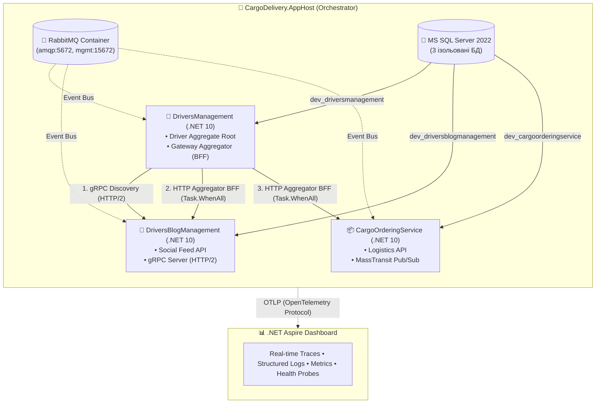

# 📚 02-01-Aspire-Documentation: Оркестрація та Розподілена Телеметрія

> Документаційний та навчальний модуль Блоку 2 (`02-Microservices-Craftsman`), присвячений впровадженню **.NET 10 Aspire Orchestration** поверх розподіленої мікросервісної підсистеми вантажних перевезень.

---

## 🎯 Матеріали модуля

| Документ | Опис | Формат |
| :--- | :--- | :--- |
| **[02-01-Aspire-MasterClass.md](02-01-Aspire-MasterClass.md)** | Повний 15-слайдовий майстер-клас "від новачка до профі" з детальним розбором C# AppHost, ServiceDefaults, OTLP, gRPC discovery, MassTransit tracing та покроковою інструкцією запуску | 🎬 Інтерактивні слайди з прямими переходами до коду |

---

## 🏗️ Архітектура розподіленої системи під .NET Aspire



---

## ⚡ Швидкий старт для розробника

> 📍 **Шлях до файлу оркестратора:** `02-Microservices-Craftsman/Aspire/CargoDelivery.AppHost/AppHost.cs`

[👉 **Перейти до файлу (клікніть тут)**](../Aspire/CargoDelivery.AppHost/AppHost.cs#L1-L68)

```powershell
# Запуск усієї системи (БД + Брокер + 3 API + Дашборд) однією командою:
dotnet run --project "02-Microservices-Craftsman\Aspire\CargoDelivery.AppHost\CargoDelivery.AppHost.csproj"
```
