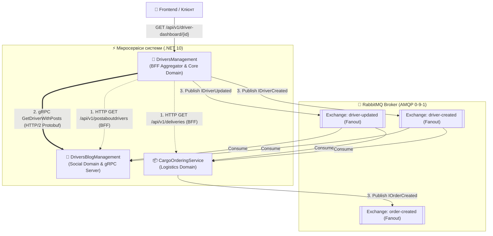
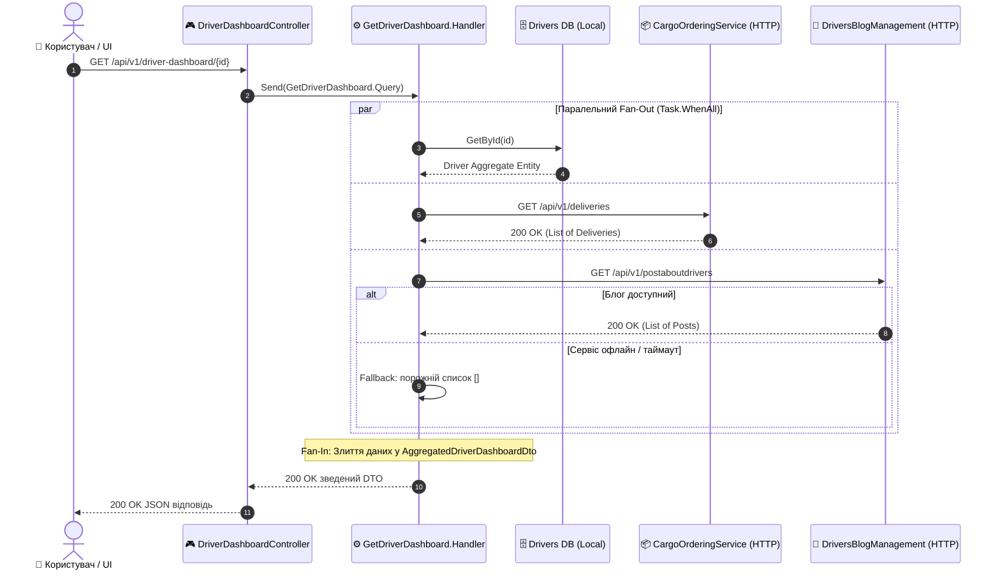
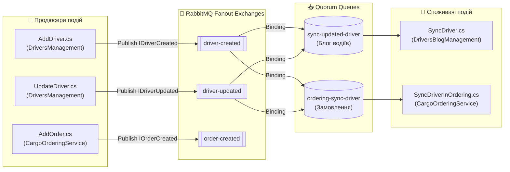

# 🧭 00. Карта та матриця міжсервісних комунікацій (Quick Reference)

> **Модуль:** `02-Microservices-Craftsman / 02-02-Communication-Documentation`  
> **Призначення:** Єдина експрес-карта міжсервісних взаємодій у системі вантажних перевезень. Містить наочні топологічні діаграми та інтерактивні таблиці з прямими клікабельними переходами до вихідного коду кожного клієнта, сервера, продюсера та консьюмера.

---

## 🗺️ 1. Загальна архітектурна топологія системи

У нашій системі реалізовано три взаємодоповнюючі види міжсервісної комунікації:
1. **HTTP Client (Gateway Aggregator / BFF):** паралельна композиція даних для клієнтського дашборду.
2. **gRPC (HTTP/2 Binary RPC):** синхронний високошвидкісний point-to-point обмін між двома сервісами.
3. **Message Broker (MassTransit + RabbitMQ):** асинхронна шина доменних подій для реплікації даних.

---

## 🌐 2. Частина 1: HTTP Client Комунікація (Gateway Aggregator / BFF)

### 2.1. Концепція та потік виконання (Fan-Out / Fan-In)

Коли клієнт запитує єдиний зведений екран кабінету водія, контролер `DriverDashboardController` запускає паралельний збір інформації через `Task.WhenAll`:
1. Зчитує локальний агрегат водія з `DriversManagement DB` (EF Core).
2. Викликає `CargoOrderingService` через `CargoOrderingApiClient` для отримання активних рейсів.
3. Викликає `DriversBlogManagement` через `DriversBlogApiClient` для отримання останніх публікацій.
4. Об'єднує результат у єдиний `AggregatedDriverDashboardDto`.

### 2.2. Навігаційна таблиця HTTP-клієнтів та ендпоінтів

| Роль у виклику | Проєкт | Компонент / Клас | Метод / Маршрут | Опис та призначення |
| :--- | :--- | :--- | :--- | :--- |
| **Точка входу BFF** | `DriversManagement` | [DriverDashboardController](../DriversManagement/src/DriversManagement/Controllers/v1/DriverDashboardController.cs) | `GET /api/v1/driver-dashboard/{id}` | Зовнішній REST-ендпоінт агрегації для мобільного/веб клієнта |
| **Оркестратор BFF** | `DriversManagement` | [GetDriverDashboard.cs](../DriversManagement/src/DriversManagement/Domain/Drivers/Features/GetDriverDashboard.cs) | `GetDriverDashboard.Handler` | CQRS-обробник, який виконує паралельний `Task.WhenAll` та злиття даних |
| **HTTP-клієнт замовлень** | `DriversManagement` | [CargoOrderingApiClient.cs](../DriversManagement/src/DriversManagement/Domain/Drivers/Services/Http/CargoOrderingApiClient.cs) ([ICargoOrderingApiClient](../DriversManagement/src/DriversManagement/Domain/Drivers/Services/Http/ICargoOrderingApiClient.cs)) | `GetActiveDeliveriesByDriverAsync()` | Типізований клієнт з `AddStandardResilienceHandler()` та Aspire Service Discovery |
| **HTTP-клієнт блогу** | `DriversManagement` | [DriversBlogApiClient.cs](../DriversManagement/src/DriversManagement/Domain/Drivers/Services/Http/DriversBlogApiClient.cs) ([IDriversBlogApiClient](../DriversManagement/src/DriversManagement/Domain/Drivers/Services/Http/IDriversBlogApiClient.cs)) | `GetRecentPostsByDriverAsync()` | Типізований клієнт з обробкою таймаутів та Graceful Fallback |
| **Зведена модель** | `DriversManagement` | [AggregatedDriverDashboardDto.cs](../DriversManagement/src/DriversManagement/Domain/Drivers/Dtos/AggregatedDriverDashboardDto.cs) | `AggregatedDriverDashboardDto` | Композитна DTO-модель (Driver + Truck + Deliveries + Posts) |
| **DI Конфігурація** | `DriversManagement` | [WebAppServiceConfiguration.cs](../DriversManagement/src/DriversManagement/Extensions/Services/WebAppServiceConfiguration.cs) | `AddHttpClient(...)` | Реєстрація клієнтів з базовими адресами `http://cargoorderingservice` та `http://driversblogmanagement` |
| **Цільовий сервіс 1** | `CargoOrderingService` | [DeliveriesController.cs](../CargoOrderingService/src/CargoOrderingService/Controllers/v1/DeliveriesController.cs) | `GET /api/v1/deliveries` | Надає список рейсів і доставок із пагінацією |
| **Цільовий сервіс 2** | `DriversBlogManagement` | [PostAboutDriversController.cs](../DriversBlogManagement/src/DriversBlogManagement/Controllers/v1/PostAboutDriversController.cs) | `GET /api/v1/postaboutdrivers` | Надає список дописів водіїв із пагінацією |

> 📖 **Детальний навчальний гайд:** [02_Patterns_Synchronous_HttpClient_Aggregator_BFF.md](02_Patterns_Synchronous_HttpClient_Aggregator_BFF.md)

---

## ⚡ 3. Частина 2: gRPC Комунікація (Синхронний бінарний RPC по HTTP/2)

### 3.1. Архітектура з'єднання та Graceful Degradation

gRPC забезпечує ультранизьку затримку (Low Latency) та компактний бінарний формат передачі даних:
- **Клієнт:** `DriversManagement` через згенерований `DriverRpc.DriverRpcClient`.
- **Сервер:** `DriversBlogManagement` через клас `DriverRpcService`.
- **Захист від каскадного збою:** Якщо gRPC-сервер тимчасово недоступний, клієнт логує `RpcException` та повертає водія з порожнім списком публікацій (`Fallback`), не ламаючи весь запит користувача!

```mermaid
sequenceDiagram
    autonumber
    participant ClientApp as 🚚 DriversManagement (Client)
    participant Handler as ⚙️ GetDriver.Handler
    participant gRPC_Client as 🔌 DriverRpc.DriverRpcClient
    participant gRPC_Server as 📝 DriverRpcService (Server)
    participant BlogDB as 🗄️ DriversBlog DB

    ClientApp->>Handler: Send(GetDriver.Query(id))
    Handler->>gRPC_Client: GetDriverWithPostsAsync(request)
    
    rect rgb(20, 35, 60)
        note over gRPC_Client,gRPC_Server: HTTP/2 Binary Frames (Protocol Buffers)
        gRPC_Client->>gRPC_Server: POST /DriverRpc/GetDriverWithPosts
        gRPC_Server->>BlogDB: Читання постів водія
        BlogDB-->>gRPC_Server: Список PostAboutDrivers
        gRPC_Server-->>gRPC_Client: DriverWithPostsResponse (Binary)
    end

    alt Успішний виклик
        gRPC_Client-->>Handler: DriverWithPostsResponse.Posts
    else Помилка сервера (RpcException / Unavailable)
        gRPC_Client--xHandler: RpcException
        Handler->>Handler: Fallback: повернути водія з posts = []
    end

    Handler-->>ClientApp: FullDataAboutDriverAndPostsDto
```

### 3.2. Навігаційна таблиця компонентів gRPC

| Сторона взаємодії | Проєкт | Компонент / Клас | Файл / Контракт | Призначення |
| :--- | :--- | :--- | :--- | :--- |
| **Контракт Protobuf** | Спільний | `Domain/Drivers/Protos/Driver.proto` | [Driver.proto](../DriversBlogManagement/src/DriversBlogManagement/Domain/Drivers/Protos/Driver.proto) | Бінарний IDL-контракт: `rpc GetDriverWithPosts`, повідомлення `DriverWithPostsRequest` та `DriverWithPostsResponse` |
| **Генерація коду** | `DriversBlogManagement` | [DriversBlogManagement.csproj](../DriversBlogManagement/src/DriversBlogManagement/DriversBlogManagement.csproj) | `<Protobuf GrpcServices="Both" />` | Компілятор Protobuf генерує клієнтські та серверні класи C# |
| **gRPC Клієнт (Виклик)** | `DriversManagement` | [GetDriver.cs](../DriversManagement/src/DriversManagement/Domain/Drivers/Features/GetDriver.cs) | `GetDriver.Handler` | Викликає `_driverRpcClient.GetDriverWithPostsAsync` та інкапсулює Graceful Degradation `try/catch (RpcException)` |
| **Реєстрація клієнта** | `DriversManagement` | [WebAppServiceConfiguration.cs](../DriversManagement/src/DriversManagement/Extensions/Services/WebAppServiceConfiguration.cs) | `AddGrpcClient<DriverRpcClient>` | Читає адресу з Aspire Service Discovery (`services:driversblogmanagement:https:0`) або Fallback |
| **gRPC Сервер (Реалізація)** | `DriversBlogManagement` | [DriverRpcService.cs](../DriversBlogManagement/src/DriversBlogManagement/Domain/Drivers/Services/DriverRpcService.cs) | `DriverRpcService : DriverRpcBase` | Серверна реалізація, що робить запит до локальної БД `DriversBlog` та мапить результати в Protobuf |
| **Реєстрація сервера** | `DriversBlogManagement` | [Program.cs](../DriversBlogManagement/src/DriversBlogManagement/Program.cs) | `app.MapGrpcService<DriverRpcService>()` | Підключення gRPC-конвеєра в ASP.NET Core Kestrel |

> 📖 **Детальний навчальний гайд:** [03_Patterns_Synchronous_gRPC_Communication.md](03_Patterns_Synchronous_gRPC_Communication.md)

---

## 🐰 4. Частина 3: Message Broker (MassTransit + RabbitMQ Pub/Sub)

### 4.1. Топологія брокера: Обмінники (Fanout) та Черги (Quorum)

В асинхронній моделі сервіс-видавець не знає, хто підписаний на його події:
- Продюсер публікує подію в **Обмінник (Exchange)** типу `Fanout`.
- RabbitMQ миттєво копіює повідомлення в усі зв'язані **Черги (Queues)**.
- Сервіси-підписники вичитують повідомлення автономно та ідемпотентно.

### 4.2. Навігаційна таблиця продюсерів, черг та споживачів

| Подія / Інтерфейс | Продюсер (Хто публікує) | Обмінник (Exchange) | Черга (Queue) | Споживач (Хто вичитує) | Що відбувається в БД |
| :--- | :--- | :--- | :--- | :--- | :--- |
| **`IDriverCreated`** ([DriverCreated.cs](../SharedKernel/DriverCreated.cs)) | `DriversManagement` [AddDriver.cs](../DriversManagement/src/DriversManagement/Domain/Drivers/Features/AddDriver.cs) *Реєстрація:* [DriverCreatedEndpointRegistration.cs](../DriversManagement/src/DriversManagement/Extensions/Services/ProducerRegistrations/DriverCreatedEndpointRegistration.cs) | `driver-created` *(Type: Fanout)* | `sync-updated-driver` | `DriversBlogManagement` [SyncDriver.cs](../DriversBlogManagement/src/DriversBlogManagement/Domain/SyncDriver.cs) *Реєстрація:* [SyncPatientEndpointRegistration.cs](../DriversBlogManagement/src/DriversBlogManagement/Extensions/Services/ConsumerRegistrations/SyncPatientEndpointRegistration.cs) | Створення тіньового запису водія в базі блогу (`DriversBlog.Drivers`) |
| **`IDriverCreated`** ([DriverCreated.cs](../SharedKernel/DriverCreated.cs)) | `DriversManagement` [AddDriver.cs](../DriversManagement/src/DriversManagement/Domain/Drivers/Features/AddDriver.cs) | `driver-created` *(Type: Fanout)* | `ordering-sync-driver` | `CargoOrderingService` [SyncDriverInOrdering.cs](../CargoOrderingService/src/CargoOrderingService/Domain/Drivers/Consumers/SyncDriverInOrdering.cs) *Реєстрація:* [SyncDriverInOrderingEndpointRegistration.cs](../CargoOrderingService/src/CargoOrderingService/Extensions/Services/ConsumerRegistrations/SyncDriverInOrderingEndpointRegistration.cs) | Створення тіньового запису водія в базі замовлень (`Ordering.Drivers`) |
| **`IDriverUpdated`** ([DriverUpdated.cs](../SharedKernel/DriverUpdated.cs)) | `DriversManagement` [UpdateDriver.cs](../DriversManagement/src/DriversManagement/Domain/Drivers/Features/UpdateDriver.cs) *Реєстрація:* [DriverUpdatedEndpointRegistration.cs](../DriversManagement/src/DriversManagement/Extensions/Services/ProducerRegistrations/DriverUpdatedEndpointRegistration.cs) | `driver-updated` *(Type: Fanout)* | `sync-updated-driver` | `DriversBlogManagement` [SyncDriver.cs](../DriversBlogManagement/src/DriversBlogManagement/Domain/SyncDriver.cs) | Оновлення ПІБ водія в базі блогу для відображення під постами |
| **`IDriverUpdated`** ([DriverUpdated.cs](../SharedKernel/DriverUpdated.cs)) | `DriversManagement` [UpdateDriver.cs](../DriversManagement/src/DriversManagement/Domain/Drivers/Features/UpdateDriver.cs) | `driver-updated` *(Type: Fanout)* | `ordering-sync-driver` | `CargoOrderingService` [SyncDriverInOrdering.cs](../CargoOrderingService/src/CargoOrderingService/Domain/Drivers/Consumers/SyncDriverInOrdering.cs) | Оновлення контактних даних водія в базі замовлень |
| **`IOrderCreated`** ([OrderMessages.cs](../SharedKernel/OrderMessages.cs)) | `CargoOrderingService` [AddOrder.cs](../CargoOrderingService/src/CargoOrderingService/Domain/Orders/Features/AddOrder.cs) | `order-created` *(Type: Fanout)* | Підготовлена для нових сервісів | Розширюваний контракт для майбутніх модулів (Billing / Notifications) | Фіксація факту оформлення нового рейсу |

#### Конфігурація підключення шини у кожному мікросервісі:
* 🚚 **DriversManagement:** [MassTransitServiceExtension.cs](../DriversManagement/src/DriversManagement/Extensions/Services/MassTransitServiceExtension.cs)
* 📝 **DriversBlogManagement:** [MassTransitServiceExtension.cs](../DriversBlogManagement/src/DriversBlogManagement/Extensions/Services/MassTransitServiceExtension.cs)
* 📦 **CargoOrderingService:** [MassTransitServiceExtension.cs](../CargoOrderingService/src/CargoOrderingService/Extensions/Services/MassTransitServiceExtension.cs)

> 📖 **Детальний навчальний гайд:** [04_Patterns_Asynchronous_Messaging_MassTransit_RabbitMQ.md](04_Patterns_Asynchronous_Messaging_MassTransit_RabbitMQ.md)

---

## ⚖️ 5. Зведена матриця вибору патерну комунікації

| Критерій | 1. HTTP Aggregator (BFF) | 2. gRPC (HTTP/2 Binary RPC) | 3. MassTransit + RabbitMQ (Pub/Sub) |
| :--- | :--- | :--- | :--- |
| **Тип взаємодії** | Синхронний запит / відповідь | Синхронний point-to-point RPC | Асинхронний подійний Pub/Sub |
| **Протокол передачі** | HTTP/1.1 або HTTP/2 + JSON | HTTP/2 + Google Protocol Buffers | AMQP 0-9-1 поверх TCP |
| **Формат даних** | Текстовий JSON | Бінарні спресовані фрейми | JSON / Protobuf у тілі повідомлення |
| **Швидкість (Latency)** | Середня (парсинг тексту JSON) | **Надвисока** (бінарна серіалізація) | Висока (зберігання брокером на диск) |
| **Зв'язність за часом** | Висока (потрібні відповіді API) | Висока (сервер повинен бути онлайн) | **Нульова** (Temporal Decoupling) |
| **Вплив збою адресата** | Частковий Fallback для блоків UI | Помилка збою / Graceful Degradation | **Повідомлення чекає в черзі брокера** |
| **Головний кейс у системі** | Зведення даних для клієнта (BFF Dashboard) | Швидке зчитування постів водія | Реплікація водіїв між базами даних |
| **Повний гайд** | [Гайд 02](02_Patterns_Synchronous_HttpClient_Aggregator_BFF.md) | [Гайд 03](03_Patterns_Synchronous_gRPC_Communication.md) | [Гайд 04](04_Patterns_Asynchronous_Messaging_MassTransit_RabbitMQ.md) |
