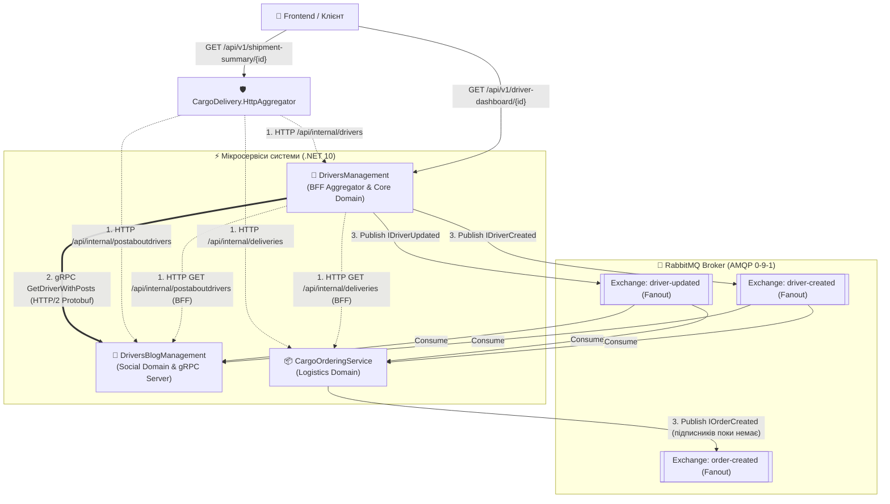
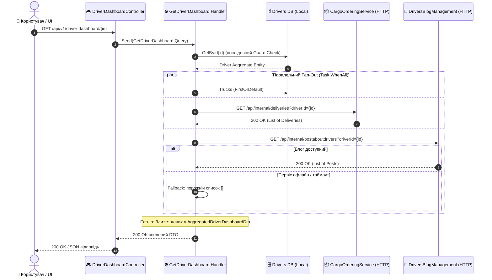
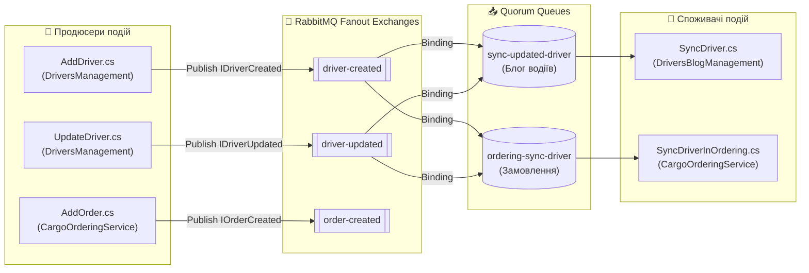

# 🧭 00. Карта та матриця міжсервісних комунікацій (Quick Reference)

> **Модуль:** `02-Microservices-Craftsman / 02-02-Communication-Documentation`  
> **Призначення:** Єдина експрес-карта міжсервісних взаємодій у системі вантажних перевезень. Містить наочні топологічні діаграми та інтерактивні таблиці з прямими клікабельними переходами до вихідного коду кожного клієнта, сервера, продюсера та консьюмера.
> **Як користуватись посиланнями:** посилання виду `Файл.cs#L42` відкривають файл одразу на потрібному рядку (VS Code Markdown Preview — `Ctrl+Shift+V`; на GitHub рядок підсвічується).
> **Перевірено на живому стенді** (Aspire AppHost, 9 ресурсів): усі три види комунікації працюють, їх видно в Aspire Dashboard → Traces.

---

## 🗺️ 1. Загальна архітектурна топологія системи

У нашій системі реалізовано три взаємодоповнюючі види міжсервісної комунікації:
1. **HTTP Client (Gateway Aggregator / BFF):** паралельна композиція даних для клієнтського дашборду. Реалізовано двічі: вбудований BFF у `DriversManagement` і виділений сервіс `CargoDelivery.HttpAggregator`.
2. **gRPC (HTTP/2 Binary RPC):** синхронний високошвидкісний point-to-point обмін між двома сервісами.
3. **Message Broker (MassTransit + RabbitMQ):** асинхронна шина доменних подій для реплікації даних.

---

## 🌐 2. Частина 1: HTTP Client Комунікація (Gateway Aggregator / BFF)

### 2.1. Концепція та потік виконання (Fan-Out / Fan-In)

Коли клієнт запитує єдиний зведений екран кабінету водія, контролер `DriverDashboardController` передає запит обробнику `GetDriverDashboard.Handler`, який:
1. Зчитує локальний агрегат водія з `DriversManagement DB` (EF Core) — **послідовно**, як «вартовий» (немає водія → 404, решту не опитуємо).
2. **Паралельно** (через `Task.WhenAll`) викликає `CargoOrderingService` через `CargoOrderingApiClient` (доставки водія), `DriversBlogManagement` через `DriversBlogApiClient` (останні пости) і читає вантажівку з локальної БД.
3. Об'єднує результат у єдиний `AggregatedDriverDashboardDto` з прапорцем `IsPartialData`.

### 2.2. Навігаційна таблиця HTTP-клієнтів та ендпоінтів

| Роль у виклику | Проєкт | Компонент / Клас | Метод / Маршрут | Опис та призначення |
| :--- | :--- | :--- | :--- | :--- |
| **Точка входу BFF** | `DriversManagement` | [DriverDashboardController.cs#L49](../DriversManagement/src/DriversManagement/Controllers/v1/DriverDashboardController.cs#L49) | `GET /api/v1/driver-dashboard/{id}` | Зовнішній REST-ендпоінт агрегації для мобільного/веб клієнта |
| **Оркестратор BFF** | `DriversManagement` | [GetDriverDashboard.cs#L82](../DriversManagement/src/DriversManagement/Domain/Drivers/Features/GetDriverDashboard.cs#L82) (Guard), [#L92-L112](../DriversManagement/src/DriversManagement/Domain/Drivers/Features/GetDriverDashboard.cs#L92) (Fan-Out/Fan-In) | `GetDriverDashboard.Handler` | CQRS-обробник, який виконує паралельний `Task.WhenAll` та злиття даних |
| **HTTP-клієнт замовлень** | `DriversManagement` | [CargoOrderingApiClient.cs#L59](../DriversManagement/src/DriversManagement/Domain/Drivers/Services/Http/CargoOrderingApiClient.cs#L59) ([ICargoOrderingApiClient](../DriversManagement/src/DriversManagement/Domain/Drivers/Services/Http/ICargoOrderingApiClient.cs)) | `GetActiveDeliveriesByDriverAsync()` | Типізований клієнт: Aspire Service Discovery + глобальний конвеєр Polly |
| **HTTP-клієнт блогу** | `DriversManagement` | [DriversBlogApiClient.cs#L52](../DriversManagement/src/DriversManagement/Domain/Drivers/Services/Http/DriversBlogApiClient.cs#L52) ([IDriversBlogApiClient](../DriversManagement/src/DriversManagement/Domain/Drivers/Services/Http/IDriversBlogApiClient.cs)) | `GetDriverPostsAsync()` | Типізований клієнт з коротким бюджетом часу (≤3 с) та Graceful Fallback |
| **Зведена модель** | `DriversManagement` | [AggregatedDriverDashboardDto.cs](../DriversManagement/src/DriversManagement/Domain/Drivers/Dtos/AggregatedDriverDashboardDto.cs) | `AggregatedDriverDashboardDto` | Композитна DTO-модель (Driver + Truck + Deliveries + Posts) |
| **DI Конфігурація** | `DriversManagement` | [WebAppServiceConfiguration.cs#L75-L82](../DriversManagement/src/DriversManagement/Extensions/Services/WebAppServiceConfiguration.cs#L75) | `AddHttpClient(...)` | Реєстрація клієнтів з логічними адресами `https+http://cargoorderingservice` та `https+http://driversblogmanagement` |
| **Цільовий сервіс 1** | `CargoOrderingService` | [InternalDeliveriesController.cs#L46](../CargoOrderingService/src/CargoOrderingService/Controllers/v1/InternalDeliveriesController.cs#L46) | `GET /api/internal/deliveries?driverId=` | Внутрішній (service-to-service) ендпоінт: доставки конкретного водія |
| **Цільовий сервіс 2** | `DriversBlogManagement` | [InternalPostAboutDriversController.cs#L45](../DriversBlogManagement/src/DriversBlogManagement/Controllers/v1/InternalPostAboutDriversController.cs#L45) | `GET /api/internal/postaboutdrivers?driverId=` | Внутрішній ендпоінт: до 10 останніх постів водія |
| **Виділений агрегатор** | `CargoDelivery.HttpAggregator` | [ShipmentAggregatorService.cs#L42](../CargoDelivery.HttpAggregator/Domain/Services/ShipmentAggregatorService.cs#L42) | `GET /api/v1/shipment-summary/{id}` | Scatter-Gather до трьох сервісів, 200 / 404 / 503, Graceful Degradation |
| **Внутрішня картка водія** | `DriversManagement` | [InternalDriversController.cs#L43](../DriversManagement/src/DriversManagement/Controllers/v1/InternalDriversController.cs#L43) | `GET /api/internal/drivers/{id}` | Компактні дані водія для агрегатора |

> ℹ️ Публічні CRUD-маршрути Craftsman мають вигляд `/api/deliveries`, `/api/postaboutdrivers`, `/api/drivers` (без `v1` у шляху — версія API передається окремо, за замовчуванням 1.0). Префікс `v1` є лише у `driver-dashboard` та `shipment-summary`.

> 📖 **Детальний навчальний гайд:** [02_Patterns_Synchronous_HttpClient_Aggregator_BFF.md](02_Patterns_Synchronous_HttpClient_Aggregator_BFF.md)

---

## ⚡ 3. Частина 2: gRPC Комунікація (Синхронний бінарний RPC по HTTP/2)

### 3.1. Архітектура з'єднання та Graceful Degradation

gRPC забезпечує ультранизьку затримку (Low Latency) та компактний бінарний формат передачі даних:
- **Клієнт:** `DriversManagement` через згенерований `DriverRpc.DriverRpcClient`.
- **Сервер:** `DriversBlogManagement` через клас `DriverRpcService`.
- **Захист від каскадного збою:** Якщо gRPC-сервер тимчасово недоступний, клієнт перехоплює `RpcException` та повертає водія з порожнім списком публікацій (`Fallback`), не ламаючи весь запит користувача! Завдяки короткому бюджету Polly деградація займає ≈2 с, а не 30 с.

```mermaid
sequenceDiagram
    autonumber
    participant ClientApp as 🚚 DriversManagement (Client)
    participant Handler as ⚙️ GetDriver.Handler
    participant gRPC_Client as 🔌 DriverRpc.DriverRpcClient
    participant gRPC_Server as 📝 DriverRpcService (Server)
    participant BlogDB as 🗄️ DriversBlog DB

    ClientApp->>Handler: Send(GetDriver.Query(id))
    Handler->>gRPC_Client: GetDriverWithPostsAsync(request)
    
    rect rgb(20, 35, 60)
        note over gRPC_Client,gRPC_Server: HTTP/2 Binary Frames (Protocol Buffers)
        gRPC_Client->>gRPC_Server: POST /DriverRpc/GetDriverWithPosts
        gRPC_Server->>BlogDB: Читання постів водія
        BlogDB-->>gRPC_Server: Список PostAboutDrivers
        gRPC_Server-->>gRPC_Client: DriverWithPostsResponse (Binary)
    end

    alt Успішний виклик
        gRPC_Client-->>Handler: DriverWithPostsResponse.Posts
    else Помилка сервера (RpcException / Unavailable)
        gRPC_Client--xHandler: RpcException
        Handler->>Handler: Fallback: повернути водія з posts = []
    end

    Handler-->>ClientApp: FullDataAboutDriverAndPostsDto
```

### 3.2. Навігаційна таблиця компонентів gRPC

| Сторона взаємодії | Проєкт | Компонент / Клас | Файл / Контракт | Призначення |
| :--- | :--- | :--- | :--- | :--- |
| **Контракт Protobuf** | Спільний | `Domain/Drivers/Protos/Driver.proto` | [Driver.proto](../DriversBlogManagement/src/DriversBlogManagement/Domain/Drivers/Protos/Driver.proto) | Бінарний IDL-контракт: `rpc GetDriverWithPosts`, повідомлення `DriverWithPostsRequest` та `DriverWithPostsResponse` |
| **Генерація коду (сервер)** | `DriversBlogManagement` | [DriversBlogManagement.csproj](../DriversBlogManagement/src/DriversBlogManagement/DriversBlogManagement.csproj) | `<Protobuf GrpcServices="Both" />` | Компілятор Protobuf генерує серверний базовий клас (і клієнт) C# |
| **Генерація коду (клієнт)** | `DriversManagement` | [DriversManagement.csproj](../DriversManagement/src/DriversManagement/DriversManagement.csproj) | `<Protobuf Include="…Driver.proto" GrpcServices="Client" />` | Той самий `.proto` компілюється лише як клієнт — без посилання на проєкт блогу (contract-first) |
| **gRPC Клієнт (Виклик)** | `DriversManagement` | [GetDriver.cs#L93](../DriversManagement/src/DriversManagement/Domain/Drivers/Features/GetDriver.cs#L93) (виклик), [#L108](../DriversManagement/src/DriversManagement/Domain/Drivers/Features/GetDriver.cs#L108) (fallback) | `GetDriver.Handler` | Викликає `_client.GetDriverWithPostsAsync` та інкапсулює Graceful Degradation `try/catch (RpcException)` |
| **Реєстрація клієнта** | `DriversManagement` | [WebAppServiceConfiguration.cs#L52-L62](../DriversManagement/src/DriversManagement/Extensions/Services/WebAppServiceConfiguration.cs#L52) | `AddGrpcClient<DriverRpcClient>` | Логічна адреса `https://driversblogmanagement` (Service Discovery) або fallback з `GrpcServer:Address`; короткий бюджет Polly |
| **gRPC Сервер (Реалізація)** | `DriversBlogManagement` | [DriverRpcService.cs#L57](../DriversBlogManagement/src/DriversBlogManagement/Domain/Drivers/Services/DriverRpcService.cs#L57) | `DriverRpcService : DriverRpcBase` | Серверна реалізація, що робить запит до локальної БД блогу через `IDriverRepository` та мапить результати в Protobuf |
| **Реєстрація сервера** | `DriversBlogManagement` | [Program.cs#L39](../DriversBlogManagement/src/DriversBlogManagement/Program.cs#L39) | `app.MapGrpcService<DriverRpcService>()` | Підключення gRPC-конвеєра в ASP.NET Core Kestrel |

> 📖 **Детальний навчальний гайд:** [03_Patterns_Synchronous_gRPC_Communication.md](03_Patterns_Synchronous_gRPC_Communication.md)

---

## 🐰 4. Частина 3: Message Broker (MassTransit + RabbitMQ Pub/Sub)

### 4.1. Топологія брокера: Обмінники (Fanout) та Черги (Quorum)

В асинхронній моделі сервіс-видавець не знає, хто підписаний на його події:
- Продюсер публікує подію в **Обмінник (Exchange)** типу `Fanout`.
- RabbitMQ миттєво копіює повідомлення в усі зв'язані **Черги (Queues)**.
- Сервіси-підписники вичитують повідомлення автономно та ідемпотентно.

### 4.2. Навігаційна таблиця продюсерів, черг та споживачів

| Подія / Інтерфейс | Продюсер (Хто публікує) | Обмінник (Exchange) | Черга (Queue) | Споживач (Хто вичитує) | Що відбувається в БД |
| :--- | :--- | :--- | :--- | :--- | :--- |
| **`IDriverCreated`** ([DriverCreated.cs#L26](../SharedKernel/DriverCreated.cs#L26)) | `DriversManagement` [AddDriver.cs#L85](../DriversManagement/src/DriversManagement/Domain/Drivers/Features/AddDriver.cs#L85) *Реєстрація:* [DriverCreatedEndpointRegistration.cs#L28](../DriversManagement/src/DriversManagement/Extensions/Services/ProducerRegistrations/DriverCreatedEndpointRegistration.cs#L28) | `driver-created` *(Type: Fanout)* | `sync-updated-driver` | `DriversBlogManagement` [SyncDriver.cs#L56](../DriversBlogManagement/src/DriversBlogManagement/Domain/SyncDriver.cs#L56) *Реєстрація:* [SyncPatientEndpointRegistration.cs#L33](../DriversBlogManagement/src/DriversBlogManagement/Extensions/Services/ConsumerRegistrations/SyncPatientEndpointRegistration.cs#L33) | Створення тіньового запису водія в базі блогу (таблиця `drivers` у `dev_driversblogmanagement`) |
| **`IDriverCreated`** ([DriverCreated.cs#L26](../SharedKernel/DriverCreated.cs#L26)) | `DriversManagement` [AddDriver.cs#L85](../DriversManagement/src/DriversManagement/Domain/Drivers/Features/AddDriver.cs#L85) | `driver-created` *(Type: Fanout)* | `ordering-sync-driver` | `CargoOrderingService` [SyncDriverInOrdering.cs#L52](../CargoOrderingService/src/CargoOrderingService/Domain/Drivers/Consumers/SyncDriverInOrdering.cs#L52) *Реєстрація:* [SyncDriverInOrderingEndpointRegistration.cs#L33](../CargoOrderingService/src/CargoOrderingService/Extensions/Services/ConsumerRegistrations/SyncDriverInOrderingEndpointRegistration.cs#L33) | Створення тіньового запису водія в базі замовлень (таблиця `drivers` у `dev_cargoorderingservice`) |
| **`IDriverUpdated`** ([DriverUpdated.cs#L20](../SharedKernel/DriverUpdated.cs#L20)) | `DriversManagement` [UpdateDriver.cs#L75](../DriversManagement/src/DriversManagement/Domain/Drivers/Features/UpdateDriver.cs#L75) *Реєстрація:* [DriverUpdatedEndpointRegistration.cs#L27](../DriversManagement/src/DriversManagement/Extensions/Services/ProducerRegistrations/DriverUpdatedEndpointRegistration.cs#L27) | `driver-updated` *(Type: Fanout)* | `sync-updated-driver` | `DriversBlogManagement` [SyncDriver.cs#L81](../DriversBlogManagement/src/DriversBlogManagement/Domain/SyncDriver.cs#L81) | Оновлення ПІБ водія в базі блогу для відображення під постами |
| **`IDriverUpdated`** ([DriverUpdated.cs#L20](../SharedKernel/DriverUpdated.cs#L20)) | `DriversManagement` [UpdateDriver.cs#L75](../DriversManagement/src/DriversManagement/Domain/Drivers/Features/UpdateDriver.cs#L75) | `driver-updated` *(Type: Fanout)* | `ordering-sync-driver` | `CargoOrderingService` [SyncDriverInOrdering.cs#L75](../CargoOrderingService/src/CargoOrderingService/Domain/Drivers/Consumers/SyncDriverInOrdering.cs#L75) | Оновлення контактних даних водія в базі замовлень |
| **`IOrderCreated`** ([OrderMessages.cs#L21](../SharedKernel/OrderMessages.cs#L21)) | `CargoOrderingService` [AddOrder.cs#L68](../CargoOrderingService/src/CargoOrderingService/Domain/Orders/Features/AddOrder.cs#L68) *Реєстрація:* [OrderCreatedEndpointRegistration.cs#L23](../CargoOrderingService/src/CargoOrderingService/Extensions/Services/ProducerRegistrations/OrderCreatedEndpointRegistration.cs#L23) | `order-created` *(Type: Fanout)* | — (черг поки немає; брокер відкидає повідомлення) | Розширюваний контракт для майбутніх модулів (Billing / Notifications) | Фіксація факту оформлення нового рейсу |

#### Конфігурація підключення шини у кожному мікросервісі:
* 🚚 **DriversManagement:** [MassTransitServiceExtension.cs#L36](../DriversManagement/src/DriversManagement/Extensions/Services/MassTransitServiceExtension.cs#L36) (продюсер: `DriverCreatedEndpoint`, `DriverUpdatedEndpoint`)
* 📝 **DriversBlogManagement:** [MassTransitServiceExtension.cs#L36](../DriversBlogManagement/src/DriversBlogManagement/Extensions/Services/MassTransitServiceExtension.cs#L36) (споживач: `SyncPatientEndpoint`)
* 📦 **CargoOrderingService:** [MassTransitServiceExtension.cs#L36](../CargoOrderingService/src/CargoOrderingService/Extensions/Services/MassTransitServiceExtension.cs#L36) (продюсер `OrderCreatedEndpoint` + споживач `SyncDriverInOrderingEndpoint` + In-Memory fallback)

> 📖 **Детальний навчальний гайд:** [04_Patterns_Asynchronous_Messaging_MassTransit_RabbitMQ.md](04_Patterns_Asynchronous_Messaging_MassTransit_RabbitMQ.md)

---

## ⚖️ 5. Зведена матриця вибору патерну комунікації

| Критерій | 1. HTTP Aggregator (BFF) | 2. gRPC (HTTP/2 Binary RPC) | 3. MassTransit + RabbitMQ (Pub/Sub) |
| :--- | :--- | :--- | :--- |
| **Тип взаємодії** | Синхронний запит / відповідь | Синхронний point-to-point RPC | Асинхронний подійний Pub/Sub |
| **Протокол передачі** | HTTP/1.1 або HTTP/2 + JSON | HTTP/2 + Google Protocol Buffers | AMQP 0-9-1 поверх TCP |
| **Формат даних** | Текстовий JSON | Бінарні спресовані фрейми | JSON-конверт MassTransit у тілі повідомлення |
| **Швидкість (Latency)** | Середня (парсинг тексту JSON) | **Висока** (бінарна серіалізація, одне HTTP/2-з'єднання) | Від мілісекунд до хвилин — залежить від черги та споживача (кворум-черга фіксує повідомлення на диску) |
| **Зв'язність за часом** | Висока (потрібні відповіді API) | Висока (сервер повинен бути онлайн) | **Нульова** (Temporal Decoupling) |
| **Вплив збою адресата** | Частковий Fallback для блоків UI | Помилка збою / Graceful Degradation | **Повідомлення чекає в черзі брокера** |
| **Головний кейс у системі** | Зведення даних для клієнта (BFF Dashboard, Shipment Summary) | Швидке зчитування постів водія | Реплікація водіїв між базами даних |
| **Як побачити в Aspire Dashboard** | Трейс `GET api/v1/shipment-summary/...` з трьома паралельними клієнтськими спанами | Спан `POST /DriverRpc/GetDriverWithPosts` (атрибут `grpc.status_code`) | Трейс `POST api/drivers` зі спанами `send driver-created` та `*-sync-driver receive/process` |
| **Повний гайд** | [Гайд 02](02_Patterns_Synchronous_HttpClient_Aggregator_BFF.md) | [Гайд 03](03_Patterns_Synchronous_gRPC_Communication.md) | [Гайд 04](04_Patterns_Asynchronous_Messaging_MassTransit_RabbitMQ.md) |
