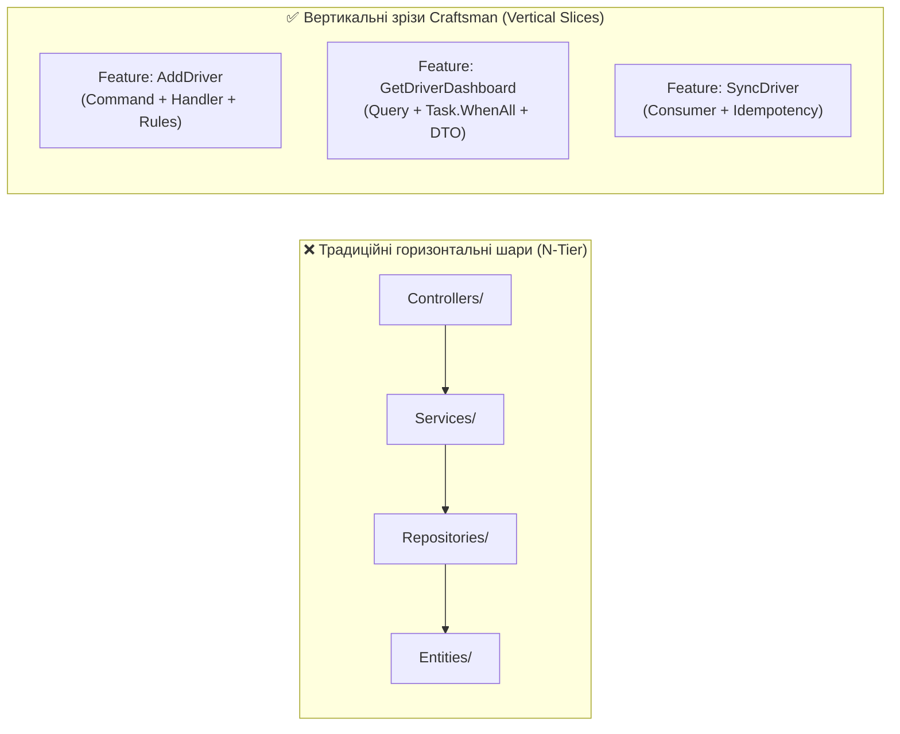

# 🏛️ 01. Патерни мікросервісної архітектури: Clean Architecture, CQRS (MediatR) та Bounded Contexts

> **Блок 2:** `02-Microservices-Craftsman`  
> **Технологічний стек:** .NET 10, Craftsman CLI Scaffolding, MediatR 12.2.0 (CQRS), Entity Framework Core 8.0, Domain-Driven Design (DDD), FluentValidation, HeimGuard (RBAC).

---

## 1. Теоретична концепція: Від моноліту до розподіленої архітектури

У **Блоці 1 (`01-Ntier-Drivers`)** було реалізовано класичну **багатошарову архітектуру (N-Tier Monolith)**:
* Єдина спільна база даних `DriversManagement`.
* Горизонтальні монолітні шари: `DAL (ADO.NET / EF Core) ➔ BLL ➔ Web API ➔ WPF Presentation`.
* Будь-яка зміна структури таблиць чи збій у роботі шару BLL зачіпав усю систему цілком.

У **Блоці 2 (`02-Microservices-Craftsman`)** ми переходимо до **розподіленої мікросервісної архітектури (Distributed Microservices)**, згенерованої за допомогою інструменту інженерного проєктування **Craftsman**.

### 📌 Головні архітектурні стовпи Блоку 2:
1. **Ізоляція баз даних (Database-per-Service):** Кожен сервіс володіє власною фізичною або логічною базою даних. Прямі міжсервісні SQL `JOIN` категорично заборонені.
2. **Обмежені контексти (Bounded Contexts з DDD):** Єдина сутність реального світу (наприклад, водій вантажівки) проектується в кожному сервісі по-різному, залежно від його бізнес-завдань.
3. **Вертикальні зрізи (Vertical Slice Architecture):** Замість розмазування коду фічі по горизонтальних шарах `Controllers/`, `Services/`, `Repositories/`, код кожної операції згрупований у єдиний файл `Feature`.
4. **Розділення команд і запитів (CQRS через MediatR):** Чітке розмежування операцій зміни стану (Commands) та операцій читання даних (Queries).

---

## 2. Візуальна архітектура системи

### 2.1. Топологія трьох Bounded Contexts та їхня взаємодія


---

## 3. Аналогія з реального життя: Департаменти великої логістичної корпорації

* **Моноліт (Блок 1)** схожий на один спільний open-space офіс із загальним паперовим архівом. Будь-який співробітник будь-якого відділу може підійти до однієї шафи з папками. Якщо шафа загориться або хтось випадково пошкодить журнал — зупиняється вся компанія.
* **Мікросервіси (Блок 2)** схожі на окремі спеціалізовані підрозділи:
  1. **Відділ кадрів (`DriversManagement`)**: веде повне досьє працівника (паспорт, категорія посвідчення, медогляд, нарахування витрат, закріплена вантажівка).
  2. **Диспетчерський центр замовлень (`CargoOrderingService`)**: оформлює товарно-транспортні накладні, рейси та доставку. Диспетчеру не потрібні дані про сімейний стан водія чи його витрати на ремонт авто — йому потрібні лише `Id`, ПІБ, телефон і категорія прав.
  3. **Корпоративний блог (`DriversBlogManagement`)**: публікує статті, новини доріг та збирає лайки від колег.
  
Кожен відділ має **свій власний закритий сейф (Database-per-Service)**. Жоден співробітник не має прямого ключа від сейфа іншого відділу — взаємодія відбувається виключно через офіційні телефонні запити (**gRPC / HTTP**) або інформаційні бюлетені (**RabbitMQ**).

---

## 4. Концепція Bounded Contexts у Domain-Driven Design (DDD)

Найчастіша помилка архітекторів-початківців — спроба винести єдину загальну таблицю `Drivers` в окрему бібліотеку і шерити її між усіма мікросервісами. Це призводить до найгіршого антипатерну — **Розподіленого моноліту (Distributed Monolith)**.

У DDD модель даних підпорядковується бізнес-контексту:

| Мікросервіс | Роль сутності водія | Які поля містить модель | Посилання на вихідний код проєкту |
| :--- | :--- | :--- | :--- |
| **`DriversManagement`** | **Rich Aggregate Root** (Повний агрегат) | Повне досьє: `FirstName`, `LastName`, `DriverLicenseNumber`, `Birthdate`, `Gender`, `Company`, `Truck`, `Expences`, `Photo` | > 🔘 **[👉 Відкрити файл: `Driver.cs` (DriversManagement)](file:///c:/Users/Yurii/source/repos/Demo-CargoDeliveryService/02-Microservices-Craftsman/DriversManagement/src/DriversManagement/Domain/Drivers/Driver.cs)**<br/>*Шлях: `DriversManagement/Domain/Drivers/Driver.cs`* |
| **`CargoOrderingService`** | **Logistics Shadow Model** (Тіньова копія) | Тільки логістичні атрибути: `Id`, `FirstName`, `LastName`, `DriverLicenseNumber`, `Phone`, зв'язок із `Deliveries` та `Orders` | > 🔘 **[👉 Відкрити файл: `Driver.cs` (CargoOrderingService)](file:///c:/Users/Yurii/source/repos/Demo-CargoDeliveryService/02-Microservices-Craftsman/CargoOrderingService/src/CargoOrderingService/Domain/Drivers/Driver.cs)**<br/>*Шлях: `CargoOrderingService/Domain/Drivers/Driver.cs`* |
| **`DriversBlogManagement`** | **Social Shadow Model** (Соціальна копія) | Тільки публічні реквізити автора: `Id`, `FirstName`, `LastName`, колекція публікацій `PostAboutDrivers` та `Likes` | > 🔘 **[👉 Відкрити файл: `Driver.cs` (DriversBlogManagement)](file:///c:/Users/Yurii/source/repos/Demo-CargoDeliveryService/02-Microservices-Craftsman/DriversBlogManagement/src/DriversBlogManagement/Domain/Drivers/Driver.cs)**<br/>*Шлях: `DriversBlogManagement/Domain/Drivers/Driver.cs`* |

> [!IMPORTANT]
> **Автономність даних:** Якщо мікросервіс `DriversManagement` вимкнеться для технічного обслуговування, сервіс `CargoOrderingService` **продовжує повноцінно працювати**, тому що всі потрібні водії вже репліковані у його власну таблицю `OrderingContext.Drivers`!

---

## 5. Горизонтальні шари проти Вертикальних зрізів (Vertical Slice Architecture)

Класична N-Tier архітектура вимагає створювати зміни у 4-5 різних папках при додаванні одного поля (Controller ➔ Service Interface ➔ Service Impl ➔ Repository ➔ Entity).

Craftsman організовує код за принципом **Vertical Slice Architecture** за допомогою бібліотеки **MediatR**:

```
02-Microservices-Craftsman/DriversManagement/Domain/Drivers/Features/
├── 📄 AddDriver.cs          <-- Команда створення (Command + Handler + Validator в одному місці)
├── 📄 UpdateDriver.cs       <-- Команда оновлення досьє
├── 📄 DeleteDriver.cs       <-- Команда видалення
├── 📄 GetDriver.cs          <-- Запит одиничного водія з gRPC підвантаженням постів
├── 📄 GetDriverList.cs      <-- Запит списку водіїв з пагінацією
└── 📄 GetDriverDashboard.cs <-- Запит зведеного дашборду (BFF Aggregator)
```

### Порівняльна схема організації коду:



---

## 6. Ключові файли реалізації та перехід до вихідного коду

Кожен файл у проєкті містить докладні коментарі українською мовою з детальним поясненням принципів Clean Architecture:

1. **Базовий агрегат водія:**
   > 🔘 **[👉 Відкрити файл: `Driver.cs`](file:///c:/Users/Yurii/source/repos/Demo-CargoDeliveryService/02-Microservices-Craftsman/DriversManagement/src/DriversManagement/Domain/Drivers/Driver.cs)**  
   *Інкапсуляція бізнес-правил, закриті сеттери, фабричний метод `Driver.Create()`, валідація віку та посвідчення.*

2. **Команда додавання водія з публікацією в шину:**
   > 🔘 **[👉 Відкрити файл: `AddDriver.cs`](file:///c:/Users/Yurii/source/repos/Demo-CargoDeliveryService/02-Microservices-Craftsman/DriversManagement/src/DriversManagement/Domain/Drivers/Features/AddDriver.cs)**  
   *Поєднання транзакційного збереження в EF Core з публікацією події `IDriverCreated` через MassTransit.*

3. **Запит водія із синхронним gRPC клієнтом:**
   > 🔘 **[👉 Відкрити файл: `GetDriver.cs`](file:///c:/Users/Yurii/source/repos/Demo-CargoDeliveryService/02-Microservices-Craftsman/DriversManagement/src/DriversManagement/Domain/Drivers/Features/GetDriver.cs)**  
   *Виклик локальної БД та швидкий віддалений RPC-дзвінок до блогу з обробкою часткової відмови.*

4. **Агрегатор аналітичної панелі водія (BFF):**
   > 🔘 **[👉 Відкрити файл: `GetDriverDashboard.cs`](file:///c:/Users/Yurii/source/repos/Demo-CargoDeliveryService/02-Microservices-Craftsman/DriversManagement/src/DriversManagement/Domain/Drivers/Features/GetDriverDashboard.cs)**  
   *Паралельне опитування мікросервісів через `Task.WhenAll` з використанням типізованих HTTP-клієнтів.*

5. **Головний API-контролер водіїв:**
   > 🔘 **[👉 Відкрити файл: `DriversController.cs`](file:///c:/Users/Yurii/source/repos/Demo-CargoDeliveryService/02-Microservices-Craftsman/DriversManagement/src/DriversManagement/Controllers/v1/DriversController.cs)**  
   *REST-ендпоінти, пагінація, передача команд через MediatR `_mediator.Send()`.*

---

## 7. Чеклист: Як додати нову бізнес-фічу за стандартами Craftsman

- [ ] **1. Визначте операцію:** це зміна стану (`Command : IRequest<TResponse>`) чи запит даних (`Query : IRequest<TResponse>`).
- [ ] **2. Створіть файл у папці `Features`:** наприклад, `ApproveDriverMedicalCheck.cs`.
- [ ] **3. Опишіть валідатор FluentValidation:** перевірте обов'язкові поля, формати дат, діапазони значень.
- [ ] **4. Реалізуйте Handler:** впровадьте репозиторій або DbContext, виконайте бізнес-логіку.
- [ ] **5. Зареєструйте контролер:** додайте тонкий метод дії (Action), який викликає `await _mediator.Send(command)`.
- [ ] **6. Покрийте тестами:** напишіть модульний тест у проєкті `.UnitTests` за допомогою бібліотеки Bogus.
