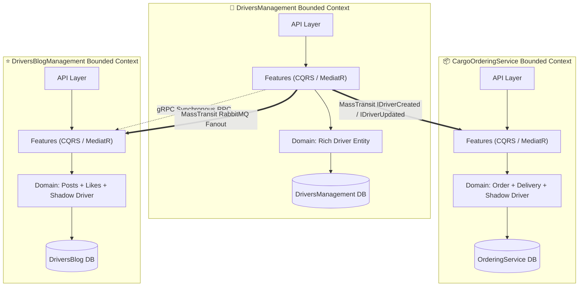

# 🏛️ 01. Патерни мікросервісної архітектури: Clean Architecture, CQRS (MediatR) та Bounded Contexts

> **Блок 2:** `02-Microservices-Craftsman`  
> **Технологічний стек:** .NET 10 / .NET 7, Craftsman CLI, MediatR (CQRS), Entity Framework Core, Bounded Contexts, FluentValidation.

---

## 1. Теоретична концепція: Від моноліту до розподілених сервісів

У **Блоці 1 (`01-Ntier-Drivers`)** ми розглядали класичну монолітну **багатошарову архітектуру (N-Tier)**: єдина база даних `DriversManagement`, єдине рішення, розділене горизонтально на шари `DAL -> BLL -> API -> Presentation`.

У **Блоці 2 (`02-Microservices-Craftsman`)** реалізовано кардинально іншу парадигму — **Розподілену мікросервісну архітектуру (Microservices Architecture)**, згенеровану через інструмент інженерного скаффолдингу **Craftsman**.

### Ключові архітектурні принципи:

---

## 2. Аналогія з реального життя: Незалежні департаменти корпорації

* **Моноліт (Блок 1)** схожий на один спільний офіс із загальним паперовим архівом. Будь-який співробітник будь-якого відділу може підійти до однієї шафи з папками. Якщо шафа загориться або хтось випадково порве документ — паралізується робота всієї компанії.
* **Мікросервіси (Блок 2)** схожі на мережу незалежних філій міжнародної корпорації:
  1. **Відділ кадрів (`DriversManagement`)**: веде повне досьє працівника (паспорт, права, категорія, медогляд, зарплата).
  2. **Логістичний центр замовлень (`CargoOrderingService`)**: оформлює вантажні накладні та доставку. Йому не потрібна інформація про сімейний стан водія чи його медичні довідки — йому потрібні лише `DriverId`, ім'я та телефон для зв'язку під час рейсу.
  3. **Прес-центр / Блог відгуків (`DriversBlogManagement`)**: публікує статті про водіїв та збирає лайки.
  
Кожен відділ має **свій власний закритий сейф (Database-per-Service)**. Жоден відділ не має прямого ключа від сейфа іншого відділу — взаємодія відбувається виключно через офіційні запити (gRPC) або інформаційні циркуляри (RabbitMQ).

---

## 3. Bounded Contexts (Обмежені контексти) у Domain-Driven Design (DDD)

Головна помилка при переході на мікросервіси — намагатися створити одну «універсальну» сутність `Driver` на всю систему. У DDD кожен контекст визначає модель так, як це необхідно для його специфічної бізнес-задачі:

| Мікросервіс | Роль сутності `Driver` | Поля та обов'язки | Файл у репозиторії |
| :--- | :--- | :--- | :--- |
| **`DriversManagement`** | **Rich Domain Aggregate Root** | Повне досьє: посвідчення, категорія, дата видачі, фото, витрати, компанія, прийом на роботу | [`Driver.cs`](file:///c:/Users/Yurii/source/repos/Demo-CargoDeliveryService/02-Microservices-Craftsman/DriversManagement/src/DriversManagement/Domain/Drivers/Driver.cs) |
| **`DriversBlogManagement`** | **Social Shadow Model** | Ім'я, прізвище, колекція лайків (`Likes`) та пости про водія (`PostAboutDriver`) | [`Driver.cs`](file:///c:/Users/Yurii/source/repos/Demo-CargoDeliveryService/02-Microservices-Craftsman/DriversBlogManagement/src/DriversBlogManagement/Domain/Drivers/Driver.cs) |
| **`CargoOrderingService`** | **Logistics Shadow Model** | Ім'я, телефон, номер посвідчення, закріплені замовлення (`Orders`) та доставки (`Deliveries`) | [`Driver.cs`](file:///c:/Users/Yurii/source/repos/Demo-CargoDeliveryService/02-Microservices-Craftsman/CargoOrderingService/src/CargoOrderingService/Domain/Drivers/Driver.cs) |

> [!IMPORTANT]
> **Database-per-Service:** Жоден сервіс не робить SQL `JOIN` до таблиці іншого сервісу. Реплікація потрібних полів відбувається асинхронно через шину повідомлень (Eventual Consistency), гарантуючи повну автономність та ізоляцію збоїв.

---

## 4. Вертикальні зрізи (Vertical Slices) та CQRS через MediatR

Замість того, щоб розпорошувати логіку сутності по горизонтальних папках `Controllers/`, `Services/`, `Repositories/`, проекти Craftsman використовують **Vertical Slice Architecture** всередині Clean Architecture:

Кожна бізнес-операція ізольована у власний окремий файл (Feature):
* **Команди (Commands - зміна стану)**:
  - [`AddDriver.cs`](file:///c:/Users/Yurii/source/repos/Demo-CargoDeliveryService/02-Microservices-Craftsman/DriversManagement/src/DriversManagement/Domain/Drivers/Features/AddDriver.cs) — створення водія + публікація в шину.
  - [`UpdateDriver.cs`](file:///c:/Users/Yurii/source/repos/Demo-CargoDeliveryService/02-Microservices-Craftsman/DriversManagement/src/DriversManagement/Domain/Drivers/Features/UpdateDriver.cs) — модифікація досьє водія + публікація оновлення.
  - [`AddOrder.cs`](file:///c:/Users/Yurii/source/repos/Demo-CargoDeliveryService/02-Microservices-Craftsman/CargoOrderingService/src/CargoOrderingService/Domain/Orders/Features/AddOrder.cs) — створення замовлення на перевезення.
* **Запити (Queries - читання без мутації)**:
  - [`GetDriver.cs`](file:///c:/Users/Yurii/source/repos/Demo-CargoDeliveryService/02-Microservices-Craftsman/DriversManagement/src/DriversManagement/Domain/Drivers/Features/GetDriver.cs) — зчитування водія з БД + оркестрація gRPC-виклику до мікросервісу блогів.
  - [`GetDriverList.cs`](file:///c:/Users/Yurii/source/repos/Demo-CargoDeliveryService/02-Microservices-Craftsman/DriversManagement/src/DriversManagement/Domain/Drivers/Features/GetDriverList.cs) — пагінована вибірка.

---

## 5. Порівняльна таблиця: Моноліт (Блок 1) vs Мікросервіси Craftsman (Блок 2)

| Критерій | N-Tier Моноліт (`01-Ntier-Drivers`) | Мікросервіси (`02-Microservices-Craftsman`) |
| :--- | :--- | :--- |
| **База даних** | Спільна (`DriversManagement`) | Окрема для кожного сервісу (Database-per-Service) |
| **Зв'язність коду** | Сильна (In-process виклики DLL) | Слабка (Network boundaries: gRPC / RabbitMQ) |
| **Організація коду** | Горизонтальні шари (DAL, BLL, API) | Вертикальні зрізи за фічами (CQRS MediatR Features) |
| **Масштабованість** | Тільки все рішення цілком | Окреме масштабування сервісу замовлень або блогу |
| **Точка відмови (SPOF)**| Падіння БД або процесу зупиняє все | Збій блогу не заважає прийому замовлень (Fault Isolation) |
| **Узгодженість даних**| Миттєва ACID транзакція | Eventual Consistency через черги повідомлень |

---

## 6. Швидка навігація по коду

- 📦 [`SharedKernel`](file:///c:/Users/Yurii/source/repos/Demo-CargoDeliveryService/02-Microservices-Craftsman/SharedKernel/SharedKernel.csproj) — спільне ядро контрактів повідомлень.
- 🚚 [`DriversManagement.csproj`](file:///c:/Users/Yurii/source/repos/Demo-CargoDeliveryService/02-Microservices-Craftsman/DriversManagement/src/DriversManagement/DriversManagement.csproj) — мікросервіс водіїв.
- 📦 [`CargoOrderingService.csproj`](file:///c:/Users/Yurii/source/repos/Demo-CargoDeliveryService/02-Microservices-Craftsman/CargoOrderingService/src/CargoOrderingService/CargoOrderingService.csproj) — мікросервіс замовлень.
- 📝 [`DriversBlogManagement.csproj`](file:///c:/Users/Yurii/source/repos/Demo-CargoDeliveryService/02-Microservices-Craftsman/DriversBlogManagement/src/DriversBlogManagement/DriversBlogManagement.csproj) — мікросервіс блогу.
