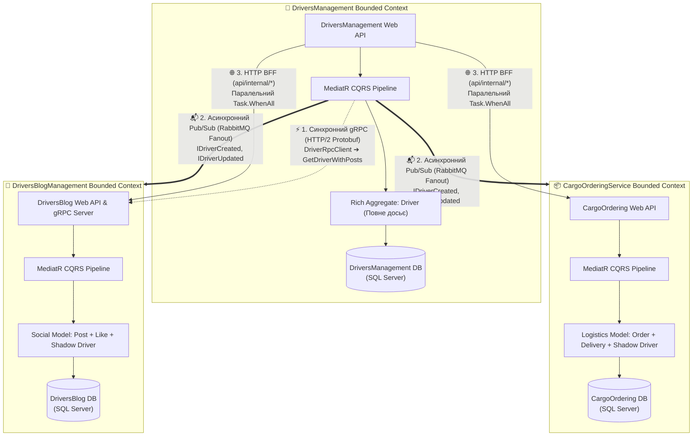
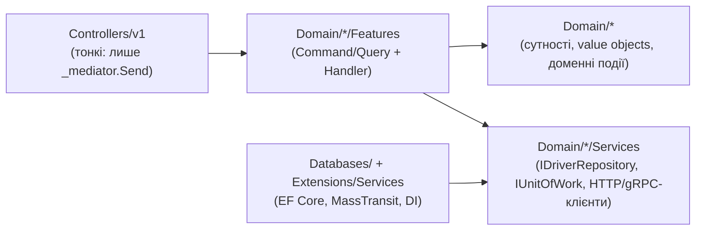
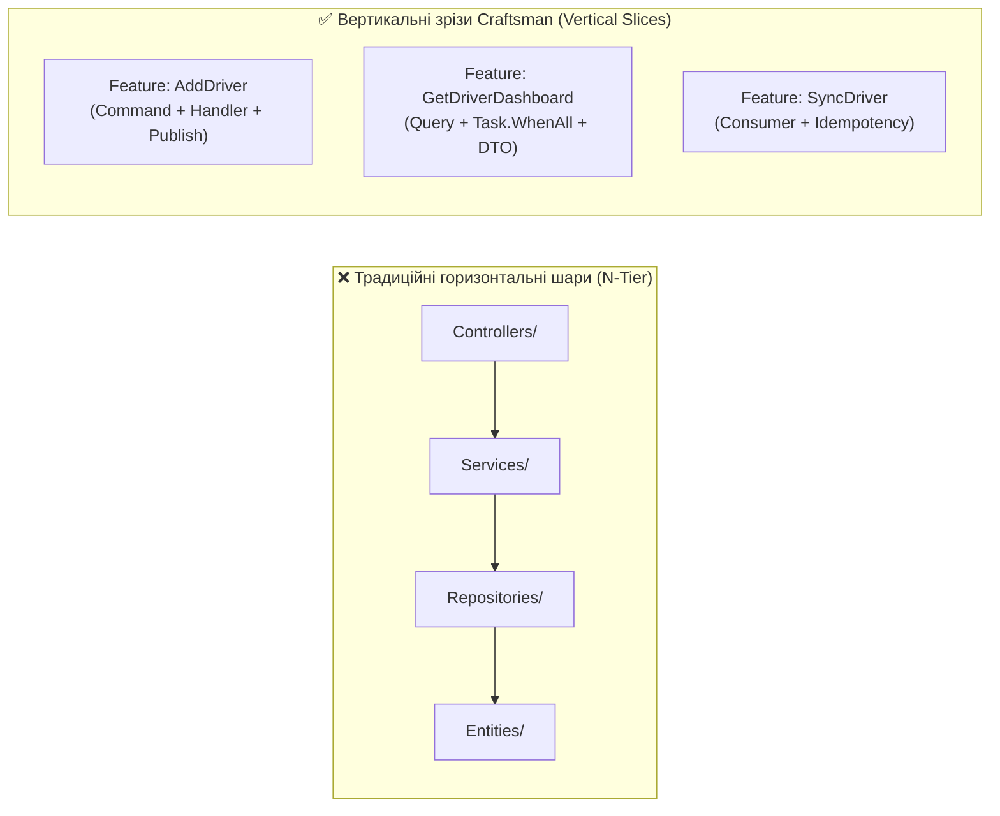
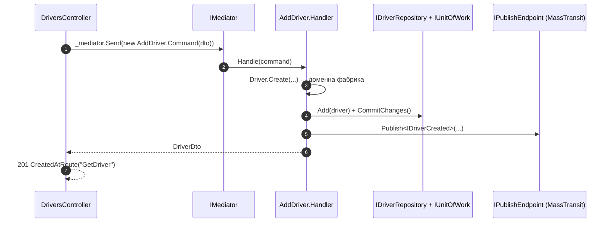

# 🏛️ 01. Патерни мікросервісної архітектури: Clean Architecture, CQRS (MediatR) та Bounded Contexts

> **Блок 2:** `02-Microservices-Craftsman`  
> **Технологічний стек:** .NET 10, Craftsman CLI Scaffolding, MediatR 12.2.0 (CQRS), Entity Framework Core 8.0 (SQL Server), Domain-Driven Design (DDD), HeimGuard (RBAC — у навчальному стенді вимкнено, див. §7), Mapperly.  
> **Як читати посилання:** `Файл.cs#L42` відкриває файл на потрібному рядку (VS Code Markdown Preview — `Ctrl+Shift+V`; GitHub підсвічує рядок).

---

## 📑 Зміст

- [1. Теоретична концепція: Від моноліту до розподіленої архітектури](#s1)
- [2. Візуальна архітектура системи](#s2)
- [3. Аналогія з реального життя: Департаменти великої логістичної корпорації](#s3)
- [4. Концепція Bounded Contexts у Domain-Driven Design (DDD)](#s4)
- [5. Горизонтальні шари проти Вертикальних зрізів (Vertical Slice Architecture)](#s5)
- [6. CQRS через MediatR: шлях одного запиту крізь код](#s6)
- [7. Ключові файли реалізації та перехід до вихідного коду](#s7)
- [8. Чеклист: Як додати нову бізнес-фічу за стандартами Craftsman](#s8)
- [9. Контрольні запитання](#s9)

---

<a id="s1"></a>
## 1. Теоретична концепція: Від моноліту до розподіленої архітектури

У **Блоці 1 (`01-Ntier-Drivers`)** було реалізовано класичну **багатошарову архітектуру (N-Tier Monolith)**:
* Єдина спільна база даних `DriversManagement`.
* Горизонтальні монолітні шари: `DAL (ADO.NET / EF Core) ➔ BLL ➔ Web API ➔ WPF Presentation`.
* Будь-яка зміна структури таблиць чи збій у роботі шару BLL зачіпав усю систему цілком.

У **Блоці 2 (`02-Microservices-Craftsman`)** ми переходимо до **розподіленої мікросервісної архітектури (Distributed Microservices)**, згенерованої за допомогою інструменту інженерного проєктування **Craftsman**.

### 📌 Головні архітектурні стовпи Блоку 2:
1. **Ізоляція баз даних (Database-per-Service):** Кожен сервіс володіє власною фізичною або логічною базою даних. Прямі міжсервісні SQL `JOIN` категорично заборонені.
2. **Обмежені контексти (Bounded Contexts з DDD):** Єдина сутність реального світу (наприклад, водій вантажівки) проектується в кожному сервісі по-різному, залежно від його бізнес-завдань.
3. **Вертикальні зрізи (Vertical Slice Architecture):** Замість розмазування коду фічі по горизонтальних шарах `Controllers/`, `Services/`, `Repositories/`, код кожної операції згрупований у єдиний файл `Feature`.
4. **Розділення команд і запитів (CQRS через MediatR):** Чітке розмежування операцій зміни стану (Commands) та операцій читання даних (Queries).

### Чому мікросервіси — це не «безкоштовно»
| Виграємо | Платимо |
| :--- | :--- |
| Незалежне розгортання та масштабування кожного домену | Мережа між сервісами: затримки, часткові збої, таймаути ([02-01 гайд 06](../02-01-Aspire-Documentation/06_ServiceDiscovery_Resilience_Polly_HttpClient.md)) |
| Ізоляція відмов: падіння блогу не кладе облік водіїв | Дані дублюються (тіньові копії) і узгоджуються **з затримкою** (Eventual Consistency, [гайд 04](04_Patterns_Asynchronous_Messaging_MassTransit_RabbitMQ.md)) |
| Команди працюють автономно, кожна — зі своєю моделлю | Потрібна інфраструктура: оркестрація, трасування, discovery ([модуль 02-01](../02-01-Aspire-Documentation/README.md)) |

> 🧭 **Закон Конвея:** архітектура системи повторює структуру комунікацій організації. Три сервіси = три «команди» (відділ кадрів, диспетчерська, корпоративний блог), кожна з власною мовою і власними даними.

---

<a id="s2"></a>
## 2. Візуальна архітектура системи

### 2.1. Топологія трьох Bounded Contexts та їхня взаємодія



### 2.2. Шари Clean Architecture всередині одного сервісу
Craftsman розкладає кожен сервіс на концентричні кола, де залежності спрямовані **всередину** (Dependency Rule):


* **Domain** не знає про EF Core, HTTP чи RabbitMQ — лише про бізнес-правила.
* **Features** оркеструють сценарій через абстракції (`IDriverRepository`, `IPublishEndpoint`, `ICargoOrderingApiClient`).
* **Infrastructure** реалізує абстракції і реєструється в DI ([InfrastructureServiceExtension.cs](../DriversManagement/src/DriversManagement/Extensions/Services/InfrastructureServiceExtension.cs), [WebAppServiceConfiguration.cs](../DriversManagement/src/DriversManagement/Extensions/Services/WebAppServiceConfiguration.cs)).

---

<a id="s3"></a>
## 3. Аналогія з реального життя: Департаменти великої логістичної корпорації

* **Моноліт (Блок 1)** схожий на один спільний open-space офіс із загальним паперовим архівом. Будь-який співробітник будь-якого відділу може підійти до однієї шафи з папками. Якщо шафа загориться або хтось випадково пошкодить журнал — зупиняється вся компанія.
* **Мікросервіси (Блок 2)** схожі на окремі спеціалізовані підрозділи:
  1. **Відділ кадрів (`DriversManagement`)**: веде повне досьє працівника (паспорт, категорія посвідчення, медогляд, нарахування витрат, закріплена вантажівка).
  2. **Диспетчерський центр замовлень (`CargoOrderingService`)**: оформлює товарно-транспортні накладні, рейси та доставку. Диспетчеру не потрібні дані про сімейний стан водія чи його витрати на ремонт авто — йому потрібні лише `Id`, ПІБ, телефон і номер посвідчення.
  3. **Корпоративний блог (`DriversBlogManagement`)**: публікує статті, новини доріг та збирає лайки від колег.
  
Кожен відділ має **свій власний закритий сейф (Database-per-Service)**. Жоден співробітник не має прямого ключа від сейфа іншого відділу — взаємодія відбувається виключно через офіційні телефонні запити (**gRPC / HTTP**) або інформаційні бюлетені (**RabbitMQ**).

---

<a id="s4"></a>
## 4. Концепція Bounded Contexts у Domain-Driven Design (DDD)

Найчастіша помилка архітекторів-початківців — спроба винести єдину загальну таблицю `Drivers` в окрему бібліотеку і шерити її між усіма мікросервісами. Це призводить до найгіршого антипатерну — **Розподіленого моноліту (Distributed Monolith)**.

> 🐞 **Реальний приклад із цього проєкту.** DriversManagement колись мав `ProjectReference` на весь проєкт DriversBlogManagement (заради gRPC-типів і DTO постів). Наслідок: у процес DriversManagement завантажувались **контролери блогу**, і маршрут `/api/drivers` давав `AmbiguousMatchException` (два контролери з однаковим маршрутом). Тепер спільний лише контракт `Driver.proto`, а DTO поста — власний ([PostAboutDriverDto.cs](../DriversManagement/src/DriversManagement/Domain/Drivers/Dtos/PostAboutDriverDto.cs)). Сервіси діляться **контрактами**, а не **кодом**.

У DDD модель даних підпорядковується бізнес-контексту:

| Мікросервіс | Роль сутності водія | Які поля містить модель | Посилання на вихідний код проєкту |
| :--- | :--- | :--- | :--- |
| **`DriversManagement`** | **Rich Aggregate Root** (Повний агрегат, джерело правди) | Повне досьє: `FirstName`, `LastName`, `DriverLicenseNumber`, `Birthdate`, `Gender`, `Company`, `Photo`, `Expences` та ін. | [👉 **`Driver.cs`**](../DriversManagement/src/DriversManagement/Domain/Drivers/Driver.cs) — фабрика `Create` [#L67](../DriversManagement/src/DriversManagement/Domain/Drivers/Driver.cs#L67) |
| **`CargoOrderingService`** | **Logistics Shadow Model** (Тіньова копія) | Тільки логістичні атрибути: `Id`, `FirstName`, `LastName`, `DriverLicenseNumber`, `Phone`, зв'язок із `Deliveries` та `Orders` | [👉 **`Driver.cs`**](../CargoOrderingService/src/CargoOrderingService/Domain/Drivers/Driver.cs) — `CreateWithId` [#L31](../CargoOrderingService/src/CargoOrderingService/Domain/Drivers/Driver.cs#L31) |
| **`DriversBlogManagement`** | **Social Shadow Model** (Соціальна копія) | Тільки публічні реквізити автора: `Id`, `FirstName`, `LastName`, `Likes` і пов'язаний `PostAboutDriver` | [👉 **`Driver.cs`**](../DriversBlogManagement/src/DriversBlogManagement/Domain/Drivers/Driver.cs) — `CreateWithId` [#L34](../DriversBlogManagement/src/DriversBlogManagement/Domain/Drivers/Driver.cs#L34) |

> [!IMPORTANT]
> **Автономність даних:** Якщо мікросервіс `DriversManagement` вимкнеться для технічного обслуговування, сервіс `CargoOrderingService` **продовжує повноцінно працювати**, тому що всі потрібні водії вже репліковані у його власну таблицю `drivers`!

### Чому тіньова копія має той самий `Id`
Тіньовий водій створюється з **ідентифікатором оригіналу** (`CreateWithId(msg.DriverId, ...)`) — це «ключ кореляції» між контекстами: агрегатор питає доставки за тим самим `driverId`, за яким шукав водія в DriversManagement.

> 🐞 **Пастка моделі Craftsman (виправлено).** Зв'язки «один-до-одного» були згенеровані зі **спільним первинним ключем** (`HasForeignKey<Driver>(s => s.Id)`): у DriversManagement `Driver.Id` мусив дорівнювати `Company.Id` **і** `Photo.Id` (вставка неможлива), а в блозі EF Core підміняв `Id` тіньового водія на `Id` порожнього поста — і кореляція ламалась. Тепер залежною стороною є `Company`/`Photo`/`PostAboutDriver` з окремою колонкою `driver_id` ([DM DriverConfiguration.cs](../DriversManagement/src/DriversManagement/Databases/EntityConfigurations/DriverConfiguration.cs), [Blog DriverConfiguration.cs](../DriversBlogManagement/src/DriversBlogManagement/Databases/EntityConfigurations/DriverConfiguration.cs)) + нові EF-міграції. Модель блогу досі має обмеження «один пост на водія» — це вже питання доменного дизайну, а не інфраструктури.

### Context Map: як контексти пов'язані
| Відношення (DDD) | Між ким | Як реалізовано |
| :--- | :--- | :--- |
| **Upstream → Downstream (Published Language)** | DriversManagement → Blog, Ordering | Події `IDriverCreated` / `IDriverUpdated` у SharedKernel — спільна «опублікована мова» |
| **Customer–Supplier (Open Host Service)** | DriversManagement → Blog | gRPC-контракт `Driver.proto`: блог надає сервіс, DM — споживач |
| **Anti-Corruption Layer** | HttpAggregator / BFF ↔ усі | Агрегатор перекладає внутрішні моделі у власні DTO (`AggregatedDriverDto`, `AggregatedDeliveryDto`) |

---

<a id="s5"></a>
## 5. Горизонтальні шари проти Вертикальних зрізів (Vertical Slice Architecture)

Класична N-Tier архітектура вимагає створювати зміни у 4-5 різних папках при додаванні одного поля (Controller ➔ Service Interface ➔ Service Impl ➔ Repository ➔ Entity).

Craftsman організовує код за принципом **Vertical Slice Architecture** за допомогою бібліотеки **MediatR**:

```
02-Microservices-Craftsman/DriversManagement/src/DriversManagement/Domain/Drivers/Features/
├── 📄 AddDriver.cs          <-- Команда створення (Command + Handler) + публікація IDriverCreated
├── 📄 UpdateDriver.cs       <-- Команда оновлення досьє + публікація IDriverUpdated
├── 📄 DeleteDriver.cs       <-- Команда видалення
├── 📄 GetDriver.cs          <-- Запит одиничного водія з gRPC підвантаженням постів
├── 📄 GetDriverList.cs      <-- Запит списку водіїв з пагінацією, фільтрацією, сортуванням
├── 📄 GetAllDrivers.cs      <-- Запит усіх водіїв без пагінації
└── 📄 GetDriverDashboard.cs <-- Запит зведеного дашборду (BFF Aggregator)
```

### Порівняльна схема організації коду:



**Чому зрізи зручніші для мікросервісів:** зміна однієї операції торкається одного файлу; дві фічі не ділять «сервісний клас» на 2000 рядків; легко видалити або переписати фічу, не зачепивши інші. Платимо деяким дублюванням (кожен Handler сам робить запит до репозиторію) — і це свідомий компроміс на користь незалежності.

---

<a id="s6"></a>
## 6. CQRS через MediatR: шлях одного запиту крізь код

**CQRS (Command Query Responsibility Segregation)** розділяє операції на два типи з різними гарантіями:

| | Command (`AddDriver`, `UpdateDriver`) | Query (`GetDriver`, `GetDriverList`) |
| :--- | :--- | :--- |
| Змінює стан? | Так | Ні |
| Що повертає | Мінімум (створений DTO / нічого) | Дані для відображення |
| Побічні ефекти | Публікація доменних подій у RabbitMQ | Немає (лише читання, `AsNoTracking`) |
| Можна кешувати / повторювати? | Обережно (ідемпотентність!) | Так |

### Шлях `POST /api/drivers` у коді

* Контролер: [DriversController.cs#L88](../DriversManagement/src/DriversManagement/Controllers/v1/DriversController.cs#L88) — лише формує команду і викликає `_mediator.Send`.
* Обробник: [AddDriver.cs#L70](../DriversManagement/src/DriversManagement/Domain/Drivers/Features/AddDriver.cs#L70) — створення агрегату, збереження ([#L81](../DriversManagement/src/DriversManagement/Domain/Drivers/Features/AddDriver.cs#L81)), публікація події ([#L85](../DriversManagement/src/DriversManagement/Domain/Drivers/Features/AddDriver.cs#L85)).

> 💡 **Навіщо посередник (Mediator)?** Контролер не знає, хто і як обробить команду. Це дозволяє додавати наскрізну поведінку (логування, транзакції, валідацію) через `IPipelineBehavior<,>` без зміни обробників. У поточному коді Craftsman pipeline-поведінок не підключено — це гарне місце для розширення (наприклад, FluentValidation-валідатора команд).

---

<a id="s7"></a>
## 7. Ключові файли реалізації та перехід до вихідного коду

Кожен файл у проєкті містить докладні коментарі українською мовою з поясненням принципів Clean Architecture:

1. **Базовий агрегат водія:**
   > 📍 **Шлях до файлу:** `DriversManagement/src/DriversManagement/Domain/Drivers/Driver.cs`  
   *Закриті сеттери (`private set`), фабричний метод `Driver.Create()` ([#L67](../DriversManagement/src/DriversManagement/Domain/Drivers/Driver.cs#L67)), постановка доменної події `DriverCreated` у чергу.*  
   *Чесна примітка:* бізнес-валідації (вік, термін дії посвідчення) у фабриці поки немає — це гарне практичне завдання.

   [👉 **Перейти до файлу (клікніть тут)**](../DriversManagement/src/DriversManagement/Domain/Drivers/Driver.cs)

2. **Команда додавання водія з публікацією в шину:**
   > 📍 **Шлях до файлу:** `DriversManagement/src/DriversManagement/Domain/Drivers/Features/AddDriver.cs`  
   *Поєднання транзакційного збереження в EF Core з публікацією події `IDriverCreated` через MassTransit.*

   [👉 **Перейти до файлу (клікніть тут)**](../DriversManagement/src/DriversManagement/Domain/Drivers/Features/AddDriver.cs#L70)

3. **Запит водія із синхронним gRPC клієнтом:**
   > 📍 **Шлях до файлу:** `DriversManagement/src/DriversManagement/Domain/Drivers/Features/GetDriver.cs`  
   *Виклик локальної БД та швидкий віддалений RPC-дзвінок до блогу з обробкою часткової відмови.*

   [👉 **Перейти до файлу (клікніть тут)**](../DriversManagement/src/DriversManagement/Domain/Drivers/Features/GetDriver.cs#L81)

4. **Агрегатор аналітичної панелі водія (BFF):**
   > 📍 **Шлях до файлу:** `DriversManagement/src/DriversManagement/Domain/Drivers/Features/GetDriverDashboard.cs`  
   *Паралельне опитування мікросервісів через `Task.WhenAll` з використанням типізованих HTTP-клієнтів.*

   [👉 **Перейти до файлу (клікніть тут)**](../DriversManagement/src/DriversManagement/Domain/Drivers/Features/GetDriverDashboard.cs#L82)

5. **Головний API-контролер водіїв:**
   > 📍 **Шлях до файлу:** `DriversManagement/src/DriversManagement/Controllers/v1/DriversController.cs`  
   *REST-ендпоінти (`/api/drivers`), пагінація, передача команд через MediatR `_mediator.Send()`.*

   [👉 **Перейти до файлу (клікніть тут)**](../DriversManagement/src/DriversManagement/Controllers/v1/DriversController.cs)

### 🔐 Авторизація в навчальному стенді
Craftsman генерує два рівні захисту: атрибут `[Authorize]` на кожному ендпоінті (JWT від Keycloak) і перевірку дозволів у кожному обробнику (`await _heimGuard.MustHavePermission<ForbiddenAccessException>(Permissions.CanAddDriver)`). Оскільки Keycloak у стенді не запускається, **обидва рівні закоментовано** з маркером `// [AUTH-DISABLED]` (наприклад, [AddDriver.cs#L73](../DriversManagement/src/DriversManagement/Domain/Drivers/Features/AddDriver.cs#L73)), а реєстрацію JwtBearer — у [InfrastructureServiceExtension.cs](../DriversManagement/src/DriversManagement/Extensions/Services/InfrastructureServiceExtension.cs). Щоб повернути безпеку — знайдіть маркер по рішенню і розкоментуйте рядки.

---

<a id="s8"></a>
## 8. Чеклист: Як додати нову бізнес-фічу за стандартами Craftsman

- [ ] **1. Визначте операцію:** це зміна стану (`Command : IRequest<TResponse>`) чи запит даних (`Query : IRequest<TResponse>`).
- [ ] **2. Створіть файл у папці `Features`:** наприклад, `ApproveDriverMedicalCheck.cs`.
- [ ] **3. Опишіть валідацію:** FluentValidation-валідатор для команди (і, за бажанням, `IPipelineBehavior` для автоматичного запуску); бізнес-інваріанти — у доменній сутності.
- [ ] **4. Реалізуйте Handler:** впровадьте репозиторій або DbContext, виконайте бізнес-логіку.
- [ ] **5. Якщо зміна важлива для інших контекстів:** опублікуйте доменну подію (контракт у SharedKernel).
- [ ] **6. Зареєструйте контролер:** додайте тонкий метод дії (Action), який викликає `await _mediator.Send(command)`.
- [ ] **7. Покрийте тестами:** напишіть модульний тест у проєкті `.UnitTests` за допомогою бібліотеки Bogus.

---

<a id="s9"></a>
## 9. Контрольні запитання
1. Чим тіньова копія водія відрізняється від спільної таблиці `Drivers` і чому друге — антипатерн «розподілений моноліт»?
2. Чому `ProjectReference` на інший мікросервіс — небезпечний спосіб «поділитися типами»? Яке рішення використано в проєкті?
3. Яку роль відіграє однаковий `Id` водія в усіх трьох контекстах?
4. Чим Command відрізняється від Query з точки зору побічних ефектів і повторних спроб?
5. Де в коді зручніше розмістити валідацію вхідних даних, а де — бізнес-інваріанти?
