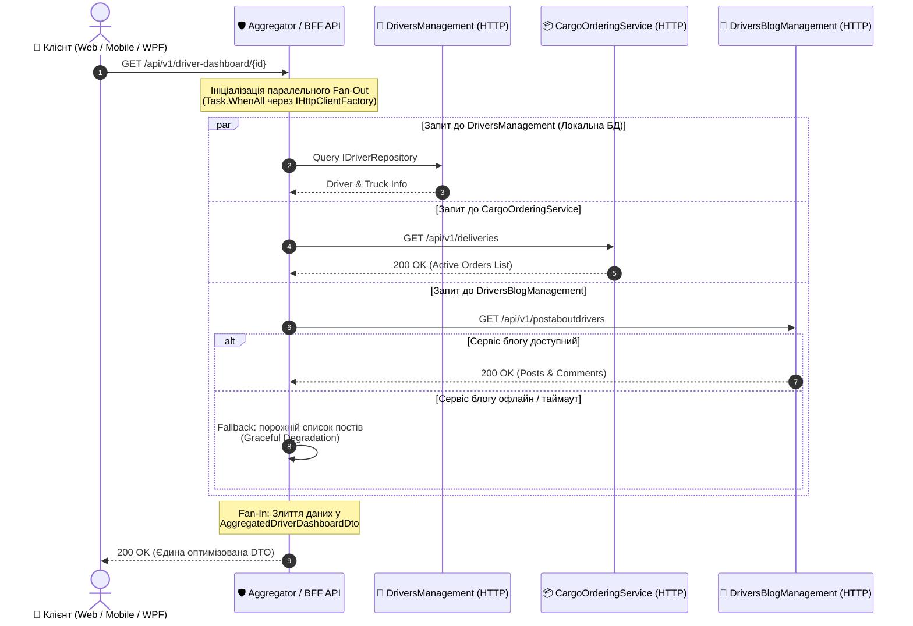
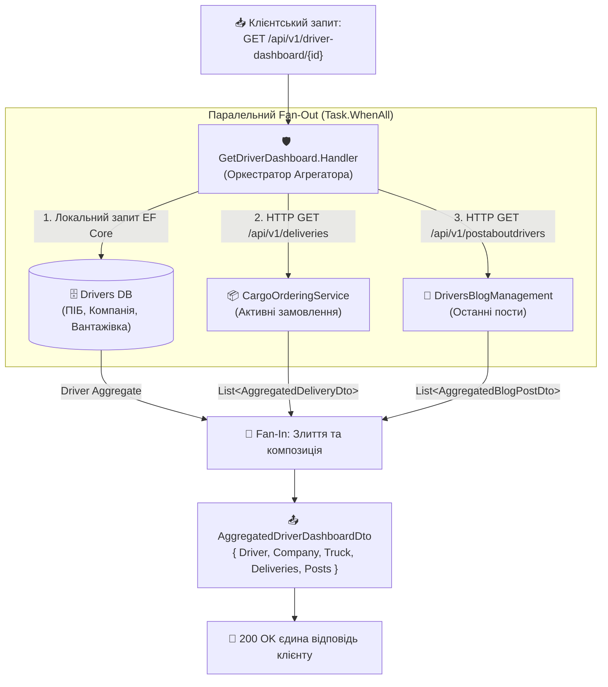

# 🌐 02. Патерни синхронної HTTP-комунікації: Gateway Aggregator та Backend for Frontend (BFF)

> **Блок 2:** `02-Microservices-Craftsman`  
> **Технологічний стек:** .NET 10, `HttpClient`, `IHttpClientFactory`, Typed HttpClients, .NET Aspire Service Discovery, Fan-Out / Fan-In (`Task.WhenAll`), Graceful Degradation.

---

## 1. Теоретична концепція: Проблема надлишкових запитів (Chatty Clients)

У мікросервісній архітектурі бізнес-дані навмисно розділені між незалежними доменами (**Bounded Contexts**):
* `DriversManagement` володіє інформацією про водія, компанію та закріплену вантажівку.
* `CargoOrderingService` володіє замовленнями, маршрутами та статусами доставки.
* `DriversBlogManagement` володіє публікаціями водія, коментарями та рейтингом.

Коли користувач відкриває веб-портал, мобільний додаток або десктопний клієнт (наприклад, **WPFDrivers**), йому потрібен **єдиний зведений екран** — *"Аналітична панель водія"* (Driver Dashboard).

### Чому пряме звернення клієнта до кожного мікросервісу — це критичний антипатерн?
1. **Надмірна балакучість мережі (Network Chattiness):** Клієнту через мобільний інтернет або зовнішню мережу доводиться виконувати 3–5 окремих послідовних або паралельних HTTP-запитів. Кожен запит витрачає час на TLS/TCP Handshake, DNS-резолвінг та маршрутизацію.
2. **Розкриття внутрішньої топології (Security Surface & Tight Coupling):** Клієнт повинен знати внутрішні URL-адреси, порти та структуру кожного окремого мікросервісу. Будь-який рефакторинг внутрішніх API ламає клієнтські додатки.
3. **Різні формати та протоколи:** Частина сервісів може використовувати REST JSON, частина gRPC Protobuf, частина GraphQL. Змушувати клієнт реалізовувати підтримку всіх протоколів — неефективно.
4. **Складність обробки часткових збоїв (Partial Failures):** Якщо сервіс блогу недоступний, фронтенд не повинен "падати" цілком — профіль водія та замовлення все одно мають відображатися.

---

## 2. Патерни Gateway Aggregator та Backend for Frontend (BFF)

Для вирішення цих викликів застосовуються два класичних патерни:

* **Gateway Aggregator Pattern:** Спеціалізований компонент (або сервіс-фасад), що приймає **один** комплексний запит від клієнта, самостійно "простукує" кілька внутрішніх мікросервісів через швидку приватну мережу, агрегує результати та повертає єдиний сформований DTO.
* **Backend for Frontend (BFF):** Різновид агрегатора, створений під конкретний тип клієнта (наприклад, один BFF для мобільного додатку з мінімальним трафіком, інший — для веб-адмінки з розширеними даними, третій — для десктопного WPF-клієнта).

### 💡 Аналогія з реального життя: Турагентство "Все включено"
* **Без агрегатора:** Ви плануєте відпустку. Ви самі купуєте квитки на поїзд на сайті залізниці, потім окремо бронюєте готель, окремо шукаєте екскурсовода в місті та замовляєте трансфер з вокзалу. Якщо сайт екскурсій завис, ви витрачаєте купу часу, узгоджуючи графіки вручну.
* **З патерном Aggregator (BFF):** Ви приходите до єдиного **турагента** (Aggregator). Ви кажете: *"Мені потрібен тур до Львова на 3 дні"*. Турагент сам паралельно дзвонить у готель, бронює квитки та замовляє трансфер. Якщо екскурсовод зараз недоступний, турагент запропонує альтернативу, але видасть вам **один цілісний пакет документів** в один клік.

---

## 3. Діаграми архітектури та взаємодії

### 3.1. Діаграма послідовності виклику (Sequence Diagram)

Діаграма демонструє, як Агрегатор виконує паралельний **Fan-Out** до трьох мікросервісів за допомогою `HttpClient` та збирає відповіді у єдиний **Fan-In**:



---

### 3.2. Діаграма моделі злиття даних (Fan-Out / Fan-In Data Aggregation Pipeline)

Агрегатор розпаралелює запити через пул асинхронних завдань `Task`, одночасно опитує незалежні мікросервіси та об'єднує різнорідні відповіді в одну зведену модель без блокування потоків:



---

## 4. Порівняння трьох видів міжсервісної комунікації

| Критерій | 1. HTTP Client Aggregator ([Гайд 02](02_Patterns_Synchronous_HttpClient_Aggregator_BFF.md)) | 2. gRPC ([Гайд 03](03_Patterns_Synchronous_gRPC_Communication.md)) | 3. MassTransit + RabbitMQ ([Гайд 04](04_Patterns_Asynchronous_Messaging_MassTransit_RabbitMQ.md)) |
| :--- | :--- | :--- | :--- |
| **Характер взаємодії** | Синхронний Request/Response (Aggregation) | Синхронний Point-to-Point (RPC) | Асинхронний Pub/Sub (Event-Driven) |
| **Протокол** | HTTP/1.1 або HTTP/2 + JSON | HTTP/2 + бінарний Protobuf | AMQP 0-9-1 / Quorum Queues |
| **Основне призначення** | Композиція даних з кількох API для клієнтів (BFF) | Ультрашвидкий бінарний обмін між двома сервісами | Реплікація даних, слабкий зв'язок, фонові задачі |
| **Ступінь зв'язності** | Середня (вимагає обробки часткових збоїв) | Висока (обидва сервіси онлайн) | Нульова (Temporal Decoupling) |
| **Вплив збою адресата** | Graceful Degradation (повернення часткових даних) | Помилка виклику (потрібен Fallback) | Повідомлення чекає в черзі брокера |

---

## 5. Детальний розбір реалізації в коді проєкту (.NET 10 & .NET Aspire)

### 5.1. Типізований клієнт до замовлень (`CargoOrderingApiClient`)

Замість використання `new HttpClient()` (що викликає вичерпання сокетів OS), клієнт інжектується через `IHttpClientFactory`.

> 📍 **Шлях до файлу:** `DriversManagement/src/DriversManagement/Domain/Drivers/Services/Http/CargoOrderingApiClient.cs`  
> 📝 *У файлі наведено докладні покрокові коментарі українською мовою.*

[👉 **Перейти до файлу (клікніть тут)**](../DriversManagement/src/DriversManagement/Domain/Drivers/Services/Http/CargoOrderingApiClient.cs)

Фрагмент коду клієнта:
```csharp
public sealed class CargoOrderingApiClient : ICargoOrderingApiClient
{
    private readonly HttpClient _httpClient;
    private readonly ILogger<CargoOrderingApiClient> _logger;

    public CargoOrderingApiClient(HttpClient httpClient, ILogger<CargoOrderingApiClient> logger)
    {
        _httpClient = httpClient;
        _logger = logger;
    }

    public async Task<List<AggregatedDeliveryDto>> GetActiveDeliveriesByDriverAsync(
        Guid driverId, CancellationToken cancellationToken = default)
    {
        // Базова адреса http://cargoorderingservice автоматично резолвиться в Aspire
        var response = await _httpClient.GetFromJsonAsync<JsonElement>("api/v1/deliveries", cancellationToken);
        // ... парсинг результатів ...
    }
}
```

---

### 5.2. Типізований клієнт до блогу (DriversBlogApiClient)

> 📍 **Шлях до файлу:** `DriversManagement/src/DriversManagement/Domain/Drivers/Services/Http/DriversBlogApiClient.cs`  
> 📝 *У файлі наведено докладні покрокові коментарі українською мовою.*

[👉 **Перейти до файлу (клікніть тут)**](../DriversManagement/src/DriversManagement/Domain/Drivers/Services/Http/DriversBlogApiClient.cs)

Фрагмент коду інтерфейсу:
```csharp
public interface IDriversBlogApiClient
{
    Task<List<AggregatedBlogPostDto>> GetDriverPostsAsync(Guid driverId, CancellationToken cancellationToken = default);
}
```

---

### 5.3. Реєстрація у Dependency Injection з Aspire Service Discovery

Реєстрація клієнтів здійснюється у файлі конфігурації сервісів:

> 📍 **Шлях до файлу:** `DriversManagement/src/DriversManagement/Extensions/Services/WebAppServiceConfiguration.cs`

[👉 **Перейти до файлу (клікніть тут)**](../DriversManagement/src/DriversManagement/Extensions/Services/WebAppServiceConfiguration.cs)

```csharp
// Реєстрація типізованого клієнта з резолвінгом імені сервісу
builder.Services.AddHttpClient<ICargoOrderingApiClient, CargoOrderingApiClient>(client =>
{
    // "http://cargoorderingservice" - ім'я проєкту в Aspire AppHost!
    var baseUrl = builder.Configuration["services:cargoorderingservice:http:0"] 
        ?? "http://cargoorderingservice";
    client.BaseAddress = new Uri(baseUrl);
})
.AddStandardResilienceHandler();

builder.Services.AddHttpClient<IDriversBlogApiClient, DriversBlogApiClient>(client =>
{
    var baseUrl = builder.Configuration["services:driversblogmanagement:http:0"] 
        ?? "http://driversblogmanagement";
    client.BaseAddress = new Uri(baseUrl);
})
.AddStandardResilienceHandler();
```

---

### 5.4. Оркестратор CQRS Handler з паралельним Fan-Out (Task.WhenAll)

Серце патерну Агрегатора — обробник запиту MediatR:

> 📍 **Шлях до файлу:** `DriversManagement/src/DriversManagement/Domain/Drivers/Features/GetDriverDashboard.cs`  
> 📝 *У файлі наведено вичерпні коментарі українською мовою до кожного кроку виконання.*

[👉 **Перейти до файлу (клікніть тут)**](../DriversManagement/src/DriversManagement/Domain/Drivers/Features/GetDriverDashboard.cs)

Ключова логіка паралельного запуску:
```csharp
// 1. Запускаємо завдання без блокування (паралельний Fan-Out)
var orderingTask = SafeFetchAsync(
    () => _orderingApiClient.GetActiveDeliveriesByDriverAsync(request.DriverId, cancellationToken),
    defaultValue: new List<AggregatedDeliveryDto>(),
    onFailure: () => hadPartialFailures = true);

var blogTask = SafeFetchAsync(
    () => _blogApiClient.GetDriverPostsAsync(request.DriverId, cancellationToken),
    defaultValue: new List<AggregatedBlogPostDto>(),
    onFailure: () => hadPartialFailures = true);

var truckTask = _truckRepository.Query().AsNoTracking().FirstOrDefaultAsync(cancellationToken);

// 2. Fan-In: Одночасне очікування результатів
await Task.WhenAll(orderingTask, blogTask, truckTask);

// 3. Зведення у DTO з прапорцем часткової деградації
return new AggregatedDriverDashboardDto
{
    DriverId = driver.Id,
    FullName = $"{driver.FirstName} {driver.LastName}",
    ActiveDeliveries = await orderingTask,
    RecentBlogPosts = await blogTask,
    IsPartialData = hadPartialFailures
};
```

---

### 5.5. API Контролер Агрегатора (BFF Endpoint)

> 📍 **Шлях до файлу:** `DriversManagement/src/DriversManagement/Controllers/v1/DriverDashboardController.cs`  
> 📝 *У файлі наведено докладні коментарі українською мовою.*

[👉 **Перейти до файлу (клікніть тут)**](../DriversManagement/src/DriversManagement/Controllers/v1/DriverDashboardController.cs)

Контролер надає маршрут `GET /api/v1/driver-dashboard/{id}` та повертає статус 200 OK з повною або частково деградованою моделлю.

---

## 6. Наскрізне трасування в OpenTelemetry (Aspire Dashboard)

Завдяки нативній телеметрії у `CargoDelivery.ServiceDefaults` при виклику ендпоінту Агрегатора в **Aspire Dashboard** формується наочне дерево розподіленого трейсингу:

```
[Trace ID: a8f41e09c85244b08709e46a782163b2]
└── GET /api/v1/driver-dashboard/{id}  [DriversManagement] (65ms)
    ├── SELECT FROM Drivers WHERE Id = @id  [EF Core] (8ms)
    ├── GET http://cargoorderingservice/api/v1/deliveries  (42ms)
    └── GET http://driversblogmanagement/api/v1/postaboutdrivers  (38ms)
```

Розробник на одному екрані бачить:
* Що зовнішні запити виконувалися паралельно, тому загальний час склав лише 65 мс (а не 8 + 42 + 38 = 88 мс).
* Кожен HTTP-статус та заголовки `traceparent`, передані бібліотекою `HttpClientInstrumentation`.

---

## 7. Чеклист Best Practices при побудові HTTP Aggregator / BFF

- [x] **Завжди використовуйте `IHttpClientFactory`:** категорично уникайте створення `new HttpClient()`.
- [x] **Паралельте запити через `Task.WhenAll`:** не робіть послідовних `await` для незалежних викликів.
- [x] **Впроваджуйте Graceful Degradation:** помилка в другорядному блозі не повинна блокувати перегляд профілю водія.
- [x] **Використовуйте Aspire Service Discovery:** звертайтеся за логічними іменами сервісів (`http://cargoorderingservice`).
- [x] **Прокидайте `CancellationToken`:** скасовуйте внутрішні HTTP-виклики, якщо клієнт закрив браузер чи вкладку.

---

## 8. Швидка навігація по вихідному коду

* 🌐 **Типізовані HTTP-клієнти:**
  * [👉 **Перейти до CargoOrderingApiClient.cs**](../DriversManagement/src/DriversManagement/Domain/Drivers/Services/Http/CargoOrderingApiClient.cs)
  * [👉 **Перейти до DriversBlogApiClient.cs**](../DriversManagement/src/DriversManagement/Domain/Drivers/Services/Http/DriversBlogApiClient.cs)
* ⚙️ **Реєстрація та Service Discovery:**
  * [👉 **Перейти до WebAppServiceConfiguration.cs**](../DriversManagement/src/DriversManagement/Extensions/Services/WebAppServiceConfiguration.cs)
* 🛡️ **Оркестратор Агрегатора (Fan-Out/Fan-In):**
  * [👉 **Перейти до GetDriverDashboard.cs**](../DriversManagement/src/DriversManagement/Domain/Drivers/Features/GetDriverDashboard.cs)
  * [👉 **Перейти до AggregatedDriverDashboardDto.cs**](../DriversManagement/src/DriversManagement/Domain/Drivers/Dtos/AggregatedDriverDashboardDto.cs)
* 📱 **BFF Контролер:**
  * [👉 **Перейти до DriverDashboardController.cs**](../DriversManagement/src/DriversManagement/Controllers/v1/DriverDashboardController.cs)

