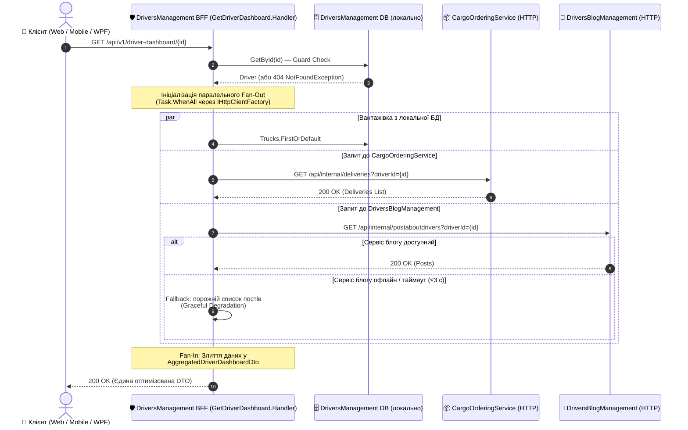
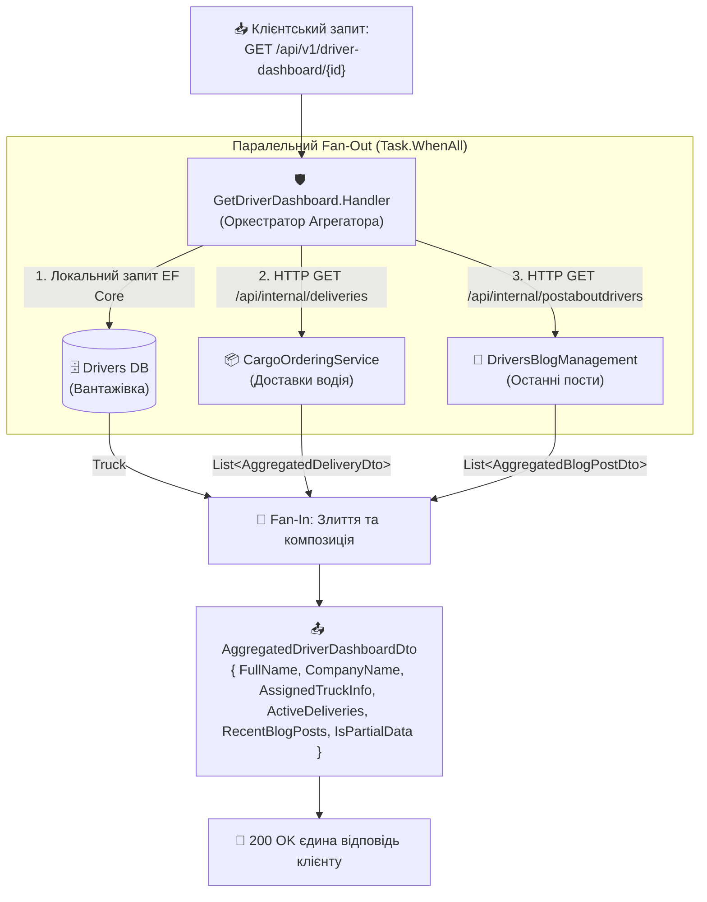

# 🌐 02. Патерни синхронної HTTP-комунікації: Gateway Aggregator та Backend for Frontend (BFF)

> **Блок 2:** `02-Microservices-Craftsman`  
> **Технологічний стек:** .NET 10, `HttpClient`, `IHttpClientFactory`, Typed HttpClients, .NET Aspire Service Discovery, Polly v8 (`Microsoft.Extensions.Http.Resilience`), Fan-Out / Fan-In (`Task.WhenAll`), Graceful Degradation.  
> **Пов'язаний поглиблений гайд:** [02-01 / 03_HttpAggregator_Gateway_Architecture_And_Design.md](../02-01-Aspire-Documentation/03_HttpAggregator_Gateway_Architecture_And_Design.md) — виділений агрегатор `CargoDelivery.HttpAggregator` (цей гайд — про **вбудований BFF** у `DriversManagement`).

---

## 1. Теоретична концепція: Проблема надлишкових запитів (Chatty Clients)

У мікросервісній архітектурі бізнес-дані навмисно розділені між незалежними доменами (**Bounded Contexts**):
* `DriversManagement` володіє інформацією про водія, компанію та закріплену вантажівку.
* `CargoOrderingService` володіє замовленнями, маршрутами та статусами доставки.
* `DriversBlogManagement` володіє публікаціями водія, коментарями та рейтингом.

Коли користувач відкриває веб-портал, мобільний додаток або десктопний клієнт (наприклад, **WPFDrivers**), йому потрібен **єдиний зведений екран** — *"Аналітична панель водія"* (Driver Dashboard).

### Чому пряме звернення клієнта до кожного мікросервісу — це критичний антипатерн?
1. **Надмірна балакучість мережі (Network Chattiness):** Клієнту через мобільний інтернет або зовнішню мережу доводиться виконувати 3–5 окремих послідовних або паралельних HTTP-запитів. Кожен запит витрачає час на TLS/TCP Handshake, DNS-резолвінг та маршрутизацію.
2. **Розкриття внутрішньої топології (Security Surface & Tight Coupling):** Клієнт повинен знати внутрішні URL-адреси, порти та структуру кожного окремого мікросервісу. Будь-який рефакторинг внутрішніх API ламає клієнтські додатки.
3. **Різні формати та протоколи:** Частина сервісів може використовувати REST JSON, частина gRPC Protobuf, частина GraphQL. Змушувати клієнт реалізовувати підтримку всіх протоколів — неефективно.
4. **Складність обробки часткових збоїв (Partial Failures):** Якщо сервіс блогу недоступний, фронтенд не повинен "падати" цілком — профіль водія та замовлення все одно мають відображатися.

---

## 2. Патерни Gateway Aggregator та Backend for Frontend (BFF)

Для вирішення цих викликів застосовуються два класичних патерни:

* **Gateway Aggregator Pattern:** Спеціалізований компонент (або сервіс-фасад), що приймає **один** комплексний запит від клієнта, самостійно "простукує" кілька внутрішніх мікросервісів через швидку приватну мережу, агрегує результати та повертає єдиний сформований DTO.
* **Backend for Frontend (BFF):** Різновид агрегатора, створений під конкретний тип клієнта (наприклад, один BFF для мобільного додатку з мінімальним трафіком, інший — для веб-адмінки з розширеними даними, третій — для десктопного WPF-клієнта). Термін запропонував Сем Ньюмен (Sam Newman): «одна команда фронтенду — один бекенд, який вона контролює».

### 💡 Аналогія з реального життя: Турагентство "Все включено"
* **Без агрегатора:** Ви плануєте відпустку. Ви самі купуєте квитки на поїзд на сайті залізниці, потім окремо бронюєте готель, окремо шукаєте екскурсовода в місті та замовляєте трансфер з вокзалу. Якщо сайт екскурсій завис, ви витрачаєте купу часу, узгоджуючи графіки вручну.
* **З патерном Aggregator (BFF):** Ви приходите до єдиного **турагента** (Aggregator). Ви кажете: *"Мені потрібен тур до Львова на 3 дні"*. Турагент сам паралельно дзвонить у готель, бронює квитки та замовляє трансфер. Якщо екскурсовод зараз недоступний, турагент запропонує альтернативу, але видасть вам **один цілісний пакет документів** в один клік.

### Дві реалізації в нашому рішенні — порівняння
| Критерій | Вбудований BFF (`DriversManagement`) | Виділений Gateway Aggregator (`CargoDelivery.HttpAggregator`) |
| :--- | :--- | :--- |
| Ендпоінт | `GET /api/v1/driver-dashboard/{id}` | `GET /api/v1/shipment-summary/{id}` |
| Де дані водія | **Локальна БД** (EF Core) — без мережі | Через HTTP `api/internal/drivers/{id}` |
| Звідки решта | HTTP до CargoOrdering і Blog | HTTP до CargoOrdering і Blog |
| Плюси | Менше мережевих викликів; сервіс-власник даних сам формує екран | Чиста ізоляція: агрегація не засмічує доменний сервіс; незалежне масштабування |
| Мінуси | Доменний сервіс обростає залежностями від сусідів | Ще один сервіс для розгортання і моніторингу |
| Поведінка при відмові блогу | 200 + `isPartialData: true` | 200 + `isDegraded: true` |
| Поведінка при відмові замовлень | 200 + `isPartialData: true` (замовлення — теж «м'яка» залежність), але через ≈30 с — стандартний бюджет Polly | **503** через ≈30 с (замовлення — «жорстка» залежність) |

> 🧠 Остання строка таблиці — про **бізнес-рішення**, а не техніку: що є критичним для конкретного екрана. Кабінет водія без доставок усе ще корисний; диспетчерське зведення рейсу без доставок — ні.

---

## 3. Діаграми архітектури та взаємодії

### 3.1. Діаграма послідовності виклику (Sequence Diagram)

Діаграма демонструє, як BFF спершу перевіряє водія в локальній БД, а потім виконує паралельний **Fan-Out** до двох мікросервісів за допомогою `HttpClient` та збирає відповіді у єдиний **Fan-In**:



---

### 3.2. Діаграма моделі злиття даних (Fan-Out / Fan-In Data Aggregation Pipeline)

Агрегатор розпаралелює запити через асинхронні завдання `Task`, одночасно опитує незалежні мікросервіси та об'єднує різнорідні відповіді в одну зведену модель без блокування потоків:



---

## 4. Порівняння трьох видів міжсервісної комунікації

| Критерій | 1. HTTP Client Aggregator ([Гайд 02](02_Patterns_Synchronous_HttpClient_Aggregator_BFF.md)) | 2. gRPC ([Гайд 03](03_Patterns_Synchronous_gRPC_Communication.md)) | 3. MassTransit + RabbitMQ ([Гайд 04](04_Patterns_Asynchronous_Messaging_MassTransit_RabbitMQ.md)) |
| :--- | :--- | :--- | :--- |
| **Характер взаємодії** | Синхронний Request/Response (Aggregation) | Синхронний Point-to-Point (RPC) | Асинхронний Pub/Sub (Event-Driven) |
| **Протокол** | HTTP/1.1 або HTTP/2 + JSON | HTTP/2 + бінарний Protobuf | AMQP 0-9-1 / Quorum Queues |
| **Основне призначення** | Композиція даних з кількох API для клієнтів (BFF) | Швидкий бінарний обмін між двома сервісами | Реплікація даних, слабкий зв'язок, фонові задачі |
| **Ступінь зв'язності** | Середня (вимагає обробки часткових збоїв) | Висока (обидва сервіси онлайн) | Нульова за часом (Temporal Decoupling) |
| **Вплив збою адресата** | Graceful Degradation (повернення часткових даних) | Помилка виклику (потрібен Fallback) | Повідомлення чекає в черзі брокера |

---

## 5. Детальний розбір реалізації в коді проєкту (.NET 10 & .NET Aspire)

### 5.1. Типізований клієнт до замовлень (`CargoOrderingApiClient`)

Замість використання `new HttpClient()` (що викликає вичерпання сокетів OS), клієнт інжектується через `IHttpClientFactory`.

> 📍 **Шлях до файлу:** `DriversManagement/src/DriversManagement/Domain/Drivers/Services/Http/CargoOrderingApiClient.cs`  
> 📝 *У файлі наведено докладні покрокові коментарі українською мовою.* Ключові рядки: адреса [#L59](../DriversManagement/src/DriversManagement/Domain/Drivers/Services/Http/CargoOrderingApiClient.cs#L59), виклик [#L65](../DriversManagement/src/DriversManagement/Domain/Drivers/Services/Http/CargoOrderingApiClient.cs#L65), обробка помилки [#L91](../DriversManagement/src/DriversManagement/Domain/Drivers/Services/Http/CargoOrderingApiClient.cs#L91).

[👉 **Перейти до файлу (клікніть тут)**](../DriversManagement/src/DriversManagement/Domain/Drivers/Services/Http/CargoOrderingApiClient.cs#L55)

Фрагмент коду клієнта:
```csharp
public async Task<List<AggregatedDeliveryDto>> GetActiveDeliveriesByDriverAsync(
    Guid driverId, CancellationToken cancellationToken = default)
{
    try
    {
        // Внутрішній (service-to-service) ендпоінт з фільтром за водієм.
        // BaseAddress = https+http://cargoorderingservice (резолвить Aspire Service Discovery)
        var requestUri = $"api/internal/deliveries?driverId={driverId}";

        var response = await _httpClient.GetFromJsonAsync<JsonElement>(requestUri, cancellationToken);

        var result = new List<AggregatedDeliveryDto>();
        if (response.ValueKind == JsonValueKind.Array)
        {
            foreach (var item in response.EnumerateArray())
            {
                result.Add(new AggregatedDeliveryDto
                {
                    // "Толерантний читач": беремо лише потрібні поля, нові поля не ламають клієнт
                    Id = item.TryGetProperty("orderId", out var idProp) && Guid.TryParse(idProp.GetString(), out var g) ? g : Guid.Empty,
                    Status = item.TryGetProperty("status", out var sProp) ? sProp.GetString() ?? "Unknown" : "Unknown",
                    RouteDescription = item.TryGetProperty("pickupAddress", out var pProp) && item.TryGetProperty("destinationAddress", out var dProp)
                        ? $"{pProp.GetString()} → {dProp.GetString()}"
                        : "Вантажний маршрут"
                });
            }
        }
        return result;
    }
    catch (HttpRequestException ex)
    {
        _logger.LogWarning(ex, "Не вдалося отримати доставки ... {StatusCode}", driverId, ex.StatusCode);
        throw; // Рішення про деградацію приймає SafeFetchAsync в обробнику
    }
}
```

> 🧩 **Tolerant Reader (Мартін Фаулер).** Клієнт розбирає `JsonElement` вручну і бере лише ті поля, які йому потрібні. Якщо CargoOrderingService додасть нове поле чи змінить порядок — клієнт не зламається. Ціна — немає перевірки типів на етапі компіляції; альтернатива — власний DTO + `ReadFromJsonAsync<T>()`, як у виділеному агрегаторі.

> 🐞 **Що було виправлено.** Клієнти звертались до `api/v1/deliveries` і `api/v1/postaboutdrivers` — таких маршрутів не існує (публічні маршрути Craftsman — `api/deliveries`, `api/postaboutdrivers`), до того ж публічні ендпоінти повертають **усі** записи з пагінацією і вимагали JWT. Результат — дашборд завжди був «частковим». Тепер BFF використовує внутрішні ендпоінти з фільтром за водієм.

---

### 5.2. Типізований клієнт до блогу (DriversBlogApiClient)

> 📍 **Шлях до файлу:** `DriversManagement/src/DriversManagement/Domain/Drivers/Services/Http/DriversBlogApiClient.cs` — адреса [#L52](../DriversManagement/src/DriversManagement/Domain/Drivers/Services/Http/DriversBlogApiClient.cs#L52), виклик [#L57](../DriversManagement/src/DriversManagement/Domain/Drivers/Services/Http/DriversBlogApiClient.cs#L57)  
> 📝 *У файлі наведено докладні покрокові коментарі українською мовою.*

[👉 **Перейти до файлу (клікніть тут)**](../DriversManagement/src/DriversManagement/Domain/Drivers/Services/Http/DriversBlogApiClient.cs#L52)

Фрагмент коду інтерфейсу ([IDriversBlogApiClient.cs](../DriversManagement/src/DriversManagement/Domain/Drivers/Services/Http/IDriversBlogApiClient.cs)):
```csharp
public interface IDriversBlogApiClient
{
    Task<List<AggregatedBlogPostDto>> GetDriverPostsAsync(Guid driverId, CancellationToken cancellationToken = default);
}
```

Інтерфейс — це точка розширення для тестів (обробник залежить від абстракції — принцип DIP) і місце, де ховаються всі мережеві деталі (URL, формат JSON, коди помилок).

---

### 5.3. Реєстрація у Dependency Injection з Aspire Service Discovery

Реєстрація клієнтів здійснюється у файлі конфігурації сервісів:

> 📍 **Шлях до файлу:** `DriversManagement/src/DriversManagement/Extensions/Services/WebAppServiceConfiguration.cs` — HTTP-клієнти [#L81](../DriversManagement/src/DriversManagement/Extensions/Services/WebAppServiceConfiguration.cs#L81), бюджет для блогу [#L100](../DriversManagement/src/DriversManagement/Extensions/Services/WebAppServiceConfiguration.cs#L100)

[👉 **Перейти до файлу (клікніть тут)**](../DriversManagement/src/DriversManagement/Extensions/Services/WebAppServiceConfiguration.cs#L81)

```csharp
// Замовлення: логічне ім'я + глобальний стандартний конвеєр Polly із ServiceDefaults
builder.Services.AddHttpClient<ICargoOrderingApiClient, CargoOrderingApiClient>(client =>
    client.BaseAddress = new Uri("https+http://cargoorderingservice"));

// Блог — НЕКРИТИЧНА залежність дашборду, тож для нього короткий бюджет часу
builder.Services.AddHttpClient<IDriversBlogApiClient, DriversBlogApiClient>(client =>
        client.BaseAddress = new Uri("https+http://driversblogmanagement"))
    .RemoveAllResilienceHandlers()
    .AddStandardResilienceHandler(SoftDependencyBudget);

// ...
private static void SoftDependencyBudget(HttpStandardResilienceOptions options)
{
    options.AttemptTimeout.Timeout = TimeSpan.FromSeconds(1);
    options.Retry.MaxRetryAttempts = 1;
    options.Retry.Delay = TimeSpan.FromMilliseconds(200);
    options.TotalRequestTimeout.Timeout = TimeSpan.FromSeconds(3);
}
```

| Елемент | Пояснення |
| :--- | :--- |
| `https+http://cargoorderingservice` | Логічне ім'я ресурсу з AppHost. Service Discovery підставляє `services__cargoorderingservice__https__0` (`https://localhost:5003`) |
| Без `.AddStandardResilienceHandler()` для замовлень | Стандартний конвеєр уже доданий **глобально** через `AddServiceDefaults()`. Повторний виклик вклав би конвеєри один в одного (див. [02-01 гайд 06, §4](../02-01-Aspire-Documentation/06_ServiceDiscovery_Resilience_Polly_HttpClient.md#section-4)) |
| `RemoveAllResilienceHandlers()` + `SoftDependencyBudget` для блогу | Замість стандартних 30 с — не більше 3 с; при недоступному блозі дашборд відповідає за ≈2 с |

> 🐞 **Що було виправлено.** Раніше тут вручну читались ключі `services:x:http:0` (їх не існує — Aspire передає лише `https:0`, бо в launchSettings сервісів оголошено тільки HTTPS) і до кожного клієнта додавався другий стандартний конвеєр Polly.

---

### 5.4. Оркестратор CQRS Handler з паралельним Fan-Out (Task.WhenAll)

Серце патерну Агрегатора — обробник запиту MediatR:

> 📍 **Шлях до файлу:** `DriversManagement/src/DriversManagement/Domain/Drivers/Features/GetDriverDashboard.cs` — Guard Check [#L82](../DriversManagement/src/DriversManagement/Domain/Drivers/Features/GetDriverDashboard.cs#L82), Fan-Out [#L92](../DriversManagement/src/DriversManagement/Domain/Drivers/Features/GetDriverDashboard.cs#L92), Fan-In [#L112](../DriversManagement/src/DriversManagement/Domain/Drivers/Features/GetDriverDashboard.cs#L112), `SafeFetchAsync` [#L141](../DriversManagement/src/DriversManagement/Domain/Drivers/Features/GetDriverDashboard.cs#L141)  
> 📝 *У файлі наведено вичерпні коментарі українською мовою до кожного кроку виконання.*

[👉 **Перейти до файлу (клікніть тут)**](../DriversManagement/src/DriversManagement/Domain/Drivers/Features/GetDriverDashboard.cs#L75)

Ключова логіка паралельного запуску:
```csharp
// 0. Guard Check: водія немає → NotFoundException → 404 (зовнішні сервіси не опитуємо)
var driver = await _driverRepository.GetById(request.DriverId, cancellationToken: cancellationToken);

bool hadPartialFailures = false;

// 1. Запускаємо завдання без блокування (паралельний Fan-Out)
var orderingTask = SafeFetchAsync(
    action: () => _orderingApiClient.GetActiveDeliveriesByDriverAsync(request.DriverId, cancellationToken),
    defaultValue: new List<AggregatedDeliveryDto>(),
    onFailure: () => hadPartialFailures = true);

var blogTask = SafeFetchAsync(
    action: () => _blogApiClient.GetDriverPostsAsync(request.DriverId, cancellationToken),
    defaultValue: new List<AggregatedBlogPostDto>(),
    onFailure: () => hadPartialFailures = true);

// Демо-спрощення: у моделі немає зв'язку Truck ↔ Driver, тому береться перша вантажівка
var truckTask = _truckRepository.Query().AsNoTracking().FirstOrDefaultAsync(cancellationToken);

// 2. Fan-In: Одночасне очікування результатів
await Task.WhenAll(orderingTask, blogTask, truckTask);

// 3. Зведення у DTO з прапорцем часткової деградації
return new AggregatedDriverDashboardDto
{
    DriverId = driver.Id,
    FullName = $"{driver.FirstName} {driver.LastName}".Trim(),
    LicenseNumber = driver.DriverLicenseNumber,
    CompanyName = driver.Company?.CompanyName ?? "Приватний перевізник",
    AssignedTruckInfo = truck != null ? $"{truck.Model} (Держномер: {truck.TruckNumber})" : "Автомобіль не призначено",
    ActiveDeliveries = await orderingTask,
    RecentBlogPosts = await blogTask,
    IsPartialData = hadPartialFailures
};
```

> ⚠️ **EF Core і паралелізм.** `DbContext` не потокобезпечний: два одночасні запити на **одному** контексті дають `InvalidOperationException: A second operation was started on this context`. Тут це безпечно, бо паралельно з HTTP-викликами йде лише **один** EF-запит (`truckTask`), а читання водія завершилось **до** Fan-Out. Якщо потрібно кілька паралельних запитів до БД — використовуйте `IDbContextFactory<T>` і окремий контекст на кожну задачу.

---

### 5.5. API Контролер Агрегатора (BFF Endpoint)

> 📍 **Шлях до файлу:** `DriversManagement/src/DriversManagement/Controllers/v1/DriverDashboardController.cs` — ендпоінт [#L49](../DriversManagement/src/DriversManagement/Controllers/v1/DriverDashboardController.cs#L49)  
> 📝 *У файлі наведено докладні коментарі українською мовою.*

[👉 **Перейти до файлу (клікніть тут)**](../DriversManagement/src/DriversManagement/Controllers/v1/DriverDashboardController.cs#L49)

Контролер надає маршрут `GET /api/v1/driver-dashboard/{id}` та повертає статус 200 OK з повною або частково деградованою моделлю. Відсутній водій → `NotFoundException` з обробника → 404 через middleware ProblemDetails.

### 5.6. Реальна відповідь стенду
```json
{
  "driverId": "2dc25740-aeb6-438a-be60-bc451562120e",
  "fullName": "Тарас Коваленко",
  "licenseNumber": "DL-994421",
  "companyName": "Приватний перевізник",
  "assignedTruckInfo": "Автомобіль не призначено",
  "activeDeliveries": [
    { "id": "ee4bfc67-66c5-4302-9869-425514fefaf3", "status": "InTransit",
      "routeDescription": "Київ, вул. Промислова, 12 → Львів, вул. Городоцька, 15" }
  ],
  "recentBlogPosts": [ { "id": "…", "title": "Траса М-06: ремонт мосту", "content": "…" } ],
  "isPartialData": false
}
```
Час відповіді на стенді — ≈90 мс (усі сервіси доступні) і ≈2.3 с при зупиненому блозі (`isPartialData: true`).

---

## 6. Наскрізне трасування в OpenTelemetry (Aspire Dashboard)

Завдяки нативній телеметрії у `CargoDelivery.ServiceDefaults` при виклику ендпоінту Агрегатора в **Aspire Dashboard** формується наочне дерево розподіленого трейсингу:

```
[Trace: driversmanagement: GET api/v1/driver-dashboard/{id:guid}]
└── GET api/v1/driver-dashboard/{id}  [DriversManagement]
    ├── SQL SELECT drivers … WHERE id = @id           (SqlClient, послідовно)
    ├── SQL SELECT TOP(1) trucks …                     (паралельно ↓)
    ├── GET https://localhost:5003/api/internal/deliveries?driverId=…
    │   └── [CargoOrderingService] GET api/internal/deliveries → SQL SELECT deliveries
    └── GET https://localhost:5002/api/internal/postaboutdrivers?driverId=…
        └── [DriversBlogManagement] GET api/internal/postaboutdrivers → SQL SELECT post_about_drivers
```

Розробник на одному екрані бачить:
* Що зовнішні запити виконувалися паралельно — їхні спани починаються одночасно, і загальний час ≈ найдовша гілка, а не сума.
* Кожен HTTP-статус і заголовок `traceparent`, переданий бібліотекою `HttpClientInstrumentation`.
* При деградації — червоні клієнтські спани до блогу (по одному на кожну спробу Polly) під «зеленим» кореневим спаном.

---

## 7. Чеклист Best Practices при побудові HTTP Aggregator / BFF

- [x] **Завжди використовуйте `IHttpClientFactory`:** категорично уникайте створення `new HttpClient()`.
- [x] **Паралельте запити через `Task.WhenAll`:** не робіть послідовних `await` для незалежних викликів.
- [x] **Впроваджуйте Graceful Degradation:** помилка в другорядному блозі не повинна блокувати перегляд профілю водія.
- [x] **Задавайте окремий бюджет часу для некритичних залежностей:** деградація за 30 с — це не деградація.
- [x] **Один конвеєр Polly на клієнт:** глобальний із ServiceDefaults або власний після `RemoveAllResilienceHandlers()`.
- [x] **Використовуйте Aspire Service Discovery:** звертайтеся за логічними іменами сервісів (`https+http://cargoorderingservice`).
- [x] **Прокидайте `CancellationToken`:** скасовуйте внутрішні HTTP-виклики, якщо клієнт закрив браузер чи вкладку.
- [x] **Не діліть DbContext між паралельними задачами.**

---

## 8. Швидка навігація по вихідному коду

* 🌐 **Типізовані HTTP-клієнти:**
  * [👉 **Перейти до CargoOrderingApiClient.cs**](../DriversManagement/src/DriversManagement/Domain/Drivers/Services/Http/CargoOrderingApiClient.cs#L55)
  * [👉 **Перейти до DriversBlogApiClient.cs**](../DriversManagement/src/DriversManagement/Domain/Drivers/Services/Http/DriversBlogApiClient.cs#L52)
* ⚙️ **Реєстрація та Service Discovery:**
  * [👉 **Перейти до WebAppServiceConfiguration.cs**](../DriversManagement/src/DriversManagement/Extensions/Services/WebAppServiceConfiguration.cs#L81)
* 🛡️ **Оркестратор Агрегатора (Fan-Out/Fan-In):**
  * [👉 **Перейти до GetDriverDashboard.cs**](../DriversManagement/src/DriversManagement/Domain/Drivers/Features/GetDriverDashboard.cs#L75)
  * [👉 **Перейти до AggregatedDriverDashboardDto.cs**](../DriversManagement/src/DriversManagement/Domain/Drivers/Dtos/AggregatedDriverDashboardDto.cs)
* 📱 **BFF Контролер:**
  * [👉 **Перейти до DriverDashboardController.cs**](../DriversManagement/src/DriversManagement/Controllers/v1/DriverDashboardController.cs#L49)
* 🎯 **Цільові внутрішні ендпоінти:**
  * [👉 **InternalDeliveriesController.cs (CargoOrderingService)**](../CargoOrderingService/src/CargoOrderingService/Controllers/v1/InternalDeliveriesController.cs#L46)
  * [👉 **InternalPostAboutDriversController.cs (DriversBlogManagement)**](../DriversBlogManagement/src/DriversBlogManagement/Controllers/v1/InternalPostAboutDriversController.cs#L45)
* 🧪 **Готові запити:** [CargoDelivery.HttpAggregator.http](../CargoDelivery.HttpAggregator/CargoDelivery.HttpAggregator.http) (запит 6️⃣)
