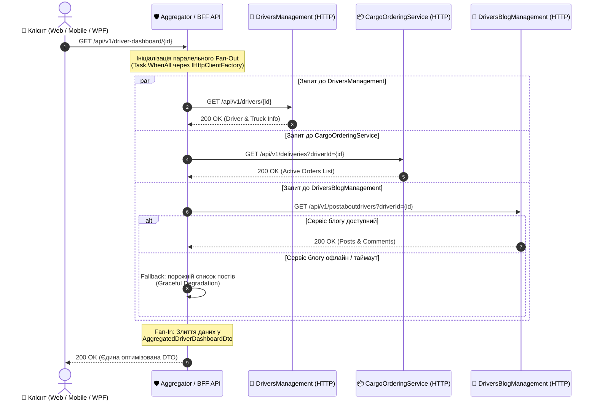

# 🌐 02. Патерни синхронної HTTP-комунікації: Gateway Aggregator та Backend for Frontend (BFF)

> **Блок 2:** `02-Microservices-Craftsman`  
> **Технологічний стек:** .NET 10, `HttpClient`, `IHttpClientFactory`, Typed Clients, .NET Aspire Service Discovery, Polly Resilience (`AddStandardResilienceHandler`), Fan-Out / Fan-In (`Task.WhenAll`).

---

## 1. Теоретична концепція: Проблема надлишкових запитів (Chatty Clients)

У мікросервісній архітектурі бізнес-дані навмисно розділені між незалежними доменами (**Bounded Contexts**):
* `DriversManagement` володіє інформацією про водія, компанію та закріплену вантажівку.
* `CargoOrderingService` володіє замовленнями, маршрутами та статусами доставки.
* `DriversBlogManagement` володіє публікаціями водія, коментарями та рейтингом.

Коли користувач відкриває веб-портал, мобільний додаток або десктопний клієнт (наприклад, **WPFDrivers**), йому потрібен **єдиний зведений екран** — *"Аналітична панель водія"* (Driver Dashboard).

### Чому пряме звернення клієнта до кожного мікросервісу — це антипатерн?
1. **Надмірна балакучість мережі (Network Chattiness):** Клієнту через мобільний інтернет або слабку мережу доводиться виконувати 3–5 послідовних або паралельних HTTP-запитів, витрачаючи час на множинні TCP/TLS рукостискання.
2. **Розкриття внутрішньої топології (Security & Coupling):** Клієнт повинен знати внутрішні URL-адреси, порти та структуру кожного окремого мікросервісу.
3. **Різні формати та протоколи:** Частина сервісів може використовувати REST, частина gRPC, вимагаючи від клієнта складної логіки адаптації.
4. **Складність обробки часткових збоїв (Partial Failures):** Якщо сервіс блогу недоступний, фронтенд не повинен "падати" цілком — профіль водія та замовлення все одно мають відображатися.

---

## 2. Патерни Gateway Aggregator та Backend for Frontend (BFF)

Для вирішення цих викликів застосовуються два споріднені патерни:

* **Gateway Aggregator Pattern:** Спеціальний компонент (або сервіс-фасад), що приймає **один** комплексний запит від клієнта, самостійно "простукує" кілька внутрішніх мікросервісів через швидку приватну мережу, агрегує результати та повертає єдиний сформований DTO.
* **Backend for Frontend (BFF):** Різновид агрегатора, створений під конкретний тип клієнта (наприклад, один BFF для мобільного додатку з мінімальним трафіком, інший — для веб-адмінки з розширеними даними).

### 💡 Аналогія з реального життя: Турагентство "Все включено"
* **Без агрегатора:** Ви плануєте відпустку. Ви самі купуєте квитки на поїзд на сайті залізниці, потім окремо бронюєте готель, окремо шукаєте екскурсовода в місті та замовляєте трансфер з вокзалу. Якщо сайт екскурсій завис, ви витрачаєте купу часу, узгоджуючи графіки вручну.
* **З патерном Aggregator (BFF):** Ви приходите до єдиного **турагента** (Aggregator). Ви кажете: *"Мені потрібен тур до Львова на 3 дні"*. Турагент сам паралельно дзвонить у готель, бронює квитки та замовляє трансфер. Якщо екскурсовод зараз недоступний, турагент запропонує альтернативу, але видасть вам **один цілісний пакет документів** в один клік.

---

## 3. Діаграма послідовності виклику (Sequence Diagram)

Діаграма демонструє, як Агрегатор виконує паралельний **Fan-Out** до трьох мікросервісів за допомогою `HttpClient` та збирає відповіді у єдиний **Fan-In**:



---

## 4. Порівняння трьох видів міжсервісної комунікації

У проєкті `Demo-CargoDeliveryService` представлені всі ключові механізми взаємодії:

| Критерій | 1. HTTP Client Aggregator ([Гайд 02](02_Patterns_Synchronous_HttpClient_Aggregator_BFF.md)) | 2. gRPC ([Гайд 03](03_Patterns_Synchronous_gRPC_Communication.md)) | 3. MassTransit + RabbitMQ ([Гайд 04](04_Patterns_Asynchronous_Messaging_MassTransit_RabbitMQ.md)) |
| :--- | :--- | :--- | :--- |
| **Характер взаємодії** | Синхронний Request/Response (Aggregation) | Синхронний Point-to-Point (RPC) | Асинхронний Pub/Sub (Event-Driven) |
| **Протокол** | HTTP/1.1 або HTTP/2 + JSON | HTTP/2 + бінарний Protobuf | AMQP 0-9-1 / Quorum Queues |
| **Основне призначення** | Композиція даних з кількох API для клієнтів (BFF) | Ультрашвидкий бінарний обмін між двома сервісами | Реплікація даних, слабкий зв'язок, фонові задачі |
| **Ступінь зв'язності** | Середня (вимагає обробки часткових збоїв) | Висока (обидва сервіси онлайн) | Нульова (Temporal Decoupling) |
| **Вплив збою адресата** | Graceful Degradation (повернення часткових даних) | Помилка виклику (потрібен Fallback) | Повідомлення чекає в черзі брокера |

---

## 5. Реалізація в коді C# (.NET 10 та .NET Aspire)

### 5.1. Типізовані HTTP-клієнти (Typed Clients)

Замість прямого створення `new HttpClient()` (що призводить до вичерпання сокетів — *Socket Exhaustion*), у .NET використовується `IHttpClientFactory` з типізованими клієнтами:

```csharp
// Інтерфейс клієнта до DriversManagement
public interface IDriversApiClient
{
    Task<DriverDto?> GetDriverByIdAsync(Guid driverId, CancellationToken ct = default);
}

public class DriversApiClient(HttpClient httpClient) : IDriversApiClient
{
    public async Task<DriverDto?> GetDriverByIdAsync(Guid driverId, CancellationToken ct = default)
    {
        return await httpClient.GetFromJsonAsync<DriverDto>($"/api/v1/drivers/{driverId}", ct);
    }
}
```

Аналогічно визначаються клієнти для інших мікросервісів:
```csharp
// Клієнт до замовлень
public interface ICargoOrderingApiClient
{
    Task<List<DeliveryDto>> GetActiveDeliveriesByDriverAsync(Guid driverId, CancellationToken ct = default);
}

// Клієнт до блогу
public interface IDriversBlogApiClient
{
    Task<List<BlogPostDto>> GetDriverPostsAsync(Guid driverId, CancellationToken ct = default);
}
```

---

### 5.2. Інтеграція з Service Discovery та Polly у .NET Aspire

У .NET Aspire адреси сервісів вирішуються автоматично за їхніми логічними іменами в оркестраторі `AppHost`. Додатково налаштовується нативна стійкість (Polly Resilience):

```csharp
// Реєстрація у Program.cs або ServiceExtension.cs
builder.Services.AddHttpClient<IDriversApiClient, DriversApiClient>(client =>
{
    // Адресація за іменем сервісу через Aspire Service Discovery!
    client.BaseAddress = new Uri("http://driversmanagement");
})
.AddStandardResilienceHandler(); // Polly: автоматичний Retry, Circuit Breaker та Timeout!

builder.Services.AddHttpClient<ICargoOrderingApiClient, CargoOrderingApiClient>(client =>
{
    client.BaseAddress = new Uri("http://cargoorderingservice");
})
.AddStandardResilienceHandler();

builder.Services.AddHttpClient<IDriversBlogApiClient, DriversBlogApiClient>(client =>
{
    client.BaseAddress = new Uri("http://driversblogmanagement");
})
.AddStandardResilienceHandler();
```

> [!TIP]
> Метод `.AddStandardResilienceHandler()` з пакету `Microsoft.Extensions.Http.Resilience` автоматично підключає:
> 1. **Rate Limiter** — захист від перевантаження цільового сервісу.
> 2. **Total Request Timeout** — загальний ліміт часу на запит (за замовчуванням 30 секунд).
> 3. **Retry Strategy** — повторні спроби при транзитних помилках (HTTP 503, 504, мережеві збої) з експоненційним відкатом.
> 4. **Circuit Breaker** — розмикання ланцюга, якщо сервіс стабільно не відповідає, щоб не спамити його запитами.

---

### 5.3. Контролер Агрегатора з паралельним Fan-Out та Graceful Degradation

Ключовий момент патерну — використання `Task.WhenAll` для **одночасного паралельного виконання** запитів:

```csharp
[ApiController]
[Route("api/v1/driver-dashboard")]
public class DriverDashboardAggregatorController(
    IDriversApiClient driversClient,
    ICargoOrderingApiClient orderingClient,
    IDriversBlogApiClient blogClient,
    ILogger<DriverDashboardAggregatorController> logger) : ControllerBase
{
    [HttpGet("{id:guid}")]
    public async Task<IActionResult> GetAggregatedDashboard(Guid id, CancellationToken ct)
    {
        // 1. Запускаємо всі 3 виклики асинхронно та паралельно!
        var driverTask = SafeFetchAsync(() => driversClient.GetDriverByIdAsync(id, ct), null);
        var deliveriesTask = SafeFetchAsync(() => orderingClient.GetActiveDeliveriesByDriverAsync(id, ct), new List<DeliveryDto>());
        var postsTask = SafeFetchAsync(() => blogClient.GetDriverPostsAsync(id, ct), new List<BlogPostDto>());

        // 2. Очікуємо завершення всіх завдань (Fan-In)
        await Task.WhenAll(driverTask, deliveriesTask, postsTask);

        var driver = await driverTask;
        if (driver == null)
        {
            return NotFound(new { message = $"Водія з ID {id} не знайдено в DriversManagement" });
        }

        // 3. Формуємо зведену модель (BFF DTO)
        var response = new AggregatedDriverDashboardDto
        {
            DriverId = driver.Id,
            FullName = $"{driver.FirstName} {driver.LastName}",
            LicenseNumber = driver.LicenseNumber,
            TruckModel = driver.AssignedTruck?.Model,
            ActiveDeliveries = await deliveriesTask ?? [],
            RecentPosts = await postsTask ?? []
        };

        return Ok(response);
    }

    // Допоміжний метод для ізоляції збоїв окремого мікросервісу (Graceful Degradation)
    private async Task<T> SafeFetchAsync<T>(Func<Task<T>> action, T defaultValue)
    {
        try
        {
            return await action();
        }
        catch (Exception ex)
        {
            logger.LogWarning(ex, "Помилка при виклику підпорядкованого сервісу в Aggregator. Застосовано fallback.");
            return defaultValue;
        }
    }
}
```

---

## 6. Наскрізне трасування в OpenTelemetry (Aspire Dashboard)

Завдяки тому, що кожен мікросервіс та Агрегатор підключають `CargoDelivery.ServiceDefaults` з `.AddHttpClientInstrumentation()`:

```
[Trace ID: 4bf92f3577b34da6a3ce929d0e0e4736]
└── GET /api/v1/driver-dashboard/{id}  (Aggregator - 45ms)
    ├── GET /api/v1/drivers/{id}           (DriversManagement - 12ms)
    ├── GET /api/v1/deliveries             (CargoOrderingService - 18ms)
    └── GET /api/v1/postaboutdrivers       (DriversBlogManagement - 14ms)
```

В єдиній панелі **Aspire Dashboard** розробник бачить:
* Загальний час агрегованого запиту (45 мс замість суми 12+18+14 = 44 мс завдяки паралельності `Task.WhenAll`).
* Точний HTTP-статус кожного дочірнього виклику.
* Сліди заголовків `traceparent`, які автоматично прокидаються клієнтом `HttpClient`.

---

## 7. Чеклист Best Practices при побудові HTTP Aggregator / BFF

- [x] **Завжди використовуйте `IHttpClientFactory`:** уникайте ручного створення екземплярів `HttpClient`.
- [x] **Паралельте запити через `Task.WhenAll`:** ніколи не робіть послідовних викликів `await client1; await client2;`, якщо дані не залежать одне від одного.
- [x] **Впроваджуйте Graceful Degradation:** не дозволяйте падінню другорядного мікросервісу (наприклад, коментарів чи лайків) зламати відображення основного профілю.
- [x] **Налаштовуйте Timeouts та Circuit Breakers:** захищайте агрегатор від зависання на повільних підлеглих сервісах за допомогою `AddStandardResilienceHandler`.
- [x] **Використовуйте Service Discovery:** у середовищі Aspire звертайтеся за логічними іменами сервісів (`http://driversmanagement`), а не фіксованими IP-адресами.
- [x] **Передавайте `CancellationToken`:** скасовуйте всі внутрішні HTTP-запити, якщо клієнт розірвав з'єднання або закрив сторінку.
