# ⚡ 02. Патерни синхронної міжсервісної взаємодії: gRPC та Protocol Buffers

> **Блок 2:** `02-Microservices-Craftsman`  
> **Технологічний стек:** gRPC (`Grpc.AspNetCore`, `Grpc.Net.Client`), Protocol Buffers (`Google.Protobuf`), HTTP/2, C# Code Generation.

---

## 1. Теоретична концепція: Чому gRPC для внутрішньої комунікації?

У розподілених системах розрізняють два типи міжсервісної взаємодії:
1. **Зовнішнє API (Edge / Ingress)**: клієнти (веб-браузери, мобільні додатки) зазвичай спілкуються з бекендом через **REST HTTP/1.1 JSON**, оскільки це універсальний стандарт.
2. **Внутрішнє міжсервісне API (Service-to-Service)**: виклики між сервісами всередині приватного кластера вимагають максимальної швидкодії, мінімальної затримки (latency) та суворої типізації.

### REST проти gRPC у мікросервісах:

| Характеристика | Класичний REST (JSON) | gRPC (Protocol Buffers) |
| :--- | :--- | :--- |
| **Транспортний протокол** | HTTP/1.1 (текстовий, повільний handshake) | **HTTP/2** (бінарний, мультиплексування в одному TCP-з'єднанні) |
| **Формат корисного навантаження** | Текстовий JSON (надлишковий, повільний парсинг) | **Protobuf** (компактний бінарний формат) |
| **Контракт** | OpenAPI/Swagger (часто несинхронізований) | **`.proto` файл** (суворий контракт, обов'язковий компілятор) |
| **Генерація клієнтів** | Сторонні утиліти | **Автоматична кодогенерація** у збірку на рівні MSBuild |
| **Стрімінг** | Лише через WebSockets/SSE | Двосторонній стрімінг із коробки (Bidirectional Streaming) |

---

## 2. Аналогія з реального життя: Спецзв'язок замість поштових листів

* **REST JSON** схожий на відправку офіційного паперового листа у конверті. Потрібно роздрукувати текст, наклеїти марку, чекати кур'єра, а адресат має розірвати конверт і прочитати текст слово за словом.
* **gRPC** схожий на **закритий телефонний спецзв'язок (пряма гаряча лінія)** між кабінетами двох директорів. З'єднання вже встановлено (`HTTP/2 Multiplexing`), розмова ведеться короткими чіткими військовими кодами (`Protobuf`), інформація передається миттєво без зайвих формальностей.

---

## 3. Діаграма послідовності виклику (Sequence Diagram)

```mermaid
sequenceDiagram
    autonumber
    actor Client as Клієнт / Frontend
    participant DM_API as DriversManagement API
    participant MediatR as GetDriver.Handler
    participant DB_Repo as Drivers DB (Local)
    participant gRPC_Client as DriverRpcClient (HTTP/2)
    participant Blog_gRPC as DriverRpcService (Blog Service)
    participant Blog_DB as DriversBlog DB

    Client->>DM_API: GET /api/v1/drivers/{id}
    DM_API->>MediatR: Send(GetDriver.Query(id))
    MediatR->>DB_Repo: GetById(id)
    DB_Repo-->>MediatR: Driver entity
    
    rect rgb(30, 40, 60)
        note over MediatR,Blog_gRPC: gRPC Synchronous RPC Call
        MediatR->>gRPC_Client: GetDriverWithPostsAsync(request)
        gRPC_Client->>Blog_gRPC: POST /DriverRpc/GetDriverWithPosts (Protobuf)
        Blog_gRPC->>Blog_DB: GetDriverWithPosts(driverId)
        Blog_DB-->>Blog_gRPC: Posts List
        Blog_gRPC-->>gRPC_Client: DriverWithPostsResponse (Binary)
        gRPC_Client-->>MediatR: grpcResponse.Posts
    end

    MediatR-->>DM_API: FullDataAboutDriverAndPostsDto
    DM_API-->>Client: HTTP 200 OK (JSON)
```



---

## 4. Реалізація у коді проєкту

### 4.1. Protobuf Контракт ([`Driver.proto`](file:///c:/Users/Yurii/source/repos/Demo-CargoDeliveryService/02-Microservices-Craftsman/DriversBlogManagement/src/DriversBlogManagement/Domain/Drivers/Protos/Driver.proto))
У файлі визначено єдиний міжсервісний контракт:

```protobuf
syntax = "proto3";

option csharp_namespace = "DriversBlogManagement";

message DriverWithPostsRequest {
  string driver_id = 1;
}

service DriverRpc {
  rpc GetDriverWithPosts(DriverWithPostsRequest) returns (DriverWithPostsResponse);
}

message DriverWithPostsResponse {
  string driver_id = 1;
  string first_name = 2;
  string last_name = 3;
  repeated PostAboutDriverResponse posts = 4;
}

message PostAboutDriverResponse {
  string id = 1;
  string title = 2;
  string content = 3;
}
```

### 4.2. Серверний сервіс ([`DriverRpcService.cs`](file:///c:/Users/Yurii/source/repos/Demo-CargoDeliveryService/02-Microservices-Craftsman/DriversBlogManagement/src/DriversBlogManagement/Domain/Drivers/Services/DriverRpcService.cs))
У проєкті `DriversBlogManagement` клас успадковує згенерований базовий клас `DriverRpc.DriverRpcBase`:

```csharp
public class DriverRpcService : DriverRpc.DriverRpcBase
{
    private readonly DriverRepository _driverRepository;

    public DriverRpcService(DriverRepository driverRepository)
    {
        _driverRepository = driverRepository;
    }

    public override async Task<DriverWithPostsResponse> GetDriverWithPosts(
        DriverWithPostsRequest request, ServerCallContext context)
    {
        var driverId = Guid.Parse(request.DriverId);
        var driverWithPostsDto = await _driverRepository.GetDriverWithPosts(driverId);

        var response = new DriverWithPostsResponse
        {
            DriverId = driverWithPostsDto.DriverId.ToString(),
            FirstName = driverWithPostsDto.FirstName,
            LastName = driverWithPostsDto.LastName
        };

        foreach (var post in driverWithPostsDto.Posts)
        {
            response.Posts.Add(new PostAboutDriverResponse
            {
                Id = post.Id.ToString(),
                Title = post.Title,
                Content = post.Content
            });
        }

        return response;
    }
}
```
Реєстрація ендпоінта в [`Program.cs`](file:///c:/Users/Yurii/source/repos/Demo-CargoDeliveryService/02-Microservices-Craftsman/DriversBlogManagement/src/DriversBlogManagement/Program.cs):
```csharp
app.MapGrpcService<DriverRpcService>();
```

### 4.3. Реєстрація gRPC-клієнта ([`WebAppServiceConfiguration.cs`](file:///c:/Users/Yurii/source/repos/Demo-CargoDeliveryService/02-Microservices-Craftsman/DriversManagement/src/DriversManagement/Extensions/Services/WebAppServiceConfiguration.cs))
У сервісі `DriversManagement` типізований gRPC-клієнт підключається через фабрику:
```csharp
builder.Services.AddGrpcClient<DriverRpc.DriverRpcClient>(options =>
{
    options.Address = new Uri(builder.Configuration["Services:BlogServiceUrl"] ?? "https://localhost:5001");
});
```

### 4.4. Виклик клієнта та патерн стійкості (Graceful Degradation) ([`GetDriver.cs`](file:///c:/Users/Yurii/source/repos/Demo-CargoDeliveryService/02-Microservices-Craftsman/DriversManagement/src/DriversManagement/Domain/Drivers/Features/GetDriver.cs))
У разі недоступності віддаленого мікросервісу блогів клієнт не повинен викидати необроблений збій на користувача (Cascading Failure):

```csharp
// Виклик віддаленого мікросервісу через синхронний gRPC контракт
try
{
    var grpcRequest = new DriverWithPostsRequest { DriverId = request.DriverId.ToString() };
    DriverWithPostsResponse grpcResponse = await _client.GetDriverWithPostsAsync(grpcRequest, cancellationToken: cancellationToken);

    if (grpcResponse?.Posts != null)
    {
        result.Posts = grpcResponse.Posts.Select(p => new PostAboutDriverDto
        {
            Id = Guid.TryParse(p.Id, out var postId) ? postId : Guid.Empty,
            Title = p.Title,
            Content = p.Content
        }).ToList();
    }
}
catch (RpcException)
{
    // Патерн стійкості (Graceful Degradation): якщо мікросервіс блогів недоступний,
    // повертаємо дані водія з порожнім списком постів, уникаючи відмови всієї операції
    result.Posts = new List<PostAboutDriverDto>();
}
```

---

## 5. Швидка навігація по файлах коду

- 📜 Контракт Protobuf: [`Driver.proto`](file:///c:/Users/Yurii/source/repos/Demo-CargoDeliveryService/02-Microservices-Craftsman/DriversBlogManagement/src/DriversBlogManagement/Domain/Drivers/Protos/Driver.proto)
- 🖥️ Сервер gRPC: [`DriverRpcService.cs`](file:///c:/Users/Yurii/source/repos/Demo-CargoDeliveryService/02-Microservices-Craftsman/DriversBlogManagement/src/DriversBlogManagement/Domain/Drivers/Services/DriverRpcService.cs)
- 🔌 Конфігурація клієнта: [`WebAppServiceConfiguration.cs`](file:///c:/Users/Yurii/source/repos/Demo-CargoDeliveryService/02-Microservices-Craftsman/DriversManagement/src/DriversManagement/Extensions/Services/WebAppServiceConfiguration.cs)
- 📞 Виклик з обробкою відмов: [`GetDriver.cs`](file:///c:/Users/Yurii/source/repos/Demo-CargoDeliveryService/02-Microservices-Craftsman/DriversManagement/src/DriversManagement/Domain/Drivers/Features/GetDriver.cs)
