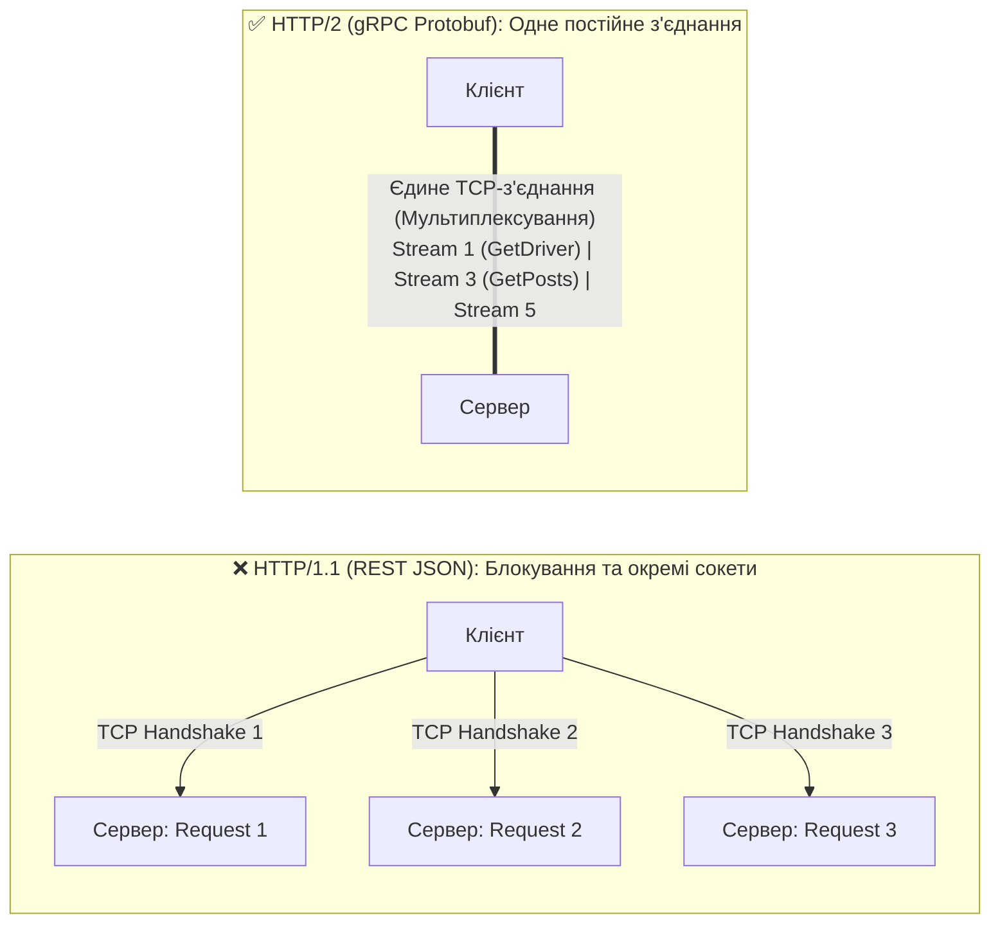
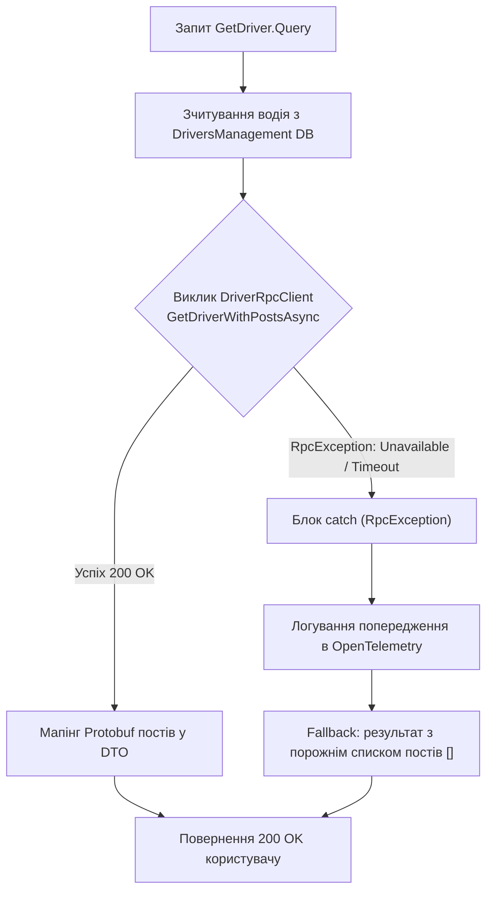

# ⚡ 03. Патерни синхронної міжсервісної взаємодії: gRPC та Protocol Buffers

> **Блок 2:** `02-Microservices-Craftsman`  
> **Технологічний стек:** .NET 10, gRPC (`Grpc.AspNetCore`, `Grpc.Net.Client`, `Grpc.Tools`), Protocol Buffers (`Google.Protobuf`), HTTP/2 Мультиплексування, C# Code Generation, Graceful Degradation.

---

## 1. Теоретична концепція: Чому gRPC для внутрішньої комунікації?

У сучасних розподілених мікросервісних системах розрізняють дві принципово різні площини взаємодії:

1. **Зовнішнє API (North-South Traffic / Ingress):**  
   Зв'язок між зовнішніми клієнтами (браузери, мобільні додатки) та бекендом. Тут домінує **REST HTTP/1.1 або HTTP/2 JSON**, тому що це загальновизнаний відкритий стандарт, зрозумілий фронтенд-розробникам і браузерним рушіям.
   
2. **Внутрішнє API (East-West Traffic / Service-to-Service):**  
   Зв'язок між сервісами всередині приватного кластера (наприклад, `DriversManagement ➔ DriversBlogManagement`). Використання тут важкого текстового REST JSON є марнотратством обчислювальних ресурсів процесора та мережі. Внутрішня комунікація вимагає:
   * **Мінімальної затримки (Sub-millisecond Latency).**
   * **Мінімального розміру корисного навантаження (Payload).**
   * **Суворої контрактної типізації**, яка перевіряється на етапі компіляції проекту.

Саме ці завдання ідеально вирішує **gRPC** (розроблений Google високопродуктивний RPC-фреймворк).

---

## 2. Глибоке порівняння: REST JSON проти gRPC Protobuf

| Характеристика | Класичний REST (JSON) | gRPC (Protocol Buffers) | Перевага gRPC |
| :--- | :--- | :--- | :--- |
| **Транспортний протокол** | HTTP/1.1 (текстовий, Head-of-Line blocking) | **HTTP/2** (бінарний фреймінг, єдине постійне з'єднання) | Відсутність затримок на TCP Handshake |
| **Мультиплексування** | ❌ Немає (1 запит = 1 TCP з'єднання) | **✅ Так** (сотні паралельних потоків в одному сокеті) | Економія сокетів операційної системи |
| **Стиснення заголовків**| ❌ Тільки важкі текстові HTTP-заголовки | **✅ Алгоритм HPACK** | Економія до 80% мережевого оверхеду |
| **Формат корисного навантаження**| Текстовий JSON (дублювання імен полів у кожному рядку) | **Бінарний Protobuf** (числові теги полів `1, 2, 3`) | Компактність байтів у 5–10 разів вища |
| **Швидкість серіалізації** | Повільний парсинг рядків у CPU | **Пряма бінарна десеріалізація** | У 6–8 разів швидше за `System.Text.Json` |
| **Контракт** | Слабкий (Swagger/OpenAPI часто застаріває) | **Суворий `.proto` файл** | Помилка несумісності виявляється під час білду |
| **Генерація клієнтів** | Ручна або сторонні генератори | **Автоматична компіляція `protoc` у MSBuild** | Готовий C# клієнт без жодного рядка коду вручну |

---

## 3. Аналогія з реального життя: Поштовий лист проти Спецзв'язку

* **REST JSON** схожий на відправку офіційного паперового листа через кур'єрську службу. Вам потрібно роздрукувати текст на аркуші, покласти в конверт, наклеїти марку, а адресат повинен розрізати ножицями конверт, прочитати кожне слово та розпарсити сенс. Це надійно, але повільно й марнотратно.
* **gRPC** схожий на **закритий телефонний спецзв'язок (пряма гаряча лінія)** між кабінетами двох директорів. Кабель зв'язку вже протягнутий і постійно підключений (`HTTP/2 Multiplexing`). Розмова ведеться короткими військовими радіокодами (`Protobuf`), інформація передається миттєво без зайвих формальностей.

---

## 4. Архітектурні діаграми

### 4.1. Мультиплексування HTTP/2 в одному TCP-з'єднанні



---

### 4.2. Повна діаграма послідовності виклику (Sequence Diagram)

Діаграма відображає наскрізний шлях запиту: від веб-клієнта, через MediatR у `DriversManagement`, до віддаленого gRPC-сервера `DriversBlogManagement`:

```mermaid
sequenceDiagram
    autonumber
    actor Client as 📱 Веб-клієнт / Frontend
    participant DM_API as 🚚 DriversController (REST)
    participant MediatR as ⚙️ GetDriver.Handler (CQRS)
    participant Local_DB as 🗄️ DriversManagement DB (EF Core)
    participant gRPC_Client as 🔌 DriverRpcClient (HTTP/2)
    participant Blog_Server as 📝 DriverRpcService (gRPC Сервер)
    participant Blog_DB as 🗄️ DriversBlog DB (EF Core)

    Client->>DM_API: GET /api/v1/drivers/{id}
    DM_API->>MediatR: Send(GetDriver.Query(id))
    
    %% Локальне зчитування
    MediatR->>Local_DB: GetById(id)
    Local_DB-->>MediatR: Driver aggregate entity

    %% Віддалений gRPC дзвінок
    rect rgb(20, 35, 60)
        note over MediatR,Blog_Server: Синхронний бінарний RPC-виклик по протоколу HTTP/2
        MediatR->>gRPC_Client: GetDriverWithPostsAsync(DriverWithPostsRequest)
        gRPC_Client->>Blog_Server: POST /DriverRpc/GetDriverWithPosts (Protobuf Frames)
        Blog_Server->>Blog_DB: GetDriverWithPosts(driverId)
        Blog_DB-->>Blog_Server: Posts List
        Blog_Server-->>gRPC_Client: DriverWithPostsResponse (Binary Payload)
        gRPC_Client-->>MediatR: grpcResponse.Posts
    end

    %% Відповідь клієнту
    MediatR-->>DM_API: FullDataAboutDriverAndPostsDto
    DM_API-->>Client: 200 OK (Композитний JSON)
```



---

### 4.3. Діаграма обробки збоїв (Graceful Degradation Flow)

Якщо віддалений мікросервіс блогів недоступний, система не повинна зазнавати каскадного колапсу (**Cascading Failure**):



---

## 5. Детальний розбір вихідного коду проєкту

### 5.1. Контракт Protocol Buffers (Driver.proto)

Контракт є єдиним джерелом правди між двома мікросервісами.

> 📍 **Шлях до файлу:** `DriversBlogManagement/src/DriversBlogManagement/Domain/Drivers/Protos/Driver.proto`

[👉 **Перейти до файлу (клікніть тут)**](../DriversBlogManagement/src/DriversBlogManagement/Domain/Drivers/Protos/Driver.proto)

```protobuf
syntax = "proto3";

option csharp_namespace = "DriversBlogManagement";

// Опис gRPC-сервісу з віддаленою процедурою
service DriverRpc {
  rpc GetDriverWithPosts(DriverWithPostsRequest) returns (DriverWithPostsResponse);
}

// Запит: містить лише ідентифікатор водія (число 1 - це числовий тег Protobuf)
message DriverWithPostsRequest {
  string driver_id = 1;
}

// Відповідь: містить дані водія та колекцію повторюваних постів (repeated)
message DriverWithPostsResponse {
  string driver_id = 1;
  string first_name = 2;
  string last_name = 3;
  repeated PostAboutDriverResponse posts = 4;
}

message PostAboutDriverResponse {
  string id = 1;
  string title = 2;
  string content = 3;
}
```

> [!NOTE]
> Числа `= 1; = 2; = 3;` — це **не значення за замовчуванням**, а **бінарні теги полів**. Саме за цими номерами Protobuf серіалізує дані в байти, не передаючи довгі текстові імена полів `first_name`, що й забезпечує неймовірну швидкість та компактність.

---

### 5.2. Серверний gRPC сервіс (DriverRpcService.cs)

Сервер реалізує абстрактний базовий клас `DriverRpc.DriverRpcBase`, згенерований пакетом `Grpc.Tools`:

> 📍 **Шлях до файлу:** `DriversBlogManagement/src/DriversBlogManagement/Domain/Drivers/Services/DriverRpcService.cs`  
> 📝 *У файлі наведено докладні покрокові коментарі українською мовою.*

[👉 **Перейти до файлу (клікніть тут)**](../DriversBlogManagement/src/DriversBlogManagement/Domain/Drivers/Services/DriverRpcService.cs#L10-L60)

Фрагмент реалізації методу:
```csharp
public class DriverRpcService : DriverRpc.DriverRpcBase
{
    private readonly DriverRepository _driverRepository;

    public DriverRpcService(DriverRepository driverRepository)
    {
        _driverRepository = driverRepository;
    }

    public override async Task<DriverWithPostsResponse> GetDriverWithPosts(
        DriverWithPostsRequest request, 
        ServerCallContext context)
    {
        // context.CancellationToken дозволяє перервати запит, якщо клієнт відключився
        var driverId = Guid.Parse(request.DriverId);
        var driverWithPostsDto = await _driverRepository.GetDriverWithPosts(driverId);

        var response = new DriverWithPostsResponse
        {
            DriverId = driverWithPostsDto.DriverId.ToString(),
            FirstName = driverWithPostsDto.FirstName,
            LastName = driverWithPostsDto.LastName
        };

        foreach (var post in driverWithPostsDto.Posts)
        {
            response.Posts.Add(new PostAboutDriverResponse
            {
                Id = post.Id.ToString(),
                Title = post.Title,
                Content = post.Content
            });
        }

        return response;
    }
}
```

Реєстрація сервісу у конвеєрі маршрутизації `DriversBlogManagement`:
```csharp
// Program.cs у DriversBlogManagement:
app.MapGrpcService<DriverRpcService>();
```

---

### 5.3. Клієнтська конфігурація та Service Discovery (WebAppServiceConfiguration.cs)

У мікросервісі `DriversManagement` клієнт gRPC реєструється через фабрику:

> 📍 **Шлях до файлу:** `DriversManagement/src/DriversManagement/Extensions/Services/WebAppServiceConfiguration.cs`

[👉 **Перейти до файлу (клікніть тут)**](../DriversManagement/src/DriversManagement/Extensions/Services/WebAppServiceConfiguration.cs#L42-L51)

```csharp
builder.Services.AddGrpcClient<DriverRpc.DriverRpcClient>(options =>
{
    // Адресація за іменем сервісу через .NET Aspire Service Discovery
    var grpcAddress = builder.Configuration["services:driversblogmanagement:https:0"]
        ?? builder.Configuration["services:driversblogmanagement:http:0"]
        ?? "https://localhost:5002";

    options.Address = new Uri(grpcAddress);
});
```

---

### 5.4. Виклик клієнта з патерном Graceful Degradation (GetDriver.cs)

> 📍 **Шлях до файлу:** `DriversManagement/src/DriversManagement/Domain/Drivers/Features/GetDriver.cs`  
> 📝 *У файлі наведено докладні покрокові коментарі українською мовою.*

[👉 **Перейти до файлу (клікніть тут)**](../DriversManagement/src/DriversManagement/Domain/Drivers/Features/GetDriver.cs#L55-L105)

Фрагмент захищеного виклику:
```csharp
try
{
    var grpcRequest = new DriverWithPostsRequest { DriverId = request.DriverId.ToString() };
    
    // Синхронний виклик через згенерований типізований клієнт
    DriverWithPostsResponse grpcResponse = await _client.GetDriverWithPostsAsync(
        grpcRequest, 
        cancellationToken: cancellationToken);

    if (grpcResponse?.Posts != null)
    {
        result.Posts = grpcResponse.Posts.Select(p => new PostAboutDriverDto
        {
            Id = Guid.TryParse(p.Id, out var postId) ? postId : Guid.Empty,
            Title = p.Title,
            Content = p.Content
        }).ToList();
    }
}
catch (RpcException)
{
    // ПАТЕРН СТІЙКОСТІ (GRACEFUL DEGRADATION):
    // Якщо мікросервіс блогів упав або не відповідає, повертаємо профіль водія
    // з порожнім списком постів, рятуючи користувацьку операцію від помилки 500!
    result.Posts = new List<PostAboutDriverDto>();
}
```

---

## 6. Чеклист для впровадження gRPC у мікросервісах

- [x] **Єдиний `.proto` контракт:** створюйте чіткі повідомлення та сервіси у файлі `.proto`.
- [x] **Налаштуйте MSBuild Protobuf:** додайте `<Protobuf Include="Protos\*.proto" GrpcServices="Server" />` на сервері та `GrpcServices="Client"` на клієнті.
- [x] **HTTP/2 Endpoints:** переконайтеся, що Kestrel налаштований на підтримку протоколу `HttpProtocols.Http2`.
- [x] **Впроваджуйте Graceful Degradation:** завжди перехоплюйте `RpcException` на клієнтській стороні.
- [x] **Передавайте `CancellationToken`:** скасовуйте тривалі операції на сервері при відміні виклику клієнтом.
- [x] **Використовуйте Service Discovery:** підключайте клієнти через логічні імена .NET Aspire.

---

## 7. Швидка навігація по вихідному коду

* 📜 **Контракт Protocol Buffers:**
  * [👉 **Перейти до Driver.proto**](../DriversBlogManagement/src/DriversBlogManagement/Domain/Drivers/Protos/Driver.proto)
* ⚡ **Сервер gRPC (DriversBlogManagement):**
  * [👉 **Перейти до DriverRpcService.cs**](../DriversBlogManagement/src/DriversBlogManagement/Domain/Drivers/Services/DriverRpcService.cs#L10-L60)
* 🔌 **Клієнт gRPC (DriversManagement):**
  * [👉 **Перейти до WebAppServiceConfiguration.cs (Реєстрація)**](../DriversManagement/src/DriversManagement/Extensions/Services/WebAppServiceConfiguration.cs#L42-L51)
  * [👉 **Перейти до GetDriver.cs (Виклик з Graceful Degradation)**](../DriversManagement/src/DriversManagement/Domain/Drivers/Features/GetDriver.cs#L55-L105)

