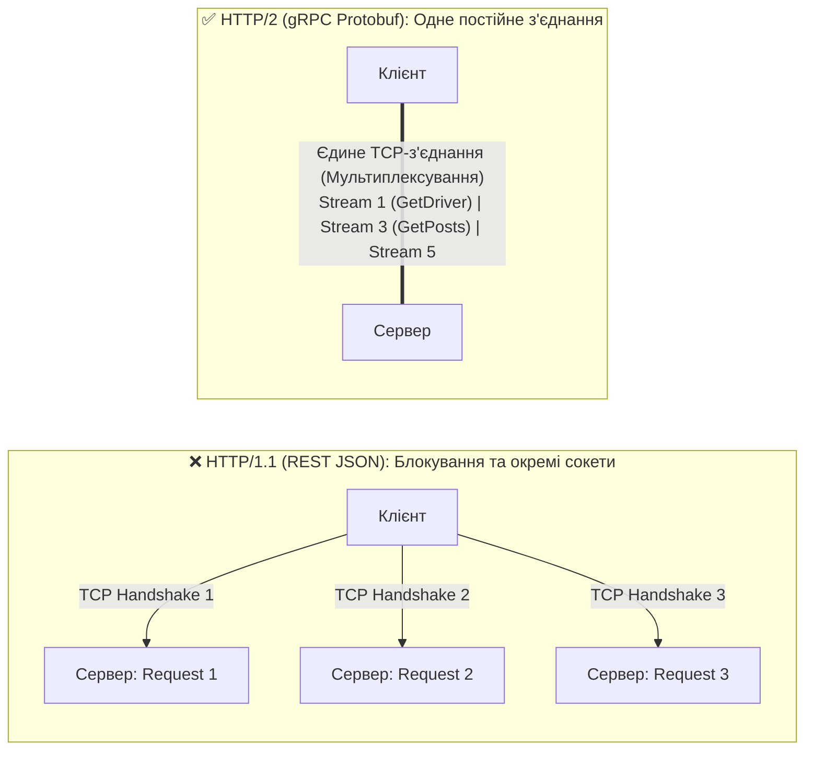
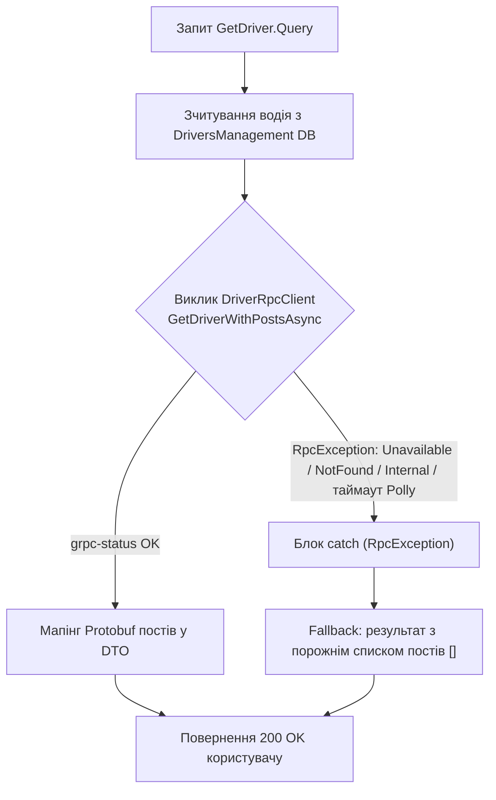

# ⚡ 03. Патерни синхронної міжсервісної взаємодії: gRPC та Protocol Buffers

> **Блок 2:** `02-Microservices-Craftsman`  
> **Технологічний стек:** .NET 10, gRPC (`Grpc.AspNetCore` 2.71, `Grpc.Net.Client` 2.71, `Grpc.Tools` 2.71), Protocol Buffers (`Google.Protobuf` 3.30), HTTP/2 Мультиплексування, C# Code Generation, Aspire Service Discovery, Polly, Graceful Degradation.  
> **Як читати посилання:** `Файл.cs#L42` відкриває файл на потрібному рядку (VS Code Markdown Preview — `Ctrl+Shift+V`).

---

## 1. Теоретична концепція: Чому gRPC для внутрішньої комунікації?

У сучасних розподілених мікросервісних системах розрізняють дві принципово різні площини взаємодії:

1. **Зовнішнє API (North-South Traffic / Ingress):**  
   Зв'язок між зовнішніми клієнтами (браузери, мобільні додатки) та бекендом. Тут домінує **REST HTTP/1.1 або HTTP/2 JSON**, тому що це загальновизнаний відкритий стандарт, зрозумілий фронтенд-розробникам і браузерним рушіям.
   
2. **Внутрішнє API (East-West Traffic / Service-to-Service):**  
   Зв'язок між сервісами всередині приватного кластера (наприклад, `DriversManagement ➔ DriversBlogManagement`). Використання тут текстового REST JSON є марнотратством обчислювальних ресурсів процесора та мережі. Внутрішня комунікація вимагає:
   * **Мінімальної затримки (Low Latency).**
   * **Мінімального розміру корисного навантаження (Payload).**
   * **Суворої контрактної типізації**, яка перевіряється на етапі компіляції проекту.

Саме ці завдання вирішує **gRPC** (розроблений Google RPC-фреймворк, нині проєкт CNCF).

> 🧭 **RPC (Remote Procedure Call)** — ідея «викликати метод на іншій машині так, ніби він локальний». gRPC — її сучасна реалізація: опис методів у `.proto` → генерація клієнта й сервера → виклик `await client.GetDriverWithPostsAsync(request)`. Але «як локальний» — небезпечна ілюзія: мережа може впасти, тож кожен виклик потребує таймауту (deadline) і обробки `RpcException` (див. омани розподілених обчислень у [02-01 гайді 01](../02-01-Aspire-Documentation/01_Aspire_Orchestration_AppHost_DeepDive.md#section-1)).

---

## 2. Глибоке порівняння: REST JSON проти gRPC Protobuf

| Характеристика | Класичний REST (JSON) | gRPC (Protocol Buffers) | Перевага gRPC |
| :--- | :--- | :--- | :--- |
| **Транспортний протокол** | Зазвичай HTTP/1.1 (текстовий, Head-of-Line blocking на рівні з'єднання) | **HTTP/2** (бінарний фреймінг, єдине постійне з'єднання) | Відсутність затримок на повторні TCP/TLS Handshake |
| **Мультиплексування** | ❌ HTTP/1.1: на одному з'єднанні — один запит за раз (паралельність = кілька з'єднань) | **✅ Так** (сотні паралельних потоків в одному сокеті) | Економія сокетів операційної системи |
| **Стиснення заголовків**| ❌ Текстові HTTP/1.1-заголовки передаються щоразу | **✅ Алгоритм HPACK** (повторювані заголовки кодуються індексами) | Суттєва економія мережевого оверхеду на дрібних викликах |
| **Формат корисного навантаження**| Текстовий JSON (імена полів у кожному об'єкті) | **Бінарний Protobuf** (числові теги полів `1, 2, 3`) | Payload у кілька разів компактніший |
| **Швидкість серіалізації** | Парсинг рядків, перетворення чисел із тексту | **Пряма бінарна десеріалізація** | Зазвичай у рази швидше за JSON (залежить від даних) |
| **Контракт** | Слабкий (Swagger/OpenAPI часто застаріває) | **Суворий `.proto` файл** | Помилка несумісності виявляється під час білду |
| **Генерація клієнтів** | Ручна або сторонні генератори | **Автоматична компіляція `protoc` у MSBuild** (`Grpc.Tools`) | Готовий C# клієнт без жодного рядка коду вручну |
| **Режими викликів** | Лише запит-відповідь | Unary, Server streaming, Client streaming, Bidirectional streaming | Потокові сценарії «з коробки» |
| **Підтримка браузерів** | ✅ Нативна | ⚠️ Лише через gRPC-Web / JSON transcoding | REST лишається для зовнішніх API |

---

## 3. Аналогія з реального життя: Поштовий лист проти Спецзв'язку

* **REST JSON** схожий на відправку офіційного паперового листа через кур'єрську службу. Вам потрібно роздрукувати текст на аркуші, покласти в конверт, наклеїти марку, а адресат повинен розрізати ножицями конверт, прочитати кожне слово та розпарсити сенс. Це надійно, але повільно й марнотратно.
* **gRPC** схожий на **закритий телефонний спецзв'язок (пряма гаряча лінія)** між кабінетами двох директорів. Кабель зв'язку вже протягнутий і постійно підключений (`HTTP/2 Multiplexing`). Розмова ведеться короткими кодами (`Protobuf`), інформація передається миттєво без зайвих формальностей. Але якщо на іншому кінці ніхто не бере слухавку — ви все одно маєте вирішити, скільки чекати (deadline) і що робити далі (fallback).

---

## 4. Архітектурні діаграми

### 4.1. Мультиплексування HTTP/2 в одному TCP-з'єднанні



### 4.2. Що насправді летить у мережі
Унарний gRPC-виклик — це один HTTP/2-запит:
```
POST /DriverRpc/GetDriverWithPosts  HTTP/2
content-type: application/grpc
te: trailers
traceparent: 00-…-01                     ← W3C TraceContext (OpenTelemetry)
[DATA] 1 байт прапорця стиснення + 4 байти довжини + Protobuf-повідомлення
──────────── відповідь ────────────
:status 200, content-type: application/grpc
[DATA] Protobuf DriverWithPostsResponse
[TRAILERS] grpc-status: 0  grpc-message: …   ← справжній результат виклику
```
> 💡 **HTTP 200 ≠ успіх gRPC.** Результат передається в трейлері `grpc-status`. Тому в трейсах Aspire серверний спан gRPC може мати `http.response.status_code = 200` і водночас `grpc.status_code = 2` (Unknown) — саме так ми знайшли помилку DI на сервері (див. §5.2).

### 4.3. Як Protobuf кодує дані (wire format)
Кожне поле кодується як `(номер_поля << 3 | тип) + значення`. Наприклад, `driver_id = 1` з рядком GUID (36 символів) займає `0x0A` (тег 1, тип «length-delimited») + `0x24` (довжина 36) + 36 байт. Імені `driver_id` у бінарних даних немає взагалі — тому **номери полів не можна змінювати**, а імена — можна.

### 4.4. Повна діаграма послідовності виклику (Sequence Diagram)

Діаграма відображає наскрізний шлях запиту: від веб-клієнта, через MediatR у `DriversManagement`, до віддаленого gRPC-сервера `DriversBlogManagement`:

```mermaid
sequenceDiagram
    autonumber
    actor Client as 📱 Веб-клієнт / Frontend
    participant DM_API as 🚚 DriversController (REST)
    participant MediatR as ⚙️ GetDriver.Handler (CQRS)
    participant Local_DB as 🗄️ DriversManagement DB (EF Core)
    participant gRPC_Client as 🔌 DriverRpcClient (HTTP/2)
    participant Blog_Server as 📝 DriverRpcService (gRPC Сервер)
    participant Blog_DB as 🗄️ DriversBlog DB (EF Core)

    Client->>DM_API: GET /api/drivers/{id}
    DM_API->>MediatR: Send(GetDriver.Query(id))
    
    %% Локальне зчитування
    MediatR->>Local_DB: GetById(id)
    Local_DB-->>MediatR: Driver aggregate entity

    %% Віддалений gRPC дзвінок
    rect rgb(20, 35, 60)
        note over MediatR,Blog_Server: Синхронний бінарний RPC-виклик по протоколу HTTP/2
        MediatR->>gRPC_Client: GetDriverWithPostsAsync(DriverWithPostsRequest)
        gRPC_Client->>Blog_Server: POST /DriverRpc/GetDriverWithPosts (Protobuf Frames)
        Blog_Server->>Blog_DB: GetDriverWithPosts(driverId)
        Blog_DB-->>Blog_Server: Тіньовий водій + пости
        Blog_Server-->>gRPC_Client: DriverWithPostsResponse (Binary Payload)
        gRPC_Client-->>MediatR: grpcResponse.Posts
    end

    %% Відповідь клієнту
    MediatR-->>DM_API: FullDataAboutDriverAndPostsDto
    DM_API-->>Client: 200 OK (Композитний JSON з полем posts)
```



---

### 4.5. Діаграма обробки збоїв (Graceful Degradation Flow)

Якщо віддалений мікросервіс блогів недоступний, система не повинна зазнавати каскадного колапсу (**Cascading Failure**):



---

## 5. Детальний розбір вихідного коду проєкту

### 5.1. Контракт Protocol Buffers (Driver.proto)

Контракт є єдиним джерелом правди між двома мікросервісами. Файл містить розгорнуті українські коментарі про генерацію коду та правила еволюції.

> 📍 **Шлях до файлу:** `DriversBlogManagement/src/DriversBlogManagement/Domain/Drivers/Protos/Driver.proto`

[👉 **Перейти до файлу (клікніть тут)**](../DriversBlogManagement/src/DriversBlogManagement/Domain/Drivers/Protos/Driver.proto)

```protobuf
syntax = "proto3";

option csharp_namespace = "DriversBlogManagement";

// Запит: отримати водія разом із його постами.
// "= 1" — це НЕ значення за замовчуванням, а НОМЕР ПОЛЯ (тег) у бінарному форматі.
message DriverWithPostsRequest {
  string driver_id = 1; // GUID у вигляді рядка (у Protobuf немає вбудованого типу Guid)
}

// Одна унарна віддалена процедура → HTTP/2 POST /DriverRpc/GetDriverWithPosts
service DriverRpc {
  rpc GetDriverWithPosts(DriverWithPostsRequest) returns (DriverWithPostsResponse);
}

message DriverWithPostsResponse {
  string driver_id = 1;
  string first_name = 2;
  string last_name = 3;
  repeated PostAboutDriverResponse posts = 4; // repeated = список (у C# — RepeatedField<T>)
}

message PostAboutDriverResponse {
  string id = 1;
  string title = 2;
  string content = 3;
}
```

> [!NOTE]
> Числа `= 1; = 2; = 3;` — це **не значення за замовчуванням**, а **бінарні теги полів**. Саме за цими номерами Protobuf серіалізує дані в байти, не передаючи довгі текстові імена полів `first_name`, що й забезпечує швидкість та компактність.

#### Правила еволюції контракту (зворотна сумісність)
| Зміна | Безпечно? | Чому |
| :--- | :--- | :--- |
| Додати нове поле з новим номером | ✅ | Старий клієнт ігнорує невідомі поля |
| Перейменувати поле, зберігши номер | ✅ | Ім'я не передається по мережі |
| Видалити поле | ⚠️ | Лише разом з `reserved 4;`, щоб номер ніхто не перевикористав |
| Змінити номер чи тип наявного поля | ❌ | Старі клієнти прочитають «сміття» |

#### Contract-first: як один `.proto` компілюється у двох сервісах
| Сервіс | Рядок у `.csproj` | Що генерується |
| :--- | :--- | :--- |
| DriversBlogManagement (сервер) | `<Protobuf Include="Domain\Drivers\Protos\Driver.proto" GrpcServices="Both" />` — [csproj#L71](../DriversBlogManagement/src/DriversBlogManagement/DriversBlogManagement.csproj#L71) | Базовий клас `DriverRpc.DriverRpcBase` (+ клієнт) |
| DriversManagement (клієнт) | `<Protobuf Include="..\..\..\DriversBlogManagement\...\Driver.proto" GrpcServices="Client" Link="Protos\Driver.proto" />` — [DriversManagement.csproj](../DriversManagement/src/DriversManagement/DriversManagement.csproj) | Лише `DriverRpc.DriverRpcClient` |

> 🐞 **Що було виправлено.** Раніше DriversManagement отримував згенеровані gRPC-типи через `ProjectReference` на **весь** проєкт DriversBlogManagement. Через це в процес DriversManagement потрапляли контролери блогу, і `GET /api/drivers` падав з `AmbiguousMatchException` (два `DriversController` з однаковим маршрутом). Тепер сервіси ділять лише контракт — класичний підхід **contract-first**.

---

### 5.2. Серверний gRPC сервіс (DriverRpcService.cs)

Сервер реалізує абстрактний базовий клас `DriverRpc.DriverRpcBase`, згенерований пакетом `Grpc.Tools`:

> 📍 **Шлях до файлу:** `DriversBlogManagement/src/DriversBlogManagement/Domain/Drivers/Services/DriverRpcService.cs` — залежність [#L34](../DriversBlogManagement/src/DriversBlogManagement/Domain/Drivers/Services/DriverRpcService.cs#L34), метод [#L57](../DriversBlogManagement/src/DriversBlogManagement/Domain/Drivers/Services/DriverRpcService.cs#L57), обробка помилок [#L97-L106](../DriversBlogManagement/src/DriversBlogManagement/Domain/Drivers/Services/DriverRpcService.cs#L97)  
> 📝 *У файлі наведено докладні покрокові коментарі українською мовою.*

[👉 **Перейти до файлу (клікніть тут)**](../DriversBlogManagement/src/DriversBlogManagement/Domain/Drivers/Services/DriverRpcService.cs#L57)

Фрагмент реалізації методу:
```csharp
public class DriverRpcService : DriverRpc.DriverRpcBase
{
    // Залежимо від АБСТРАКЦІЇ: DI реєструє репозиторії за інтерфейсами
    private readonly IDriverRepository _driverRepository;

    public DriverRpcService(IDriverRepository driverRepository)
    {
        _driverRepository = driverRepository;
    }

    public override async Task<DriverWithPostsResponse> GetDriverWithPosts(
        DriverWithPostsRequest request, 
        ServerCallContext context)
    {
        try
        {
            if (!Guid.TryParse(request.DriverId, out var driverId))
                throw new RpcException(new Status(StatusCode.InvalidArgument, "Некоректний формат DriverId GUID"));

            var driverWithPostsDto = await _driverRepository.GetDriverWithPosts(driverId);
            if (driverWithPostsDto == null)
                throw new RpcException(new Status(StatusCode.NotFound, $"Водія {driverId} не знайдено у блозі"));

            var response = new DriverWithPostsResponse
            {
                DriverId = driverWithPostsDto.DriverId.ToString(),
                FirstName = driverWithPostsDto.FirstName ?? string.Empty,  // Protobuf string не приймає null!
                LastName = driverWithPostsDto.LastName ?? string.Empty
            };

            foreach (var post in driverWithPostsDto.Posts)
            {
                response.Posts.Add(new PostAboutDriverResponse
                {
                    Id = post.Id.ToString(),
                    Title = post.Title ?? string.Empty,
                    Content = post.Content ?? string.Empty
                });
            }

            return response;
        }
        catch (RpcException) { throw; }                      // відомі gRPC-статуси — без змін
        catch (Exception ex)
        {
            throw new RpcException(new Status(StatusCode.Internal, $"Внутрішня помилка gRPC сервера: {ex.Message}"));
        }
    }
}
```

> 🐞 **Реальна помилка, знайдена через трасування.** Раніше конструктор приймав **конкретний** клас `DriverRepository`. DI-контейнер реєструє репозиторії лише за інтерфейсами (`AddBoundaryServices` → `IDriverRepository`), тож сервіс **не створювався взагалі**. Кожен виклик завершувався `grpc.status_code = 2` (Unknown) ще до входу в метод — тому `try/catch` усередині не допомагав, а клієнт мовчки застосовував Graceful Degradation (пости завжди порожні). У трейсі Aspire це було видно як серверний gRPC-спан **без жодного SQL-спану** під ним.

#### Карта статусів gRPC, які варто знати
| `StatusCode` | Коли повертати | Повторювати? |
| :--- | :--- | :--- |
| `OK (0)` | Успіх | — |
| `InvalidArgument (3)` | Некоректний запит (не GUID) | ❌ Ні — повтор дасть те саме |
| `NotFound (5)` | Тіньового водія ще немає (подія з RabbitMQ ще не дійшла) | ⚠️ Інколи — eventual consistency |
| `Unavailable (14)` | Сервер недоступний / перезапускається | ✅ Так — класичний транзієнтний збій |
| `DeadlineExceeded (4)` | Вичерпано deadline клієнта | ⚠️ Обережно |
| `Internal (13)` / `Unknown (2)` | Необроблений виняток на сервері | ❌ Як правило, ні |

Реєстрація сервісу у конвеєрі маршрутизації `DriversBlogManagement` ([Program.cs#L39](../DriversBlogManagement/src/DriversBlogManagement/Program.cs#L39)):
```csharp
// Program.cs у DriversBlogManagement:
app.MapGrpcService<DriverRpcService>();
```
і `builder.Services.AddGrpc(o => o.EnableDetailedErrors = true)` у [WebAppServiceConfiguration.cs#L41](../DriversBlogManagement/src/DriversBlogManagement/Extensions/Services/WebAppServiceConfiguration.cs#L41). `EnableDetailedErrors` передає текст винятку клієнту — зручно в розробці, але в продакшні це витік внутрішніх деталей.

---

### 5.3. Клієнтська конфігурація та Service Discovery (WebAppServiceConfiguration.cs)

У мікросервісі `DriversManagement` клієнт gRPC реєструється через фабрику:

> 📍 **Шлях до файлу:** `DriversManagement/src/DriversManagement/Extensions/Services/WebAppServiceConfiguration.cs` — [#L52-L62](../DriversManagement/src/DriversManagement/Extensions/Services/WebAppServiceConfiguration.cs#L52)

[👉 **Перейти до файлу (клікніть тут)**](../DriversManagement/src/DriversManagement/Extensions/Services/WebAppServiceConfiguration.cs#L52)

```csharp
builder.Services.AddGrpcClient<DriverRpc.DriverRpcClient>(options =>
{
    // Під Aspire: логічне ім'я (резолвить Service Discovery зі змінної
    // services__driversblogmanagement__https__0). Без Aspire: GrpcServer:Address з appsettings.
    var grpcAddress = builder.Configuration["services:driversblogmanagement:https:0"] is not null
        ? "https://driversblogmanagement"
        : builder.Configuration.GetSection("GrpcServer")["Address"] ?? "https://localhost:5002";

    options.Address = new Uri(grpcAddress);
})
.RemoveAllResilienceHandlers()
// Пости блогу — некритичні дані профілю: короткий бюджет часу замість стандартних 30 с
.AddStandardResilienceHandler(SoftDependencyBudget);
```

Що тут важливо:
1. **`AddGrpcClient` використовує `IHttpClientFactory`.** Тому на gRPC-клієнт діють глобальні налаштування ServiceDefaults: обробник Service Discovery та стандартний конвеєр Polly. Ми свідомо замінюємо конвеєр на короткий бюджет (`SoftDependencyBudget`: спроба 1 с, 1 повтор, загалом ≤3 с).
2. **Чому HTTPS.** gRPC працює лише поверх HTTP/2. Kestrel на HTTPS-ендпоінті вмикає `Http1AndHttp2` і узгоджує HTTP/2 через TLS ALPN. Для HTTP без TLS довелося б окремо вмикати `Http2` (prior knowledge) — тому для gRPC беремо саме HTTPS-адресу.
3. **Версії пакетів.** gRPC-пакети оновлено з 2.60 до 2.71: стара `Grpc.Net.ClientFactory` кидала `InvalidOperationException: The ConfigureHttpClient method is not supported when creating gRPC clients`, бо стандартний конвеєр Polly з ServiceDefaults налаштовує `HttpClient` саме через `ConfigureHttpClient`.

---

### 5.4. Виклик клієнта з патерном Graceful Degradation (GetDriver.cs)

> 📍 **Шлях до файлу:** `DriversManagement/src/DriversManagement/Domain/Drivers/Features/GetDriver.cs` — виклик [#L93](../DriversManagement/src/DriversManagement/Domain/Drivers/Features/GetDriver.cs#L93), fallback [#L108](../DriversManagement/src/DriversManagement/Domain/Drivers/Features/GetDriver.cs#L108)  
> 📝 *У файлі наведено докладні покрокові коментарі українською мовою.*

[👉 **Перейти до файлу (клікніть тут)**](../DriversManagement/src/DriversManagement/Domain/Drivers/Features/GetDriver.cs#L73)

Фрагмент захищеного виклику:
```csharp
try
{
    var grpcRequest = new DriverWithPostsRequest { DriverId = request.DriverId.ToString() };
    
    // Синхронний (з точки зору сценарію) виклик через згенерований типізований клієнт
    DriverWithPostsResponse grpcResponse = await _client.GetDriverWithPostsAsync(
        grpcRequest, 
        cancellationToken: cancellationToken);

    if (grpcResponse?.Posts != null)
    {
        // Мапінг Protobuf-повідомлень у ВЛАСНИЙ DTO сервісу (не в клас із сервісу блогу!)
        result.Posts = grpcResponse.Posts.Select(p => new PostAboutDriverDto
        {
            Id = Guid.TryParse(p.Id, out var postId) ? postId : Guid.Empty,
            Title = p.Title,
            Content = p.Content
        }).ToList();
    }
}
catch (RpcException)
{
    // ПАТЕРН СТІЙКОСТІ (GRACEFUL DEGRADATION):
    // Якщо мікросервіс блогів упав або не відповідає, повертаємо профіль водія
    // з порожнім списком постів, рятуючи користувацьку операцію від помилки 500!
    result.Posts = new List<PostAboutDriverDto>();
}
```

> ⚠️ **Тиха деградація ховає баги.** Порожній `catch` без логування — саме тому помилку DI на сервері (§5.2) не було видно. Хороша практика — хоча б `LogWarning(ex, ...)` з `ex.StatusCode`, а в моніторингу — метрика «частка деградованих відповідей».

> ⏱️ **Deadline.** gRPC має власне поняття граничного часу: `_client.GetDriverWithPostsAsync(req, deadline: DateTime.UtcNow.AddSeconds(2))`. У нашому коді роль deadline виконує конвеєр Polly (`AttemptTimeout` = 1 с, `TotalRequestTimeout` = 3 с). Важливо, щоб deadline **поширювався** далі: якщо клієнт чекає 3 с, серверу немає сенсу працювати 10 с — ASP.NET Core gRPC передає його в `context.CancellationToken`.

### 5.5. Реальна поведінка на стенді
| Сценарій | Результат `GET /api/drivers/{id}` |
| :--- | :--- |
| Блог працює, у водія є пост | 200, `posts: [{ "title": "Траса М-06: ремонт мосту", … }]` (~30 мс) |
| Блог працює, тіньового водія ще немає | 200, `posts: []` (сервер повертає `NotFound`, клієнт деградує) |
| Блог зупинено в дашборді | 200, `posts: []` за ≈2.3 с (короткий бюджет Polly) |

---

## 6. Чеклист для впровадження gRPC у мікросервісах

- [x] **Єдиний `.proto` контракт:** створюйте чіткі повідомлення та сервіси у файлі `.proto`.
- [x] **Налаштуйте MSBuild Protobuf:** `<Protobuf Include="Protos\*.proto" GrpcServices="Server" />` на сервері та `GrpcServices="Client"` на клієнті — **без** `ProjectReference` на сервіс-сервер.
- [x] **HTTP/2 Endpoints:** переконайтеся, що Kestrel обслуговує HTTP/2 (за замовчуванням так для HTTPS).
- [x] **Впроваджуйте Graceful Degradation:** перехоплюйте `RpcException` на клієнтській стороні — і логуйте його.
- [x] **Задайте deadline / бюджет Polly:** gRPC-виклик без обмеження часу так само небезпечний, як HTTP.
- [x] **Передавайте `CancellationToken`:** скасовуйте тривалі операції на сервері при відміні виклику клієнтом.
- [x] **Використовуйте Service Discovery:** підключайте клієнти через логічні імена .NET Aspire.
- [x] **Залежте від інтерфейсів у gRPC-сервісах:** DI створює їх так само, як контролери.

---

## 7. Швидка навігація по вихідному коду

* 📜 **Контракт Protocol Buffers:**
  * [👉 **Перейти до Driver.proto**](../DriversBlogManagement/src/DriversBlogManagement/Domain/Drivers/Protos/Driver.proto)
* ⚡ **Сервер gRPC (DriversBlogManagement):**
  * [👉 **Перейти до DriverRpcService.cs**](../DriversBlogManagement/src/DriversBlogManagement/Domain/Drivers/Services/DriverRpcService.cs#L57)
  * [👉 **Перейти до DriverRepository.GetDriverWithPosts**](../DriversBlogManagement/src/DriversBlogManagement/Domain/Drivers/Services/DriverRepository.cs#L24)
  * [👉 **Реєстрація: Program.cs (MapGrpcService)**](../DriversBlogManagement/src/DriversBlogManagement/Program.cs#L39)
* 🔌 **Клієнт gRPC (DriversManagement):**
  * [👉 **Перейти до WebAppServiceConfiguration.cs (Реєстрація)**](../DriversManagement/src/DriversManagement/Extensions/Services/WebAppServiceConfiguration.cs#L52)
  * [👉 **Перейти до GetDriver.cs (Виклик з Graceful Degradation)**](../DriversManagement/src/DriversManagement/Domain/Drivers/Features/GetDriver.cs#L93)
  * [👉 **Власний DTO поста: PostAboutDriverDto.cs**](../DriversManagement/src/DriversManagement/Domain/Drivers/Dtos/PostAboutDriverDto.cs)
* 🧪 **Готовий запит:** [CargoDelivery.HttpAggregator.http](../CargoDelivery.HttpAggregator/CargoDelivery.HttpAggregator.http) (запит 5️⃣)
