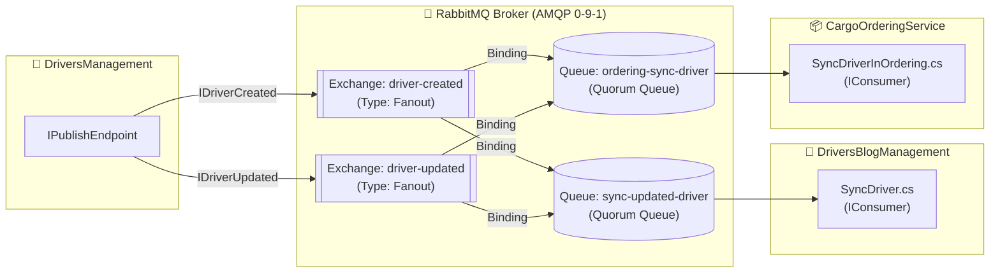
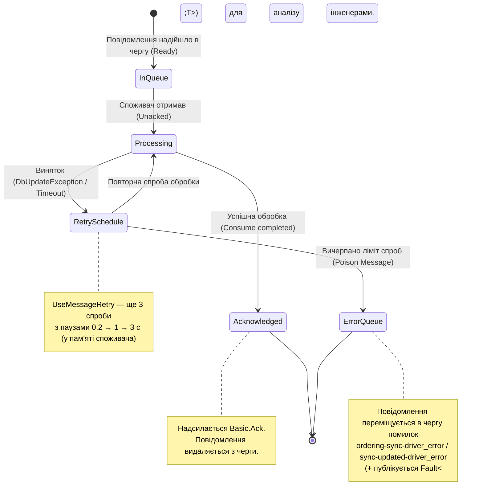
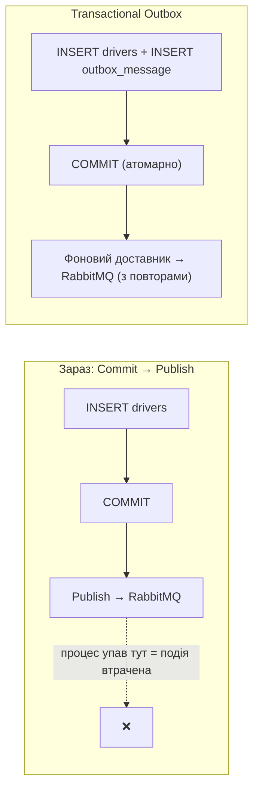

# 📬 04. Патерни асинхронного обміну подіями: MassTransit, RabbitMQ та Eventual Consistency

> **Блок 2:** `02-Microservices-Craftsman`  
> **Технологічний стек:** .NET 10, MassTransit 8.1.3, RabbitMQ 4.x (AMQP 0-9-1, Fanout Exchanges, Quorum Queues), SharedKernel, InMemory Fallback Bus, OpenTelemetry.  
> **Як читати посилання:** `Файл.cs#L42` відкриває файл на потрібному рядку (VS Code Markdown Preview — `Ctrl+Shift+V`).

---

## 1. Теоретична концепція: Подієво-орієнтована архітектура (Event-Driven Architecture)

У синхронних моделях (розглянутих у [Гайді 02: HTTP Gateway Aggregator](02_Patterns_Synchronous_HttpClient_Aggregator_BFF.md) та [Гайді 03: gRPC](03_Patterns_Synchronous_gRPC_Communication.md)) клієнт або викликаючий сервіс **блокується й чекає**, поки віддалений сервіс завершить обчислення та надішле відповідь.

Якщо цільовий сервіс недоступний, перезавантажується, виконує міграцію бази даних або тимчасово перевантажений:
* Синхронний запит зазнає збою (Exception / HTTP 500 / 504 Gateway Timeout).
* Починається каскадний колапс суміжних підсистем (**Cascading Failure**).
* Сервіси стають жорстко прив'язаними один до одного за часом виконання (**Temporal Coupling**).

**Подієво-орієнтована архітектура (EDA)** вирішує цю проблему за допомогою **часового та просторового розв'язання (Temporal & Spatial Decoupling)**:
1. **Факт у минулому часі:** Сервіс-джерело публікує факт події, що вже сталася в його бізнес-домені (`DriverCreated`, `DriverUpdated`, `OrderCreated`). Подія — це не прохання «зроби», а повідомлення «сталося».
2. **Гарантія брокера:** Брокер повідомлень (**RabbitMQ**) приймає повідомлення, записує його в чергу (кворум-черга — на диск) і підтверджує публікацію (publisher confirm).
3. **Автономність споживачів:** Сервіси-підписники вичитують події у власному темпі, коли вони готові, без необхідності тримати пряме з'єднання з видавцем.

### Команда vs Подія
| | Command (`Send`) | Event (`Publish`) |
| :--- | :--- | :--- |
| Семантика | «Зроби X» — наказ конкретному виконавцю | «X сталося» — факт для всіх зацікавлених |
| Скільки отримувачів | Рівно один | Нуль, один або багато |
| Хто знає адресата | Відправник | Ніхто — маршрутизацію робить брокер |
| У проєкті | — | `IDriverCreated`, `IDriverUpdated`, `IOrderCreated` |

```mermaid
sequenceDiagram
    autonumber
    
    rect rgb(38, 25, 25)
        note over Client,SyncServer: ❌ 1. Синхронна взаємодія (REST / gRPC) — Часове блокування (Temporal Coupling)
        Client->>SyncServer: Виклик: POST /api/drivers (або gRPC)
        activate Client
        activate SyncServer
        note over SyncServer: Сервер виконує бізнес-логіку,<br/>запис у базу даних тощо...
        note over Client: ⏳ Клієнт заблокований і чекає!<br/>(Якщо сервер офлайн або впав — клієнт ламається)
        SyncServer-->>Client: Відповідь: 200 OK / Response DTO
        deactivate SyncServer
        deactivate Client
    end

    rect rgb(20, 36, 48)
        note over Producer,Consumer: ✅ 2. Асинхронний EDA (MassTransit + RabbitMQ) — Часове розв'язання (Temporal Decoupling)
        Producer->>Broker: Публікація: Publish<IDriverCreated>(event)
        activate Producer
        activate Broker
        Broker-->>Producer: Publisher confirm (повідомлення прийнято брокером)
        deactivate Broker
        deactivate Producer
        note over Producer: 🚀 Продюсер вільний!<br/>Диспетчер отримує 201 Created.

        note over Broker,Consumer: Асинхронна доставка (у власному темпі підписника)
        Broker->>Consumer: Push повідомлення з черги: ConsumeContext(IDriverCreated)
        activate Consumer
        note over Consumer: Споживач записує дані у свою БД,<br/>навіть якщо продюсер уже вимкнено
        Consumer-->>Broker: Basic.Ack (Повідомлення видалено з черги)
        deactivate Consumer
    end
```



---

## 2. Аналогія з реального життя: Поштовий термінал логістичної компанії

* **Синхронний телефонний дзвінок (REST / gRPC):** Диспетчер телефонує водієві: *"Ти прийняв вантаж? Скажи мені прямо зараз!"*. Якщо у водія розрядився телефон, він у тунелі або зайнятий керуванням — дзвінок зривається, а робота диспетчера блокується.
* **Асинхронний поштовий термінал (MassTransit + RabbitMQ):** Диспетчер друкує наказ на завантаження, кладе його у центральний сортувальний термінал (**Exchange**). Сортувальний автомат миттєво робить копії наказу для бухгалтерії, складу та гаража і розкладає їх по персональних закритих скриньках (**Queues**). Диспетчер миттєво повертається до інших справ. Коли комірник виходить на зміну, він відкриває свою скриньку, забирає наказ і спокійно комплектує вантаж.

---

## 3. Модель протоколу AMQP 0-9-1 та топологія RabbitMQ

RabbitMQ працює за стандартом **AMQP 0-9-1** (Advanced Message Queuing Protocol). У цьому протоколі продюсер публікує повідомлення не в чергу, а в **Обмінник (Exchange)**; обмінник за правилами **прив'язок (Bindings)** розкладає копії по чергах:



> 💡 **Одна черга на сервіс, а не на подію.** Обидві події водія потрапляють в одну чергу споживача (`sync-updated-driver` прив'язана і до `driver-created`, і до `driver-updated`). Перевага: порядок «створено → оновлено» для одного водія зберігається в межах однієї черги. Якби події йшли в різні черги, оновлення могло б бути оброблене раніше за створення.

> 🔁 **Масштабування споживачів (Competing Consumers).** Якщо запустити дві репліки CargoOrderingService, обидві читатимуть **ту саму** чергу `ordering-sync-driver`, і RabbitMQ роздасть повідомлення між ними (кожне — лише одній репліці). А різні сервіси мають **різні** черги — тому кожен сервіс отримує свою копію. Так один Fanout дає і «широкомовлення між сервісами», і «балансування всередині сервісу».

### Чому обрано саме тип обмінника Fanout?
| Тип Exchange | Механізм маршрутизації | Коли застосовується | Чому Fanout у нашому проєкті? |
| :--- | :--- | :--- | :--- |
| **Fanout** | **Широкомовний (Broadcasting).** Ігнорує Routing Key, дублює повідомлення в **усі** прив'язані черги. | Pub-Sub доменних подій усім підписникам. | **Ідеально для реплікації водіїв.** Коли з'являється або оновлюється водій, усі зацікавлені мікросервіси повинні гарантовано отримати копію події. |
| **Direct** | Точний збіг Routing Key (`RoutingKey == BindingKey`). | Таргетована відправка команд конкретному воркеру. | Не підходить для широкомовного сповіщення кількох сервісів. |
| **Topic** | Збіг за маскою із зірочками (`cargo.eu.*`, `orders.#`). | Складні ієрархічні фільтри маршрутизації. | Надлишковий для загальних доменних подій створення/оновлення. |
| **Headers** | Маршрутизація за заголовками AMQP, а не за Routing Key. | Специфічні метадані (формати, мови). | Рідко використовується на практиці через накладні витрати. |

> 🧭 **Як побачити топологію наживо:** відкрийте Management UI RabbitMQ (посилання в рядку `rabbitmq` дашборду Aspire, логін `guest`, пароль — параметр `rabbitmq-password` у вкладці *Parameters*) → вкладки *Exchanges* і *Queues*.

---

## 4. Кворум-черги (Quorum Queues) та міф про Lazy Queues

У конфігурації обох споживачів (`ordering-sync-driver` та `sync-updated-driver`) застосовано кворум-черги ([SyncPatientEndpointRegistration.cs#L39](../DriversBlogManagement/src/DriversBlogManagement/Extensions/Services/ConsumerRegistrations/SyncPatientEndpointRegistration.cs#L39), [SyncDriverInOrderingEndpointRegistration.cs#L39](../CargoOrderingService/src/CargoOrderingService/Extensions/Services/ConsumerRegistrations/SyncDriverInOrderingEndpointRegistration.cs#L39)):

```csharp
re.SetQuorumQueue();
```

### 1. Що дає `SetQuorumQueue()`?
* **Raft Consensus:** Quorum Queues базуються на консенсусному алгоритмі **Raft** (на відміну від застарілих Mirrored Queues, які видалено в RabbitMQ 4.0).
* **Стійкість до втрати даних:** Повідомлення реплікується на кворум вузлів кластера RabbitMQ (більшість з N) і записується на диск. Навіть при аварійній зупинці одного вузла брокера жодна підтверджена подія про створення чи зміну водія не загубиться.
* **FIFO порядок:** Повідомлення доставляються в порядку надходження (з поправкою на повторні доставки після збоїв споживача).
* **Poison message handling:** кворум-черги рахують кількість повторних доставок (`x-delivery-count`) і можуть обмежувати її (`x-delivery-limit`).

> ℹ️ У локальному стенді RabbitMQ — це **один** контейнер, тож реплікації між вузлами немає; кворум-черга все одно працює (кворум з одного вузла) і зберігає повідомлення на диску.

### 2. Міф про `lazy` (`SetQueueArgument("declare", "lazy")`) — виправлено
Раніше в реєстрації споживачів був рядок `re.SetQueueArgument("declare", "lazy")`, а документація стверджувала, що він вмикає «ліниві» черги. Насправді:
* Аргументу з ім'ям `declare` у RabbitMQ **не існує** — брокер просто ігнорував його.
* «Ліниві» черги вмикались аргументом `x-queue-mode: lazy` і лише для **класичних** черг; починаючи з RabbitMQ 3.12 класичні черги й так поводяться «ліниво», а в 4.x цей режим не має сенсу.
* **Кворум-черги** за дизайном пишуть повідомлення на диск і тримають у пам'яті лише невеликий «хвіст», тож проблему OOM під піковим навантаженням вони вирішують і без окремого прапорця.

Рядок видалено з коду з поясненням у коментарі — [SyncPatientEndpointRegistration.cs](../DriversBlogManagement/src/DriversBlogManagement/Extensions/Services/ConsumerRegistrations/SyncPatientEndpointRegistration.cs#L41).

---

## 5. Діаграми процесів взаємодії

### 5.1. Повна діаграма послідовності виклику (Sequence Diagram: Publish -> Broker -> Consumers)

```mermaid
sequenceDiagram
    autonumber
    actor Dispatcher as 👤 Диспетчер / Користувач
    participant DM as 🚚 DriversManagement (API)
    participant DM_DB as 🗄️ DriversManagement DB
    participant Bus as 🚌 MassTransit (IPublishEndpoint)
    participant Broker as 🐰 RabbitMQ (Fanout Exchange)
    participant Q_Blog as 📥 Queue: sync-updated-driver
    participant Q_Ord as 📥 Queue: ordering-sync-driver
    participant Blog as 📝 DriversBlogManagement (Consumer)
    participant Ord as 📦 CargoOrderingService (Consumer)

    Dispatcher->>DM: POST /api/drivers (Створення водія)
    DM->>DM_DB: INSERT INTO drivers та CommitChanges()
    DM_DB-->>DM: OK (Водія збережено локально)

    %% Асинхронна публікація події
    rect rgb(20, 35, 60)
        note over DM,Broker: Публікація доменної події
        DM->>Bus: Publish(IDriverCreated)
        Bus->>Broker: Basic.Publish -> exchange "driver-created"
        Broker-->>Bus: Publisher confirm (Повідомлення прийнято брокером)
        DM-->>Dispatcher: 201 Created (Відповідь диспетчеру)
    end

    %% Брокер розмножує повідомлення
    Broker->>Q_Blog: Копія у чергу блогу
    Broker->>Q_Ord: Копія у чергу замовлень

    %% Асинхронне вичитування підписниками
    par Споживач Блогу
        Q_Blog->>Blog: ConsumeContext(IDriverCreated)
        Blog->>Blog: Перевірка ідемпотентності (if not exists)
        Blog->>Blog: INSERT INTO drivers (тіньова копія, той самий Id)
        Blog-->>Q_Blog: Basic.Ack (Повідомлення видалено з черги)
    and Споживач Замовлень
        Q_Ord->>Ord: ConsumeContext(IDriverCreated)
        Ord->>Ord: Перевірка ідемпотентності (if not exists)
        Ord->>Ord: INSERT INTO drivers (тіньова копія, той самий Id)
        Ord-->>Q_Ord: Basic.Ack (Повідомлення видалено з черги)
    end
```



**Реальний трейс стенду** (Aspire Dashboard → Traces → `driversmanagement: POST api/drivers`, ≈1 с): `POST api/drivers` → `send driver-created` → `ordering-sync-driver receive` / `process` і `sync-updated-driver receive` / `process`. У *Structured logs* записи `==>> [MassTransit Blog] …` і `==>> [MassTransit Ordering] …` мають той самий TraceId.

---

### 5.2. Діаграма життєвого циклу повідомлення у MassTransit (Message Lifecycle & Dead Letter)

Що відбувається, коли споживач падає з помилкою (наприклад, тимчасово недоступна база даних блогу)?



> 🐞 **Що було виправлено.** Діаграма описувала повтори, але в коді їх не було: MassTransit **за замовчуванням не повторює** обробку — перший же виняток відправляв повідомлення в `_error`. Тепер у кожній реєстрації споживача є `re.UseMessageRetry(r => r.Intervals(200, 1000, 3000))` — [SyncPatientEndpointRegistration.cs#L52](../DriversBlogManagement/src/DriversBlogManagement/Extensions/Services/ConsumerRegistrations/SyncPatientEndpointRegistration.cs#L52), [SyncDriverInOrderingEndpointRegistration.cs#L50](../CargoOrderingService/src/CargoOrderingService/Extensions/Services/ConsumerRegistrations/SyncDriverInOrderingEndpointRegistration.cs#L50).

| Механізм | Де живе повтор | Коли застосовувати |
| :--- | :--- | :--- |
| `UseMessageRetry` (Immediate / Intervals / Exponential) | У пам'яті процесу споживача, повідомлення лишається «Unacked» | Короткі транзієнтні збої (секунди) |
| `UseDelayedRedelivery` (Second-Level Retry) | Повідомлення повертається в брокер із затримкою | Довгі збої (хвилини: БД на обслуговуванні) |
| Черга `_error` + ручний/автоматичний replay | Окрема черга помилок | Помилки в даних, баги — потрібна людина |

---

## 6. Проблема подвійного запису (Dual-Write Problem) та Eventual Consistency

У розподілених системах без розподілених двофазних блокуючих транзакцій (2PC / WS-AtomicTransaction) існує класична проблема ([AddDriver.cs#L81-L85](../DriversManagement/src/DriversManagement/Domain/Drivers/Features/AddDriver.cs#L81)):

```csharp
// 1. Локальна транзакція
await _unitOfWork.CommitChanges(cancellationToken);

// 2. Мережевий запит до брокера
await _publishEndpoint.Publish<IDriverCreated>(message, cancellationToken);
```

### Що може піти не так?
1. База даних зафіксувала водія, але сервер аварійно вимкнувся прямо перед `Publish` (або брокер був недоступний). У результаті: водій існує в `DriversManagement`, але жоден інший мікросервіс ніколи не дізнається про це.
2. Якщо поміняти порядок — `Publish` першим, а `CommitChanges` впаде через порушення констрейнта, — підписники отримають подію про водія, якого насправді не існує (**Ghost Entity**).

### Як це вирішується в нашому проєкті?
* **Принцип Eventual Consistency (Кінцева узгодженість):** База даних є первинним джерелом правди. Повідомлення публікується **після** успішного фіксування транзакції `_unitOfWork.CommitChanges`. Це прибирає «привидів», але не прибирає ризик втрати події (сценарій 1).
* **Ідемпотентність споживачів:** Усі споживачі перевіряють наявність сутності перед вставкою (`if (existingDriver == null)` — [SyncDriver.cs#L63](../DriversBlogManagement/src/DriversBlogManagement/Domain/SyncDriver.cs#L63), [SyncDriverInOrdering.cs#L58](../CargoOrderingService/src/CargoOrderingService/Domain/Drivers/Consumers/SyncDriverInOrdering.cs#L58)), що запобігає дублікатам при повторній доставці (семантика *At-least-once delivery*).
* **Перспектива розвитку — Transactional Outbox Pattern:** нативний `AddEntityFrameworkOutbox<TContext>()` від MassTransit зберігає повідомлення у спеціальну таблицю в **тій самій** транзакції EF Core, що й водія, а фоновий процес гарантовано пересилає їх у RabbitMQ. Тоді обидва записи або відбуваються разом, або не відбуваються взагалі.



### Наслідки Eventual Consistency для UI та API
* Між `201 Created` у DriversManagement і появою тіньового водія в блозі/замовленнях минає час (на стенді — <1 с). Якщо в цей проміжок викликати `demo-seed` або gRPC `GetDriverWithPosts`, отримаєте `404` / `NotFound` — це **нормально** для асинхронної архітектури, а не баг.
* Тому gRPC-клієнт трактує `NotFound` від блогу як «постів поки немає» і не ламає профіль водія.

---

## 7. Детальний розбір реалізації в коді проєкту

### 7.1. Спільні контракти повідомлень (SharedKernel)

Контракти повідомлень містяться у легкому проєкті `SharedKernel` без залежностей від баз даних:

> 📍 **Шлях до файлу:** `SharedKernel/DriverCreated.cs` — інтерфейс [#L26](../SharedKernel/DriverCreated.cs#L26)  
> 📝 *У файлі наведено докладні покрокові коментарі українською мовою.*

[👉 **Перейти до файлу (клікніть тут)**](../SharedKernel/DriverCreated.cs#L26)

```csharp
public interface IDriverCreated
{
    Guid DriverId { get; set; }
    string FirstName { get; set; }
    string LastName { get; set; }
    string DriverLicenseNumber { get; set; }
    string Phone { get; set; }
}
```

> 📍 **Шлях до файлу:** `SharedKernel/DriverUpdated.cs` — інтерфейс [#L20](../SharedKernel/DriverUpdated.cs#L20)

[👉 **Перейти до файлу (клікніть тут)**](../SharedKernel/DriverUpdated.cs#L20)

```csharp
public interface IDriverUpdated
{
    Guid DriverId { get; set; }
    string FirstName { get; set; }
    string LastName { get; set; }
}
```

> 📍 **Шлях до файлу:** `SharedKernel/OrderMessages.cs` — `IOrderCreated` [#L21](../SharedKernel/OrderMessages.cs#L21), `IOrderAssignedToDriver` [#L56](../SharedKernel/OrderMessages.cs#L56)

[👉 **Перейти до файлу (клікніть тут)**](../SharedKernel/OrderMessages.cs#L21)

> 💡 **Чому SharedKernel — це нормально, а спільна таблиця — ні?** SharedKernel містить лише **контракти повідомлень** (Published Language у термінах DDD) — маленькі, стабільні, версіоновані. Він не містить сутностей, бізнес-логіки чи доступу до даних. Зміна контракту — це свідома подія для всіх сторін; найбезпечніше еволюціонувати його **додаванням** полів (споживачі ігнорують невідомі).

---

### 7.2. Продюсер подій: сервіс DriversManagement

Коли створюється водій, після збереження агрегату в базі викликається `IPublishEndpoint.Publish`:

> 📍 **Шлях до файлу:** `DriversManagement/src/DriversManagement/Domain/Drivers/Features/AddDriver.cs` — збереження [#L81](../DriversManagement/src/DriversManagement/Domain/Drivers/Features/AddDriver.cs#L81), публікація [#L85](../DriversManagement/src/DriversManagement/Domain/Drivers/Features/AddDriver.cs#L85)  
> 📝 *У файлі наведено докладні покрокові коментарі українською мовою.*

[👉 **Перейти до файлу (клікніть тут)**](../DriversManagement/src/DriversManagement/Domain/Drivers/Features/AddDriver.cs#L81)

```csharp
// Зберігаємо водія в локальній базі даних
await _driverRepository.Add(driver, cancellationToken);
await _unitOfWork.CommitChanges(cancellationToken);

// Публікуємо доменну подію створення водія в RabbitMQ
await _publishEndpoint.Publish<IDriverCreated>(new DriverCreated
{
    DriverId = driver.Id,
    FirstName = driver.FirstName,
    LastName = driver.LastName,
    DriverLicenseNumber = driver.DriverLicenseNumber,
    Phone = driver.Phone
}, cancellationToken);
```

При оновленні даних водія аналогічно публікується подія `IDriverUpdated`:

> 📍 **Шлях до файлу:** `DriversManagement/src/DriversManagement/Domain/Drivers/Features/UpdateDriver.cs` — публікація [#L75](../DriversManagement/src/DriversManagement/Domain/Drivers/Features/UpdateDriver.cs#L75)

[👉 **Перейти до файлу (клікніть тут)**](../DriversManagement/src/DriversManagement/Domain/Drivers/Features/UpdateDriver.cs#L75)

---

### 7.3. Налаштування первинних обмінників (Producer Registrations)

У конфігурації шини ми явно прив'язуємо інтерфейси до імен обмінників типу `Fanout`:

> 📍 **Шлях до файлу:** `DriversManagement/src/DriversManagement/Extensions/Services/ProducerRegistrations/DriverCreatedEndpointRegistration.cs` — [#L28-L29](../DriversManagement/src/DriversManagement/Extensions/Services/ProducerRegistrations/DriverCreatedEndpointRegistration.cs#L28)

[👉 **Перейти до файлу (клікніть тут)**](../DriversManagement/src/DriversManagement/Extensions/Services/ProducerRegistrations/DriverCreatedEndpointRegistration.cs#L28)

```csharp
public static void DriverCreatedEndpoint(this IRabbitMqBusFactoryConfigurator cfg)
{
    cfg.Message<IDriverCreated>(e => e.SetEntityName("driver-created"));  // назва обмінника
    cfg.Publish<IDriverCreated>(e => e.ExchangeType = ExchangeType.Fanout); // тип обмінника
}
```

> ℹ️ Без `SetEntityName` MassTransit назвав би обмінник за повним ім'ям типу (`SharedKernel.Messages:IDriverCreated`). Явне ім'я робить топологію читабельною і незалежною від простору імен C#.

> 📍 **Аналогічно:** [DriverUpdatedEndpointRegistration.cs#L27](../DriversManagement/src/DriversManagement/Extensions/Services/ProducerRegistrations/DriverUpdatedEndpointRegistration.cs#L27) (`driver-updated`), [OrderCreatedEndpointRegistration.cs#L23](../CargoOrderingService/src/CargoOrderingService/Extensions/Services/ProducerRegistrations/OrderCreatedEndpointRegistration.cs#L23) (`order-created`).

---

### 7.4. Споживач у блозі водіїв (DriversBlogManagement)

Клас `SyncDriver` підписаний одночасно на створення та оновлення водіїв:

> 📍 **Шлях до файлу:** `DriversBlogManagement/src/DriversBlogManagement/Domain/SyncDriver.cs` — `IDriverCreated` [#L56](../DriversBlogManagement/src/DriversBlogManagement/Domain/SyncDriver.cs#L56), `IDriverUpdated` [#L81](../DriversBlogManagement/src/DriversBlogManagement/Domain/SyncDriver.cs#L81)  
> 📝 *У файлі наведено докладні покрокові коментарі українською мовою щодо ідемпотентності та тіньових моделей.*

[👉 **Перейти до файлу (клікніть тут)**](../DriversBlogManagement/src/DriversBlogManagement/Domain/SyncDriver.cs#L56)

```csharp
public sealed class SyncDriver : IConsumer<IDriverCreated>, IConsumer<IDriverUpdated>
{
    public async Task Consume(ConsumeContext<IDriverCreated> context)
    {
        var msg = context.Message;
        var existingDriver = await _db.Drivers.FirstOrDefaultAsync(d => d.Id == msg.DriverId, context.CancellationToken);
        if (existingDriver == null)   // ідемпотентність: повторна доставка не створить дубліката
        {
            var driver = Driver.CreateWithId(msg.DriverId, msg.FirstName, msg.LastName);
            await _db.Drivers.AddAsync(driver, context.CancellationToken);
            await _db.SaveChangesAsync(context.CancellationToken);
        }
    }
}
```

> 🐞 **Прихована проблема моделі (виправлено).** У блозі `Driver` був налаштований як залежний бік зв'язку «один-до-одного» з `PostAboutDriver` через **спільний первинний ключ**, і за замовчуванням створював порожній пост. При вставці EF Core підміняв `Id` тіньового водія на `Id` цього поста — і ідентифікатор розходився з оригіналом у DriversManagement. Тепер пост має окрему колонку `driver_id` ([DriverConfiguration.cs](../DriversBlogManagement/src/DriversBlogManagement/Databases/EntityConfigurations/DriverConfiguration.cs)), а порожній пост не створюється.

Конфігурація кінцевої точки та зв'язування з обмінниками:

> 📍 **Шлях до файлу:** `DriversBlogManagement/src/DriversBlogManagement/Extensions/Services/ConsumerRegistrations/SyncPatientEndpointRegistration.cs` — черга [#L33](../DriversBlogManagement/src/DriversBlogManagement/Extensions/Services/ConsumerRegistrations/SyncPatientEndpointRegistration.cs#L33), повтори [#L52](../DriversBlogManagement/src/DriversBlogManagement/Extensions/Services/ConsumerRegistrations/SyncPatientEndpointRegistration.cs#L52), прив'язки [#L58-L65](../DriversBlogManagement/src/DriversBlogManagement/Extensions/Services/ConsumerRegistrations/SyncPatientEndpointRegistration.cs#L58)  
> 📝 *Назва `SyncPatient...` — спадок шаблону Craftsman; за змістом це реєстрація споживача водіїв.*

[👉 **Перейти до файлу (клікніть тут)**](../DriversBlogManagement/src/DriversBlogManagement/Extensions/Services/ConsumerRegistrations/SyncPatientEndpointRegistration.cs#L33)

```csharp
cfg.ReceiveEndpoint("sync-updated-driver", re =>
{
    re.ConfigureConsumeTopology = false;                       // топологію задаємо вручну
    re.SetQuorumQueue();                                       // надійна черга (Raft, диск)
    re.UseMessageRetry(r => r.Intervals(200, 1000, 3000));    // повтори при транзієнтних збоях
    re.ConfigureConsumer<SyncDriver>(context);                 // хто обробляє
    re.Bind("driver-updated", e => e.ExchangeType = ExchangeType.Fanout);
    re.Bind("driver-created", e => e.ExchangeType = ExchangeType.Fanout);
});
```

---

### 7.5. Споживач у сервісі замовлень (CargoOrderingService)

Сервіс замовлень також реплікує водіїв для забезпечення повної автономності при призначенні вантажів:

> 📍 **Шлях до файлу:** `CargoOrderingService/src/CargoOrderingService/Domain/Drivers/Consumers/SyncDriverInOrdering.cs` — [#L52](../CargoOrderingService/src/CargoOrderingService/Domain/Drivers/Consumers/SyncDriverInOrdering.cs#L52) (створення), [#L75](../CargoOrderingService/src/CargoOrderingService/Domain/Drivers/Consumers/SyncDriverInOrdering.cs#L75) (оновлення)  
> 📝 *У файлі наведено докладні покрокові коментарі українською мовою щодо автономності Bounded Context.*

[👉 **Перейти до файлу (клікніть тут)**](../CargoOrderingService/src/CargoOrderingService/Domain/Drivers/Consumers/SyncDriverInOrdering.cs#L52)

> 📍 **Шлях до файлу:** `CargoOrderingService/src/CargoOrderingService/Extensions/Services/ConsumerRegistrations/SyncDriverInOrderingEndpointRegistration.cs` — черга [#L33](../CargoOrderingService/src/CargoOrderingService/Extensions/Services/ConsumerRegistrations/SyncDriverInOrderingEndpointRegistration.cs#L33), повтори [#L50](../CargoOrderingService/src/CargoOrderingService/Extensions/Services/ConsumerRegistrations/SyncDriverInOrderingEndpointRegistration.cs#L50)  
> 📝 *У файлі наведено докладні покрокові коментарі українською мовою.*

[👉 **Перейти до файлу (клікніть тут)**](../CargoOrderingService/src/CargoOrderingService/Extensions/Services/ConsumerRegistrations/SyncDriverInOrderingEndpointRegistration.cs#L33)

> 💡 Зверніть увагу на обробку `IDriverUpdated` для водія, якого ще немає: споживач **створює** його з події оновлення ([SyncDriverInOrdering.cs#L94](../CargoOrderingService/src/CargoOrderingService/Domain/Drivers/Consumers/SyncDriverInOrdering.cs#L94)). Це захист від ситуації «оновлення прийшло раніше за створення» або «подію створення втрачено» — споживач самовідновлюється з наступної ж події.

---

### 7.6. Відмовостійкість та In-Memory Transport Fallback

У файлі конфігурації шини реалізовано механізм вибору транспорту:

> 📍 **Шлях до файлу:** `CargoOrderingService/src/CargoOrderingService/Extensions/Services/MassTransitServiceExtension.cs` — рядок підключення [#L36](../CargoOrderingService/src/CargoOrderingService/Extensions/Services/MassTransitServiceExtension.cs#L36), appsettings-гілка [#L68](../CargoOrderingService/src/CargoOrderingService/Extensions/Services/MassTransitServiceExtension.cs#L68), In-Memory [#L99](../CargoOrderingService/src/CargoOrderingService/Extensions/Services/MassTransitServiceExtension.cs#L99)  
> 📝 *У файлі наведено докладні покрокові коментарі українською мовою.*

[👉 **Перейти до файлу (клікніть тут)**](../CargoOrderingService/src/CargoOrderingService/Extensions/Services/MassTransitServiceExtension.cs#L36)

```csharp
// 1. Якщо передано рядок підключення від Aspire (GetConnectionString("rabbitmq"))
if (!string.IsNullOrEmpty(rmqConnectionString))
{
    services.AddMassTransit(mt =>
    {
        mt.AddConsumers(Assembly.GetExecutingAssembly());
        mt.UsingRabbitMq((context, cfg) => { /* Host з amqp-URI (пароль декодується Uri.UnescapeDataString) + ендпоінти */ });
    });
}
// 2. Класична конфігурація RabbitMq з appsettings (запуск без Aspire)
else if (rmqOptions != null && !string.IsNullOrEmpty(rmqOptions.Host)) { /* ... */ }
// 3. Якщо брокер не налаштований (локальні тести без Docker) — Fallback на швидку пам'ять
else
{
    services.AddMassTransit(mt =>
    {
        mt.AddConsumers(Assembly.GetExecutingAssembly());
        mt.UsingInMemory((context, cfg) => { cfg.ConfigureEndpoints(context); });
    });
}
```

> 📍 **Шлях до файлу:** `DriversManagement/src/DriversManagement/Extensions/Services/MassTransitServiceExtension.cs` — [#L36](../DriversManagement/src/DriversManagement/Extensions/Services/MassTransitServiceExtension.cs#L36). У DriversManagement і блозі In-Memory гілки немає: у тестових середовищах (`IntegrationTesting`, `FunctionalTesting`) шина просто не реєструється.

[👉 **Перейти до файлу (клікніть тут)**](../DriversManagement/src/DriversManagement/Extensions/Services/MassTransitServiceExtension.cs#L36)

> ⚠️ In-Memory транспорт живе в межах **одного процесу** — повідомлення не виходять за його межі. Тому він придатний лише для тестів одного сервісу; для перевірки взаємодії сервісів потрібен реальний RabbitMQ (його й піднімає Aspire).

---

## 8. Порівняльна таблиця трьох комунікаційних парадигм у проєкті

| Характеристика | 1. HTTP Gateway Aggregator ([Гайд 02](02_Patterns_Synchronous_HttpClient_Aggregator_BFF.md)) | 2. gRPC RPC-зв'язок ([Гайд 03](03_Patterns_Synchronous_gRPC_Communication.md)) | 3. MassTransit + RabbitMQ ([Гайд 04](04_Patterns_Asynchronous_Messaging_MassTransit_RabbitMQ.md)) |
| :--- | :--- | :--- | :--- |
| **Тип взаємодії** | Синхронний Request/Response (Опитування багатьох API) | Синхронний Point-to-Point (Прямий бінарний дзвінок) | Асинхронний Publish/Subscribe (Подієво-орієнтований) |
| **Транспортний протокол** | HTTP/1.1 або HTTP/2 + JSON | HTTP/2 + Protocol Buffers | AMQP 0-9-1 через TCP сокет |
| **Часова залежність** | Жорстка: клієнт очікує збирання даних | Жорстка: обидва сервіси мають бути онлайн | **Відсутня (Temporal Decoupling)** |
| **Формат повідомлень** | Текстовий JSON | Бінарний Protobuf | JSON-конверт MassTransit (тіло + службові заголовки) |
| **Основна сфера застосування** | Backend for Frontend (BFF) для UI/WPF/Web | Міжсервісні швидкі операції (RPC) | Реплікація даних, доменні події, саги |
| **Що стається при збої адресата?** | Часткова деградація (Graceful Degradation) | Помилка `RpcException` / Fallback значення | **Повідомлення надійно зберігається в черзі брокера** до появи споживача |

---

## 9. Чекліст найкращих практик (Production Best Practices)

- [x] **Контракти базуються на інтерфейсах:** Дозволяє поліморфну маршрутизацію та усуває пряму прив'язку до конкретних класів.
- [x] **Контракти зберігаються в SharedKernel:** Жоден мікросервіс не має прямого посилання на бізнес-збірки іншого.
- [x] **Сувора ідемпотентність у споживачах:** Кожен метод `Consume()` готовий до повторного отримання повідомлення (семантика *At-least-once delivery*).
- [x] **Кворум-черги (Quorum Queues) для критичних даних:** Реплікація на базі Raft-консенсусу захищає від збоїв кластера.
- [x] **Повтори споживача (`UseMessageRetry`):** транзієнтні збої обробляються без втручання людини; «отруйні» повідомлення потрапляють у `_error`.
- [ ] **Transactional Outbox:** наступний крок, щоб прибрати ризик втрати події між `COMMIT` і `Publish`.
- [x] **In-Memory Fallback для автоматизованих тестів:** Юніт- та компонентні тести проходять миттєво в пам'яті без необхідності підіймати важкий контейнер RabbitMQ.
- [x] **Трасування повідомлень:** `AddSource("MassTransit")` у ServiceDefaults — подія видно в одному трейсі з HTTP-запитом.

---

## 10. Швидка навігація по вихідному коду

* 📦 **Контракти повідомлень (SharedKernel):**
  * [👉 **Перейти до DriverCreated.cs**](../SharedKernel/DriverCreated.cs#L26)
  * [👉 **Перейти до DriverUpdated.cs**](../SharedKernel/DriverUpdated.cs#L20)
  * [👉 **Перейти до OrderMessages.cs**](../SharedKernel/OrderMessages.cs#L21)
* 🚀 **Продюсери подій (Publishers):**
  * [👉 **Перейти до AddDriver.cs (DriversManagement)**](../DriversManagement/src/DriversManagement/Domain/Drivers/Features/AddDriver.cs#L85)
  * [👉 **Перейти до UpdateDriver.cs (DriversManagement)**](../DriversManagement/src/DriversManagement/Domain/Drivers/Features/UpdateDriver.cs#L75)
  * [👉 **Перейти до DriverCreatedEndpointRegistration.cs**](../DriversManagement/src/DriversManagement/Extensions/Services/ProducerRegistrations/DriverCreatedEndpointRegistration.cs#L28)
  * [👉 **Перейти до DriverUpdatedEndpointRegistration.cs**](../DriversManagement/src/DriversManagement/Extensions/Services/ProducerRegistrations/DriverUpdatedEndpointRegistration.cs#L27)
  * [👉 **Перейти до AddOrder.cs (CargoOrderingService)**](../CargoOrderingService/src/CargoOrderingService/Domain/Orders/Features/AddOrder.cs#L68)
* 📥 **Споживачі (Consumers):**
  * [👉 **Перейти до SyncDriver.cs (DriversBlogManagement)**](../DriversBlogManagement/src/DriversBlogManagement/Domain/SyncDriver.cs#L56)
  * [👉 **Перейти до SyncPatientEndpointRegistration.cs**](../DriversBlogManagement/src/DriversBlogManagement/Extensions/Services/ConsumerRegistrations/SyncPatientEndpointRegistration.cs#L33)
  * [👉 **Перейти до SyncDriverInOrdering.cs (CargoOrderingService)**](../CargoOrderingService/src/CargoOrderingService/Domain/Drivers/Consumers/SyncDriverInOrdering.cs#L52)
  * [👉 **Перейти до SyncDriverInOrderingEndpointRegistration.cs**](../CargoOrderingService/src/CargoOrderingService/Extensions/Services/ConsumerRegistrations/SyncDriverInOrderingEndpointRegistration.cs#L33)
* ⚙️ **Конфігурація шини MassTransit:**
  * [👉 **Перейти до MassTransitServiceExtension.cs (Ordering)**](../CargoOrderingService/src/CargoOrderingService/Extensions/Services/MassTransitServiceExtension.cs#L36)
  * [👉 **Перейти до MassTransitServiceExtension.cs (Drivers)**](../DriversManagement/src/DriversManagement/Extensions/Services/MassTransitServiceExtension.cs#L36)
  * [👉 **Перейти до MassTransitServiceExtension.cs (Blog)**](../DriversBlogManagement/src/DriversBlogManagement/Extensions/Services/MassTransitServiceExtension.cs#L36)
* 🧪 **Готові запити:** [CargoDelivery.HttpAggregator.http](../CargoDelivery.HttpAggregator/CargoDelivery.HttpAggregator.http) (запити 1️⃣–2️⃣)
