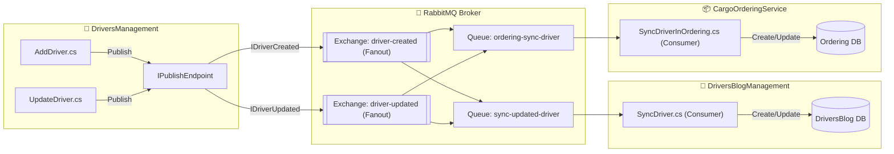

# 📬 04. Патерни асинхронного обміну подіями: MassTransit, RabbitMQ та Eventual Consistency

> **Блок 2:** `02-Microservices-Craftsman`  
> **Технологічний стек:** MassTransit 8.1.3, RabbitMQ (Fanout Exchanges & Quorum Queues), SharedKernel, InMemory Fallback Bus.

---

## 1. Теоретична концепція: Подієво-орієнтована архітектура (EDA)

У синхронному HTTP- або gRPC-виклику (розглянутому в гайдах 02 та 03) клієнт **блокується і чекає**, поки сервер опрацює запит. Якщо сервіс-одержувач офлайн або перевантажений — запит зазнає невдачі.

**Подієво-орієнтована архітектура (Event-Driven Architecture, EDA)** вирішує цю проблему за допомогою **часового розв'язання (Temporal Decoupling)**:
* Сервіс-джерело публікує факт того, що щось сталося у минулому часі (`DriverCreated`, `DriverUpdated`, `OrderCreated`).
* Брокер повідомлень (**RabbitMQ**) гарантує доставку повідомлення в чергу.
* Сервіси-підписники вичитують події у власному темпі, навіть якщо в момент публікації вони були тимчасово перезавантажені або недоступні.

---

## 2. Аналогія з реального життя: Радіомовлення та поштовий термінал

* **Синхронний дзвінок (REST / gRPC)**: ви телефонуєте колезі. Якщо в нього зайнято або сіла батарея — ви не можете передати інформацію і ваш робочий процес зупиняється.
* **Асинхронна шина повідомлень (MassTransit + RabbitMQ)**: ви відправляєте офіційного листа через центральну поштову сортувальну станцію (**Exchange**). Станція автоматично робить копії листа для всіх відділів, які підписалися на цю тему (**Queues**), і розкладає їх по персональних скриньках. Коли менеджер іншого відділу виходить на роботу, він забирає пошту зі своєї скриньки та обробляє її.

---

## 3. Топологія шини повідомлень (Pub-Sub у системі)



---

## 4. Контракти повідомлень у SharedKernel

Контракти повідомлень повинні бути максимально легкими, не містити бізнес-логіки та бути спільними для всіх мікросервісів:

* [`SharedKernel/DriverCreated.cs`](file:///c:/Users/Yurii/source/repos/Demo-CargoDeliveryService/02-Microservices-Craftsman/SharedKernel/DriverCreated.cs):
  ```csharp
  public interface IDriverCreated
  {
      Guid DriverId { get; set; }
      string FirstName { get; set; }
      string LastName { get; set; }
      string DriverLicenseNumber { get; set; }
      string Phone { get; set; }
  }
  ```
* [`SharedKernel/DriverUpdated.cs`](file:///c:/Users/Yurii/source/repos/Demo-CargoDeliveryService/02-Microservices-Craftsman/SharedKernel/DriverUpdated.cs):
  ```csharp
  public interface IDriverUpdated
  {
      Guid DriverId { get; set; }
      string FirstName { get; set; }
      string LastName { get; set; }
  }
  ```
* [`SharedKernel/OrderMessages.cs`](file:///c:/Users/Yurii/source/repos/Demo-CargoDeliveryService/02-Microservices-Craftsman/SharedKernel/OrderMessages.cs):
  ```csharp
  public interface IOrderCreated
  {
      Guid OrderId { get; set; }
      string OrderNumber { get; set; }
      string CustomerName { get; set; }
      string TotalAmount { get; set; }
  }
  ```

---

## 5. Реалізація продюсерів (Publishers)

У сервісі `DriversManagement` при створенні або оновленні водія інжектується `IPublishEndpoint`:

### Публікація в [`AddDriver.cs`](file:///c:/Users/Yurii/source/repos/Demo-CargoDeliveryService/02-Microservices-Craftsman/DriversManagement/src/DriversManagement/Domain/Drivers/Features/AddDriver.cs):
```csharp
// ПАТЕРН EVENT-DRIVEN ARCHITECTURE (EDA / Pub-Sub через MassTransit):
await _publishEndpoint.Publish<IDriverCreated>(new DriverCreated
{
    DriverId = driver.Id,
    FirstName = driver.FirstName,
    LastName = driver.LastName,
    DriverLicenseNumber = driver.DriverLicenseNumber,
    Phone = driver.Phone
}, cancellationToken);
```

### Налаштування первинного Exchange у [`DriverCreatedEndpointRegistration.cs`](file:///c:/Users/Yurii/source/repos/Demo-CargoDeliveryService/02-Microservices-Craftsman/DriversManagement/src/DriversManagement/Extensions/Services/ProducerRegistrations/DriverCreatedEndpointRegistration.cs):
```csharp
public static void DriverCreatedEndpoint(this IRabbitMqBusFactoryConfigurator cfg)
{
    cfg.Message<IDriverCreated>(e => e.SetEntityName("driver-created"));
    cfg.Publish<IDriverCreated>(e => e.ExchangeType = ExchangeType.Fanout);
}
```

---

## 6. Реалізація споживачів (Consumers) та реплікація даних

### 6.1. Споживач у блозі: [`SyncDriver.cs`](file:///c:/Users/Yurii/source/repos/Demo-CargoDeliveryService/02-Microservices-Craftsman/DriversBlogManagement/src/DriversBlogManagement/Domain/SyncDriver.cs)
Споживач слухає обидва типи подій (`IDriverCreated`, `IDriverUpdated`) та забезпечує **Eventual Consistency** локальної тіньової моделі:

```csharp
public sealed class SyncDriver : IConsumer<IDriverCreated>, IConsumer<IDriverUpdated>
{
    public async Task Consume(ConsumeContext<IDriverCreated> context)
    {
        var msg = context.Message;
        var existingDriver = await _db.Drivers.FirstOrDefaultAsync(d => d.Id == msg.DriverId);
        if (existingDriver == null)
        {
            var driver = Driver.CreateWithId(msg.DriverId, msg.FirstName, msg.LastName);
            await _db.Drivers.AddAsync(driver);
            await _db.SaveChangesAsync();
        }
    }
}
```

### 6.2. Споживач у замовленнях: [`SyncDriverInOrdering.cs`](file:///c:/Users/Yurii/source/repos/Demo-CargoDeliveryService/02-Microservices-Craftsman/CargoOrderingService/src/CargoOrderingService/Domain/Drivers/Consumers/SyncDriverInOrdering.cs)
Реплікує водіїв у контекст замовлень `CargoOrderingService` для швидкого закріплення рейсів та вантажів без міжсервісних затримок.

---

## 7. Відмовостійкість та Fallback до InMemory Bus

У [`MassTransitServiceExtension.cs`](file:///c:/Users/Yurii/source/repos/Demo-CargoDeliveryService/02-Microservices-Craftsman/CargoOrderingService/src/CargoOrderingService/Extensions/Services/MassTransitServiceExtension.cs) реалізовано патерн **Graceful Fallback**:
* Якщо RabbitMQ доступний у конфігурації (наприклад, у Docker контейнері `rabbitmq:3-management` на порту `5672`) — використовується повноцінний брокер з кворум-чергами (`Quorum Queues`).
* Якщо система запускається локально під час юніт- або інтеграційних тестів без активного Docker-демона — MassTransit автоматично перемикається на **In-Memory Transport**, запобігаючи падінню додатків:

```csharp
if (rmqOptions != null && !string.IsNullOrEmpty(rmqOptions.Host))
{
    mt.UsingRabbitMq((context, cfg) => { /* конфігурація RMQ */ });
}
else
{
    mt.UsingInMemory((context, cfg) => { cfg.ConfigureEndpoints(context); });
}
```

---

## 8. Швидка навігація по файлах коду

- 📦 Контракти повідомлень: [`SharedKernel/DriverCreated.cs`](file:///c:/Users/Yurii/source/repos/Demo-CargoDeliveryService/02-Microservices-Craftsman/SharedKernel/DriverCreated.cs), [`SharedKernel/DriverUpdated.cs`](file:///c:/Users/Yurii/source/repos/Demo-CargoDeliveryService/02-Microservices-Craftsman/SharedKernel/DriverUpdated.cs), [`SharedKernel/OrderMessages.cs`](file:///c:/Users/Yurii/source/repos/Demo-CargoDeliveryService/02-Microservices-Craftsman/SharedKernel/OrderMessages.cs)
- 🚀 Продюсери: [`AddDriver.cs`](file:///c:/Users/Yurii/source/repos/Demo-CargoDeliveryService/02-Microservices-Craftsman/DriversManagement/src/DriversManagement/Domain/Drivers/Features/AddDriver.cs), [`UpdateDriver.cs`](file:///c:/Users/Yurii/source/repos/Demo-CargoDeliveryService/02-Microservices-Craftsman/DriversManagement/src/DriversManagement/Domain/Drivers/Features/UpdateDriver.cs), [`AddOrder.cs`](file:///c:/Users/Yurii/source/repos/Demo-CargoDeliveryService/02-Microservices-Craftsman/CargoOrderingService/src/CargoOrderingService/Domain/Orders/Features/AddOrder.cs)
- 📥 Консьюмери: [`SyncDriver.cs`](file:///c:/Users/Yurii/source/repos/Demo-CargoDeliveryService/02-Microservices-Craftsman/DriversBlogManagement/src/DriversBlogManagement/Domain/SyncDriver.cs), [`SyncDriverInOrdering.cs`](file:///c:/Users/Yurii/source/repos/Demo-CargoDeliveryService/02-Microservices-Craftsman/CargoOrderingService/src/CargoOrderingService/Domain/Drivers/Consumers/SyncDriverInOrdering.cs)
- ⚙️ Конфігурація MassTransit: [`MassTransitServiceExtension.cs (Ordering)`](file:///c:/Users/Yurii/source/repos/Demo-CargoDeliveryService/02-Microservices-Craftsman/CargoOrderingService/src/CargoOrderingService/Extensions/Services/MassTransitServiceExtension.cs), [`MassTransitServiceExtension.cs (Drivers)`](file:///c:/Users/Yurii/source/repos/Demo-CargoDeliveryService/02-Microservices-Craftsman/DriversManagement/src/DriversManagement/Extensions/Services/MassTransitServiceExtension.cs)
