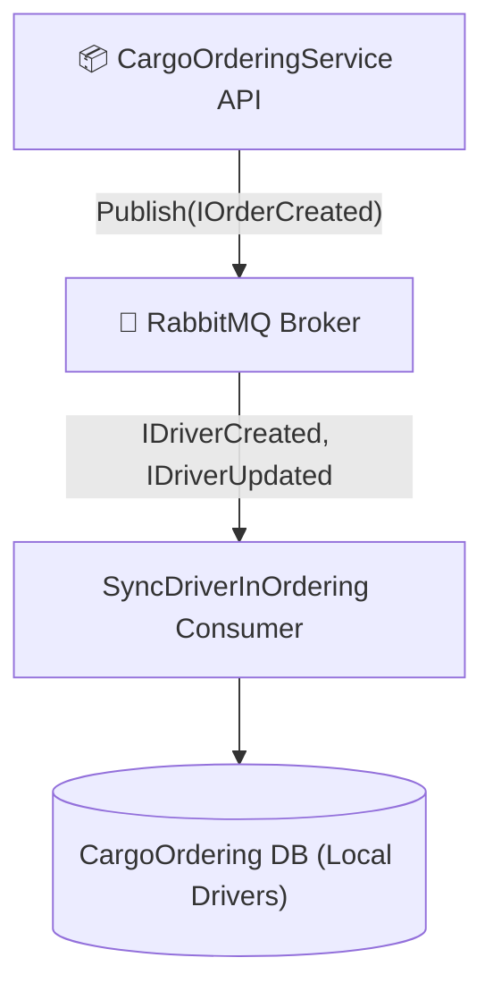

# 📦 Модуль Замовлень Вантажоперевезень (CargoOrderingService)

> **Блок 2:** `02-Microservices-Craftsman`  
> **Сервіс замовлень:** Мікросервіс управління клієнтськими замовленнями на доставку вантажів, рейсами та логістичними маршрутами.

---

## 📌 Огляд мікросервісу

Мікросервіс **`CargoOrderingService`** відповідає за створення клієнтських замовлень на транспортування вантажів, формування рейсів (доправок) та призначення вантажів на конкретних водіїв.

Для збереження автономності сервіс зберігає локальну репліку водіїв, синхронізовану через шину подій.

---

## 🏛️ Архітектурний стек

* **Стиль архітектури:** Clean Architecture, Domain-Driven Design (DDD).
* **Патерн CQRS:** Реалізація команд і запитів через **MediatR 12.2.0** з валідацією через **FluentValidation**.
* **База даних та ORM:** Microsoft SQL Server, Entity Framework Core 8.0 (`CargoOrderingServiceDbContext`).
* **Асинхронна комунікація (MassTransit + RabbitMQ):**
  * **Споживач подій (Consumer):** Слухає події `IDriverCreated` та `IDriverUpdated` від `DriversManagement` для оновлення локальної таблиці `Drivers`.
  * **Видавець подій (Publisher):** Публікує доменні події створення та зміни статусу замовлення (`IOrderCreated`, `IOrderAssignedToDriver`).
* **Діагностика та оркестрація (.NET 10 + .NET Aspire):**
  * Підключено `CargoDelivery.ServiceDefaults` з нативним OTLP експортером телеметрії та Service Discovery.

---

## 📁 Структура проєктів

```
02-Microservices-Craftsman/CargoOrderingService/
├── src/
│   └── CargoOrderingService/                 # Web API, Доменні сутності Orders/Deliveries, DbContext
└── tests/
    ├── CargoOrderingService.UnitTests/       # Модульні тести бізнес-логіки (37 тестів)
    ├── CargoOrderingService.IntegrationTests/# Інтеграційні тести бази даних
    ├── CargoOrderingService.FunctionalTests/ # Функціональні тести API
    └── CargoOrderingService.SharedTestHelpers/# Генератори тестових даних (Bogus)
```

---

## 🛠️ Основні REST API контролери

| Контролер | Маршрут | Призначення |
| :--- | :--- | :--- |
| `OrdersController` | `/api/v1/orders` | Створення та облік замовлень на перевезення вантажів |
| `DeliveriesController` | `/api/v1/deliveries` | Управління доставками, відстеження статусів виконання |
| `UsersController` / `RolesController` | `/api/v1/users`, `/api/v1/roles` | Користувачі та контроль доступу |

---

## 🔄 Міжсервісна взаємодія



---

## 🧪 Тестування

* Модульні тести: **37 passed (100% успішність)**.
* Запуск тестів:
  ```powershell
  dotnet test 02-Microservices-Craftsman/CargoOrderingService/tests/CargoOrderingService.UnitTests/CargoOrderingService.UnitTests.csproj
  ```
