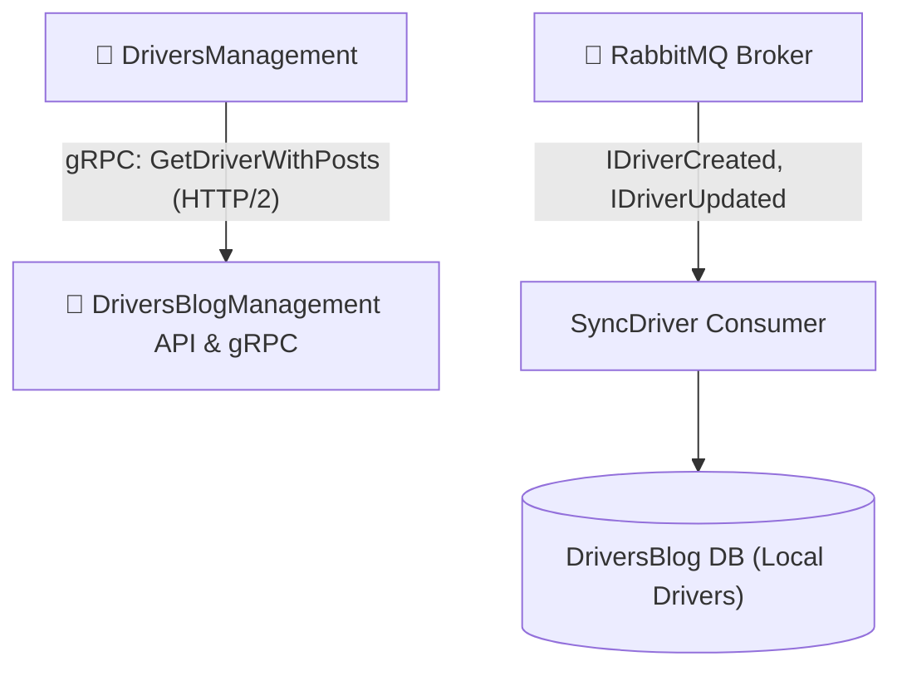

# 📝 Модуль Блогу Водіїв (DriversBlogManagement)

> **Блок 2:** `02-Microservices-Craftsman`  
> **Сервіс блогу:** Мікросервіс внутрішньої соціальної взаємодії водіїв, публікацій, коментарів, оцінок та gRPC-сервера для міжсервісних запитів.

---

## 📌 Огляд мікросервісу

Мікросервіс **`DriversBlogManagement`** забезпечує корпоративний портал для спілкування водіїв та диспетчерів. Водії публікують пости про стан доріг, черги на митницях, технічні лайфхаки та залишають коментарі.

Сервіс одночасно виступає **gRPC-сервером** для швидкої синхронної видачі постів у `DriversManagement` та **споживачем подій** шини RabbitMQ.

---

## 🏛️ Архітектурний стек

* **Стиль архітектури:** Clean Architecture, Domain-Driven Design (DDD).
* **Патерн CQRS:** Реалізація команд і запитів через **MediatR 12.2.0** з валідацією через **FluentValidation**.
* **База даних та ORM:** Microsoft SQL Server, Entity Framework Core 8.0 (`DriversBlogManagementDbContext`).
* **Синхронна комунікація (gRPC Server):**
  * Реалізує gRPC-сервіс `DriverRpcService` на базі контракту `Driver.proto` (HTTP/2 + Protobuf) для синхронної відповіді на запит `GetDriverWithPosts`.
* **Асинхронна комунікація (MassTransit + RabbitMQ):**
  * Споживач `SyncDriver` отримує події `IDriverCreated` та `IDriverUpdated` для актуалізації локальної таблиці водіїв блогу.
* **Діагностика та оркестрація (.NET 10 + .NET Aspire):**
  * Підключено `CargoDelivery.ServiceDefaults` з нативною телеметрією OTLP та gRPC endpoint mapping.

---

## 📁 Структура проєктів

```
02-Microservices-Craftsman/DriversBlogManagement/
├── src/
│   └── DriversBlogManagement/                 # Web API, gRPC Service, Сутності Posts/Comments/Likes
└── tests/
    ├── DriversBlogManagement.UnitTests/       # Модульні тести бізнес-логіки (49 тестів)
    ├── DriversBlogManagement.IntegrationTests/# Інтеграційні тести бази даних
    ├── DriversBlogManagement.FunctionalTests/ # Функціональні тести API
    └── DriversBlogManagement.SharedTestHelpers/# Генератори тестових даних (Bogus)
```

---

## 🛠️ Основні REST API контролери та gRPC сервіси

| Компонент | Маршрут / Протокол | Призначення |
| :--- | :--- | :--- |
| `PostAboutDriversController` | `/api/v1/postaboutdrivers` | CRUD публікацій про водіїв та рейси |
| `CommentsController` | `/api/v1/comments` | Коментарі до публікацій у блозі |
| `LikesController` | `/api/v1/likes` | Оцінки (лайки/дизлайки) до постів |
| `BlogUsersController` | `/api/v1/blogusers` | Профілі користувачів блогу |
| **`DriverRpcService`** | **gRPC HTTP/2 (`/DriverRpc/*`)** | **Внутрішній RPC-ендпоінт віддаленого виклику для `DriversManagement`** |

---

## 🔄 Міжсервісна взаємодія



---

## 🧪 Тестування

* Модульні тести: **49 passed (100% успішність)**.
* Запуск тестів:
  ```powershell
  dotnet test 02-Microservices-Craftsman/DriversBlogManagement/tests/DriversBlogManagement.UnitTests/DriversBlogManagement.UnitTests.csproj
  ```
