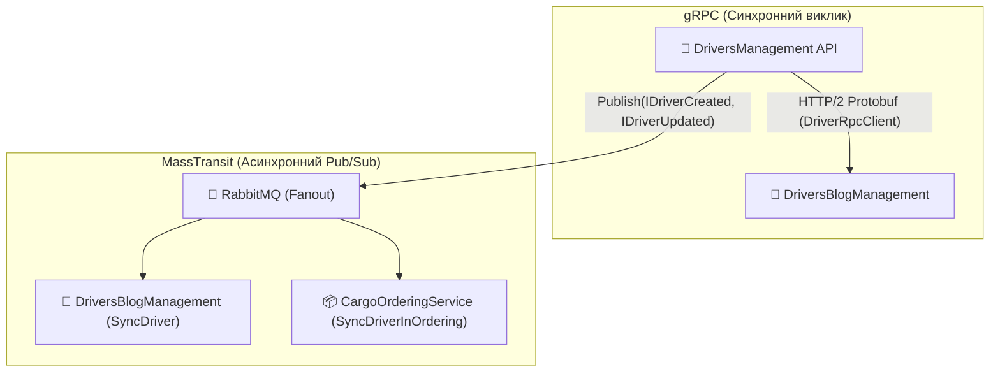

# 🚚 Модуль Обліку Водіїв та Автопарку (DriversManagement)

> **Блок 2:** `02-Microservices-Craftsman`  
> **Основний сервіс:** Центральний мікросервіс управління персоналом водіїв, транспортними компаніями, вантажівками та технічним обслуговуванням автопарку.

---

## 📌 Огляд мікросервісу

Мікросервіс **`DriversManagement`** є ядром логістичної платформи. Він веде повний життєвий цикл водіїв, відстежує їхню кваліфікацію, прив'язку до транспортних компаній, призначений автопарк, графіки технічних оглядів та ремонтів.

Крім того, `DriversManagement` виступає первинним джерелом правди (**Source of Truth**) для сутності `Driver` у системі.

---

## 🏛️ Архітектурний стек

* **Стиль архітектури:** Clean Architecture (Onion/Hexagonal), Domain-Driven Design (DDD).
* **Патерн CQRS:** Реалізація команд і запитів через **MediatR 12.2.0** з валідацією запитів через **FluentValidation**.
* **База даних та ORM:** Microsoft SQL Server, Entity Framework Core 8.0, авто-міграції.
* **Синхронна комунікація (gRPC Client):**
  * Використовує клієнт `DriverRpcClient` для виклику `DriversBlogManagement` за протоколом HTTP/2 Protobuf для отримання постів водія.
* **Асинхронна комунікація (MassTransit + RabbitMQ):**
  * Публікує події `IDriverCreated` та `IDriverUpdated` із `SharedKernel` у шину RabbitMQ (Fanout Exchanges).
* **Діагностика та оркестрація (.NET 10 + .NET Aspire):**
  * Повна інтеграція з `CargoDelivery.ServiceDefaults` (OpenTelemetry OTLP без застарілого Jaeger, Health Checks `/health` та `/alive`, Service Discovery).

---

## 📁 Структура проєктів

```
02-Microservices-Craftsman/DriversManagement/
├── src/
│   └── DriversManagement/                 # Web API, Доменні сутності, CQRS команди/запити, DbContext
└── tests/
    ├── DriversManagement.UnitTests/       # Модульні тести бізнес-логіки (57 тестів)
    ├── DriversManagement.IntegrationTests/ # Інтеграційні тести репозиторіїв та БД (Testcontainers)
    ├── DriversManagement.FunctionalTests/ # Наскрізні тести Web API з TestServer
    └── DriversManagement.SharedTestHelpers/ # Фабрики фейкових даних (Bogus)
```

---

## 🛠️ Основні REST API контролери

| Контролер | Маршрут | Призначення |
| :--- | :--- | :--- |
| `DriversController` | `/api/v1/drivers` | CRUD водіїв, отримання зведених профілів (включно з gRPC викликом блогу) |
| `CompaniesController` | `/api/v1/companies` | Управління логістичними компаніями та перевізниками |
| `TrucksController` | `/api/v1/trucks` | Облік вантажного автопарку (моделі, номери, вантажопідйомність) |
| `RepairsController` | `/api/v1/repairs` | Реєстрація ремонтних робіт та замін автозапчастин |
| `InspectionsController` | `/api/v1/inspections` | Планові та позачергові технічні огляди вантажівок |
| `ExpencesController` | `/api/v1/expences` | Фіксація витрат на паливо, митні збори та амортизацію |
| `PhotosController` | `/api/v1/photos` | Завантаження та облік фотографій транспорту і водіїв |
| `UsersController` / `RolesController` | `/api/v1/users`, `/api/v1/roles` | Управління користувачами та рольовими правами доступу |

---

## 🔄 Міжсервісна взаємодія



---

## 🧪 Тестування

* Модульні тести: **57 passed (100% успішність)**.
* Запуск тестів:
  ```powershell
  dotnet test 02-Microservices-Craftsman/DriversManagement/tests/DriversManagement.UnitTests/DriversManagement.UnitTests.csproj
  ```
