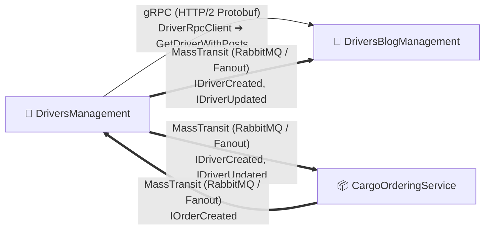

# 📦 02-Microservices-Craftsman: Clean Architecture, CQRS, gRPC & Event-Driven Architecture

> Розподілена мікросервісна підсистема вантажних перевезень, згенерована за допомогою інструменту **Craftsman** на базі принципів **Clean Architecture**, **Domain-Driven Design (DDD)**, **CQRS (MediatR)**, **gRPC** та **MassTransit (RabbitMQ)**.

---

## 📂 Структура проєктів блоку

| Мікросервіс / Проєкт | Опис | Архітектурний стек |
| :--- | :--- | :--- |
| **`DriversManagement`** | Основний сервіс обліку водіїв, автопарку, компаній та технічного обслуговування | Clean Architecture, CQRS, MediatR, gRPC Client, MassTransit Publisher |
| **`CargoOrderingService`** | Сервіс керування замовленнями вантажів, доставками та відстеженням маршрутів | Clean Architecture, MediatR, EF Core (.NET 10), MassTransit Publisher & Consumer |
| **`DriversBlogManagement`** | Сервіс блогу водіїв, постів, коментарів, лайків та соціальної взаємодії | Clean Architecture, CQRS, MediatR, gRPC Server (`DriverRpcService`), MassTransit Consumer |
| **`SharedKernel`** | Спільне ядро подій та контрактів між мікросервісами | `IDriverCreated`, `IDriverUpdated`, `IOrderCreated`, `IOrderAssignedToDriver` |

---

## 📚 Навчально-технічні посібники (Numbered Pattern Guides)

1. 🏛️ **[01_Patterns_Microservices_Clean_Architecture.md](docs/Guides/01_Patterns_Microservices_Clean_Architecture.md)**  
   *Концепція Bounded Contexts у DDD, Vertical Slice Architecture з MediatR (CQRS), відокремлені сутності Driver у різних мікросервісах та порівняння з монолітом Блоку 1.*

2. ⚡ **[02_Patterns_Synchronous_gRPC_Communication.md](docs/Guides/02_Patterns_Synchronous_gRPC_Communication.md)**  
   *Високопродуктивний міжсервісний зв'язок через gRPC (HTTP/2 + Protobuf), контракт `Driver.proto`, сервер `DriverRpcService`, клієнт `DriverRpcClient` та патерн стійкості Graceful Degradation.*

3. 📬 **[03_Patterns_Asynchronous_Messaging_MassTransit_RabbitMQ.md](docs/Guides/03_Patterns_Asynchronous_Messaging_MassTransit_RabbitMQ.md)**  
   *Подієво-орієнтована архітектура (EDA), Pub/Sub шина MassTransit з RabbitMQ Fanout Exchanges, асинхронна реплікація даних та Fallback до InMemory Bus.*

---

## 🛠️ Специфікація міжсервісної комунікації

---

## 🧪 Верифікація юніт-тестів

Усі три сервіси мають повне покриття модульними тестами:
* `DriversManagement.UnitTests`: **57 passed**
* `DriversBlogManagement.UnitTests`: **49 passed**
* `CargoOrderingService.UnitTests`: **37 passed** (.NET 10)
* **Загалом у Блоці 2:** **143 тести проходять успішно (0 помилок)**.
