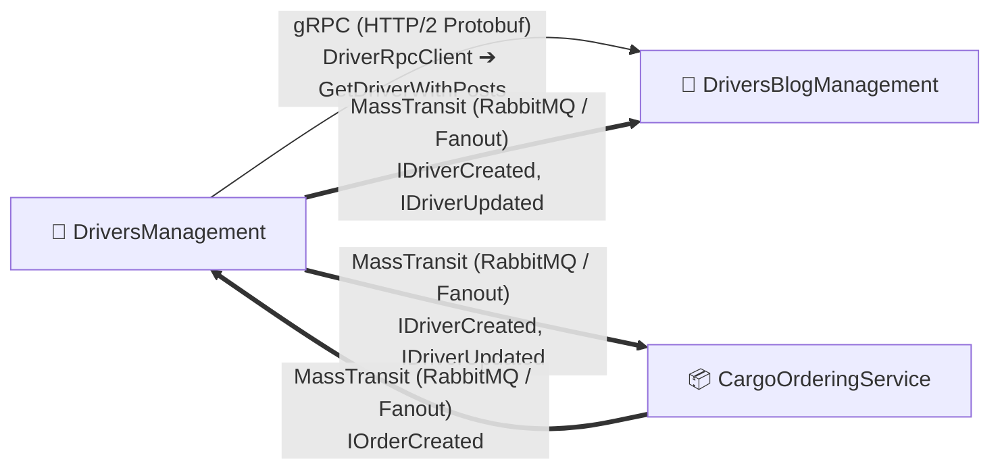

# 📦 02-Microservices-Craftsman: Clean Architecture, CQRS, gRPC & Event-Driven Architecture

> Розподілена мікросервісна підсистема вантажних перевезень, згенерована за допомогою інструменту **Craftsman** на базі принципів **Clean Architecture**, **Domain-Driven Design (DDD)**, **CQRS (MediatR)**, **gRPC** та **MassTransit (RabbitMQ)**.

---

## 📂 Структура проєктів блоку

| Мікросервіс / Проєкт | Опис | Архітектурний стек |
| :--- | :--- | :--- |
| **[`DriversManagement`](02-02-Communication-Documentation/DriversManagement-README.md)** | Основний сервіс обліку водіїв, автопарку, компаній та технічного обслуговування | Clean Architecture, CQRS, MediatR, gRPC Client, MassTransit Publisher (.NET 10) |
| **[`CargoOrderingService`](02-02-Communication-Documentation/CargoOrderingService-README.md)** | Сервіс керування замовленнями вантажів, доставками та відстеженням маршрутів | Clean Architecture, MediatR, EF Core, MassTransit Publisher & Consumer (.NET 10) |
| **[`DriversBlogManagement`](02-02-Communication-Documentation/DriversBlogManagement-README.md)** | Сервіс блогу водіїв, постів, коментарів, лайків та соціальної взаємодії | Clean Architecture, CQRS, MediatR, gRPC Server (`DriverRpcService`), MassTransit Consumer (.NET 10) |
| **`SharedKernel`** | Спільне ядро подій та контрактів між мікросервісами | `IDriverCreated`, `IDriverUpdated`, `IOrderCreated`, `IOrderAssignedToDriver` |
| **`CargoDelivery.AppHost`** | Диригент оркестрації .NET Aspire: запуск RabbitMQ, SQL Server та 3 API | .NET Aspire 13, Full Orchestration, C# Application Model (.NET 10) |
| **`CargoDelivery.ServiceDefaults`** | Спільні діагностичні розширення для всіх мікросервісів | OpenTelemetry (OTLP), Health Checks, Service Discovery, Polly Resilience (.NET 10) |

---

## 🚀 Оркестрація та Розподілена Телеметрія (.NET Aspire)

👉 **[02-01-Aspire-Documentation/02-01-Aspire-MasterClass.md](02-01-Aspire-Documentation/02-01-Aspire-MasterClass.md)** — **Повний інтерактивний Майстер-Клас (15 слайдів)** з деталізованим розбором для чайників, архітектурою `AppHost`, відмовою від Jaeger на користь нативного OTLP, gRPC discovery, сквозним трейсингом MassTransit та практичним гайдом запуску.  
*(Детальний індекс: [02-01-Aspire-Documentation/README.md](02-01-Aspire-Documentation/README.md))*

---

## 📚 Навчально-технічні посібники (Numbered Pattern Guides)

*(Повний індекс та специфікації сервісів: [02-02-Communication-Documentation/README.md](02-02-Communication-Documentation/README.md))*

1. 🏛️ **[01_Patterns_Microservices_Clean_Architecture.md](02-02-Communication-Documentation/01_Patterns_Microservices_Clean_Architecture.md)**  
   *Концепція Bounded Contexts у DDD, Vertical Slice Architecture з MediatR (CQRS), відокремлені сутності Driver у різних мікросервісах та порівняння з монолітом Блоку 1.*

2. 🌐 **[02_Patterns_Synchronous_HttpClient_Aggregator_BFF.md](02-02-Communication-Documentation/02_Patterns_Synchronous_HttpClient_Aggregator_BFF.md)**  
   *Синхронна HTTP-комунікація через `HttpClient` / `IHttpClientFactory`, патерн Gateway Aggregator / Backend for Frontend (BFF), паралельний Fan-Out/Fan-In (`Task.WhenAll`), Polly Resilience та Aspire Service Discovery.*

3. ⚡ **[03_Patterns_Synchronous_gRPC_Communication.md](02-02-Communication-Documentation/03_Patterns_Synchronous_gRPC_Communication.md)**  
   *Високопродуктивний міжсервісний зв'язок через gRPC (HTTP/2 + Protobuf), контракт `Driver.proto`, сервер `DriverRpcService`, клієнт `DriverRpcClient` та патерн стійкості Graceful Degradation.*

4. 📬 **[04_Patterns_Asynchronous_Messaging_MassTransit_RabbitMQ.md](02-02-Communication-Documentation/04_Patterns_Asynchronous_Messaging_MassTransit_RabbitMQ.md)**  
   *Подієво-орієнтована архітектура (EDA), Pub/Sub шина MassTransit з RabbitMQ Fanout Exchanges, асинхронна реплікація даних та Fallback до InMemory Bus.*

---

## 🛠️ Специфікація міжсервісної комунікації

---

## 🧪 Верифікація юніт-тестів

Усі три сервіси мають повне покриття модульними тестами:
* `DriversManagement.UnitTests`: **57 passed**
* `DriversBlogManagement.UnitTests`: **49 passed**
* `CargoOrderingService.UnitTests`: **37 passed** (.NET 10)
* **Загалом у Блоці 2:** **143 тести проходять успішно (0 помилок)**.
