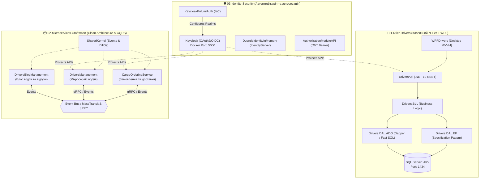

# 🚛 Cargo Delivery Service: Enterprise Multi-Paradigm Platform (.NET 10)

> Комплексна демонстраційна платформа вантажних перевезень, структурована за трьома чіткими архітектурними підсистемами в єдиному репозиторії:
> 1. **Класичний N-Tier моноліт з WPF-клієнтом** (EF Core 10, Dapper, Specification Pattern)
> 2. **Розподілені Craftsman мікросервіси** (Clean Architecture, CQRS, MediatR, gRPC & Message Brokers)
> 3. **Централізована безпека та авторизація** (Keycloak з Pulumi IaC, Duende IdentityServer, JWT Bearer)

---

## 🏛️ Архітектурна карта платформи



---

## 📂 Структура репозиторію за логічними блоками

```text
Demo-CargoDeliveryService/
│
├── 📂 01-Ntier-Drivers/               <-- Блок 1: N-Tier архітектура, EF Core 10, Dapper та WPF
│   ├── DriversApi/                    (REST Web API з інтерактивним Swagger)
│   ├── Drivers.BLL/                   (Бізнес-логіка, валідація, скоринг)
│   ├── Drivers.DAL.EF/                (EF Core 10 + Specification Pattern + Evaluator)
│   ├── Drivers.DAL.ADO/               (ADO.NET + Dapper мікро-ORM)
│   ├── Drivers.Db/                    (SQL Server Database Project)
│   ├── Drivers.JWT/                   (Схеми безпеки БД)
│   ├── WPFDrivers/                    (Десктопний WPF-клієнт у фіолетових тонах)
│   ├── FakeDataDbGenerator/           (Генератор фейкових даних через Bogus)
│   ├── NtierDrivers.UnitTests/        (Комплекс із 49 юніт-тестів)
│   ├── docs/                          (Презентація на 22 слайди, посібники EF vs Dapper та Specification)
│   └── README.md                      (Детальний опис блоку N-Tier)
│
├── 📂 02-Microservices-Craftsman/     <-- Блок 2: Мікросервіси Clean Architecture (Craftsman)
│   ├── CargoOrderingService/          (Сервіс замовлень і доставок вантажів)
│   ├── DriversBlogManagement/         (Сервіс блогу водіїв)
│   ├── DriversManagement/             (Сервіс обліку водіїв і автопарку)
│   ├── SharedKernel/                  (Спільні контракти та доменні події)
│   ├── Aspire/                        (Оркестрація AppHost та ServiceDefaults .NET Aspire)
│   ├── 02-01-Aspire-Documentation/    (Майстер-клас та посібник з .NET Aspire)
│   ├── 02-02-Communication-Documentation/ (Посібники gRPC, MassTransit, Clean Architecture)
│   └── README.md                      (Детальний опис мікросервісного блоку)
│
├── 📂 03-Identity-Security/           <-- Блок 3: Безпека, OIDC та авторизація
│   ├── AuthorizationModuleAPI/        (JWT Bearer Gateway та керування доступом)
│   ├── DuendeIdentityInMemory/        (Duende IdentityServer провайдер)
│   ├── KeycloakPulumiAuth/            (IaC скрипти конфігурації Keycloak на Pulumi)
│   └── README.md                      (Детальний опис підсистеми безпеки)
│
├── CargoDeliveryService.sln           <-- Єдине головне рішення Visual Studio
├── docker-compose.yaml                <-- Інфраструктура Docker (SQL Server, Keycloak, Jaeger)
└── README.md                          <-- Цей файл
```

---

## ⚡ Швидкий старт та перевірка

### 1. Перевірка та запуск юніт-тестів N-Tier
```powershell
dotnet test 01-Ntier-Drivers/NtierDrivers.UnitTests/NtierDrivers.UnitTests.csproj
```
*(49 тестів проходять успішно).*

### 2. Запуск інфраструктури в Docker
```powershell
docker compose up -d
```
- SQL Server: `localhost:1434`
- Keycloak: `http://localhost:5000`
- Jaeger Tracing: `http://localhost:16686`
