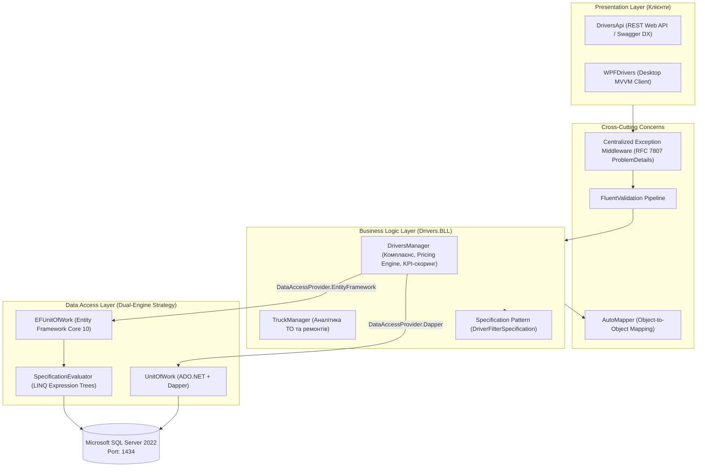

# 🚛 Demo Cargo Delivery Service (.NET 10 Enterprise N-Tier Solution)

> Сучасне корпоративне рішення на базі **.NET 10** для логістичних перевезень та управління автопарком, що демонструє чисту **Тришарову архітектуру (3-Tier)**, паралельний **Dual-Engine DAL (Entity Framework Core 10 проти Dapper)**, патерни **Specification**, **Unit of Work**, **Generic Repository**, декларативну валідацію **FluentValidation**, централізовану обробку помилок **RFC 7807** та гібридний десктопний клієнт на **WPF (MVVM)**.

---

## 📚 Швидка навігація по архітектурній документації

| Документ | Опис | Посилання |
| :--- | :--- | :---: |
| 🎓 **Архітектурна презентація** | Інтерактивна майстер-клас презентація на 22 слайди з TOC, переходами, схемами та клікабельними лінками на вихідний код | [Відкрити презентацію](docs/Architecture-Presentation.md) |
| 📘 **Технічний довідник** | Глибокий посібник з патернів **Specification, Generic Repository та Unit of Work** (внутрішня механіка, Evaluator, пайплайн «матрьошка») | [Відкрити довідник](docs/Specification-and-Repository-Guide.md) |
| ⚡ **Бенчмаркінг: EF Core vs Dapper** | Порівняльний аналіз швидкодії ORM та Micro-ORM, усунення N+1 та Cartesian Product, заміри часу виконання | [Відкрити звіт](NTIER_DRIVERS_EF_VS_DAPPER.md) |

---

## 🏛️ Загальна архітектура системи (N-Tier Pipeline)



---

## 📦 Огляд проєктів рішення (`NtierDriversModule`)

| Проєкт | Платформа | Призначення | Ключові технології |
| :--- | :---: | :--- | :--- |
| **`DriversApi`** | `net10.0` | Презентаційний рівень (REST Web API) | ASP.NET Core, Swagger OpenAPI, OAuth2 PKCE, Exception Middleware |
| **`WPFDrivers`** | `net10.0-windows` | Гібридний десктопний клієнт | WPF, MVVM, RelayCommand, Live Benchmarking UI, Purple C# Styling |
| **`Drivers.BLL`** | `net10.0` | Рівень бізнес-логіки та розрахунків | FluentValidation, AutoMapper, Pricing Engine, KPI Scoring |
| **`Drivers.DAL.EF`** | `net10.0` | ORM рівень збереження даних | EF Core 10, Specification Pattern, SpecificationEvaluator, Change Tracking |
| **`Drivers.DAL.ADO`** | `net10.0` | Micro-ORM рівень збереження | Dapper, ADO.NET, QueryMultipleAsync, Raw SQL, SqlTransaction |
| **`NtierDrivers.UnitTests`** | `net10.0` | Набір модульних тестів (49 тестів) | xUnit, Moq, FluentAssertions, AAA Pattern |

---

## 🚀 Швидкий запуск проєкту (Developer Experience)

### 1. Запуск бази даних через Docker
У корені репозиторію налаштовано Docker Compose для підняття MS SQL Server 2022 на нестандартному безпечному порті `1434`:

```bash
docker compose up -d
```
* **Хост:** `localhost,1434`
* **Користувач:** `sa`
* **Пароль:** `yourStrong(!)Password`
* **База даних:** `DriversManagement`

### 2. Запуск Web API з автоматичним Swagger
Проєкт налаштовано з прапорцем `launchBrowser: true` та редиректом з кореня `/`:

```bash
dotnet run --project .\DriversApi\Drivers.Api.csproj
```
Браузер автоматично відкриє інтерактивну документацію Swagger за адресою:  
👉 **`https://localhost:4002/swagger`**

### 3. Запуск десктопного клієнта WPF
```bash
dotnet run --project .\WPFDrivers\WPFDrivers.csproj
```
Клієнт надає можливість перемикання між:
- **Архітектурними режимами:** `Direct BLL` (пряме використання шарів) проти `Web API` (віддалений HTTP клієнт).
- **Провайдерами даних:** `EF Core` проти `Dapper`.
- **Живим бенчмаркінгом:** вимір мілісекунд виконання запитів та коефіцієнта прискорення.

### 4. Запуск модульних тестів
```bash
dotnet test .\NtierDrivers.UnitTests\NtierDrivers.UnitTests.csproj
```
**Результат:** `49 Passed! - 0 Failed, 0 Skipped (100% успішність)`.

---

## 🔑 Ключові бізнес-процеси у BLL

1. **`AssessAndDispatchDriverForTripAsync` (Комплаєнс-допуск до рейсу):**
   - Перевірка вікового цензу (від 21 року, від 25 років для небезпечних вантажів `ADR`).
   - Перевірка вантажної категорії прав (`C`, `CE`) та терміну дії ліцензії з 14-денним запасом.
   - Контроль придатності тягача (останній техогляд не повинен бути провалений або старший за 180 днів).
   - Багаторівневий тарифний калькулятор (базова ставка, надбавка за стаж $+10\%/+20\%$, надбавка за ризик $+35\%$, добові 800 грн/день, прогнозне пальне та $10\%$ аварійний фонд).
   - Автоматичне транзакційне створення запису витрат (`Expenses`).

2. **`ConductDriverAnnualPerformanceAuditAsync` (Річний KPI-аудит):**
   - Нормалізовані показники (0–100): паливна ефективність ($KPI_{Fuel}$), дбайливість до техніки ($KPI_{Care}$), безпека та дисципліна ($KPI_{Safety}$).
   - Інтегральний рейтинг: $\text{Score} = 0.35 \times KPI_{Fuel} + 0.35 \times KPI_{Care} + 0.30 \times KPI_{Safety}$.
   - Корпоративна матриця грейдування: **Grade A (Platinum)**, **Grade B (Gold)**, **Grade C (Silver)**, **UnderReview**.
   - Автоматичне преміювання: нарахування та фіксація бонусної виплати ($10\%$ або $5\%$).

---

## 🛠️ Вимоги до середовища
- **.NET SDK:** 10.0 або новіший
- **IDE:** Visual Studio 2022 / 2025 або JetBrains Rider / VS Code
- **Docker:** Docker Desktop для контейнера бази даних
